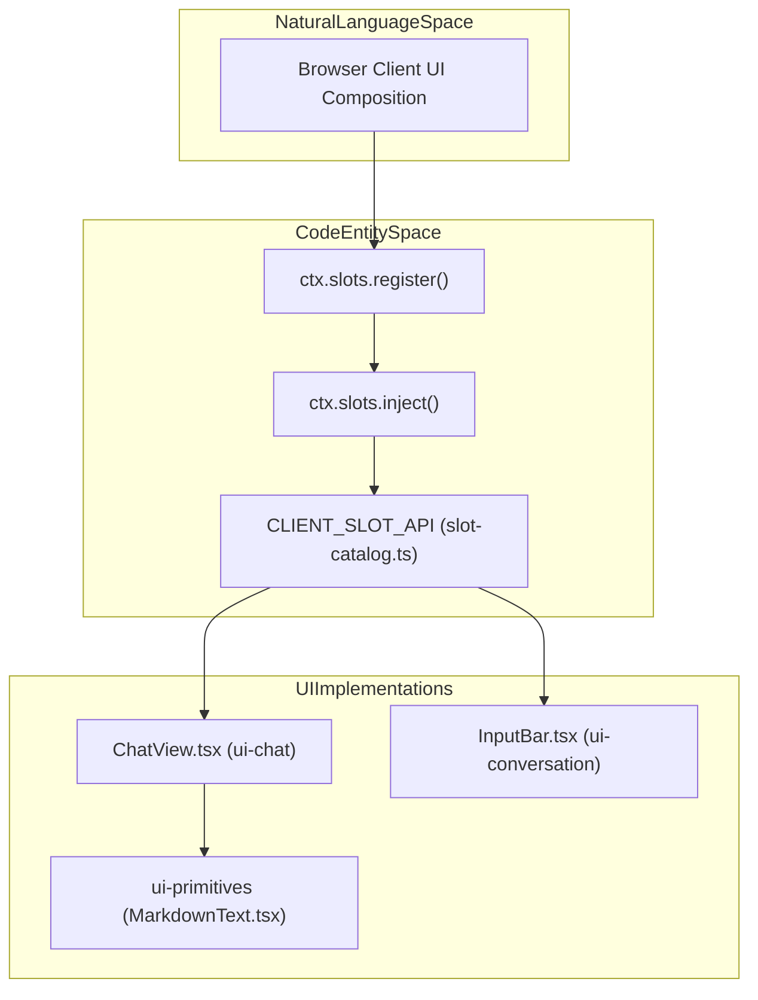
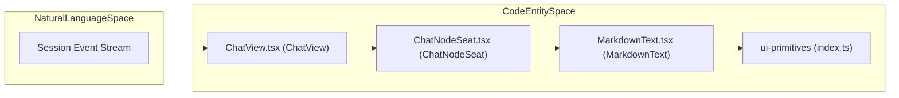

# Web UI

Relevant source files

The following files were used as context for generating this wiki page:

- [apps/web/tests/chat-scroll-contract.e2e.ts](apps/web/tests/chat-scroll-contract.e2e.ts)
- [docs/subsystems/slots.i18n.yaml](docs/subsystems/slots.i18n.yaml)
- [docs/subsystems/slots.md](docs/subsystems/slots.md)
- [docs/subsystems/slots.zh.md](docs/subsystems/slots.zh.md)
- [packages/client/ui-chat/README.i18n.yaml](packages/client/ui-chat/README.i18n.yaml)
- [packages/client/ui-chat/README.md](packages/client/ui-chat/README.md)
- [packages/client/ui-chat/README.zh.md](packages/client/ui-chat/README.zh.md)
- [packages/client/ui-chat/package.json](packages/client/ui-chat/package.json)
- [packages/client/ui-chat/src/client/apply.ts](packages/client/ui-chat/src/client/apply.ts)
- [packages/client/ui-chat/src/client/chat/ChatFlow.tsx](packages/client/ui-chat/src/client/chat/ChatFlow.tsx)
- [packages/client/ui-chat/src/client/chat/ChatNodeSeat.tsx](packages/client/ui-chat/src/client/chat/ChatNodeSeat.tsx)
- [packages/client/ui-chat/src/client/chat/ChatView.module.css](packages/client/ui-chat/src/client/chat/ChatView.module.css)
- [packages/client/ui-chat/src/client/chat/ChatView.tsx](packages/client/ui-chat/src/client/chat/ChatView.tsx)
- [packages/client/ui-chat/src/client/chat/use-chat-scroll.ts](packages/client/ui-chat/src/client/chat/use-chat-scroll.ts)
- [packages/client/ui-chat/src/client/chat/use-chat-viewport.ts](packages/client/ui-chat/src/client/chat/use-chat-viewport.ts)
- [packages/client/ui-chat/src/client/contract/slots.ts](packages/client/ui-chat/src/client/contract/slots.ts)
- [packages/client/ui-chat/src/client/conversation-nodes/README.i18n.yaml](packages/client/ui-chat/src/client/conversation-nodes/README.i18n.yaml)
- [packages/client/ui-chat/src/client/conversation-nodes/README.md](packages/client/ui-chat/src/client/conversation-nodes/README.md)
- [packages/client/ui-chat/src/client/conversation-nodes/README.zh.md](packages/client/ui-chat/src/client/conversation-nodes/README.zh.md)
- [packages/client/ui-chat/src/client/index.ts](packages/client/ui-chat/src/client/index.ts)
- [packages/client/ui-chat/src/client/locale.ts](packages/client/ui-chat/src/client/locale.ts)
- [packages/client/ui-chat/tests/apply-inject.client.spec.tsx](packages/client/ui-chat/tests/apply-inject.client.spec.tsx)
- [packages/client/ui-chat/tests/chat-apply.client.spec.tsx](packages/client/ui-chat/tests/chat-apply.client.spec.tsx)
- [packages/client/ui-chat/tests/chat-scroll.client.spec.tsx](packages/client/ui-chat/tests/chat-scroll.client.spec.tsx)
- [packages/client/ui-chat/tests/chat-view.client.spec.tsx](packages/client/ui-chat/tests/chat-view.client.spec.tsx)
- [packages/client/ui-chat/tests/chat-viewport.client.spec.ts](packages/client/ui-chat/tests/chat-viewport.client.spec.ts)
- [packages/client/ui-chat/tests/conversation-node-definitions.client.spec.ts](packages/client/ui-chat/tests/conversation-node-definitions.client.spec.ts)
- [packages/client/ui-chat/tests/transcript-view-row.client.spec.tsx](packages/client/ui-chat/tests/transcript-view-row.client.spec.tsx)
- [packages/client/ui-chat/tests/turn-tail-spacing.client.spec.ts](packages/client/ui-chat/tests/turn-tail-spacing.client.spec.ts)
- [packages/client/ui-chat/tsconfig.json](packages/client/ui-chat/tsconfig.json)
- [packages/extensions/cordis-client-runner/src/client/slot-catalog.ts](packages/extensions/cordis-client-runner/src/client/slot-catalog.ts)

The DeepSeek Harness (`dsh`) Web UI is a modular, plugin-based React application built on the **Cordis** framework. It provides a rich, extensible environment for interacting with AI agents, managing code workspaces, and inspecting execution trajectories. The architecture emphasizes a strict separation between browser-side presentation logic and host-side execution, bridged by a type-safe RPC layer. Theme-facing colors and styles rely on `--dsw-*` design tokens [packages/extensions/cordis-client-runner/src/client/slot-catalog.ts:67-75]().

This page acts as a parent overview. For specific subsystem details, refer to the child pages:
- [Conversation UI & Chat View](#6.1)
- [Workspace Browser & Sidebar](#6.2)
- [UI Primitives, Trajectory & Tool Views](#6.3)
- [Settings, Agent Presets & Onboarding](#6.4)
- [Desktop App & Web Shell Packaging](#6.5)

---

## Plugin Architecture & Slot System

The Web UI is built from independent packages that contribute UI components via a slot-based plugin system. Browser-half packages register React components into named slots exposed by the Cordis client runtime using `ctx.slots.register()` and `ctx.slots.inject()` [packages/extensions/cordis-client-runner/src/client/slot-catalog.ts:67-75](). This mechanism enables flexible dynamic UI composition without hard dependencies or imports of implementation internals, preserving strong decoupling between packages.

Slots have a compile-time contract specifying the slot key name, cardinality (`single`, `list`, `keyed`, or `chain`), data scope (`root`, `session`, or `session-maybe`), exposed props, and owning component entry requirements. The slot catalog source is generated and forms the definitive contract between the shell and dynamic packages [packages/extensions/cordis-client-runner/src/client/slot-catalog.ts:1-75]().

### UI Slot Registration and Composition Flow

Sources: [packages/extensions/cordis-client-runner/src/client/slot-catalog.ts:1-75](), [packages/extensions/cordis-client-runner/src/client/slot-catalog.ts:67-75]()

---

## Key UI Subdomains & Child Pages

### 1. Conversation UI & Chat View  
The `ui-conversation` package provides the core conversation skeleton (`ConversationRoot`), the `ChatView` component for rendering conversation nodes [packages/client/ui-chat/src/client/chat/ChatView.tsx:60-64](), the input bar with a Lexical editor, and integrates features like streaming assistant messages, steering commands, and queue docking. It uses a slot-based extensibility model to allow plugins to augment or replace UI pieces dynamically.  
For details, see [Conversation UI & Chat View](#6.1).

### 2. Workspace Browser & Sidebar  
The `ui-workspace` package handles browsing and selecting workspaces, rendering the session tree hierarchy, and managing directory pickers. It cooperates closely with the `ui-sidebar` package, which maintains sidebar states, and `ui-layout` which manages the overall app frame layout including column partitioning and document preview panes.  
For details, see [Workspace Browser & Sidebar](#6.2).

### 3. UI Primitives, Trajectory & Tool Views  
Shared UI primitives (`ui-primitives`) provide essential UI building blocks like icons, markdown renderers, syntax-highlighted code blocks, and file-type icons that all other UI packages consume. The `ui-tool` package renders tool-call details, deliverables, present cards, and user questions within the trajectory inspection ledger. These packages are designed to avoid importing the Cordis plugin runtime to remain lightweight and reusable.  
For details, see [UI Primitives, Trajectory & Tool Views](#6.3).

### 4. Settings, Agent Presets & Onboarding  
User configurability is handled by the `ui-settings` package family, which manages model and account settings, general preferences, and plugin toggles. It also includes the UI for authoring agent presets and the onboarding flow that new users see.  
For details, see [Settings, Agent Presets & Onboarding](#6.4).

### 5. Desktop App & Web Shell Packaging  
The desktop Electron app packages the Web UI with additional host capabilities like process and project management, packaging, signing, and auto-updates through `apps/desktop` and `desktop-host`. The Web shell is built with Vite under `apps/web`, which provides the runtime boot graph and client entrypoints.  
For details, see [Desktop App & Web Shell Packaging](#6.5).

Sources: [packages/extensions/cordis-client-runner/src/client/slot-catalog.ts:67-75](), [packages/client/ui-chat/src/client/chat/ChatView.tsx:60-64]()

---

## Component & Data Flow Mapping

The Web UI consumes session controller events and related backend services exposed over a type-safe RPC API proxy. These feeds are projected via observable snapshot stores and selector hooks into React components that render the UI state and respond to interactions [packages/client/ui-chat/src/client/chat/ChatView.tsx:60-70]().

The `ChatView` component maps conversation view snapshot data into keyed React node renderer seats and integrates features like turn navigation, running status indicators, and client-side link handlers [packages/client/ui-chat/src/client/chat/ChatView.tsx:60-75]().

### Web UI Component and Data Flow Mapping

Sources: [packages/client/ui-chat/src/client/chat/ChatView.tsx:60-75](), [packages/extensions/cordis-client-runner/src/client/slot-catalog.ts:67-75]()

---

## Summary

The DeepSeek Harness Web UI embraces plugin-driven composition via a robust slot architecture defined by compile-time contracts. It divides concerns cleanly across conversation, workspace management, basic UI primitives, settings, and desktop app packaging. Observables and selector hooks tightly couple backend session state streams to React renderers, ensuring scalable, maintainable UI logic. This parent page orients new contributors to the broad design and provides links to detailed documentation of each core UI sub-area.

# Child Pages

- [Conversation UI & Chat View](#6.1)  
- [Workspace Browser & Sidebar](#6.2)  
- [UI Primitives, Trajectory & Tool Views](#6.3)  
- [Settings, Agent Presets & Onboarding](#6.4)  
- [Desktop App & Web Shell Packaging](#6.5)