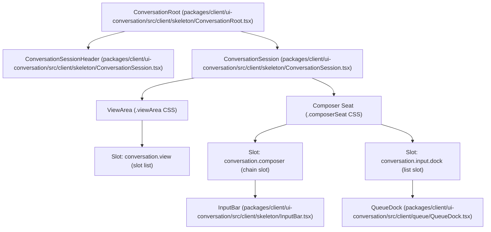
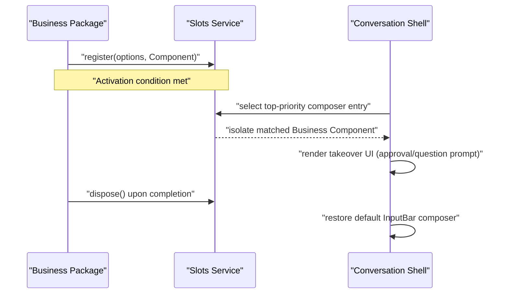
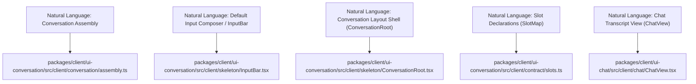
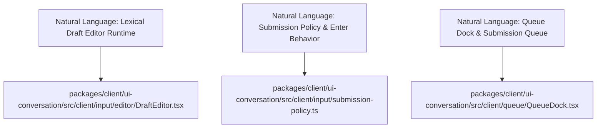
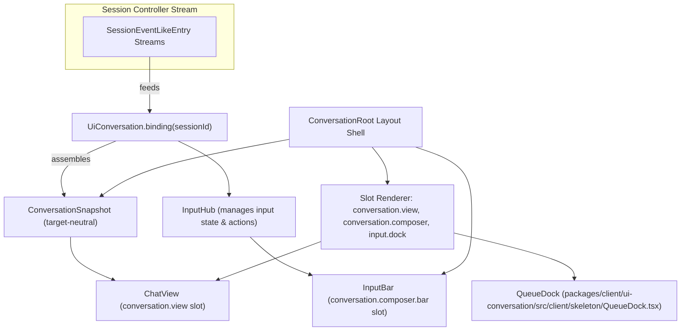

# Conversation UI & Chat View

Relevant source files

The following files were used as context for generating this wiki page:

- [apps/web/stress-tests/reasoning-chunks.stress.ts](apps/web/stress-tests/reasoning-chunks.stress.ts)
- [apps/web/tests/chat-scroll-contract.e2e.ts](apps/web/tests/chat-scroll-contract.e2e.ts)
- [apps/web/tests/composer-draft-scroll.e2e.ts](apps/web/tests/composer-draft-scroll.e2e.ts)
- [apps/web/tests/composer-focus.e2e.ts](apps/web/tests/composer-focus.e2e.ts)
- [apps/web/tests/draft-initialization.e2e.ts](apps/web/tests/draft-initialization.e2e.ts)
- [apps/web/tests/expected/composer-focus/focus.expected.md](apps/web/tests/expected/composer-focus/focus.expected.md)
- [apps/web/tests/expected/composer-focus/submission.expected.md](apps/web/tests/expected/composer-focus/submission.expected.md)
- [apps/web/tests/expected/goal-bar/blocked.expected.md](apps/web/tests/expected/goal-bar/blocked.expected.md)
- [apps/web/tests/feedback-release.e2e.ts](apps/web/tests/feedback-release.e2e.ts)
- [apps/web/tests/github-ready-review.e2e.ts](apps/web/tests/github-ready-review.e2e.ts)
- [apps/web/tests/goal-bar.e2e.ts](apps/web/tests/goal-bar.e2e.ts)
- [apps/web/tests/goal-bar.overlay.yml](apps/web/tests/goal-bar.overlay.yml)
- [apps/web/tests/queue-actions.e2e.ts](apps/web/tests/queue-actions.e2e.ts)
- [apps/web/tests/queue-image.e2e.ts](apps/web/tests/queue-image.e2e.ts)
- [apps/web/tests/seeded-history.e2e.ts](apps/web/tests/seeded-history.e2e.ts)
- [apps/web/tests/workspace-management.e2e.ts](apps/web/tests/workspace-management.e2e.ts)
- [docs/subsystems/slots.i18n.yaml](docs/subsystems/slots.i18n.yaml)
- [docs/subsystems/slots.md](docs/subsystems/slots.md)
- [docs/subsystems/slots.zh.md](docs/subsystems/slots.zh.md)
- [packages/client/ui-chat/README.i18n.yaml](packages/client/ui-chat/README.i18n.yaml)
- [packages/client/ui-chat/README.md](packages/client/ui-chat/README.md)
- [packages/client/ui-chat/README.zh.md](packages/client/ui-chat/README.zh.md)
- [packages/client/ui-chat/package.json](packages/client/ui-chat/package.json)
- [packages/client/ui-chat/src/client/apply.ts](packages/client/ui-chat/src/client/apply.ts)
- [packages/client/ui-chat/src/client/chat/ChatFlow.tsx](packages/client/ui-chat/src/client/chat/ChatFlow.tsx)
- [packages/client/ui-chat/src/client/chat/ChatNodeSeat.tsx](packages/client/ui-chat/src/client/chat/ChatNodeSeat.tsx)
- [packages/client/ui-chat/src/client/chat/ChatView.module.css](packages/client/ui-chat/src/client/chat/ChatView.module.css)
- [packages/client/ui-chat/src/client/chat/ChatView.tsx](packages/client/ui-chat/src/client/chat/ChatView.tsx)
- [packages/client/ui-chat/src/client/chat/use-chat-scroll.ts](packages/client/ui-chat/src/client/chat/use-chat-scroll.ts)
- [packages/client/ui-chat/src/client/chat/use-chat-viewport.ts](packages/client/ui-chat/src/client/chat/use-chat-viewport.ts)
- [packages/client/ui-chat/src/client/contract/slots.ts](packages/client/ui-chat/src/client/contract/slots.ts)
- [packages/client/ui-chat/src/client/conversation-nodes/README.i18n.yaml](packages/client/ui-chat/src/client/conversation-nodes/README.i18n.yaml)
- [packages/client/ui-chat/src/client/conversation-nodes/README.md](packages/client/ui-chat/src/client/conversation-nodes/README.md)
- [packages/client/ui-chat/src/client/conversation-nodes/README.zh.md](packages/client/ui-chat/src/client/conversation-nodes/README.zh.md)
- [packages/client/ui-chat/src/client/index.ts](packages/client/ui-chat/src/client/index.ts)
- [packages/client/ui-chat/src/client/locale.ts](packages/client/ui-chat/src/client/locale.ts)
- [packages/client/ui-chat/tests/apply-inject.client.spec.tsx](packages/client/ui-chat/tests/apply-inject.client.spec.tsx)
- [packages/client/ui-chat/tests/chat-apply.client.spec.tsx](packages/client/ui-chat/tests/chat-apply.client.spec.tsx)
- [packages/client/ui-chat/tests/chat-scroll.client.spec.tsx](packages/client/ui-chat/tests/chat-scroll.client.spec.tsx)
- [packages/client/ui-chat/tests/chat-view.client.spec.tsx](packages/client/ui-chat/tests/chat-view.client.spec.tsx)
- [packages/client/ui-chat/tests/chat-viewport.client.spec.ts](packages/client/ui-chat/tests/chat-viewport.client.spec.ts)
- [packages/client/ui-chat/tests/conversation-node-definitions.client.spec.ts](packages/client/ui-chat/tests/conversation-node-definitions.client.spec.ts)
- [packages/client/ui-chat/tests/transcript-view-row.client.spec.tsx](packages/client/ui-chat/tests/transcript-view-row.client.spec.tsx)
- [packages/client/ui-chat/tests/turn-tail-spacing.client.spec.ts](packages/client/ui-chat/tests/turn-tail-spacing.client.spec.ts)
- [packages/client/ui-chat/tsconfig.json](packages/client/ui-chat/tsconfig.json)
- [packages/client/ui-commands/tests/browser-plugin.client.spec.ts](packages/client/ui-commands/tests/browser-plugin.client.spec.ts)
- [packages/client/ui-conversation/README.i18n.yaml](packages/client/ui-conversation/README.i18n.yaml)
- [packages/client/ui-conversation/README.md](packages/client/ui-conversation/README.md)
- [packages/client/ui-conversation/README.zh.md](packages/client/ui-conversation/README.zh.md)
- [packages/client/ui-conversation/src/client/apply.ts](packages/client/ui-conversation/src/client/apply.ts)
- [packages/client/ui-conversation/src/client/contract/input.ts](packages/client/ui-conversation/src/client/contract/input.ts)
- [packages/client/ui-conversation/src/client/contract/slots.ts](packages/client/ui-conversation/src/client/contract/slots.ts)
- [packages/client/ui-conversation/src/client/index.ts](packages/client/ui-conversation/src/client/index.ts)
- [packages/client/ui-conversation/src/client/input/decorations.ts](packages/client/ui-conversation/src/client/input/decorations.ts)
- [packages/client/ui-conversation/src/client/input/editor/runtime.ts](packages/client/ui-conversation/src/client/input/editor/runtime.ts)
- [packages/client/ui-conversation/src/client/input/editor/view-binding.ts](packages/client/ui-conversation/src/client/input/editor/view-binding.ts)
- [packages/client/ui-conversation/src/client/input/facade.ts](packages/client/ui-conversation/src/client/input/facade.ts)
- [packages/client/ui-conversation/src/client/input/hub.ts](packages/client/ui-conversation/src/client/input/hub.ts)
- [packages/client/ui-conversation/src/client/input/machine.ts](packages/client/ui-conversation/src/client/input/machine.ts)
- [packages/client/ui-conversation/src/client/queue/QueueDock.module.css](packages/client/ui-conversation/src/client/queue/QueueDock.module.css)
- [packages/client/ui-conversation/src/client/queue/QueueDock.tsx](packages/client/ui-conversation/src/client/queue/QueueDock.tsx)
- [packages/client/ui-conversation/src/client/service.ts](packages/client/ui-conversation/src/client/service.ts)
- [packages/client/ui-conversation/src/client/skeleton/ConversationRoot.module.css](packages/client/ui-conversation/src/client/skeleton/ConversationRoot.module.css)
- [packages/client/ui-conversation/src/client/skeleton/ConversationRoot.tsx](packages/client/ui-conversation/src/client/skeleton/ConversationRoot.tsx)
- [packages/client/ui-conversation/src/client/skeleton/ConversationSession.tsx](packages/client/ui-conversation/src/client/skeleton/ConversationSession.tsx)
- [packages/client/ui-conversation/src/client/skeleton/InputBar.module.css](packages/client/ui-conversation/src/client/skeleton/InputBar.module.css)
- [packages/client/ui-conversation/src/client/skeleton/InputBar.tsx](packages/client/ui-conversation/src/client/skeleton/InputBar.tsx)
- [packages/client/ui-conversation/src/client/skeleton/TodoPanel.module.css](packages/client/ui-conversation/src/client/skeleton/TodoPanel.module.css)
- [packages/client/ui-conversation/src/client/skeleton/TodoPanel.tsx](packages/client/ui-conversation/src/client/skeleton/TodoPanel.tsx)
- [packages/client/ui-conversation/tests/apply-inject.client.spec.tsx](packages/client/ui-conversation/tests/apply-inject.client.spec.tsx)
- [packages/client/ui-conversation/tests/draft-document.client.spec.ts](packages/client/ui-conversation/tests/draft-document.client.spec.ts)
- [packages/client/ui-conversation/tests/draft-hub.client.spec.ts](packages/client/ui-conversation/tests/draft-hub.client.spec.ts)
- [packages/client/ui-conversation/tests/editor-focus.client.spec.ts](packages/client/ui-conversation/tests/editor-focus.client.spec.ts)
- [packages/client/ui-conversation/tests/input-bar.client.spec.tsx](packages/client/ui-conversation/tests/input-bar.client.spec.tsx)
- [packages/client/ui-conversation/tests/input-matrix.client.spec.tsx](packages/client/ui-conversation/tests/input-matrix.client.spec.tsx)
- [packages/client/ui-conversation/tests/input-scenarios.client.spec.tsx](packages/client/ui-conversation/tests/input-scenarios.client.spec.tsx)
- [packages/client/ui-conversation/tests/queue-dock.client.spec.tsx](packages/client/ui-conversation/tests/queue-dock.client.spec.tsx)
- [packages/client/ui-conversation/tests/skeleton.client.spec.tsx](packages/client/ui-conversation/tests/skeleton.client.spec.tsx)
- [packages/client/ui-conversation/tests/submit-machine.client.spec.ts](packages/client/ui-conversation/tests/submit-machine.client.spec.ts)
- [packages/client/ui-goal/README.i18n.yaml](packages/client/ui-goal/README.i18n.yaml)
- [packages/client/ui-goal/README.md](packages/client/ui-goal/README.md)
- [packages/client/ui-goal/README.zh.md](packages/client/ui-goal/README.zh.md)
- [packages/client/ui-goal/src/client/GoalBar.module.css](packages/client/ui-goal/src/client/GoalBar.module.css)
- [packages/client/ui-goal/src/client/GoalBar.tsx](packages/client/ui-goal/src/client/GoalBar.tsx)
- [packages/client/ui-goal/src/client/index.ts](packages/client/ui-goal/src/client/index.ts)
- [packages/client/ui-goal/src/client/locales.ts](packages/client/ui-goal/src/client/locales.ts)
- [packages/client/ui-goal/src/client/slots.ts](packages/client/ui-goal/src/client/slots.ts)
- [packages/client/ui-goal/tests/browser-plugin.client.spec.tsx](packages/client/ui-goal/tests/browser-plugin.client.spec.tsx)
- [packages/client/ui-goal/tests/goalbar.client.spec.tsx](packages/client/ui-goal/tests/goalbar.client.spec.tsx)
- [packages/client/ui-primitives/src/focus.ts](packages/client/ui-primitives/src/focus.ts)
- [packages/extensions/cordis-client-runner/src/client/slot-catalog.ts](packages/extensions/cordis-client-runner/src/client/slot-catalog.ts)
- [patches/lexical@0.49.0.patch](patches/lexical@0.49.0.patch)
- [vitest.web-stress.config.ts](vitest.web-stress.config.ts)

The purpose and scope of this leaf page is to provide a full technical detail of the `ui-conversation` package and the related `ui-chat` package, which together implement the conversation UI experience of DeepSeek Harness (`dsh`). This includes target-neutral conversation assembly, the `ConversationRoot` layout skeleton, slot-based extensibility architecture, the main `InputBar` with its internal Lexical editor and attachment handling, streaming delta reconciliation, steering input management, queue dock integration, and markdown rendering within the chat transcript.

Sources:
- `packages/client/ui-conversation/README.md:12-15`
- `packages/client/ui-chat/README.md:11-14`

---

## Conversation Skeleton & Root

The `ConversationRoot` component (`packages/client/ui-conversation/src/client/skeleton/ConversationRoot.tsx`) forms the core layout shell of the interface. It manages presentation phases such as empty hero states and active conversation sessions, orchestrating transitions between session lifecycle states and active conversation targets.

### Implementation Details

- The presentation phase is computed using session lifecycle data and the active conversation target `[packages/client/ui-conversation/README.md:39](), [packages/client/ui-conversation/src/client/skeleton/ConversationRoot.tsx:1-13]()`.
- The content width of the conversation transcript and composer is controlled via CSS custom properties supporting dynamic scaling and user drag adjustments `[packages/client/ui-conversation/src/client/skeleton/ConversationRoot.tsx:13]()`.
- When no active session exists, the root renders an inert editor and a workspace picker component (via the hero state) to prompt workspace selection `[packages/client/ui-conversation/README.md:41](), [packages/client/ui-conversation/src/client/skeleton/ConversationRoot.module.css:31-40]()`.
- The `ConversationRoot` layout nests a header (`ConversationSessionHeader`), body (`ConversationSession`), a flexible view area for conversation views, and a composer seat supporting a slot chain for input bar extensibility `[packages/client/ui-conversation/src/client/skeleton/ConversationRoot.module.css:193-246]()`.

### Component Hierarchy Diagram

Sources:
- `packages/client/ui-conversation/src/client/skeleton/ConversationRoot.tsx:1-70`
- `packages/client/ui-conversation/src/client/skeleton/ConversationRoot.module.css:1-35`
- `packages/client/ui-conversation/README.md:39-41`
- `packages/client/ui-conversation/src/client/contract/slots.ts:118-152`

---

## Conversation Assembly & Streaming

The `UiConversation` service provides the foundation for target-neutral conversation assembly from incoming session event streams.

### Key Concepts and Features

- The service consumes a feed of `SessionEventLikeEntry` objects from the Session Controller and incrementally assembles a coherent, session-wide state of conversation targets without UI assumptions `[packages/client/ui-conversation/README.md:28-35]()`.
- `UiConversation.events` is the single registry for event Definitions—these decode and match events into context for targets `[packages/client/ui-conversation/README.md:31]()`.
- `UiConversation.views` registers target snapshot builders that materialize target-specific views from the core context state `[packages/client/ui-conversation/README.md:31]()`.
- Incremental assembly handles live appends, historical prepends, and settlement of transient assistant deltas, rebuilding contexts as necessary `[packages/client/ui-conversation/README.md:35]()`.
- An image URL cache bound to the session supplies durable, session-authorized URLs for message attachments with automatic revocation upon session binding disposal `[packages/client/ui-conversation/README.md:14]()`.

Sources:
- `packages/client/ui-conversation/README.md:28-35`
- `packages/client/ui-conversation/src/client/apply.ts:135-142`

---

## Composer & Input System

The conversation input system is built around a slot chain allowing temporary capability takeover (e.g., approval UI). The default input area is the `InputBar` backed by the Lexical editor runtime.

### InputBar - Default Composer

- The `InputBar` component (`packages/client/ui-conversation/src/client/skeleton/InputBar.tsx`) is the default `conversation.composer.bar` slot entry `[packages/client/ui-conversation/src/client/skeleton/InputBar.tsx:1-14]()`.
- It receives machine state through the standard hook interface `useInput` plus `inputActions` `[packages/client/ui-conversation/src/client/skeleton/InputBar.tsx:46-54]()`.
- The underlying text surface uses the `DraftEditor` component which attaches to a Lexical editor instance supporting decorator portals and rich editor commands `[packages/client/ui-conversation/src/client/skeleton/InputBar.tsx:32-36]()`.
- It handles file and image attachments, asynchronous image dimension probing, upload lifecycle state tracking, and recovery from failures `[packages/client/ui-conversation/src/client/skeleton/InputBar.tsx:76-130]()`.

### Composer Takeover Mechanism

Sources:
- `packages/client/ui-conversation/README.md:41-80`
- `packages/client/ui-conversation/src/client/contract/slots.ts:68-76`
- `packages/client/ui-conversation/src/client/skeleton/InputBar.tsx:1-130`

---

## Extensibility via Slots

The `ui-conversation` package employs slot-based UI extensibility with SlotMap declarations that allow plugins or packages to register composable UI fragments.

### Key Slot Declarations

| Slot Name | Kind | Scope | Description |
|---|---|---|---|
| `main.conversation` | single | session-maybe | Root shell container for the conversation UI `[packages/extensions/cordis-client-runner/src/client/slot-catalog.ts:81-125]()` |
| `conversation.session` | single | session | Strict per-Session conversation body component `[packages/extensions/cordis-client-runner/src/client/slot-catalog.ts:81-125]()` |
| `conversation.header` | single | session-maybe | Resident navigation header container `[packages/extensions/cordis-client-runner/src/client/slot-catalog.ts:81-125]()` |
| `conversation.view` | list | session | Registered conversation views/tabs (e.g., chat) `[packages/extensions/cordis-client-runner/src/client/slot-catalog.ts:81-125]()` |
| `conversation.composer` | chain | session | Composer input chain slot for multiple composer UIs `[packages/extensions/cordis-client-runner/src/client/slot-catalog.ts:81-125]()` |
| `conversation.composer.bar` | single | session | The default composer input bar (`InputBar` component) `[packages/extensions/cordis-client-runner/src/client/slot-catalog.ts:81-125]()` |
| `conversation.input.dock` | list | session | Panels docked beneath the input bar (`QueueDock`) `[packages/extensions/cordis-client-runner/src/client/slot-catalog.ts:81-125]()` |

Sources:
- `packages/client/ui-conversation/src/client/contract/slots.ts:128-152`
- `packages/extensions/cordis-client-runner/src/client/slot-catalog.ts:81-125`

---

## Chat View & Markdown Rendering

The `ui-chat` package specializes in rendering the conversation transcript as a chat interface, registering a primary chat view under the `conversation.view` slot.

### Features

- The `ChatView` component (`packages/client/ui-chat/src/client/chat/ChatView.tsx`) renders conversation nodes with histories, image previews, and action handlers `[packages/client/ui-chat/README.md:11-14]()`.
- Supports streaming updates, folding of turn processes, and token usage statistics `[packages/client/ui-chat/README.md:13-28]()`.
- Integrates with markdown delegates to provide file and HTTP(S) link navigation within messages, sidebar previews, and attachment lightboxes `[packages/client/ui-chat/README.md:38-48]()`.
- Implements scroll ownership rules to preserve user reading position and support bottom-following scroll modes `[packages/client/ui-chat/README.md:13]()`.

Sources:
- `packages/client/ui-chat/src/client/chat/ChatView.tsx:1-40`
- `packages/client/ui-chat/README.md:11-63`

---

## Natural Language to Code Entity Mappings

### Diagram 1: Architectural Components

### Diagram 2: Input and Execution Pipeline

Sources:
- `packages/client/ui-conversation/README.md:12-34`
- `packages/client/ui-conversation/src/client/skeleton/ConversationRoot.tsx:10-13`
- `packages/client/ui-conversation/src/client/skeleton/InputBar.tsx:40-50`
- `packages/client/ui-conversation/src/client/contract/slots.ts:118-135`
- `packages/client/ui-chat/src/client/chat/ChatView.tsx:1-20`

---

## Conversation UI Data Flow & Composition

Sources:
- `packages/client/ui-conversation/README.md:12-32`
- `packages/client/ui-conversation/src/client/skeleton/ConversationRoot.tsx:1-47`
- `packages/client/ui-conversation/src/client/skeleton/InputBar.tsx:40-90`
- `packages/client/ui-conversation/src/client/contract/slots.ts:118-160`
- `packages/client/ui-chat/src/client/chat/ChatView.tsx:1-20`

---

# Summary

The `ui-conversation` package implements a target-neutral conversation assembly and shell framework, exposing flexible slot-based extensibility and robust input state management. The `ConversationRoot` component provides the structural skeleton for conversation presentation and user interaction. The `InputBar` leverages a Lexical-based rich text editor with attachment management and submission policies.

The `ui-chat` package builds upon this foundation to provide a feature-complete conversation transcript view including streaming message updates, tool-call rendering, markdown navigation, process folding, and token usage display.

Sources:
- `packages/client/ui-conversation/README.md:12-15`
- `packages/client/ui-chat/README.md:11-14`

---

# References

- `packages/client/ui-conversation/README.md`
- `packages/client/ui-conversation/src/client/skeleton/ConversationRoot.tsx`
- `packages/client/ui-conversation/src/client/skeleton/InputBar.tsx`
- `packages/client/ui-conversation/src/client/contract/slots.ts`
- `packages/client/ui-conversation/src/client/apply.ts`
- `packages/client/ui-chat/src/client/chat/ChatView.tsx`
- `packages/client/ui-chat/README.md`
- `packages/extensions/cordis-client-runner/src/client/slot-catalog.ts`