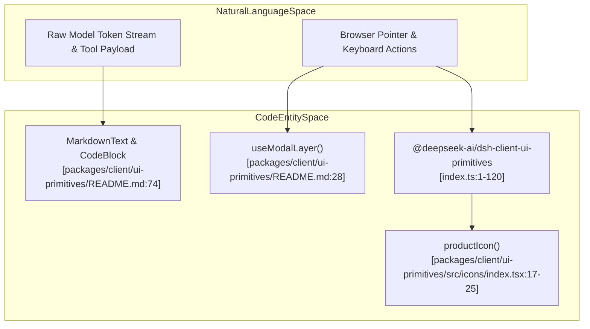
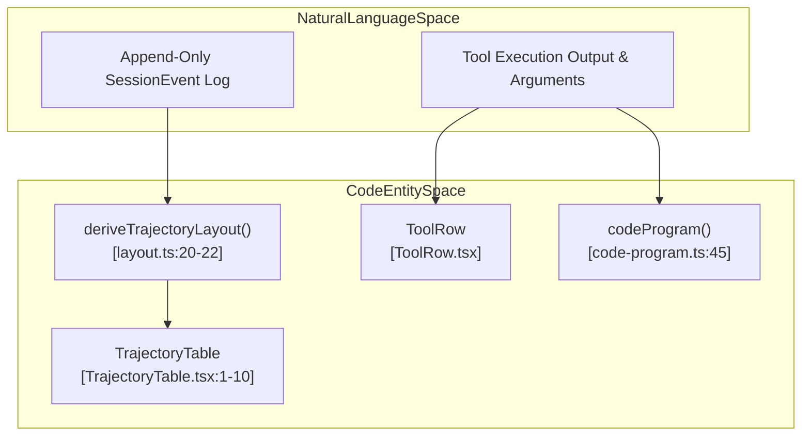

# UI Primitives, Trajectory & Tool Views

Relevant source files

The following files were used as context for generating this wiki page:

- [.agents/notes/implemented/architecture/2026-09-19-timed-user-question-two-settlements.i18n.yaml](.agents/notes/implemented/architecture/2026-09-19-timed-user-question-two-settlements.i18n.yaml)
- [.agents/notes/implemented/architecture/2026-09-19-timed-user-question-two-settlements.md](.agents/notes/implemented/architecture/2026-09-19-timed-user-question-two-settlements.md)
- [.agents/notes/implemented/architecture/2026-09-19-timed-user-question-two-settlements.zh.md](.agents/notes/implemented/architecture/2026-09-19-timed-user-question-two-settlements.zh.md)
- [.agents/notes/implemented/bug-fix/2026-09-17-multiline-display-dollar-math.i18n.yaml](.agents/notes/implemented/bug-fix/2026-09-17-multiline-display-dollar-math.i18n.yaml)
- [.agents/notes/implemented/bug-fix/2026-09-17-multiline-display-dollar-math.md](.agents/notes/implemented/bug-fix/2026-09-17-multiline-display-dollar-math.md)
- [.agents/notes/implemented/bug-fix/2026-09-17-multiline-display-dollar-math.zh.md](.agents/notes/implemented/bug-fix/2026-09-17-multiline-display-dollar-math.zh.md)
- [.agents/notes/implemented/testing/2026-10-11-user-text-credential-matching.i18n.yaml](.agents/notes/implemented/testing/2026-10-11-user-text-credential-matching.i18n.yaml)
- [.agents/notes/implemented/testing/2026-10-11-user-text-credential-matching.md](.agents/notes/implemented/testing/2026-10-11-user-text-credential-matching.md)
- [.agents/notes/implemented/testing/2026-10-11-user-text-credential-matching.zh.md](.agents/notes/implemented/testing/2026-10-11-user-text-credential-matching.zh.md)
- [apps/web/tests/built-boot.expected.e2e.ts](apps/web/tests/built-boot.expected.e2e.ts)
- [apps/web/tests/changed-files-turn.e2e.ts](apps/web/tests/changed-files-turn.e2e.ts)
- [apps/web/tests/clickable-links-gallery.e2e.ts](apps/web/tests/clickable-links-gallery.e2e.ts)
- [apps/web/tests/expected/clickable-links-gallery/ui.expected.md](apps/web/tests/expected/clickable-links-gallery/ui.expected.md)
- [apps/web/tests/expected/markdown-cjk-strong/ui.expected.md](apps/web/tests/expected/markdown-cjk-strong/ui.expected.md)
- [apps/web/tests/expected/markdown-images/ui.expected.md](apps/web/tests/expected/markdown-images/ui.expected.md)
- [apps/web/tests/expected/markdown-inline-code-links/ui.expected.md](apps/web/tests/expected/markdown-inline-code-links/ui.expected.md)
- [apps/web/tests/expected/math-rendering/ui.expected.md](apps/web/tests/expected/math-rendering/ui.expected.md)
- [apps/web/tests/expected/thinking-markdown/ui.expected.md](apps/web/tests/expected/thinking-markdown/ui.expected.md)
- [apps/web/tests/hmr-live.e2e.ts](apps/web/tests/hmr-live.e2e.ts)
- [apps/web/tests/markdown-cjk-strong.e2e.ts](apps/web/tests/markdown-cjk-strong.e2e.ts)
- [apps/web/tests/markdown-image-refresh.e2e.ts](apps/web/tests/markdown-image-refresh.e2e.ts)
- [apps/web/tests/markdown-images.e2e.ts](apps/web/tests/markdown-images.e2e.ts)
- [apps/web/tests/markdown-inline-code-links.e2e.ts](apps/web/tests/markdown-inline-code-links.e2e.ts)
- [apps/web/tests/markdown-wide-table.e2e.ts](apps/web/tests/markdown-wide-table.e2e.ts)
- [apps/web/tests/navigation-panes.e2e.ts](apps/web/tests/navigation-panes.e2e.ts)
- [apps/web/tests/open-in-app-ssh.e2e.ts](apps/web/tests/open-in-app-ssh.e2e.ts)
- [apps/web/tests/present-svg.e2e.ts](apps/web/tests/present-svg.e2e.ts)
- [apps/web/tests/present.e2e.ts](apps/web/tests/present.e2e.ts)
- [apps/web/tests/produced-file-mentions.e2e.ts](apps/web/tests/produced-file-mentions.e2e.ts)
- [apps/web/tests/question-composer.e2e.ts](apps/web/tests/question-composer.e2e.ts)
- [apps/web/tests/settings-appearance.e2e.ts](apps/web/tests/settings-appearance.e2e.ts)
- [apps/web/tests/startup-auto-selection.e2e.ts](apps/web/tests/startup-auto-selection.e2e.ts)
- [apps/web/tests/thinking-markdown.e2e.ts](apps/web/tests/thinking-markdown.e2e.ts)
- [benchmarks/user-text/user-text.bench.client.ts](benchmarks/user-text/user-text.bench.client.ts)
- [benchmarks/user-text/user-text.worker.client.ts](benchmarks/user-text/user-text.worker.client.ts)
- [packages/client/ui-agent-preset/src/client/AgentPresetSeat.module.css](packages/client/ui-agent-preset/src/client/AgentPresetSeat.module.css)
- [packages/client/ui-commands/src/client/presentation.ts](packages/client/ui-commands/src/client/presentation.ts)
- [packages/client/ui-conversation/src/client/locales.ts](packages/client/ui-conversation/src/client/locales.ts)
- [packages/client/ui-conversation/src/client/skeleton/EmptyHero.tsx](packages/client/ui-conversation/src/client/skeleton/EmptyHero.tsx)
- [packages/client/ui-conversation/src/client/skeleton/HeroShell.module.css](packages/client/ui-conversation/src/client/skeleton/HeroShell.module.css)
- [packages/client/ui-deliverables/README.i18n.yaml](packages/client/ui-deliverables/README.i18n.yaml)
- [packages/client/ui-deliverables/README.md](packages/client/ui-deliverables/README.md)
- [packages/client/ui-deliverables/README.zh.md](packages/client/ui-deliverables/README.zh.md)
- [packages/client/ui-deliverables/src/client/Deliverables.module.css](packages/client/ui-deliverables/src/client/Deliverables.module.css)
- [packages/client/ui-deliverables/src/client/Deliverables.tsx](packages/client/ui-deliverables/src/client/Deliverables.tsx)
- [packages/client/ui-deliverables/src/client/PresentedFileCard.tsx](packages/client/ui-deliverables/src/client/PresentedFileCard.tsx)
- [packages/client/ui-deliverables/src/client/ReviewTab.module.css](packages/client/ui-deliverables/src/client/ReviewTab.module.css)
- [packages/client/ui-deliverables/src/client/ReviewTab.tsx](packages/client/ui-deliverables/src/client/ReviewTab.tsx)
- [packages/client/ui-deliverables/src/client/index.ts](packages/client/ui-deliverables/src/client/index.ts)
- [packages/client/ui-deliverables/src/client/locales.ts](packages/client/ui-deliverables/src/client/locales.ts)
- [packages/client/ui-deliverables/src/client/present-open.ts](packages/client/ui-deliverables/src/client/present-open.ts)
- [packages/client/ui-deliverables/src/client/turn-deliverables.ts](packages/client/ui-deliverables/src/client/turn-deliverables.ts)
- [packages/client/ui-deliverables/src/index.ts](packages/client/ui-deliverables/src/index.ts)
- [packages/client/ui-deliverables/tests/deliverables.client.spec.tsx](packages/client/ui-deliverables/tests/deliverables.client.spec.tsx)
- [packages/client/ui-deliverables/tests/present-open.client.spec.ts](packages/client/ui-deliverables/tests/present-open.client.spec.ts)
- [packages/client/ui-deliverables/tests/presented-file-card.client.spec.tsx](packages/client/ui-deliverables/tests/presented-file-card.client.spec.tsx)
- [packages/client/ui-deliverables/tests/review-tab.client.spec.tsx](packages/client/ui-deliverables/tests/review-tab.client.spec.tsx)
- [packages/client/ui-primitives/README.i18n.yaml](packages/client/ui-primitives/README.i18n.yaml)
- [packages/client/ui-primitives/README.md](packages/client/ui-primitives/README.md)
- [packages/client/ui-primitives/README.zh.md](packages/client/ui-primitives/README.zh.md)
- [packages/client/ui-primitives/package.json](packages/client/ui-primitives/package.json)
- [packages/client/ui-primitives/src/HoverCard.module.css](packages/client/ui-primitives/src/HoverCard.module.css)
- [packages/client/ui-primitives/src/HoverCard.tsx](packages/client/ui-primitives/src/HoverCard.tsx)
- [packages/client/ui-primitives/src/ImageLightbox.module.css](packages/client/ui-primitives/src/ImageLightbox.module.css)
- [packages/client/ui-primitives/src/ImageLightbox.tsx](packages/client/ui-primitives/src/ImageLightbox.tsx)
- [packages/client/ui-primitives/src/Menu.module.css](packages/client/ui-primitives/src/Menu.module.css)
- [packages/client/ui-primitives/src/Menu.tsx](packages/client/ui-primitives/src/Menu.tsx)
- [packages/client/ui-primitives/src/icons/index.tsx](packages/client/ui-primitives/src/icons/index.tsx)
- [packages/client/ui-primitives/src/index.ts](packages/client/ui-primitives/src/index.ts)
- [packages/client/ui-primitives/src/markdown/MarkdownDelegate.tsx](packages/client/ui-primitives/src/markdown/MarkdownDelegate.tsx)
- [packages/client/ui-primitives/src/markdown/MarkdownText.module.css](packages/client/ui-primitives/src/markdown/MarkdownText.module.css)
- [packages/client/ui-primitives/src/markdown/MarkdownText.tsx](packages/client/ui-primitives/src/markdown/MarkdownText.tsx)
- [packages/client/ui-primitives/src/markdown/mathCompatibility.ts](packages/client/ui-primitives/src/markdown/mathCompatibility.ts)
- [packages/client/ui-primitives/src/markdown/parse.ts](packages/client/ui-primitives/src/markdown/parse.ts)
- [packages/client/ui-primitives/src/markdown/render.tsx](packages/client/ui-primitives/src/markdown/render.tsx)
- [packages/client/ui-primitives/src/markdown/windows-path-destinations.ts](packages/client/ui-primitives/src/markdown/windows-path-destinations.ts)
- [packages/client/ui-primitives/tests/atoms.client.spec.tsx](packages/client/ui-primitives/tests/atoms.client.spec.tsx)
- [packages/client/ui-primitives/tests/fixtures/markdown-dom/math-multiline-display.settled.txt](packages/client/ui-primitives/tests/fixtures/markdown-dom/math-multiline-display.settled.txt)
- [packages/client/ui-primitives/tests/fixtures/markdown-dom/math-multiline-display.streaming.txt](packages/client/ui-primitives/tests/fixtures/markdown-dom/math-multiline-display.streaming.txt)
- [packages/client/ui-primitives/tests/hover-card.client.spec.tsx](packages/client/ui-primitives/tests/hover-card.client.spec.tsx)
- [packages/client/ui-primitives/tests/icons.client.spec.tsx](packages/client/ui-primitives/tests/icons.client.spec.tsx)
- [packages/client/ui-primitives/tests/markdown-file-links.client.spec.tsx](packages/client/ui-primitives/tests/markdown-file-links.client.spec.tsx)
- [packages/client/ui-primitives/tests/markdown-image-entries.client.spec.tsx](packages/client/ui-primitives/tests/markdown-image-entries.client.spec.tsx)
- [packages/client/ui-primitives/tests/markdown-path-images.client.spec.tsx](packages/client/ui-primitives/tests/markdown-path-images.client.spec.tsx)
- [packages/client/ui-primitives/tests/markdown.client.spec.tsx](packages/client/ui-primitives/tests/markdown.client.spec.tsx)
- [packages/client/ui-schedule/src/client/ScheduleEmptyIllustration.tsx](packages/client/ui-schedule/src/client/ScheduleEmptyIllustration.tsx)
- [packages/client/ui-settings/src/client/index.ts](packages/client/ui-settings/src/client/index.ts)
- [packages/client/ui-settings/tests/plugin.client.spec.ts](packages/client/ui-settings/tests/plugin.client.spec.ts)
- [packages/client/ui-sidebar-documentpreview/src/client/LoadingIndicator.tsx](packages/client/ui-sidebar-documentpreview/src/client/LoadingIndicator.tsx)
- [packages/client/ui-sidebar-documentpreview/tests/loading-indicator.client.spec.tsx](packages/client/ui-sidebar-documentpreview/tests/loading-indicator.client.spec.tsx)
- [packages/client/ui-theme/README.i18n.yaml](packages/client/ui-theme/README.i18n.yaml)
- [packages/client/ui-theme/README.md](packages/client/ui-theme/README.md)
- [packages/client/ui-theme/README.zh.md](packages/client/ui-theme/README.zh.md)
- [packages/client/ui-theme/src/client/FontFamilyRow.module.css](packages/client/ui-theme/src/client/FontFamilyRow.module.css)
- [packages/client/ui-theme/src/client/FontFamilyRow.tsx](packages/client/ui-theme/src/client/FontFamilyRow.tsx)
- [packages/client/ui-theme/src/client/FontSizeRow.module.css](packages/client/ui-theme/src/client/FontSizeRow.module.css)
- [packages/client/ui-theme/src/client/index.ts](packages/client/ui-theme/src/client/index.ts)
- [packages/client/ui-theme/src/styles/design-platform.css](packages/client/ui-theme/src/styles/design-platform.css)
- [packages/client/ui-theme/tests/illustration-colors.client.spec.ts](packages/client/ui-theme/tests/illustration-colors.client.spec.ts)
- [packages/client/ui-tool/README.i18n.yaml](packages/client/ui-tool/README.i18n.yaml)
- [packages/client/ui-tool/README.md](packages/client/ui-tool/README.md)
- [packages/client/ui-tool/README.zh.md](packages/client/ui-tool/README.zh.md)
- [packages/client/ui-tool/src/client/apply.ts](packages/client/ui-tool/src/client/apply.ts)
- [packages/client/ui-tool/src/client/contract/slots.ts](packages/client/ui-tool/src/client/contract/slots.ts)
- [packages/client/ui-tool/src/client/index.ts](packages/client/ui-tool/src/client/index.ts)
- [packages/client/ui-tool/src/client/tool/ToolCallTree.tsx](packages/client/ui-tool/src/client/tool/ToolCallTree.tsx)
- [packages/client/ui-tool/src/client/tool/components/ToolRow.tsx](packages/client/ui-tool/src/client/tool/components/ToolRow.tsx)
- [packages/client/ui-tool/src/client/tool/models/diff-card-model.ts](packages/client/ui-tool/src/client/tool/models/diff-card-model.ts)
- [packages/client/ui-tool/src/client/tool/models/image-card-model.ts](packages/client/ui-tool/src/client/tool/models/image-card-model.ts)
- [packages/client/ui-tool/src/client/tool/models/raw-tool-call.ts](packages/client/ui-tool/src/client/tool/models/raw-tool-call.ts)
- [packages/client/ui-tool/src/client/tool/models/terminal-card-model.ts](packages/client/ui-tool/src/client/tool/models/terminal-card-model.ts)
- [packages/client/ui-tool/src/client/tool/models/tool-call-model.ts](packages/client/ui-tool/src/client/tool/models/tool-call-model.ts)
- [packages/client/ui-tool/src/client/tool/toolviews/GenericToolCard.tsx](packages/client/ui-tool/src/client/tool/toolviews/GenericToolCard.tsx)
- [packages/client/ui-tool/src/client/tool/toolviews/ask-question-row.tsx](packages/client/ui-tool/src/client/tool/toolviews/ask-question-row.tsx)
- [packages/client/ui-tool/src/client/tool/toolviews/bash-sample.tsx](packages/client/ui-tool/src/client/tool/toolviews/bash-sample.tsx)
- [packages/client/ui-tool/src/client/tool/toolviews/file-mutation-row.tsx](packages/client/ui-tool/src/client/tool/toolviews/file-mutation-row.tsx)
- [packages/client/ui-tool/src/client/tool/toolviews/read-row.tsx](packages/client/ui-tool/src/client/tool/toolviews/read-row.tsx)
- [packages/client/ui-tool/src/client/tool/toolviews/search-row.tsx](packages/client/ui-tool/src/client/tool/toolviews/search-row.tsx)
- [packages/client/ui-tool/src/client/tool/toolviews/todo-row.tsx](packages/client/ui-tool/src/client/tool/toolviews/todo-row.tsx)
- [packages/client/ui-tool/src/client/tool/toolviews/web-row.tsx](packages/client/ui-tool/src/client/tool/toolviews/web-row.tsx)
- [packages/client/ui-tool/tests/ask-question-row.client.spec.tsx](packages/client/ui-tool/tests/ask-question-row.client.spec.tsx)
- [packages/client/ui-tool/tests/coverage-tails.client.spec.tsx](packages/client/ui-tool/tests/coverage-tails.client.spec.tsx)
- [packages/client/ui-tool/tests/diff-card.client.spec.tsx](packages/client/ui-tool/tests/diff-card.client.spec.tsx)
- [packages/client/ui-tool/tests/image-card.client.spec.tsx](packages/client/ui-tool/tests/image-card.client.spec.tsx)
- [packages/client/ui-tool/tests/read-card.client.spec.tsx](packages/client/ui-tool/tests/read-card.client.spec.tsx)
- [packages/client/ui-tool/tests/search-card.client.spec.tsx](packages/client/ui-tool/tests/search-card.client.spec.tsx)
- [packages/client/ui-tool/tests/terminal-card.client.spec.tsx](packages/client/ui-tool/tests/terminal-card.client.spec.tsx)
- [packages/client/ui-tool/tests/todo-row.client.spec.tsx](packages/client/ui-tool/tests/todo-row.client.spec.tsx)
- [packages/client/ui-tool/tests/tool-call-tree.client.spec.tsx](packages/client/ui-tool/tests/tool-call-tree.client.spec.tsx)
- [packages/client/ui-tool/tests/tool-row.client.spec.tsx](packages/client/ui-tool/tests/tool-row.client.spec.tsx)
- [packages/client/ui-tool/tests/web-card.client.spec.tsx](packages/client/ui-tool/tests/web-card.client.spec.tsx)
- [packages/client/ui-trajectory/README.i18n.yaml](packages/client/ui-trajectory/README.i18n.yaml)
- [packages/client/ui-trajectory/README.md](packages/client/ui-trajectory/README.md)
- [packages/client/ui-trajectory/README.zh.md](packages/client/ui-trajectory/README.zh.md)
- [packages/client/ui-trajectory/src/client/TrajectoryCell.tsx](packages/client/ui-trajectory/src/client/TrajectoryCell.tsx)
- [packages/client/ui-trajectory/src/client/TrajectoryTable.module.css](packages/client/ui-trajectory/src/client/TrajectoryTable.module.css)
- [packages/client/ui-trajectory/src/client/TrajectoryTable.tsx](packages/client/ui-trajectory/src/client/TrajectoryTable.tsx)
- [packages/client/ui-trajectory/src/client/TrajectoryTimeline.module.css](packages/client/ui-trajectory/src/client/TrajectoryTimeline.module.css)
- [packages/client/ui-trajectory/src/client/TrajectoryTimeline.tsx](packages/client/ui-trajectory/src/client/TrajectoryTimeline.tsx)
- [packages/client/ui-trajectory/src/client/TrajectoryToolbar.module.css](packages/client/ui-trajectory/src/client/TrajectoryToolbar.module.css)
- [packages/client/ui-trajectory/src/client/TrajectoryToolbar.tsx](packages/client/ui-trajectory/src/client/TrajectoryToolbar.tsx)
- [packages/client/ui-trajectory/src/client/TrajectoryView.tsx](packages/client/ui-trajectory/src/client/TrajectoryView.tsx)
- [packages/client/ui-trajectory/src/client/index.ts](packages/client/ui-trajectory/src/client/index.ts)
- [packages/client/ui-trajectory/src/client/layout.ts](packages/client/ui-trajectory/src/client/layout.ts)
- [packages/client/ui-trajectory/src/client/locales.ts](packages/client/ui-trajectory/src/client/locales.ts)
- [packages/client/ui-trajectory/src/client/timeline.ts](packages/client/ui-trajectory/src/client/timeline.ts)
- [packages/client/ui-trajectory/src/client/trajectory-record.ts](packages/client/ui-trajectory/src/client/trajectory-record.ts)
- [packages/client/ui-trajectory/src/client/views.module.css](packages/client/ui-trajectory/src/client/views.module.css)
- [packages/client/ui-trajectory/src/index.ts](packages/client/ui-trajectory/src/index.ts)
- [packages/client/ui-trajectory/tests/conversation-definitions.client.spec.ts](packages/client/ui-trajectory/tests/conversation-definitions.client.spec.ts)
- [packages/client/ui-trajectory/tests/layout.client.spec.tsx](packages/client/ui-trajectory/tests/layout.client.spec.tsx)
- [packages/client/ui-trajectory/tests/table.client.spec.tsx](packages/client/ui-trajectory/tests/table.client.spec.tsx)
- [packages/client/ui-trajectory/tests/tool-results.host.spec.ts](packages/client/ui-trajectory/tests/tool-results.host.spec.ts)
- [packages/client/ui-trajectory/tests/views.client.spec.tsx](packages/client/ui-trajectory/tests/views.client.spec.tsx)
- [packages/client/ui-user-questions/README.i18n.yaml](packages/client/ui-user-questions/README.i18n.yaml)
- [packages/client/ui-user-questions/README.md](packages/client/ui-user-questions/README.md)
- [packages/client/ui-user-questions/README.zh.md](packages/client/ui-user-questions/README.zh.md)
- [packages/client/ui-user-questions/package.json](packages/client/ui-user-questions/package.json)
- [packages/client/ui-user-questions/src/client/QuestionComposer.module.css](packages/client/ui-user-questions/src/client/QuestionComposer.module.css)
- [packages/client/ui-user-questions/src/client/QuestionComposer.tsx](packages/client/ui-user-questions/src/client/QuestionComposer.tsx)
- [packages/client/ui-user-questions/src/client/contract/slots.ts](packages/client/ui-user-questions/src/client/contract/slots.ts)
- [packages/client/ui-user-questions/src/client/index.ts](packages/client/ui-user-questions/src/client/index.ts)
- [packages/client/ui-user-questions/src/client/locales.ts](packages/client/ui-user-questions/src/client/locales.ts)
- [packages/client/ui-user-questions/tests/browser-plugin.client.spec.ts](packages/client/ui-user-questions/tests/browser-plugin.client.spec.ts)
- [packages/client/ui-user-questions/tests/plan-review-panel.client.spec.tsx](packages/client/ui-user-questions/tests/plan-review-panel.client.spec.tsx)
- [packages/client/ui-user-questions/tests/question-composer-styles.client.spec.ts](packages/client/ui-user-questions/tests/question-composer-styles.client.spec.ts)
- [packages/client/ui-user-questions/tests/user-questions-composer.client.spec.tsx](packages/client/ui-user-questions/tests/user-questions-composer.client.spec.tsx)
- [packages/client/ui-user-questions/tsconfig.json](packages/client/ui-user-questions/tsconfig.json)
- [packages/experimental/webworker-runtime/tests/node/crypto-globals.spec.ts](packages/experimental/webworker-runtime/tests/node/crypto-globals.spec.ts)
- [packages/interaction/user-questions/src/projection.ts](packages/interaction/user-questions/src/projection.ts)
- [packages/interaction/user-questions/tests/projection.spec.ts](packages/interaction/user-questions/tests/projection.spec.ts)
- [packages/schedule/schedule/tests/runtime.spec.ts](packages/schedule/schedule/tests/runtime.spec.ts)
- [snapshots/web/changed-files-turn/ui.expected.md](snapshots/web/changed-files-turn/ui.expected.md)
- [snapshots/web/file-upload-round/ui.expected.md](snapshots/web/file-upload-round/ui.expected.md)
- [snapshots/web/markdown-file-links/links.expected.md](snapshots/web/markdown-file-links/links.expected.md)
- [snapshots/web/markdown-file-links/session.v3.jsonl](snapshots/web/markdown-file-links/session.v3.jsonl)
- [snapshots/web/open-in-app-ssh/header.expected.md](snapshots/web/open-in-app-ssh/header.expected.md)
- [snapshots/web/open-in-app-ssh/snapshot.yml](snapshots/web/open-in-app-ssh/snapshot.yml)
- [snapshots/web/present-svg/ui.expected.md](snapshots/web/present-svg/ui.expected.md)
- [snapshots/web/present/ui.expected.md](snapshots/web/present/ui.expected.md)
- [snapshots/web/question-composer/composed.expected.md](snapshots/web/question-composer/composed.expected.md)
- [snapshots/web/question-composer/ui.expected.md](snapshots/web/question-composer/ui.expected.md)
- [snapshots/web/seeded-history/file-preview.expected.md](snapshots/web/seeded-history/file-preview.expected.md)

This leaf wiki page details the shared UI foundation in the DeepSeek Harness (`dsh`) web client. It covers atomic React controls, icons, markdown/code renderers, the turn-aware trajectory inspection ledger, deliverables/present cards, and tool-call view rendering across packages `@deepseek-ai/dsh-client-ui-primitives`, `ui-trajectory`, `ui-deliverables`, and `ui-tool` [packages/client/ui-primitives/README.md:1-13](), [packages/client/ui-trajectory/README.md:1-12](), [packages/client/ui-deliverables/README.md:1-15]().

---

## 1. UI Primitives (`@deepseek-ai/dsh-client-ui-primitives`)

The `@deepseek-ai/dsh-client-ui-primitives` package provides a pure, Cordis-free React component library styled exclusively through `--dsw-*` design tokens [packages/client/ui-primitives/README.md:1-13](), [packages/client/ui-primitives/src/index.ts:1-3](). 

### 1.1 Architecture & Security Rules
- **Zero Cordis Runtime:** Components import no runtime services or state managers; callers supply localized labels and callbacks [packages/client/ui-primitives/README.md:10-13]().
- **Untrusted Output Defense:** Renderers drop raw HTML, restrict HTTP(S) links, and safely parse ANSI escape codes [packages/client/ui-primitives/README.md:10-13]().
- **Styling Seam:** The components rely on design tokens (`--dsw-*`), enabling seamless adaptation across plugins and themes [packages/client/ui-primitives/README.md:10-13]().
- **Icon Sprite System:** Product icons reference SVG symbol IDs (`dsw-icon-<glyph>-<weight>`) from a document sprite maintained by `ui-theme`, inheriting `currentColor` [packages/client/ui-primitives/src/icons/index.tsx:1-8]().

Sources: [packages/client/ui-primitives/README.md:1-37](), [packages/client/ui-primitives/src/icons/index.tsx:1-25]()

### 1.2 Core Component Catalog
The package exports standard controls, overlays, icons, and specialized agent output blocks:

| Export | Role / Implementation |
|---|---|
| `Button`, `Switch`, `Checkbox`, `Input` | Interactive form primitives with focus ring management via `focusWithoutRing` [packages/client/ui-primitives/README.md:41-49]() |
| `SegmentedControl`, `SegmentedTabs` | Mode switchers with sliding indicators and ARIA bindings [packages/client/ui-primitives/README.md:47-55]() |
| `Menu`, `MenuItemButton`, `Modal` | Overlay components managed by `useModalLayer` and keyboard trap handlers [packages/client/ui-primitives/README.md:28-33]() |
| `MarkdownText`, `CodeBlock` | GFM parser enhanced with KaTeX math and Shiki code highlighting [packages/client/ui-primitives/README.md:74-75]() |
| `JsonTree`, `JsonBlock` | Read-only structured JSON viewers with collapsible nodes [packages/client/ui-primitives/README.md:73-74]() |

Sources: [packages/client/ui-primitives/README.md:43-78](), [packages/client/ui-primitives/src/icons/index.tsx:1-137]()

---

## Diagram 1: Natural Language Space to Code Entity Space (UI Rendering)

Sources: [packages/client/ui-primitives/README.md:28-75](), [packages/client/ui-primitives/src/icons/index.tsx:17-25]()

---

## 2. Trajectory Inspection Ledger (`ui-trajectory`)

The `ui-trajectory` package converts linear session event logs into a turn-aware, virtualized inspection matrix [packages/client/ui-trajectory/src/client/TrajectoryTable.tsx:1-10](), [packages/client/ui-trajectory/README.md:1-13]().

### 2.1 Layout Folding & Data Flow
Raw event nodes, partial tool outputs, and running calls are folded into hierarchical structures via `deriveTrajectoryLayout()` [packages/client/ui-trajectory/src/client/TrajectoryView.tsx:20-22](). Selection, timeline navigation, folding, and search cover the React-visible window, while request numbers and cumulative usage cover the complete resident snapshot [packages/client/ui-trajectory/README.md:34-35]().

Sources: [packages/client/ui-trajectory/src/client/TrajectoryTable.tsx:1-54](), [packages/client/ui-trajectory/src/client/TrajectoryView.tsx:1-30]()

### 2.2 Table Virtualization & Inspection
- **Virtualization:** Uses `@tanstack/react-virtual` via `useVirtualizer` in `TrajectoryTable` to render only visible items with overscan rows [packages/client/ui-trajectory/src/client/TrajectoryTable.tsx:7-53]().
- **Event Kinds:** Categorizes entries into `system`, `user`, `context`, `compacted`, `message`, `tool`, and `subtool`, mapped to dedicated SVG icons [packages/client/ui-trajectory/src/client/TrajectoryTable.tsx:55-134]().
- **Detail Panes:** Selecting any row opens a split inspector tab with raw JSON, timing profiles, diffs, and schema inspection [packages/client/ui-trajectory/src/client/TrajectoryTable.tsx:172-185]().

Sources: [packages/client/ui-trajectory/src/client/TrajectoryTable.tsx:1-227](), [packages/client/ui-trajectory/src/client/TrajectoryTable.module.css:1-50]()

---

## 3. Deliverables and Present Cards (`ui-deliverables`)

The `ui-deliverables` package renders the artifacts produced during an agent turn [packages/client/ui-deliverables/README.md:1-15]().

### 3.1 Changed-Files Card & Review Tab
- **Workspace Changes:** Reads server-served summaries of `workspace/changes` announcements [packages/client/ui-deliverables/README.md:41-47]().
- **Interactive Review:** Clicking a changed file opens the `changes-review` sidebar tab, utilizing structured diff patches (`structuredPatch`) with Shiki token highlighting [packages/client/ui-deliverables/README.zh.md:49-51]().
- **Explicit Deliveries:** Parses `present` tool calls (`files: [{ path, description? }]`) to render delivery cards equipped with file-type icons and native open/reveal controls [packages/client/ui-deliverables/README.md:37-40]().

Sources: [packages/client/ui-deliverables/README.md:1-47](), [packages/client/ui-deliverables/README.zh.md:47-54]()

---

## 4. Tool-Call Rendering via `ui-tool`

The `ui-tool` package bridges raw tool executions to structured visualization cards [packages/client/ui-tool/README.md:1-30]().

### 4.1 Rendering Pipeline & Dispatch
- **Tree Resolution:** Decodes nested tool execution trees, including PTC (Programmatic Tool Calling) subcalls [packages/client/ui-trajectory/src/client/TrajectoryTable.tsx:42-45]().
- **Slot Registration:** Dispatches tool view rendering via slot bindings to dedicated tool cards [packages/client/ui-tool/README.md:1-40]().

Sources: [packages/client/ui-trajectory/src/client/TrajectoryTable.tsx:42-46](), [packages/client/ui-tool/README.md:1-30]()

---

## Diagram 2: Natural Language Space to Code Entity Space (Tool & Trajectory Rendering)

Sources: [packages/client/ui-trajectory/src/client/TrajectoryTable.tsx:1-10](), [packages/client/ui-trajectory/src/client/TrajectoryView.tsx:20-22](), [packages/client/ui-tool/src/client/tool/components/ToolRow.tsx:1-10]()