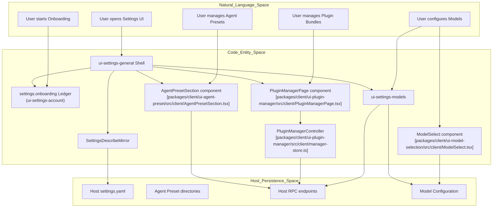
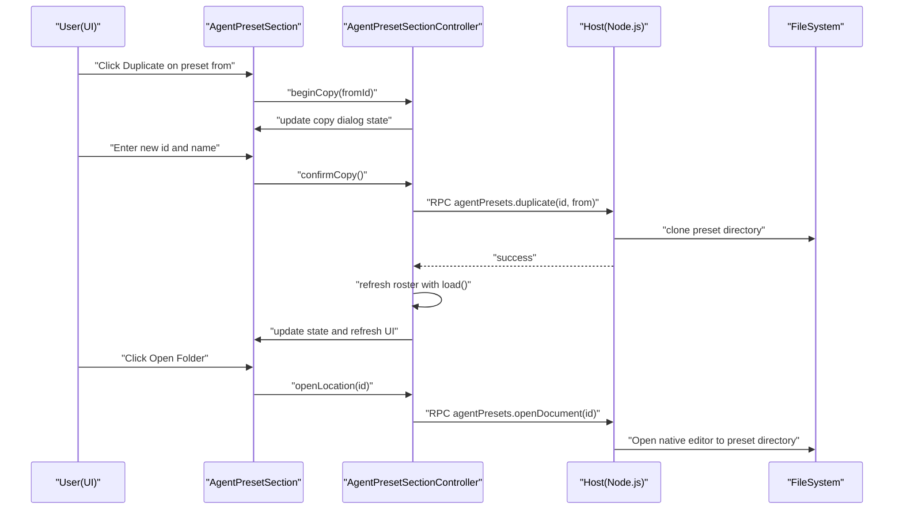

# Settings, Agent Presets & Onboarding

Relevant source files

The following files were used as context for generating this wiki page:

- [apps/web/tests/agent-preset-authoring.e2e.ts](apps/web/tests/agent-preset-authoring.e2e.ts)
- [apps/web/tests/agent-preset-selection.e2e.ts](apps/web/tests/agent-preset-selection.e2e.ts)
- [apps/web/tests/default-model.e2e.ts](apps/web/tests/default-model.e2e.ts)
- [apps/web/tests/desktop-updates.e2e.ts](apps/web/tests/desktop-updates.e2e.ts)
- [apps/web/tests/developer-tools-settings.e2e.ts](apps/web/tests/developer-tools-settings.e2e.ts)
- [apps/web/tests/expected/agent-preset-authoring/section.expected.md](apps/web/tests/expected/agent-preset-authoring/section.expected.md)
- [apps/web/tests/expected/agent-preset-selection/menu.expected.md](apps/web/tests/expected/agent-preset-selection/menu.expected.md)
- [apps/web/tests/expected/default-model/search.expected.md](apps/web/tests/expected/default-model/search.expected.md)
- [apps/web/tests/expected/desktop-locale/automatic.expected.md](apps/web/tests/expected/desktop-locale/automatic.expected.md)
- [apps/web/tests/expected/desktop-locale/selected.expected.md](apps/web/tests/expected/desktop-locale/selected.expected.md)
- [apps/web/tests/expected/plugin-config/official.expected.md](apps/web/tests/expected/plugin-config/official.expected.md)
- [apps/web/tests/expected/plugin-install-registry/installed.expected.md](apps/web/tests/expected/plugin-install-registry/installed.expected.md)
- [apps/web/tests/expected/plugin-install-registry/picker.expected.md](apps/web/tests/expected/plugin-install-registry/picker.expected.md)
- [apps/web/tests/expected/plugin-manager/live-enabled.expected.md](apps/web/tests/expected/plugin-manager/live-enabled.expected.md)
- [apps/web/tests/expected/plugin-manager/manager.expected.md](apps/web/tests/expected/plugin-manager/manager.expected.md)
- [apps/web/tests/expected/plugin-manager/refresh.expected.md](apps/web/tests/expected/plugin-manager/refresh.expected.md)
- [apps/web/tests/expected/settings-chrome/dialog-en.expected.md](apps/web/tests/expected/settings-chrome/dialog-en.expected.md)
- [apps/web/tests/expected/settings-chrome/dialog-no-browser.expected.md](apps/web/tests/expected/settings-chrome/dialog-no-browser.expected.md)
- [apps/web/tests/expected/settings-chrome/dialog.expected.md](apps/web/tests/expected/settings-chrome/dialog.expected.md)
- [apps/web/tests/expected/settings-chrome/plugin-instances.expected.md](apps/web/tests/expected/settings-chrome/plugin-instances.expected.md)
- [apps/web/tests/expected/settings-chrome/plugins.expected.md](apps/web/tests/expected/settings-chrome/plugins.expected.md)
- [apps/web/tests/models-settings.e2e.ts](apps/web/tests/models-settings.e2e.ts)
- [apps/web/tests/plugin-install-registry.e2e.ts](apps/web/tests/plugin-install-registry.e2e.ts)
- [apps/web/tests/plugin-manager.e2e.ts](apps/web/tests/plugin-manager.e2e.ts)
- [apps/web/tests/settings-chrome.e2e.ts](apps/web/tests/settings-chrome.e2e.ts)
- [docs/subsystems/credentials.i18n.yaml](docs/subsystems/credentials.i18n.yaml)
- [docs/subsystems/credentials.md](docs/subsystems/credentials.md)
- [docs/subsystems/credentials.zh.md](docs/subsystems/credentials.zh.md)
- [packages/api/remotes/src/remote-events.ts](packages/api/remotes/src/remote-events.ts)
- [packages/client/ui-agent-preset/README.i18n.yaml](packages/client/ui-agent-preset/README.i18n.yaml)
- [packages/client/ui-agent-preset/README.md](packages/client/ui-agent-preset/README.md)
- [packages/client/ui-agent-preset/README.zh.md](packages/client/ui-agent-preset/README.zh.md)
- [packages/client/ui-agent-preset/src/client/AgentPresetSeat.tsx](packages/client/ui-agent-preset/src/client/AgentPresetSeat.tsx)
- [packages/client/ui-agent-preset/src/client/AgentPresetSection.module.css](packages/client/ui-agent-preset/src/client/AgentPresetSection.module.css)
- [packages/client/ui-agent-preset/src/client/AgentPresetSection.tsx](packages/client/ui-agent-preset/src/client/AgentPresetSection.tsx)
- [packages/client/ui-agent-preset/src/client/index.ts](packages/client/ui-agent-preset/src/client/index.ts)
- [packages/client/ui-agent-preset/src/client/locales.ts](packages/client/ui-agent-preset/src/client/locales.ts)
- [packages/client/ui-agent-preset/src/client/seat-store.ts](packages/client/ui-agent-preset/src/client/seat-store.ts)
- [packages/client/ui-agent-preset/src/client/section-store.ts](packages/client/ui-agent-preset/src/client/section-store.ts)
- [packages/client/ui-agent-preset/src/client/settings-store.ts](packages/client/ui-agent-preset/src/client/settings-store.ts)
- [packages/client/ui-agent-preset/tests/apply.client.spec.ts](packages/client/ui-agent-preset/tests/apply.client.spec.ts)
- [packages/client/ui-agent-preset/tests/components.client.spec.tsx](packages/client/ui-agent-preset/tests/components.client.spec.tsx)
- [packages/client/ui-agent-preset/tests/section-store.client.spec.ts](packages/client/ui-agent-preset/tests/section-store.client.spec.ts)
- [packages/client/ui-agent-preset/tests/section.client.spec.tsx](packages/client/ui-agent-preset/tests/section.client.spec.tsx)
- [packages/client/ui-agent-preset/tests/settings-store.client.spec.ts](packages/client/ui-agent-preset/tests/settings-store.client.spec.ts)
- [packages/client/ui-commands/tests/popup-view.client.spec.tsx](packages/client/ui-commands/tests/popup-view.client.spec.tsx)
- [packages/client/ui-model-selection/README.i18n.yaml](packages/client/ui-model-selection/README.i18n.yaml)
- [packages/client/ui-model-selection/README.md](packages/client/ui-model-selection/README.md)
- [packages/client/ui-model-selection/README.zh.md](packages/client/ui-model-selection/README.zh.md)
- [packages/client/ui-model-selection/src/client/ModelSelect.module.css](packages/client/ui-model-selection/src/client/ModelSelect.module.css)
- [packages/client/ui-model-selection/src/client/ModelSelect.tsx](packages/client/ui-model-selection/src/client/ModelSelect.tsx)
- [packages/client/ui-model-selection/src/client/catalog.ts](packages/client/ui-model-selection/src/client/catalog.ts)
- [packages/client/ui-model-selection/src/client/directory.ts](packages/client/ui-model-selection/src/client/directory.ts)
- [packages/client/ui-model-selection/src/client/index.ts](packages/client/ui-model-selection/src/client/index.ts)
- [packages/client/ui-model-selection/src/client/locales.ts](packages/client/ui-model-selection/src/client/locales.ts)
- [packages/client/ui-model-selection/src/client/service.ts](packages/client/ui-model-selection/src/client/service.ts)
- [packages/client/ui-model-selection/tests/browser-plugin.client.spec.ts](packages/client/ui-model-selection/tests/browser-plugin.client.spec.ts)
- [packages/client/ui-model-selection/tests/expected/unselected-model.txt](packages/client/ui-model-selection/tests/expected/unselected-model.txt)
- [packages/client/ui-model-selection/tests/model-select.client.spec.tsx](packages/client/ui-model-selection/tests/model-select.client.spec.tsx)
- [packages/client/ui-plugin-manager/README.i18n.yaml](packages/client/ui-plugin-manager/README.i18n.yaml)
- [packages/client/ui-plugin-manager/README.md](packages/client/ui-plugin-manager/README.md)
- [packages/client/ui-plugin-manager/README.zh.md](packages/client/ui-plugin-manager/README.zh.md)
- [packages/client/ui-plugin-manager/src/client/PluginManagerPage.module.css](packages/client/ui-plugin-manager/src/client/PluginManagerPage.module.css)
- [packages/client/ui-plugin-manager/src/client/PluginManagerPage.tsx](packages/client/ui-plugin-manager/src/client/PluginManagerPage.tsx)
- [packages/client/ui-plugin-manager/src/client/locales.ts](packages/client/ui-plugin-manager/src/client/locales.ts)
- [packages/client/ui-plugin-manager/src/client/manager-store.ts](packages/client/ui-plugin-manager/src/client/manager-store.ts)
- [packages/client/ui-plugin-manager/src/client/presentation.ts](packages/client/ui-plugin-manager/src/client/presentation.ts)
- [packages/client/ui-plugin-manager/tests/components.client.spec.tsx](packages/client/ui-plugin-manager/tests/components.client.spec.tsx)
- [packages/client/ui-plugin-manager/tests/manager-store.client.spec.ts](packages/client/ui-plugin-manager/tests/manager-store.client.spec.ts)
- [packages/client/ui-primitives/src/ConnectionIndicator.module.css](packages/client/ui-primitives/src/ConnectionIndicator.module.css)
- [packages/client/ui-primitives/src/ConnectionIndicator.tsx](packages/client/ui-primitives/src/ConnectionIndicator.tsx)
- [packages/client/ui-settings-account/README.i18n.yaml](packages/client/ui-settings-account/README.i18n.yaml)
- [packages/client/ui-settings-account/README.md](packages/client/ui-settings-account/README.md)
- [packages/client/ui-settings-account/README.zh.md](packages/client/ui-settings-account/README.zh.md)
- [packages/client/ui-settings-account/src/client/AccountMenu.module.css](packages/client/ui-settings-account/src/client/AccountMenu.module.css)
- [packages/client/ui-settings-account/src/client/AccountMenu.tsx](packages/client/ui-settings-account/src/client/AccountMenu.tsx)
- [packages/client/ui-settings-account/src/client/AccountSection.tsx](packages/client/ui-settings-account/src/client/AccountSection.tsx)
- [packages/client/ui-settings-account/src/client/index.ts](packages/client/ui-settings-account/src/client/index.ts)
- [packages/client/ui-settings-account/src/client/locales.ts](packages/client/ui-settings-account/src/client/locales.ts)
- [packages/client/ui-settings-account/tests/account.client.spec.tsx](packages/client/ui-settings-account/tests/account.client.spec.tsx)
- [packages/client/ui-settings-account/tests/apply.client.spec.ts](packages/client/ui-settings-account/tests/apply.client.spec.ts)
- [packages/client/ui-settings-account/tests/expected/account-en.txt](packages/client/ui-settings-account/tests/expected/account-en.txt)
- [packages/client/ui-settings-account/tests/expected/account-zh.txt](packages/client/ui-settings-account/tests/expected/account-zh.txt)
- [packages/client/ui-settings-account/tests/expected/bonus-en.txt](packages/client/ui-settings-account/tests/expected/bonus-en.txt)
- [packages/client/ui-settings-account/tests/expected/details-en.txt](packages/client/ui-settings-account/tests/expected/details-en.txt)
- [packages/client/ui-settings-account/tests/expected/details-zh.txt](packages/client/ui-settings-account/tests/expected/details-zh.txt)
- [packages/client/ui-settings-account/tests/expected/profile-before-balance.txt](packages/client/ui-settings-account/tests/expected/profile-before-balance.txt)
- [packages/client/ui-settings-general/README.i18n.yaml](packages/client/ui-settings-general/README.i18n.yaml)
- [packages/client/ui-settings-general/README.md](packages/client/ui-settings-general/README.md)
- [packages/client/ui-settings-general/README.zh.md](packages/client/ui-settings-general/README.zh.md)
- [packages/client/ui-settings-general/package.json](packages/client/ui-settings-general/package.json)
- [packages/client/ui-settings-general/src/client/DesktopUpdateIndicator.module.css](packages/client/ui-settings-general/src/client/DesktopUpdateIndicator.module.css)
- [packages/client/ui-settings-general/src/client/DesktopUpdateIndicator.tsx](packages/client/ui-settings-general/src/client/DesktopUpdateIndicator.tsx)
- [packages/client/ui-settings-general/src/client/SettingsRoot.module.css](packages/client/ui-settings-general/src/client/SettingsRoot.module.css)
- [packages/client/ui-settings-general/src/client/SettingsRoot.tsx](packages/client/ui-settings-general/src/client/SettingsRoot.tsx)
- [packages/client/ui-settings-general/src/client/index.ts](packages/client/ui-settings-general/src/client/index.ts)
- [packages/client/ui-settings-general/src/client/locales.ts](packages/client/ui-settings-general/src/client/locales.ts)
- [packages/client/ui-settings-general/src/client/shell-contract.ts](packages/client/ui-settings-general/src/client/shell-contract.ts)
- [packages/client/ui-settings-general/tests/apply.client.spec.ts](packages/client/ui-settings-general/tests/apply.client.spec.ts)
- [packages/client/ui-settings-general/tests/components.client.spec.tsx](packages/client/ui-settings-general/tests/components.client.spec.tsx)
- [packages/client/ui-settings-general/tests/desktop-update.client.spec.tsx](packages/client/ui-settings-general/tests/desktop-update.client.spec.tsx)
- [packages/client/ui-settings-general/tests/settings-root.client.spec.tsx](packages/client/ui-settings-general/tests/settings-root.client.spec.tsx)
- [packages/client/ui-settings-general/tests/shell.client.spec.ts](packages/client/ui-settings-general/tests/shell.client.spec.ts)
- [packages/client/ui-settings-general/tsconfig.json](packages/client/ui-settings-general/tsconfig.json)
- [packages/client/ui-settings-models/README.i18n.yaml](packages/client/ui-settings-models/README.i18n.yaml)
- [packages/client/ui-settings-models/README.md](packages/client/ui-settings-models/README.md)
- [packages/client/ui-settings-models/README.zh.md](packages/client/ui-settings-models/README.zh.md)
- [packages/client/ui-settings-models/src/client/CustomProviderCard.tsx](packages/client/ui-settings-models/src/client/CustomProviderCard.tsx)
- [packages/client/ui-settings-models/src/client/DeepSeekModelsEditor.tsx](packages/client/ui-settings-models/src/client/DeepSeekModelsEditor.tsx)
- [packages/client/ui-settings-models/src/client/ModelListEditor.tsx](packages/client/ui-settings-models/src/client/ModelListEditor.tsx)
- [packages/client/ui-settings-models/src/client/ModelReasoningEfforts.tsx](packages/client/ui-settings-models/src/client/ModelReasoningEfforts.tsx)
- [packages/client/ui-settings-models/src/client/ModelRow.tsx](packages/client/ui-settings-models/src/client/ModelRow.tsx)
- [packages/client/ui-settings-models/src/client/ModelsSection.module.css](packages/client/ui-settings-models/src/client/ModelsSection.module.css)
- [packages/client/ui-settings-models/src/client/ModelsSection.tsx](packages/client/ui-settings-models/src/client/ModelsSection.tsx)
- [packages/client/ui-settings-models/src/client/ProviderEditor.tsx](packages/client/ui-settings-models/src/client/ProviderEditor.tsx)
- [packages/client/ui-settings-models/src/client/locales.ts](packages/client/ui-settings-models/src/client/locales.ts)
- [packages/client/ui-settings-models/src/client/store.ts](packages/client/ui-settings-models/src/client/store.ts)
- [packages/client/ui-settings-models/src/client/useModelRows.ts](packages/client/ui-settings-models/src/client/useModelRows.ts)
- [packages/client/ui-settings-models/tests/components.client.spec.tsx](packages/client/ui-settings-models/tests/components.client.spec.tsx)
- [packages/client/ui-settings-models/tests/model-order.client.spec.tsx](packages/client/ui-settings-models/tests/model-order.client.spec.tsx)
- [packages/client/ui-settings-models/tests/model-reasoning-efforts.client.spec.tsx](packages/client/ui-settings-models/tests/model-reasoning-efforts.client.spec.tsx)
- [packages/client/ui-settings-models/tests/provider-form.client.spec.tsx](packages/client/ui-settings-models/tests/provider-form.client.spec.tsx)
- [packages/client/ui-settings-models/tests/store.client.spec.ts](packages/client/ui-settings-models/tests/store.client.spec.ts)
- [packages/client/ui-settings-plugin-inventory/README.i18n.yaml](packages/client/ui-settings-plugin-inventory/README.i18n.yaml)
- [packages/client/ui-settings-plugin-inventory/README.md](packages/client/ui-settings-plugin-inventory/README.md)
- [packages/client/ui-settings-plugin-inventory/README.zh.md](packages/client/ui-settings-plugin-inventory/README.zh.md)
- [packages/client/ui-settings-plugin-inventory/src/client/PluginInventorySettingsTab.module.css](packages/client/ui-settings-plugin-inventory/src/client/PluginInventorySettingsTab.module.css)
- [packages/client/ui-settings-plugin-inventory/src/client/PluginInventorySettingsTab.tsx](packages/client/ui-settings-plugin-inventory/src/client/PluginInventorySettingsTab.tsx)
- [packages/client/ui-settings-plugin-inventory/src/client/locales.ts](packages/client/ui-settings-plugin-inventory/src/client/locales.ts)
- [packages/client/ui-settings-plugin-inventory/tests/components.client.spec.tsx](packages/client/ui-settings-plugin-inventory/tests/components.client.spec.tsx)
- [packages/client/ui-settings-plugins/src/client/index.ts](packages/client/ui-settings-plugins/src/client/index.ts)
- [packages/credentials/deepseek-account-platform/README.i18n.yaml](packages/credentials/deepseek-account-platform/README.i18n.yaml)
- [packages/credentials/deepseek-account-platform/README.md](packages/credentials/deepseek-account-platform/README.md)
- [packages/credentials/deepseek-account-platform/README.zh.md](packages/credentials/deepseek-account-platform/README.zh.md)
- [packages/credentials/deepseek-account-platform/src/details.ts](packages/credentials/deepseek-account-platform/src/details.ts)
- [packages/credentials/deepseek-account-platform/src/index.ts](packages/credentials/deepseek-account-platform/src/index.ts)
- [packages/credentials/deepseek-account-platform/src/protocol.ts](packages/credentials/deepseek-account-platform/src/protocol.ts)
- [packages/credentials/deepseek-account-platform/tests/account.spec.ts](packages/credentials/deepseek-account-platform/tests/account.spec.ts)
- [packages/credentials/deepseek-account-platform/tests/diagnostics.spec.ts](packages/credentials/deepseek-account-platform/tests/diagnostics.spec.ts)
- [packages/credentials/deepseek-account/README.i18n.yaml](packages/credentials/deepseek-account/README.i18n.yaml)
- [packages/credentials/deepseek-account/README.md](packages/credentials/deepseek-account/README.md)
- [packages/credentials/deepseek-account/README.zh.md](packages/credentials/deepseek-account/README.zh.md)
- [packages/credentials/deepseek-account/src/index.ts](packages/credentials/deepseek-account/src/index.ts)
- [packages/credentials/deepseek-account/src/types.ts](packages/credentials/deepseek-account/src/types.ts)

This page provides a comprehensive technical overview of the user settings interface, agent preset authoring system, the plugin manager page, onboarding flows, model selection, and plan mode control in DeepSeek Harness (`dsh`). It covers the architecture and code entities involved in presenting and managing application settings (models, account, general preferences, plugins), preset configurations, session plan modes, and the settings chrome.

---

## Settings UI & General Chrome

The settings UI is structured as a modular shell where multiple feature areas register cards and controls. The main shell module resides in the `ui-settings-general` package. It manages the overall settings modal frame, navigation tabs, and anchors the onboarding and plan mode ledgers.

### Settings Shell Architecture

- **Hosting & Slots**: The settings UI mounts into the sidebar’s `sidebar.settings` slot.
- **Ledger Structure**:
  - **`settings.section` ledger**: Renders the side navigation sections for different settings categories.
  - **`settings.general.item` slot**: Hosts individual preference controls such as toggles, input fields, and selectors.
  - **`settings.onboarding` ledger**: Drives the sequential onboarding flow UI steps.
- **Host RPC Integration**: Privileged actions invoke Host RPC calls (`settings/openSettingsDocument`) to open host-side YAML configuration files during local development or loopback mode [apps/web/tests/settings-chrome.e2e.ts:98-126]().
- **E2E Validation**: The `apps/web/tests/settings-chrome.e2e.ts` test ensures modal open/close flows, navigation among settings sections, and preference interactions [apps/web/tests/settings-chrome.e2e.ts:71-131]().

### Mirror and Scoped Views

- **SettingsDescribeMirror**: Subscribes once to the host's settings describe API to cache the entire settings catalog and current values, reducing repeated RPC calls [packages/client/ui-plugin-manager/tests/components.client.spec.tsx:9-9]().
- **SettingsScopeController**: Creates filtered, scoped settings views by namespace (e.g., agent-presets), enabling fine-grained UI binding and editing [packages/client/ui-plugin-manager/tests/components.client.spec.tsx:9-9]().
- **Write Synchronization**: Uses revision fences to serialize write operations and avoid conflicting updates. Upon conflict detection, the mirror updates and reloads UI views [packages/client/ui-plugin-manager/tests/components.client.spec.tsx:9-9]().

### Language Preference

- **LocaleRuntime** manages UI localization strings [packages/client/ui-plugin-manager/tests/components.client.spec.tsx:6-6]().
- Language preference is resolved from multiple sources including browser settings and host overrides [apps/web/tests/plugin-manager.e2e.ts:68-82]().
- UI updates the `<html lang>` attribute dynamically for accessibility and compliance [apps/web/tests/plugin-manager.e2e.ts:68-70]().
- Locale bindings are injected into UI packages to localize controls and text [packages/client/ui-plugin-manager/src/client/locales.ts:1-30]().

Sources:
- [packages/client/ui-plugin-manager/tests/components.client.spec.tsx:6-10]()
- [packages/client/ui-plugin-manager/src/client/locales.ts:1-30]()
- [apps/web/tests/plugin-manager.e2e.ts:68-82]()
- [apps/web/tests/settings-chrome.e2e.ts:71-131]()

---

## Agent Preset Authoring (`ui-agent-preset`)

Agent presets define agent runtime compositions: plugins, tools, skills, and prompts configured for sessions. Presets are immutable once bound to running sessions.

### Core Concepts & User Interaction

- **Preset Storage**: Each preset is backed by a directory containing composition YAML (`agent.cordis.yml`) [apps/web/tests/agent-preset-selection.e2e.ts:1-12]().
- **UI**: The preset roster lists system presets and user-created custom copies [apps/web/tests/agent-preset-selection.e2e.ts:1-12]().
- **Authoring**: Duplication of existing presets is supported via UI. Editing occurs on the preset directory YAML via native editor opened through RPC [apps/web/tests/agent-preset-selection.e2e.ts:1-12]().
- **Default Preset**: Users can configure a default preset for new sessions, stored persistently in the `agent-presets` settings namespace [apps/web/tests/agent-preset-selection.e2e.ts:1-12]().

### Key Code Components

| Feature | Entity & Location | Description |
| :-------------------------------- | :------------------------------------------------------------------------------------------------------ | :---------------------------------------------------------------- |
| Roster Management | `AgentPresetSectionController`  [packages/client/ui-agent-preset/src/client/AgentPresetSection.tsx]() | Loads, manages, allows copy/delete dialogs, default toggle. |
| Copy Dialog Validation | `draftBlocker` validation rules in section store  [packages/client/ui-agent-preset/src/client/seat-store.ts]() | Client-side validity and uniqueness checks for new preset IDs. |
| Default Preset Persistence | `writeDefaultPreset()`  [packages/client/ui-agent-preset/src/client/settings-store.ts]() | Writes default preset `id` to host user settings storage. |
| Main UI Component | `AgentPresetSection` React component  [packages/client/ui-agent-preset/src/client/AgentPresetSection.tsx]() | Presents list, dialogs, copy/create UI for presets. |
| Session-global Preset Chooser | `AgentPresetSeatController`  [packages/client/ui-agent-preset/src/client/AgentPresetSeat.tsx]() | Controls preset selection chip on new session screen and header. |

Sources:
- [packages/client/ui-agent-preset/src/client/AgentPresetSection.tsx]()
- [packages/client/ui-agent-preset/src/client/seat-store.ts]()
- [packages/client/ui-agent-preset/src/client/settings-store.ts]()
- [packages/client/ui-agent-preset/src/client/AgentPresetSeat.tsx]()
- [apps/web/tests/agent-preset-selection.e2e.ts:1-30]()

---

## Plugin Manager Page (`ui-plugin-manager`)

The plugin manager UI (`ui-plugin-manager`) provides interactive management for plugin bundles, their component rows, and plugin configuration pages [packages/client/ui-plugin-manager/src/client/PluginManagerPage.tsx:1-9]().

### Key Features

- **Bundle Listings**: Shows installed bundles and official bundles shipped with the installation that can be enabled or disabled [packages/client/ui-plugin-manager/src/client/PluginManagerPage.tsx:100-135]().

- **Registry Probing**:
  - Probes various npm registries (e.g., official npm registry and Chinese mirror `npmmirror`) in parallel [packages/client/ui-plugin-manager/README.md:51-53]() [packages/client/ui-plugin-manager/src/client/locales.ts:90-100]().
  - Uses HTTPS pings with race conditions; the first successful response selects the preferred registry [packages/client/ui-plugin-manager/README.md:51-53]().
  - Cache and timeout configuration optimizes UX during first use [packages/client/ui-plugin-manager/README.md:53-53]().

- **Installation Flow**:
  - Accepts package names, Git addresses, tarballs, or local directory paths [packages/client/ui-plugin-manager/README.md:54-55]() [packages/client/ui-plugin-manager/src/client/locales.ts:74-78]().
  - Performs spec inspection via Host RPC (`pluginManager.inspect`) to validate install targets [packages/client/ui-plugin-manager/src/client/manager-store.ts:135-145]().
  - Integrates with `pnpm` for package management [packages/client/ui-plugin-manager/README.md:54-55]().
  - Displays install progress and deferred authorization for build scripts [packages/client/ui-plugin-manager/README.md:54-55]().
  - Handles cancellation, rollbacks, and retries with clear UI feedback [packages/client/ui-plugin-manager/README.md:56-58]().

- **Component Row Toggling**:
  - Each bundle contains multiple plugin "rows" that can be enabled or disabled individually [packages/client/ui-plugin-manager/README.md:68-69]().
  - Toggling writes patch overrides to the user profile (`cordis.patch.yml`) [packages/client/ui-plugin-manager/README.md:68-69]().
  - UI reflects fiber loading states from the host: `pending`, `loading`, `active`, `failed`, `unloading` [packages/client/ui-plugin-manager/src/client/locales.ts:59-64]().
  - Includes filtering, sorting, statuses, and badges for clarity [packages/client/ui-plugin-manager/src/client/PluginManagerPage.tsx:50-70]().

Sources:
- [packages/client/ui-plugin-manager/src/client/PluginManagerPage.tsx:1-135]()
- [packages/client/ui-plugin-manager/README.md:30-58]()
- [packages/client/ui-plugin-manager/src/client/manager-store.ts:1-145]()
- [packages/client/ui-plugin-manager/src/client/locales.ts:1-100]()

---

## Onboarding Flow

Onboarding in DeepSeek Harness is implemented as a dedicated ledger-driven UI flow, mounted in the settings system [packages/client/ui-settings-account/README.md:30-31]() [packages/client/ui-settings-account/README.zh.md:30-31]().

### Behavior and Features

- Only one onboarding UI step is shown at a time, controlled by the `settings.onboarding` ledger [packages/client/ui-settings-account/README.md:30-31]() [packages/client/ui-settings-account/README.zh.md:30-31]().
- While onboarding is active, the main UI (`app-root`) is made inert to prevent background interactions [packages/client/ui-settings-account/README.md:30-31]() [packages/client/ui-settings-account/README.zh.md:30-31]().
- Onboarding progress is persisted using public settings, enabling multi-session and deployment-wide continuity [packages/client/ui-settings-account/README.md:30-31]() [packages/client/ui-settings-account/README.zh.md:30-31]().
- Typical onboarding includes versioned welcome dialogs, initial configuration prompts (such as API credential input), and readiness checks [packages/client/ui-settings-account/README.md:30-31]() [packages/client/ui-settings-account/README.zh.md:30-31]().

### Desktop Onboarding

The `ui-settings-account` package handles the Desktop onboarding flow [packages/client/ui-settings-account/README.md:28-29]().

- **Activation**: Enabled when Desktop preload detects stored account credentials [packages/client/ui-settings-account/README.md:60-60]().
- **Persistence**: Progress is stored in local Host settings, not Platform account, allowing resumption after restart [packages/client/ui-settings-account/README.md:60-60]().
- **API Key Handling**: If an API Key is configured but not logged in, the onboarding flow is bypassed [packages/client/ui-settings-account/README.md:62-63]().
- **Steps**: Includes a welcome page, credit page (with top-up options), and usage preference questions [packages/client/ui-settings-account/README.md:64-65]().

Sources:
- [packages/client/ui-settings-account/README.md:1-119]()
- [packages/client/ui-settings-account/README.zh.md:1-77]()

---

## Model Selection & Settings

Model selection is a critical part of configuring agent behavior, allowing users to choose which LLM powers their sessions.

### UI Component (`ui-model-selection`)

The `ui-model-selection` package provides the `ModelSelect` React component for model selection [packages/client/ui-model-selection/src/client/ModelSelect.tsx]().

- **Purpose**: Allows users to choose an LLM from available providers.
- **Integration**: Typically used within agent preset configuration or session creation flows.
- **E2E Testing**: `apps/web/tests/models-settings.e2e.ts` includes tests for model selection within the settings UI.

### Model Settings (`ui-settings-models`)

The `ui-settings-models` package provides the settings page for configuring LLM providers and models.

- **Provider Configuration**: Users can add and manage API keys for various LLM providers (e.g., DeepSeek, OpenAI) [packages/client/ui-settings-models/README.md:14-15]().
- **Model Management**: Displays available models, their capabilities, and allows enabling/disabling them [packages/client/ui-settings-models/README.md:16-17]().

Sources:
- [packages/client/ui-model-selection/src/client/ModelSelect.tsx]()
- [packages/client/ui-settings-models/README.md:1-20]()
- [apps/web/tests/models-settings.e2e.ts]()

---

## Plan Mode Control

Plan mode introduces a structured interaction pattern where the agent first produces a plan before executing any tools or code.

### Functional Overview

- Implements a system prompt injection phase for plan guidance owned by deployment policies.
- Tools execution is filtered based on session events tagged with `plan/mode`.
- State updates for plan mode (entering, blocking, exiting) are appended to the session event log for persistence and resumption.
- The exit plan mode tool displays the plan content and prompts for user approval before continuing execution.

Sources:
- [apps/web/tests/agent-preset-selection.e2e.ts:1-30]()

---

## Architecture Diagrams

### System Architecture: Settings, Presets, and Onboarding

Bridging Natural Language User Interactions to Code Entities in Settings, Agent Presets, Plugin Management, and Onboarding:

Sources:
- [packages/client/ui-agent-preset/src/client/AgentPresetSection.tsx]()
- [packages/client/ui-plugin-manager/src/client/PluginManagerPage.tsx]()
- [packages/client/ui-plugin-manager/src/client/manager-store.ts]()
- [packages/client/ui-settings-account/README.md]()
- [packages/client/ui-settings-models/README.md]()
- [packages/client/ui-model-selection/src/client/ModelSelect.tsx]()

### Sequence Diagram: Agent Preset Duplication & Management

Browser-host interaction flow when duplicating an agent preset and opening its folder:

Sources:
- [packages/client/ui-agent-preset/src/client/AgentPresetSection.tsx]()
- [apps/web/tests/agent-preset-selection.e2e.ts]()

---

### Sources

- [apps/web/tests/agent-preset-selection.e2e.ts:1-76]()
- [apps/web/tests/models-settings.e2e.ts]()
- [apps/web/tests/plugin-manager.e2e.ts:68-82]()
- [apps/web/tests/settings-chrome.e2e.ts:71-131]()
- [packages/client/ui-agent-preset/src/client/AgentPresetSection.tsx]()
- [packages/client/ui-agent-preset/src/client/seat-store.ts]()
- [packages/client/ui-agent-preset/src/client/settings-store.ts]()
- [packages/client/ui-agent-preset/src/client/AgentPresetSeat.tsx]()
- [packages/client/ui-model-selection/src/client/ModelSelect.tsx]()
- [packages/client/ui-plugin-manager/README.md:1-58]()
- [packages/client/ui-plugin-manager/src/client/PluginManagerPage.tsx:1-135]()
- [packages/client/ui-plugin-manager/src/client/locales.ts:1-100]()
- [packages/client/ui-plugin-manager/src/client/manager-store.ts:1-145]()
- [packages/client/ui-plugin-manager/tests/components.client.spec.tsx:6-10]()
- [packages/client/ui-settings-account/README.md:1-119]()
- [packages/client/ui-settings-account/README.zh.md:1-77]()
- [packages/client/ui-settings-models/README.md:1-20]()