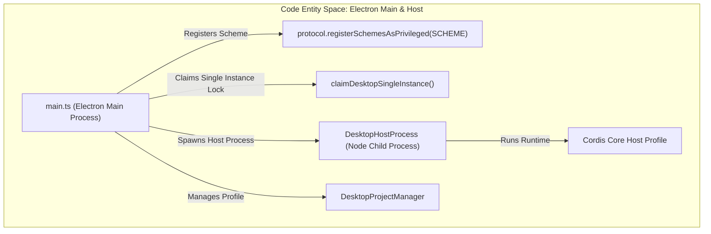
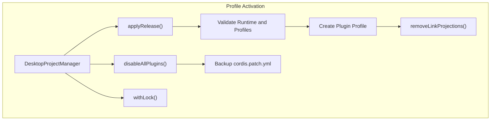
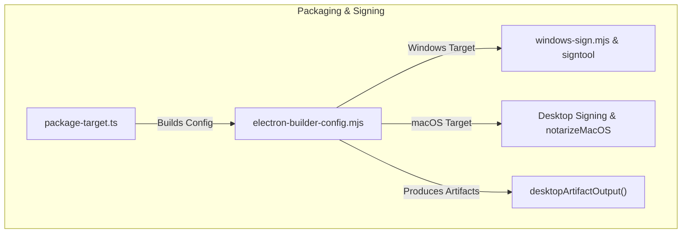
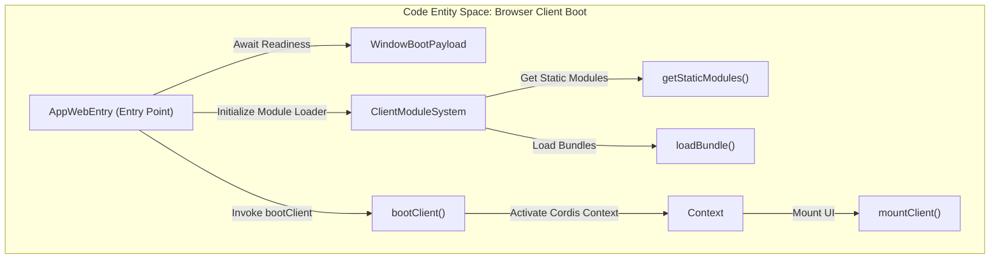
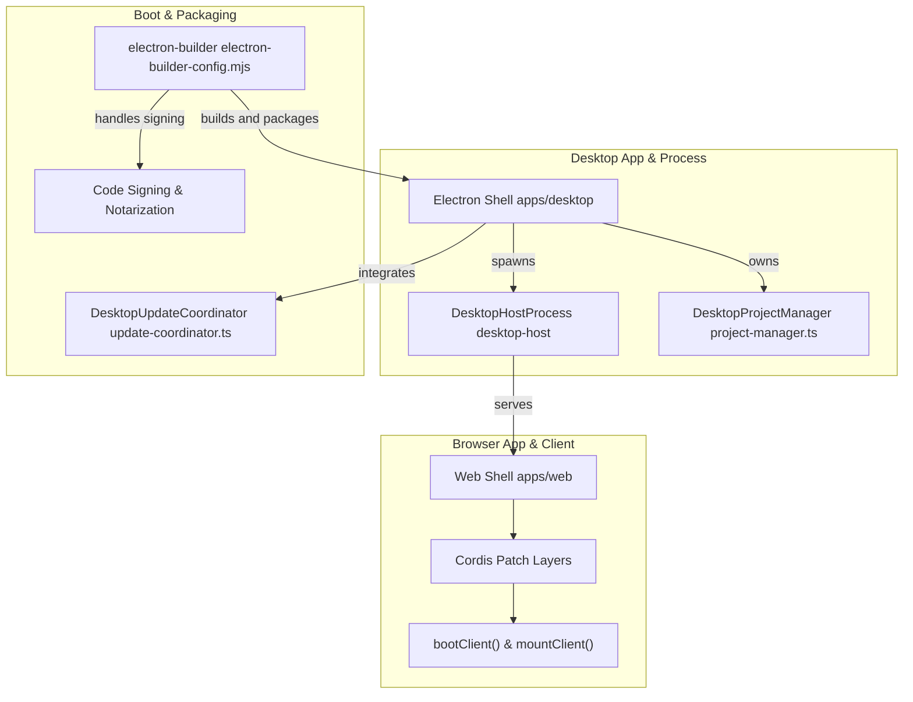

# Desktop App & Web Shell Packaging

Relevant source files

The following files were used as context for generating this wiki page:

- [.agents/notes/implemented/architecture/2026-08-25-electron-desktop-packaging-and-updates.i18n.yaml](.agents/notes/implemented/architecture/2026-08-25-electron-desktop-packaging-and-updates.i18n.yaml)
- [.agents/notes/implemented/architecture/2026-08-25-electron-desktop-packaging-and-updates.md](.agents/notes/implemented/architecture/2026-08-25-electron-desktop-packaging-and-updates.md)
- [.agents/notes/implemented/architecture/2026-08-25-electron-desktop-packaging-and-updates.zh.md](.agents/notes/implemented/architecture/2026-08-25-electron-desktop-packaging-and-updates.zh.md)
- [.agents/notes/implemented/architecture/2026-09-15-desktop-native-fatal-recovery.i18n.yaml](.agents/notes/implemented/architecture/2026-09-15-desktop-native-fatal-recovery.i18n.yaml)
- [.agents/notes/implemented/architecture/2026-09-15-desktop-native-fatal-recovery.md](.agents/notes/implemented/architecture/2026-09-15-desktop-native-fatal-recovery.md)
- [.agents/notes/implemented/architecture/2026-09-15-desktop-native-fatal-recovery.zh.md](.agents/notes/implemented/architecture/2026-09-15-desktop-native-fatal-recovery.zh.md)
- [.github/workflows/ci-windows.yml](.github/workflows/ci-windows.yml)
- [.github/workflows/macos-package.yml](.github/workflows/macos-package.yml)
- [.github/workflows/windows-package.yml](.github/workflows/windows-package.yml)
- [apps/cli/tests/profiles/sdk/keyless-smoke.e2e.ts](apps/cli/tests/profiles/sdk/keyless-smoke.e2e.ts)
- [apps/desktop-host/src/index.ts](apps/desktop-host/src/index.ts)
- [apps/desktop/.env.macos.example](apps/desktop/.env.macos.example)
- [apps/desktop/.env.windows.example](apps/desktop/.env.windows.example)
- [apps/desktop/README.i18n.yaml](apps/desktop/README.i18n.yaml)
- [apps/desktop/README.md](apps/desktop/README.md)
- [apps/desktop/README.zh.md](apps/desktop/README.zh.md)
- [apps/desktop/electron-builder.config.d.mts](apps/desktop/electron-builder.config.d.mts)
- [apps/desktop/electron-builder.config.mjs](apps/desktop/electron-builder.config.mjs)
- [apps/desktop/packaging/README.i18n.yaml](apps/desktop/packaging/README.i18n.yaml)
- [apps/desktop/packaging/README.md](apps/desktop/packaging/README.md)
- [apps/desktop/packaging/README.zh.md](apps/desktop/packaging/README.zh.md)
- [apps/desktop/scripts/desktop-build-paths.d.mts](apps/desktop/scripts/desktop-build-paths.d.mts)
- [apps/desktop/scripts/desktop-build-paths.mjs](apps/desktop/scripts/desktop-build-paths.mjs)
- [apps/desktop/scripts/desktop-package-environment.d.mts](apps/desktop/scripts/desktop-package-environment.d.mts)
- [apps/desktop/scripts/desktop-package-environment.mjs](apps/desktop/scripts/desktop-package-environment.mjs)
- [apps/desktop/scripts/electron-builder-config.mjs](apps/desktop/scripts/electron-builder-config.mjs)
- [apps/desktop/scripts/macos-runtime.ts](apps/desktop/scripts/macos-runtime.ts)
- [apps/desktop/scripts/node-x64-entitlements.plist](apps/desktop/scripts/node-x64-entitlements.plist)
- [apps/desktop/scripts/package-target.ts](apps/desktop/scripts/package-target.ts)
- [apps/desktop/scripts/prepare-dsh.ts](apps/desktop/scripts/prepare-dsh.ts)
- [apps/desktop/scripts/run-windows-runner-network-process.ps1](apps/desktop/scripts/run-windows-runner-network-process.ps1)
- [apps/desktop/scripts/run-windows-runner-task.ps1](apps/desktop/scripts/run-windows-runner-task.ps1)
- [apps/desktop/scripts/smoke-packaged-runtime.ts](apps/desktop/scripts/smoke-packaged-runtime.ts)
- [apps/desktop/scripts/windows-runner-launcher.cs](apps/desktop/scripts/windows-runner-launcher.cs)
- [apps/desktop/scripts/windows-runner-network.ps1](apps/desktop/scripts/windows-runner-network.ps1)
- [apps/desktop/scripts/windows-runner-task.ps1](apps/desktop/scripts/windows-runner-task.ps1)
- [apps/desktop/scripts/windows-token-identity.ts](apps/desktop/scripts/windows-token-identity.ts)
- [apps/desktop/src/client/WelcomePage.tsx](apps/desktop/src/client/WelcomePage.tsx)
- [apps/desktop/src/host-process.ts](apps/desktop/src/host-process.ts)
- [apps/desktop/src/locale.ts](apps/desktop/src/locale.ts)
- [apps/desktop/src/main.ts](apps/desktop/src/main.ts)
- [apps/desktop/src/preload-welcome.ts](apps/desktop/src/preload-welcome.ts)
- [apps/desktop/src/project-manager.ts](apps/desktop/src/project-manager.ts)
- [apps/desktop/src/welcome-api.ts](apps/desktop/src/welcome-api.ts)
- [apps/desktop/src/welcome-window.ts](apps/desktop/src/welcome-window.ts)
- [apps/desktop/tests/desktop-build-paths.spec.ts](apps/desktop/tests/desktop-build-paths.spec.ts)
- [apps/desktop/tests/desktop-package-environment.spec.ts](apps/desktop/tests/desktop-package-environment.spec.ts)
- [apps/desktop/tests/expected/fatal-dialog-en.txt](apps/desktop/tests/expected/fatal-dialog-en.txt)
- [apps/desktop/tests/expected/fatal-dialog-zh-CN.txt](apps/desktop/tests/expected/fatal-dialog-zh-CN.txt)
- [apps/desktop/tests/host-process.spec.ts](apps/desktop/tests/host-process.spec.ts)
- [apps/desktop/tests/installer-packaging.spec.ts](apps/desktop/tests/installer-packaging.spec.ts)
- [apps/desktop/tests/macos-cache-policy.spec.ts](apps/desktop/tests/macos-cache-policy.spec.ts)
- [apps/desktop/tests/macos-runtime.spec.ts](apps/desktop/tests/macos-runtime.spec.ts)
- [apps/desktop/tests/macos-signature.spec.ts](apps/desktop/tests/macos-signature.spec.ts)
- [apps/desktop/tests/main-startup.spec.ts](apps/desktop/tests/main-startup.spec.ts)
- [apps/desktop/tests/package-target-stages.spec.ts](apps/desktop/tests/package-target-stages.spec.ts)
- [apps/desktop/tests/preload.e2e.ts](apps/desktop/tests/preload.e2e.ts)
- [apps/desktop/tests/project-manager.spec.ts](apps/desktop/tests/project-manager.spec.ts)
- [apps/desktop/tests/welcome-renderer.client.spec.tsx](apps/desktop/tests/welcome-renderer.client.spec.tsx)
- [apps/desktop/tests/welcome-startup.spec.ts](apps/desktop/tests/welcome-startup.spec.ts)
- [apps/desktop/tests/welcome-window.spec.ts](apps/desktop/tests/welcome-window.spec.ts)
- [apps/desktop/tests/windows-runner-launcher.ps1](apps/desktop/tests/windows-runner-launcher.ps1)
- [apps/desktop/tests/windows-runner-network-process.ps1](apps/desktop/tests/windows-runner-network-process.ps1)
- [apps/desktop/tests/windows-runner-network.ps1](apps/desktop/tests/windows-runner-network.ps1)
- [apps/desktop/tests/windows-runner-task.ps1](apps/desktop/tests/windows-runner-task.ps1)
- [apps/desktop/tests/windows-token-identity.spec.ts](apps/desktop/tests/windows-token-identity.spec.ts)
- [apps/desktop/windows-signing/README.i18n.yaml](apps/desktop/windows-signing/README.i18n.yaml)
- [apps/desktop/windows-signing/README.md](apps/desktop/windows-signing/README.md)
- [apps/desktop/windows-signing/README.zh.md](apps/desktop/windows-signing/README.zh.md)
- [packages/bundle/sdk-app/README.i18n.yaml](packages/bundle/sdk-app/README.i18n.yaml)
- [packages/bundle/sdk-app/README.md](packages/bundle/sdk-app/README.md)
- [packages/bundle/sdk-app/README.zh.md](packages/bundle/sdk-app/README.zh.md)
- [packages/bundle/sdk-app/cordis.patch.yml](packages/bundle/sdk-app/cordis.patch.yml)
- [packages/skill/tool-workspace-dependencies/README.i18n.yaml](packages/skill/tool-workspace-dependencies/README.i18n.yaml)
- [packages/skill/tool-workspace-dependencies/README.md](packages/skill/tool-workspace-dependencies/README.md)
- [packages/skill/tool-workspace-dependencies/README.zh.md](packages/skill/tool-workspace-dependencies/README.zh.md)
- [packages/skill/tool-workspace-dependencies/src/index.ts](packages/skill/tool-workspace-dependencies/src/index.ts)
- [packages/skill/tool-workspace-dependencies/tests/primary-runtime-copy.spec.ts](packages/skill/tool-workspace-dependencies/tests/primary-runtime-copy.spec.ts)
- [packages/skill/tool-workspace-dependencies/tests/tool-workspace-dependencies.spec.ts](packages/skill/tool-workspace-dependencies/tests/tool-workspace-dependencies.spec.ts)
- [scripts/macos-package-workflow.spec.ts](scripts/macos-package-workflow.spec.ts)
- [scripts/npm-platform.ts](scripts/npm-platform.ts)
- [scripts/primary-runtime/prepare.spec.ts](scripts/primary-runtime/prepare.spec.ts)
- [scripts/primary-runtime/prepare.ts](scripts/primary-runtime/prepare.ts)
- [scripts/primary-runtime/smoke.py](scripts/primary-runtime/smoke.py)
- [scripts/windows-package-workflow.spec.ts](scripts/windows-package-workflow.spec.ts)

This page covers the architecture, packaging, and boot mechanics of the Electron desktop application (`apps/desktop`, `desktop-host`) and the Vite web shell (`apps/web`). It details host process management, exclusive profile ownership, platform-specific packaging, signing, notarization, auto-updates, bundled runtime dependencies, and the client module loader boot graph.

---

## 1. Electron Desktop Shell & Host Process Management

The desktop application wraps the `dsh` web application inside an Electron container without opening any listening network port. Electron's main process (`apps/desktop/src/main.ts`) initializes the environment, registers privileged custom URI schemes via `protocol.registerSchemesAsPrivileged()` to secure the `dsh-app://` scheme, enforces single-instance locks, and spawns a private upstream Node.js child process (`DesktopHostProcess`) that boots the installed project [apps/desktop/README.md:35-40](), [apps/desktop/src/main.ts:25-40](), [apps/desktop/src/main.ts:134-144]().

*Figure 1: Code entity mapping of Electron main process, single-instance enforcement, and host process boot.*

Sources:
- `apps/desktop/README.md` [apps/desktop/README.md:35-43]()
- `apps/desktop/src/main.ts` [apps/desktop/src/main.ts:25-45]()
- `apps/desktop/tests/main-startup.spec.ts` [apps/desktop/tests/main-startup.spec.ts:35-45]()

### Host Process Lifecycle & IPC

- **Single-Instance Enforcement**: The desktop shell ensures only one instance runs by acquiring a lock on the desktop profile directory (`$DSH_HOME/profiles/desktop/lock`). This prevents conflicting modifications or multiple active hosts [.agents/notes/implemented/architecture/2026-08-25-electron-desktop-packaging-and-updates.md:25-30]() [apps/desktop/src/main.ts:35]().
- **Custom Protocols & Asset Forwarding**: The Electron shell registers the `dsh-app` URL scheme with privileged permissions, including support for CORS, streaming responses, fetch API, and code caching [apps/desktop/src/main.ts:134-144]().
- **Renderer Process Security**: All renderer windows are created with `nodeIntegration: false`, `contextIsolation: true`, and `sandbox: true` to prevent Node.js access in the browser context [.agents/notes/implemented/architecture/2026-08-25-electron-desktop-packaging-and-updates.md:40-45]() [apps/desktop/README.md:35-45]().

Sources:
- `apps/desktop/README.md` [apps/desktop/README.md:35-45]()
- `apps/desktop/src/main.ts` [apps/desktop/src/main.ts:134-144]()
- `.agents/notes/implemented/architecture/2026-08-25-electron-desktop-packaging-and-updates.md` [.agents/notes/implemented/architecture/2026-08-25-electron-desktop-packaging-and-updates.md:25-45]()

---

## 2. Profile Activation & Package Management

The Electron desktop shell exclusively owns the desktop profile directory (`$DSH_HOME/profiles/desktop`) and its package manager state [.agents/notes/implemented/architecture/2026-08-25-electron-desktop-packaging-and-updates.md:20-30]() [apps/desktop/src/project-manager.ts:1-30]().

### `DesktopProjectManager` Responsibilities

The class `DesktopProjectManager` orchestrates profile activation and recovery in the Electron environment:

1. **Profile Initialization**: Sets up a baseline profile with required manifests and package references [apps/desktop/src/project-manager.ts:60-90]().
2. **Release Application (`applyRelease`)**: Prepares the production release profile by validating and cleaning application packages [apps/desktop/src/project-manager.ts:80-100]().
3. **Profile Locking**: Applies file locks to prevent race conditions during profile mutations [apps/desktop/src/project-manager.ts:90-120]().
4. **Plugin Disabling & Recovery**: Provides a safe recovery path by disabling third-party bundles and backing up patch files (`cordis.patch.yml`) [apps/desktop/src/project-manager.ts:100-140]().

*Figure 2: Desktop profile lifecycle management within Electron shell.*

Sources:
- `apps/desktop/README.md` [apps/desktop/README.md:15-25]()
- `apps/desktop/src/project-manager.ts` [apps/desktop/src/project-manager.ts:60-140]()
- `apps/desktop/tests/project-manager.spec.ts` [apps/desktop/tests/project-manager.spec.ts:1-50]()

---

## 3. Packaging, Code Signing & Notarization Targets

The desktop app packaging process uses `electron-builder` configured via `apps/desktop/scripts/electron-builder-config.mjs` and orchestrated through `apps/desktop/scripts/package-target.ts` [apps/desktop/scripts/package-target.ts:50-85](), [apps/desktop/scripts/electron-builder-config.mjs:46-70]().

### Configuration & Automation

- **Platform Targets**: Supports `mac-arm64`, `mac-x64`, and `win-x64` targets [apps/desktop/scripts/package-target.ts:50-85]().
- **Windows Token Signing**: Uses `signtool` via helper utilities to sign PE executables and NSIS installers [apps/desktop/scripts/electron-builder-config.mjs:75-95]().
- **macOS Notarization**: Applies entitlements, rigid code-signing rules (`signIgnore`), and submits artifacts for Apple notarization [apps/desktop/tests/macos-signature.spec.ts:48-95]().

*Figure 3: Code entity flow for target packaging, signing, and artifact generation.*

Sources:
- `apps/desktop/scripts/package-target.ts` [apps/desktop/scripts/package-target.ts:50-85]()
- `apps/desktop/scripts/electron-builder-config.mjs` [apps/desktop/scripts/electron-builder-config.mjs:46-95]()
- `apps/desktop/tests/macos-signature.spec.ts` [apps/desktop/tests/macos-signature.spec.ts:48-95]()

---

## 4. Auto-Updates & Local Runtime Environments

The desktop application integrates an update coordinator (`DesktopUpdateCoordinator`) that manages staging, verifying checksums, downloading updates via `electron-updater`, and prompting users before restarting [apps/desktop/README.md:70-75](). Furthermore, the application ships with a pinned `pnpm` distribution (`resources/runtime/primary-runtime/dependencies/pnpm`) to handle dependency operations without relying on host environments [apps/desktop/README.md:43-45]().

Sources:
- `apps/desktop/README.md` [apps/desktop/README.md:43-45]()
- `apps/desktop/README.md` [apps/desktop/README.md:70-75]()

---

## 5. Web Shell, Vite Bundle Pipeline, and Client Boot Graph

The browser UI app is served from inside the Electron shell via the custom `dsh-app://` protocol and is built using Vite [apps/web/package.json:1-35]().

*Figure 4: Code entity flow from browser entry point through module loading and UI rendering.*

Sources:
- `apps/web/package.json` [apps/web/package.json:1-35]()

---

## Summary Diagram: Natural Language System Names to Core Code Entities

*Figure 5: Bridging natural language subsystems to concrete code entities and processes.*

Sources:
- `apps/desktop/README.md` [apps/desktop/README.md:1-45]()
- `apps/desktop/src/main.ts` [apps/desktop/src/main.ts:25-144]()

---

## References

| Topic | Files |
|---|---|
| Electron shell and host main process | `apps/desktop/src/main.ts` |
| Profile management and recovery | `apps/desktop/src/project-manager.ts` |
| Electron packaging and signing | `apps/desktop/scripts/electron-builder-config.mjs` |
| Target packaging logic | `apps/desktop/scripts/package-target.ts` |
| Web client boot and build config | `apps/web/package.json` |

Sources:  
- `apps/desktop/README.md` [apps/desktop/README.md:1-45]()  
- `apps/desktop/src/main.ts` [apps/desktop/src/main.ts:25-144]()  
- `apps/desktop/src/project-manager.ts` [apps/desktop/src/project-manager.ts:60-140]()  
- `apps/desktop/scripts/package-target.ts` [apps/desktop/scripts/package-target.ts:50-85]()  
- `apps/desktop/scripts/electron-builder-config.mjs` [apps/desktop/scripts/electron-builder-config.mjs:46-95]()  
- `apps/desktop/tests/macos-signature.spec.ts` [apps/desktop/tests/macos-signature.spec.ts:48-95]()  
- `apps/web/package.json` [apps/web/package.json:1-35]()