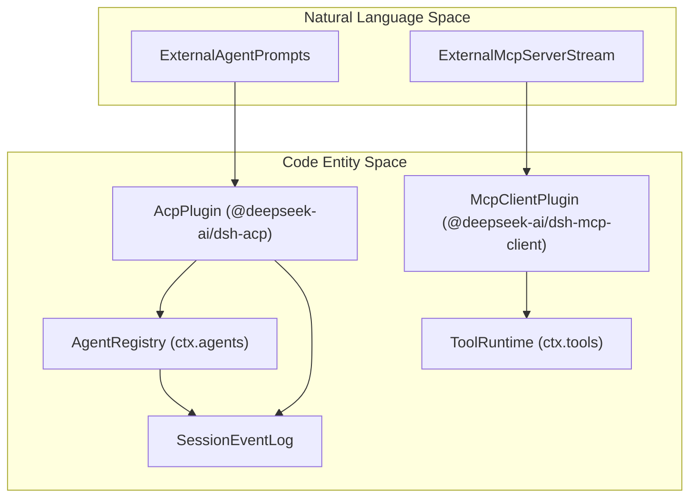
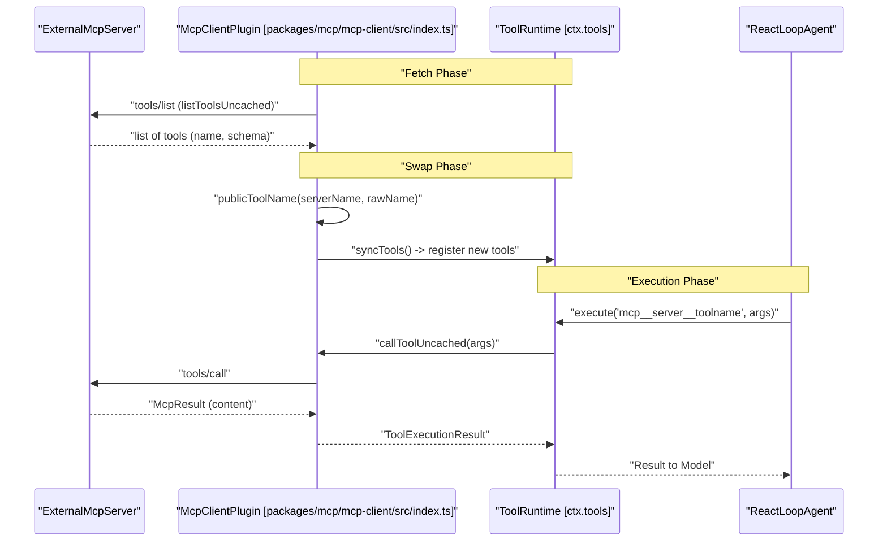

# Extensions & Integrations

Relevant source files

The following files were used as context for generating this wiki page:

- [.agents/notes/implemented/simplification/2026-07-23-acp-automation-only-protocol.i18n.yaml](.agents/notes/implemented/simplification/2026-07-23-acp-automation-only-protocol.i18n.yaml)
- [.agents/notes/implemented/simplification/2026-07-23-acp-automation-only-protocol.md](.agents/notes/implemented/simplification/2026-07-23-acp-automation-only-protocol.md)
- [.agents/notes/implemented/simplification/2026-07-23-acp-automation-only-protocol.zh.md](.agents/notes/implemented/simplification/2026-07-23-acp-automation-only-protocol.zh.md)
- [packages/acp/acp/README.i18n.yaml](packages/acp/acp/README.i18n.yaml)
- [packages/acp/acp/README.md](packages/acp/acp/README.md)
- [packages/acp/acp/README.zh.md](packages/acp/acp/README.zh.md)
- [packages/acp/acp/src/codec.ts](packages/acp/acp/src/codec.ts)
- [packages/acp/acp/src/index.ts](packages/acp/acp/src/index.ts)
- [packages/acp/acp/src/model-control.ts](packages/acp/acp/src/model-control.ts)
- [packages/acp/acp/src/session.ts](packages/acp/acp/src/session.ts)
- [packages/acp/acp/tests/bridge.spec.ts](packages/acp/acp/tests/bridge.spec.ts)
- [packages/acp/acp/tests/codec.spec.ts](packages/acp/acp/tests/codec.spec.ts)
- [packages/acp/acp/tests/dispose.spec.ts](packages/acp/acp/tests/dispose.spec.ts)
- [packages/acp/acp/tests/edges.spec.ts](packages/acp/acp/tests/edges.spec.ts)
- [packages/acp/acp/tests/harness.ts](packages/acp/acp/tests/harness.ts)
- [packages/acp/acp/tests/model-control.spec.ts](packages/acp/acp/tests/model-control.spec.ts)
- [packages/acp/acp/tests/turns.spec.ts](packages/acp/acp/tests/turns.spec.ts)
- [packages/core/agent/src/model-selection.ts](packages/core/agent/src/model-selection.ts)
- [packages/core/agent/tests/model-selection.spec.ts](packages/core/agent/tests/model-selection.spec.ts)
- [packages/sdk/server/tests/wait.spec.ts](packages/sdk/server/tests/wait.spec.ts)
- [snapshots/session/model-switch-notice/model-switch-driver.mjs](snapshots/session/model-switch-notice/model-switch-driver.mjs)

The DeepSeek Harness (DSH) architecture supports extensibility through optional extension packages and standardized protocols. This page provides a high-level overview of optional extension packages that bridge DSH with external tool ecosystems, automation clients, and high-level task management frameworks.

These extensions enable integration with external Model Context Protocol (MCP) servers, programmatic agent control via standard protocols, advanced goal and workflow management, Python bindings, and experimental browser runtime environments.

For details on specific subsystems, consult the child pages:
- [ACP Protocol & Agent Communication](#7.1)
- [MCP Client, Hooks & Skills](#7.2)
- [Goals, Todos, Workflows & Web Tools](#7.3)
- [Python SDK & Runtime Distribution](#7.4)
- [Experimental Packages: Agent Teams, WebWorker Runtime & Inspector](#7.5)
- [LiveShare: Session Sharing & Tunnel Protocol](#7.6)

---

## 7.1 ACP Protocol & Agent Communication

The Agent Client Protocol (ACP) plugin (`acp`) implements a JSON-RPC stdio server exposing DeepSeek Harness sessions to programmatic clients. This automation interface allows external controllers—such as test runners, subagents, or scripted automation clients—to drive persistent agents without relying on the browser UI.

Key components include:
- **Session Management:** Creation, listing, resuming, and closure of persistent agent sessions managed via `AcpSession` `[packages/acp/acp/src/session.ts:101-142]`.
- **Turn Codec & Lifecycle:** Conversion of internal agent `SessionEvent` streams into ACP protocol messages, ensuring committed outputs are relayed `[packages/acp/acp/src/index.ts:134-137]`.
- **Cancellation & Disposal:** Orderly shutdown by cancelling ongoing prompts and draining continuable subagents before releasing session resources `[packages/acp/acp/tests/dispose.spec.ts:20-88]`.

For details, see [ACP Protocol & Agent Communication](#7.1).

Sources: `[packages/acp/acp/src/index.ts:134-137]`, `[packages/acp/acp/src/session.ts:101-142]`, `[packages/acp/acp/tests/dispose.spec.ts:20-88]`

---

## 7.2 MCP Client, Hooks & Skills

DeepSeek Harness connects to external Model Context Protocol (MCP) servers through the `dsh-mcp-client` plugin, mounting servers as namespaces under the global tool registry (`ctx.tools`).

### MCP Client Bridge
- Supports multiple transport methods, including standard IO child processes and Streamable HTTP `[packages/mcp/mcp-client/src/index.ts:52-104]()`.
- Tools are discovered through paginated calls to MCP's `tools/list`, then registered under normalized public tool names via `publicToolName()` `[packages/mcp/mcp-client/src/tools.ts:81-87]()`.
- Synchronization follows a two-phase process (Fetch and Swap phases) in `syncTools()` to atomically update tool catalogs `[packages/mcp/mcp-client/src/tools.ts:113-154]()`.

### Hooks & Skills
- **Hooks protocols** (`hooks-codex`, `hooks-claude-code`) facilitate dynamic interception of agent turns before tool execution.
- The **Skills system** (`@deepseek-ai/dsh-skill`) manages a registry of curated agent instruction sets `[packages/skill/skill/src/index.ts:1-110]()`.
- The `@deepseek-ai/dsh-tool-skill` package exposes a `skill` loader tool for agent instruction integration `[packages/skill/tool-skill/src/index.ts:81-161]()`.

For details, see [MCP Client, Hooks & Skills](#7.2).

Sources: `[packages/mcp/mcp-client/src/index.ts:52-104]()`, `[packages/mcp/mcp-client/src/tools.ts:81-87]()`, `[packages/mcp/mcp-client/src/tools.ts:113-154]()`, `[packages/skill/skill/src/index.ts:1-110]()`, `[packages/skill/tool-skill/src/index.ts:81-161]()`

---

## 7.3 Goals, Todos, Workflows & Web Tools

DSH extends agent orchestration beyond conversation turns through specialized packages:
- **Goal System:** Persistent tracking of multi-turn objectives via `tool-goal` and `goal-round-driver`.
- **Todo Tracking:** Structured task breakdown and progress tracking via `tool-todo`.
- **Workflows:** Long-running, multi-step processes managed using background workers (`workflow-worker-thread`) and `ui-workflow-run`.
- **Web Tools:** Web fetch and search capabilities supported by schedule and time-context plugins.

For details, see [Goals, Todos, Workflows & Web Tools](#7.3).

Sources: `[packages/acp/acp/src/index.ts:12-115]()`

---

## 7.4 Python SDK & Runtime Distribution

The **Python SDK** (`deepseek-harness-sdk`) exposes DeepSeek Harness functionality to Python applications:
- Provides a JSON-RPC client compatible with the host API.
- Implements a Turns API enabling programmatic creation and control of agent turns.

The **runtime package** (`deepseek-harness-runtime-bin`) bundles DSH as a single-file executable for distribution and deployment.

For details, see [Python SDK & Runtime Distribution](#7.4).

Sources: `[packages/acp/acp/src/index.ts:1-175]()`

---

## 7.5 Experimental Packages: Agent Teams, WebWorker Runtime & Inspector

The `packages/experimental` workspace hosts emerging modules:
- **Agent Teams:** Defines profiles and coordination rules for multi-agent collaboration.
- **WebWorker Runtime:** Browser-compatible WebWorker runtime with Node builtin shims and storage Virtual File System (VFS).
- **Code Runtime Python & Cordis Inspector:** Experimental sandboxes and diagnostic inspection tools for Cordis plugin graphs.

For details, see [Experimental Packages: Agent Teams, WebWorker Runtime & Inspector](#7.5).

Sources: `[packages/acp/acp/src/index.ts:1-175]()`

---

## 7.6 LiveShare: Session Sharing & Tunnel Protocol

The experimental `liveshare` and `liveshare-protocol` packages establish secure tunnel frames, viewer carrier channels, IPC tokens, and share access modes. They enable relay and gateway roles to expose shared sessions either read-only or interactively across remote boundaries.

For details, see [LiveShare: Session Sharing & Tunnel Protocol](#7.6).

Sources: `[packages/acp/acp/src/index.ts:1-175]()`

---

## Architecture Overview: Integration Space

Below are diagrams illustrating how natural language interactions and external protocols bridge to code entities within the harness.

Diagram: "ProtocolAndAgentIntegration"

Sources: `[packages/acp/acp/src/index.ts:12-115]`, `[packages/mcp/mcp-client/src/index.ts:1-40]`

Diagram: "McpToolDiscoveryAndExecution"

Sources: `[packages/mcp/mcp-client/src/tools.ts:113-154]`, `[packages/mcp/mcp-client/README.md:28-85]`

---

For technical details and usage guides, see the child pages:
- [ACP Protocol & Agent Communication](#7.1)
- [MCP Client, Hooks & Skills](#7.2)
- [Goals, Todos, Workflows & Web Tools](#7.3)
- [Python SDK & Runtime Distribution](#7.4)
- [Experimental Packages: Agent Teams, WebWorker Runtime & Inspector](#7.5)
- [LiveShare: Session Sharing & Tunnel Protocol](#7.6)