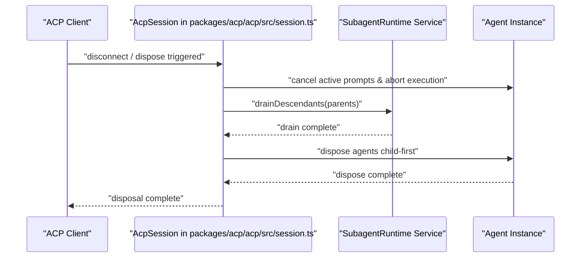
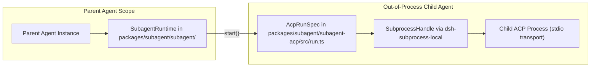

# ACP Protocol & Agent Communication

<details>
<summary>Relevant source files</summary>

The following files were used as context for generating this wiki page:

- [.agents/notes/implemented/simplification/2026-07-23-acp-automation-only-protocol.i18n.yaml](.agents/notes/implemented/simplification/2026-07-23-acp-automation-only-protocol.i18n.yaml)
- [.agents/notes/implemented/simplification/2026-07-23-acp-automation-only-protocol.md](.agents/notes/implemented/simplification/2026-07-23-acp-automation-only-protocol.md)
- [.agents/notes/implemented/simplification/2026-07-23-acp-automation-only-protocol.zh.md](.agents/notes/implemented/simplification/2026-07-23-acp-automation-only-protocol.zh.md)
- [packages/acp/acp/README.i18n.yaml](packages/acp/acp/README.i18n.yaml)
- [packages/acp/acp/README.md](packages/acp/acp/README.md)
- [packages/acp/acp/README.zh.md](packages/acp/acp/README.zh.md)
- [packages/acp/acp/src/codec.ts](packages/acp/acp/src/codec.ts)
- [packages/acp/acp/src/index.ts](packages/acp/acp/src/index.ts)
- [packages/acp/acp/src/model-control.ts](packages/acp/acp/src/model-control.ts)
- [packages/acp/acp/src/session.ts](packages/acp/acp/src/session.ts)
- [packages/acp/acp/tests/bridge.spec.ts](packages/acp/acp/tests/bridge.spec.ts)
- [packages/acp/acp/tests/codec.spec.ts](packages/acp/acp/tests/codec.spec.ts)
- [packages/acp/acp/tests/dispose.spec.ts](packages/acp/acp/tests/dispose.spec.ts)
- [packages/acp/acp/tests/edges.spec.ts](packages/acp/acp/tests/edges.spec.ts)
- [packages/acp/acp/tests/harness.ts](packages/acp/acp/tests/harness.ts)
- [packages/acp/acp/tests/model-control.spec.ts](packages/acp/acp/tests/model-control.spec.ts)
- [packages/acp/acp/tests/turns.spec.ts](packages/acp/acp/tests/turns.spec.ts)
- [packages/core/agent/src/model-selection.ts](packages/core/agent/src/model-selection.ts)
- [packages/core/agent/tests/model-selection.spec.ts](packages/core/agent/tests/model-selection.spec.ts)
- [packages/sdk/server/tests/wait.spec.ts](packages/sdk/server/tests/wait.spec.ts)
- [packages/subagent/subagent-acp/README.i18n.yaml](packages/subagent/subagent-acp/README.i18n.yaml)
- [packages/subagent/subagent-acp/README.md](packages/subagent/subagent-acp/README.md)
- [packages/subagent/subagent-acp/README.zh.md](packages/subagent/subagent-acp/README.zh.md)
- [packages/subagent/subagent-acp/src/index.ts](packages/subagent/subagent-acp/src/index.ts)
- [packages/subagent/subagent-acp/src/run.ts](packages/subagent/subagent-acp/src/run.ts)
- [packages/subagent/subagent-acp/tests/mock-acp-server.ts](packages/subagent/subagent-acp/tests/mock-acp-server.ts)
- [packages/subagent/subagent-acp/tests/subagent-acp.spec.ts](packages/subagent/subagent-acp/tests/subagent-acp.spec.ts)
- [snapshots/session/model-switch-notice/model-switch-driver.mjs](snapshots/session/model-switch-notice/model-switch-driver.mjs)

</details>


The Agent Client Protocol (ACP) is a JSON-RPC 2.0-based automation-focused protocol used in DeepSeek Harness (`dsh`) via `@deepseek-ai/dsh-acp` (`packages/acp/acp`) to enable programmatic communication with agents. It defines a strict streaming wire protocol for parent-child agent interactions, subagent orchestration, and integration with external ACP-compatible agent processes.

This page provides an in-depth technical overview of ACP in DeepSeek Harness focusing on the turn codec, dispose semantics, the `acp-agent` example, and how ACP is employed for subagent orchestration, including key implementation details, data flow, and relevant classes/functions.

---

## Overview of ACP in DeepSeek Harness

DeepSeek Harness uses ACP as a dedicated automation protocol with the following characteristics:

- **Stream-based JSON-RPC**: ACP operates over newline-delimited JSON frames on standard I/O streams (`stdin`/`stdout`), with unrelated logs strictly segregated to `stderr` to guarantee protocol purity `packages/acp/acp/README.md:36-37()`.
- **Process Isolation**: Each child agent using ACP runs in a distinct subprocess with its own session, model instantiation, tools, and runtime environment `packages/subagent/subagent-acp/README.md:12-32()`.
- **Automation-Only Boundary**: As detailed in implementation notes, ACP acts as an automation transport rather than an interactive UI `.agents/notes/implemented/simplification/2026-07-23-acp-automation-only-protocol.md:10-23()`. It manages persistent sessions, model options, stdio/HTTP MCP mounts, prompt submission, committed updates, cancellation, and one-shot permissions `packages/acp/acp/README.md:10-13()`.

### Architectural Context Diagram: Natural Language to Code Entity Space

```mermaid
graph TD
    subgraph "Natural Language Space"
        ExternalClient["External Client Process"]
        ServerBridge["ACP Server Bridge"]
        SessionRecord["Session Record Manager"]
    end

    subgraph "Code Entity Space"
        SDKClient["Client `@agentclientprotocol/sdk`"]
        ApplyFn["`apply()` in `packages/acp/acp/src/index.ts`"]
        AcpSessionClass["`AcpSession` in `packages/acp/acp/src/session.ts`"]
        AgentInst["`Agent` instance via `ctx.agents.create()`"]
    end

    ExternalClient --> SDKClient
    ServerBridge --> ApplyFn
    SessionRecord --> AcpSessionClass
    
    SDKClient -- "JSON-RPC stdio" --> ApplyFn
    ApplyFn -- "instantiates" --> AcpSessionClass
    AcpSessionClass -- "drives" --> AgentInst
```

The ACP client (`@agentclientprotocol/sdk`) communicates with the ACP server bridge implemented by the `dsh-acp` plugin (`packages/acp/acp/src/index.ts`), which instantiates `AcpSession` records (`packages/acp/acp/src/session.ts`) to mediate between external ACP sessions and internal dsh agent lifecycles `packages/acp/acp/src/index.ts:60-156()`, `packages/acp/acp/src/session.ts:101-142()`.

Sources: `packages/acp/acp/src/index.ts:1-156()`, `packages/acp/acp/src/session.ts:101-142()`, `packages/subagent/subagent-acp/README.md:12-32()`, `.agents/notes/implemented/simplification/2026-07-23-acp-automation-only-protocol.md:10-23()`

---

## Turn Codec & Lifecycle Management

ACP encapsulates agent interactions as discrete prompt-response "turns" with fine-grained lifecycle and cancellation semantics managed per session `packages/acp/acp/src/session.ts:50-65()`.

### Turn Correlation and Control Flow

- The ACP client calls `session/prompt` with a batched prompt payload `packages/acp/acp/README.md:70-71()`.
- The per-session module (`AcpSession`) snapshots the selected model route, validates raster images via `AttachmentStore`, and manages prompt admission `packages/acp/acp/src/session.ts:101-176()`, `.agents/notes/implemented/simplification/2026-07-23-acp-automation-only-protocol.md:21()`.
- Upon prompt resolution, the internal stop reason is translated through `turnEndToStopReason` (`packages/acp/acp/src/codec.ts`) into standard ACP `StopReason` strings (`end_turn`, `max_tokens`, `cancelled`) `packages/acp/acp/src/codec.ts:1-16()`.
- Permission requests (`session/request_permission`) sent by the child are wired to one-shot allow/reject options via `ctx.on('approval/request', ...)` in `packages/acp/acp/src/index.ts` `packages/acp/acp/src/index.ts:159-174()`.

### Internal Codec: Mapping DSH to ACP Content Blocks

The `dsh-acp` plugin employs a codec layer (`packages/acp/acp/src/codec.ts`) and update transformers that convert internal session event types to ACP-compliant content blocks on the wire:

| DSH Internal Type           | ACP Message Type              | Description                                 |
|----------------------------|------------------------------|---------------------------------------------|
| `assistant_message_chunk`   | `agent_message_chunk` (text) | Streamed assistant text blocks in sequence `packages/acp/acp/tests/turns.spec.ts:30-36()` |
| `assistant_message_chunk`   | `agent_message_chunk` (image)| Base64-encoded inline verified images `packages/acp/acp/tests/turns.spec.ts:78-102()` |
| `TurnEndReason` enum         | ACP `StopReason` strings      | Mapped stop reasons for agent termination via `turnEndToStopReason` `packages/acp/acp/src/codec.ts:1-16()` |

This codec enforces strict ordering and validation.

### Diagram: Turn Codec Mapping

```mermaid
graph LR
    subgraph "Natural Language Space"
        StopReasonConcept["Agent Termination Reason"]
    end

    subgraph "Code Entity Space"
        TurnEndEnum["`TurnEndReason` enum"]
        CodecFn["`turnEndToStopReason()` in `packages/acp/acp/src/codec.ts`"]
        WireStop["ACP `StopReason` wire message"]
    end

    StopReasonConcept --> TurnEndEnum
    TurnEndEnum --> CodecFn
    CodecFn --> WireStop
```

Sources: `packages/acp/acp/src/index.ts:125-174()`, `packages/acp/acp/src/codec.ts:1-16()`, `packages/acp/acp/src/session.ts:50-65()`, `packages/acp/acp/tests/turns.spec.ts:25-102()`

---

## Dispose Semantics & Controlled Teardown

ACP connections and agent lifecycles observe strict dispose protocols for clean shutdown, resource reclamation, and failure handling `packages/acp/acp/tests/dispose.spec.ts:20-64()`.

### Dispose Sequence

Disposal proceeds as follows upon client disconnect or plugin shutdown:

1. **Cancel Active Prompts:** Ongoing prompt turns receive cancellation signals to abort futures gracefully `packages/acp/acp/tests/dispose.spec.ts:20-32()`.
2. **Drain Continuable Subagents:** Descendant activations are drained via `drainDescendants` before releasing parent agents `packages/acp/acp/tests/dispose.spec.ts:65-88()`.
3. **Dispose Owned Agents:** The plugin disposes all owned agents in child-first order, ensuring persistence flushes and consistent final session state `packages/acp/acp/src/session.ts:118-121()`, `packages/acp/acp/tests/dispose.spec.ts:143-149()`.
4. **Aggregate & Report Errors:** Disposal errors are logged without blocking the overall dispose process `packages/acp/acp/tests/dispose.spec.ts:126-141()`.

### Diagram: Dispose Flow



This orderly teardown prevents orphaned subprocesses and provides structured diagnostics on premature terminations.

Sources: `packages/acp/acp/src/index.ts:97-123()`, `packages/acp/acp/src/session.ts:110-122()`, `packages/acp/acp/tests/dispose.spec.ts:16-124()`

---

## The `subagent-acp` Provider & Out-of-Process Orchestration

The package `@deepseek-ai/dsh-subagent-acp` implements an ACP client-backed out-of-process subagent provider that allows spawning and controlling child agents in separate processes `packages/subagent/subagent-acp/src/index.ts:1-159()`.

### Features and Implementation

- **Spawn Fresh Processes Per Run:** Spawns a new process with configured command, arguments, environment, and working directory `packages/subagent/subagent-acp/src/run.ts:29-73()`.
- **ACP Client Lifecycle Driving:** Uses the official ACP client SDK (`@agentclientprotocol/sdk`) to perform session handshakes (`initialize`, `newSession`), prompt exchanges, and stdio JSON-RPC communication `packages/subagent/subagent-acp/src/run.ts:11-18()`.
- **Permission Auto-Answer:** Automatically answers permission requests based on configuration `packages/subagent/subagent-acp/src/run.ts:26-42()`.
- **Stop Reason Translation:** Maps ACP stop reasons to dsh standardized stop reasons (`completed`, `max-tokens`) `packages/subagent/subagent-acp/README.md:66-67()`.
- **Dispose Semantics & Teardown:** Implements graceful signal escalation and process termination `packages/subagent/subagent-acp/src/run.ts:55-86()`.

### Diagram: Subagent Orchestration Architecture



Sources: `packages/subagent/subagent-acp/src/index.ts:20-159()`, `packages/subagent/subagent-acp/src/run.ts:1-180()`, `packages/subagent/subagent-acp/README.md:10-75()`

---

## Testing & Wire Protocol Verification

Robust ACP implementation is validated through dedicated test suites verifying wire protocol correctness, codec mappings, and disposal invariants.

### Test Coverage Highlights

- **Prompt Lifecycle Tests (`packages/acp/acp/tests/turns.spec.ts`):** Validates max-token reporting, assistant image base64 verification, prompt ordering, and missing attachment failures `packages/acp/acp/tests/turns.spec.ts:70-159()`.
- **Connection Ownership & Disposal (`packages/acp/acp/tests/dispose.spec.ts`):** Tests prompt cancellation on disposal, asynchronous attachment delivery draining, and continuable subagent teardown `packages/acp/acp/tests/dispose.spec.ts:20-141()`.
- **Codec Mappings (`packages/acp/acp/tests/codec.spec.ts`):** Asserts deterministic mapping of Cordis/DSH `TurnEndReason` variants to ACP stop reasons `packages/acp/acp/tests/codec.spec.ts:5-16()`.
- **Keyless Integration Tests (`packages/subagent/subagent-acp/tests/subagent-acp.spec.ts`):** Spawns a real subprocess running the scripted mock server (`packages/subagent/subagent-acp/tests/mock-acp-server.ts`) to exercise connection setup, client callbacks, prompt round-trips, stop reasons, cancellation, and quiescent disposal end-to-end `packages/subagent/subagent-acp/tests/subagent-acp.spec.ts:22-30()`.

Sources: `packages/acp/acp/tests/turns.spec.ts:1-159()`, `packages/acp/acp/tests/dispose.spec.ts:1-150()`, `packages/subagent/subagent-acp/tests/subagent-acp.spec.ts:1-100()`