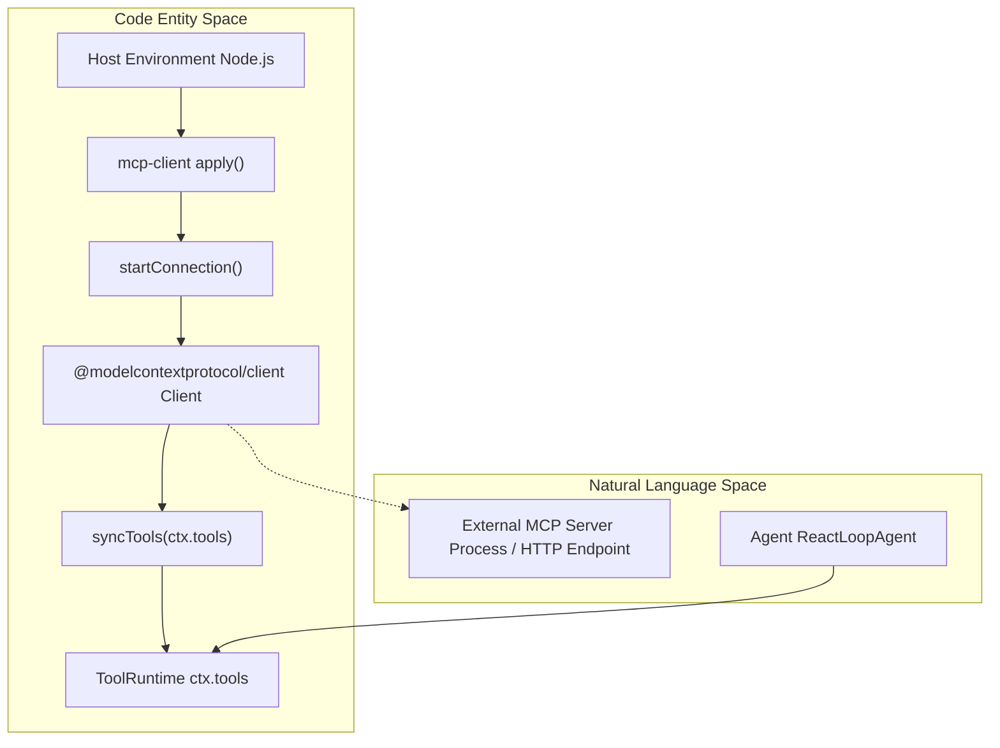
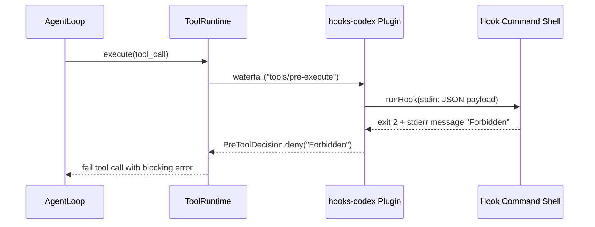
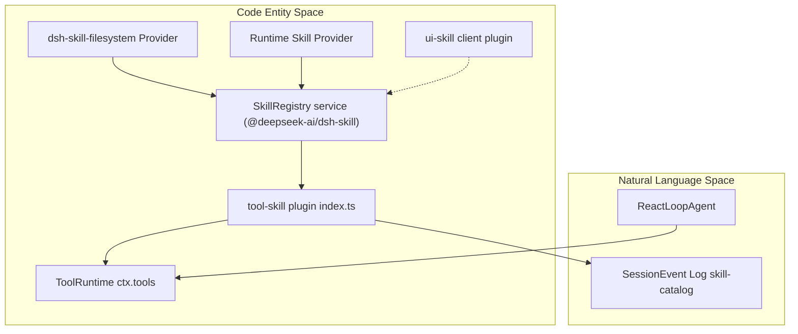

# MCP Client, Hooks & Skills

<details>
<summary>Relevant source files</summary>

The following files were used as context for generating this wiki page:

- [apps/cli/tests/optional-bundle-transitions.e2e.ts](apps/cli/tests/optional-bundle-transitions.e2e.ts)
- [docs/subsystems/skills.i18n.yaml](docs/subsystems/skills.i18n.yaml)
- [docs/subsystems/skills.md](docs/subsystems/skills.md)
- [docs/subsystems/skills.zh.md](docs/subsystems/skills.zh.md)
- [docs/tool-catalog.i18n.yaml](docs/tool-catalog.i18n.yaml)
- [docs/tool-catalog.md](docs/tool-catalog.md)
- [docs/tool-catalog.zh.md](docs/tool-catalog.zh.md)
- [packages/core/tools/tests/gen-tool-catalog.spec.ts](packages/core/tools/tests/gen-tool-catalog.spec.ts)
- [packages/skill/skill-filesystem/README.i18n.yaml](packages/skill/skill-filesystem/README.i18n.yaml)
- [packages/skill/skill-filesystem/README.md](packages/skill/skill-filesystem/README.md)
- [packages/skill/skill-filesystem/README.zh.md](packages/skill/skill-filesystem/README.zh.md)
- [packages/skill/skill-filesystem/src/index.ts](packages/skill/skill-filesystem/src/index.ts)
- [packages/skill/skill-filesystem/tests/skill-filesystem.spec.ts](packages/skill/skill-filesystem/tests/skill-filesystem.spec.ts)
- [packages/skill/skill/README.i18n.yaml](packages/skill/skill/README.i18n.yaml)
- [packages/skill/skill/README.md](packages/skill/skill/README.md)
- [packages/skill/skill/README.zh.md](packages/skill/skill/README.zh.md)
- [packages/skill/skill/src/index.ts](packages/skill/skill/src/index.ts)
- [packages/skill/skill/tests/skill.spec.ts](packages/skill/skill/tests/skill.spec.ts)
- [packages/skill/tool-skill/README.i18n.yaml](packages/skill/tool-skill/README.i18n.yaml)
- [packages/skill/tool-skill/README.md](packages/skill/tool-skill/README.md)
- [packages/skill/tool-skill/README.zh.md](packages/skill/tool-skill/README.zh.md)
- [packages/skill/tool-skill/src/index.ts](packages/skill/tool-skill/src/index.ts)
- [packages/skill/tool-skill/tests/tool-skill.spec.ts](packages/skill/tool-skill/tests/tool-skill.spec.ts)
- [scripts/gen-tool-catalog.ts](scripts/gen-tool-catalog.ts)
- [scripts/snapshots/python-sdk-single-exe/minimal/model-visible.json](scripts/snapshots/python-sdk-single-exe/minimal/model-visible.json)
- [scripts/snapshots/python-sdk-single-exe/minimal/win-x64/model-visible.json](scripts/snapshots/python-sdk-single-exe/minimal/win-x64/model-visible.json)
- [snapshots/sdk/desktop-context/tool-schemas.expected.json](snapshots/sdk/desktop-context/tool-schemas.expected.json)
- [snapshots/sdk/desktop-ptc-context/system-prompt.expected.md](snapshots/sdk/desktop-ptc-context/system-prompt.expected.md)
- [snapshots/web/cordis-tool-round/tool-schemas.expected.json](snapshots/web/cordis-tool-round/tool-schemas.expected.json)
- [snapshots/web/fresh-round-trip/tool-schemas.expected.json](snapshots/web/fresh-round-trip/tool-schemas.expected.json)
- [snapshots/web/minimal-preset/tool-schemas.expected.json](snapshots/web/minimal-preset/tool-schemas.expected.json)
- [snapshots/web/official-subagent-bundle/system-prompt.expected.md](snapshots/web/official-subagent-bundle/system-prompt.expected.md)
- [snapshots/web/optional-string-editor/session.v4.jsonl](snapshots/web/optional-string-editor/session.v4.jsonl)
- [snapshots/web/optional-string-editor/system-prompt.expected.md](snapshots/web/optional-string-editor/system-prompt.expected.md)
- [snapshots/web/optional-string-editor/tool-schemas.expected.json](snapshots/web/optional-string-editor/tool-schemas.expected.json)
- [snapshots/web/ptc-round/system-prompt.expected.md](snapshots/web/ptc-round/system-prompt.expected.md)

</details>


The DeepSeek Harness (`dsh`) integrates external tools, pre-tool interception protocols, and durable instruction sets through three core extension subsystems: the **Model Context Protocol (MCP)** client bridge (`@deepseek-ai/dsh-mcp-client`), the **Hook Protocol** (`@deepseek-ai/dsh-hooks-codex`, `@deepseek-ai/dsh-hooks-claude-code`, and `@deepseek-ai/dsh-hook-protocol`), and the **Skill System** (`@deepseek-ai/dsh-skill`, `@deepseek-ai/dsh-tool-skill`, and `@deepseek-ai/dsh-client-ui-skill`).

---

## 1. MCP Client Bridge

The `mcp-client` plugin connects `dsh` to external MCP servers, projecting remote tools into the local `ctx.tools` registry `[packages/mcp/mcp-client/src/index.ts:1-153]()`. Each plugin instance manages one connection to a specific MCP server, enabling external tool capabilities to be seamlessly integrated into the agent environment.

### 1.1 Implementation & Tool Namespacing

To prevent naming collisions when multiple MCP clients connect to different servers, remote tools are registered under a deterministic namespaced identifier:

```
mcp__<serverName>__<rawToolName>
```

The `publicToolName(serverName: string, rawName: string): string` function enforces DeepSeek's function-name constraints on resulting tool names `[packages/mcp/mcp-client/src/tools.ts:48-87]()`:

- Allowed characters: `[A-Za-z0-9_-]`
- Maximum length: 64 characters

If the raw normalized name exceeds 64 characters or differs after normalization, it is truncated and suffixed by a 12-character SHA-256 hash derived from `(serverName, rawName)` to guarantee uniqueness and stability `[packages/mcp/mcp-client/src/tools.ts:81-87]()`.

Sources:
- `[packages/mcp/mcp-client/src/tools.ts:48-87]()`
- `[packages/mcp/mcp-client/src/tools.ts:81-87]()`

### 1.2 Connection Lifecycle and Transport

The MCP client supports multiple transport methods `[packages/mcp/mcp-client/src/connection.ts:100-106]()`:

- **Stdio**: Spawns an MCP server subprocess, communicating over stdin/stdout.
- **Streamable HTTP**: Opens a persistent HTTP or Server-Sent Events (SSE) connection.

Plugin startup flow:
1. The configured server namespace is reserved in `ctx.tools` ensuring no duplicates.
2. The connection is established using the configured transport.
3. The client fetches tools from the server via a paged `tools/list` API `[packages/mcp/mcp-client/src/tools.ts:119-123]()`.
4. Tools are registered atomically in the local tool registry with namespaced names `[packages/mcp/mcp-client/src/tools.ts:145-151]()`.
5. The client listens for tool list changes to maintain synchronization `[packages/mcp/mcp-client/tests/apply.spec.ts:31-33]()`.
6. Reconnection and retry logic with exponential backoff manages network/interruption resilience `[packages/mcp/mcp-client/README.md:64-67]()`.

Upon plugin disposal, the MCP client disconnects from the server and unregisters its tools atomically.

Sources:
- `[packages/mcp/mcp-client/src/connection.ts:100-106]()`
- `[packages/mcp/mcp-client/src/tools.ts:119-123]()`
- `[packages/mcp/mcp-client/src/tools.ts:145-151]()`
- `[packages/mcp/mcp-client/tests/apply.spec.ts:31-33]()`
- `[packages/mcp/mcp-client/README.md:64-67]()`

### 1.3 Data Flow Architecture

Title: "MCP Client Bridge Architecture & Code Mapping"



**Explanation:**
- The MCP client plugin initializes in the host environment via `apply()` `[packages/mcp/mcp-client/tests/apply.spec.ts:31-33]()`.
- It invokes `startConnection()` to instantiate the MCP SDK client connected to the remote MCP server `[packages/mcp/mcp-client/src/connection.ts:100-106]()`.
- Retrieved tools are synchronized and registered into the global tool runtime registry (`ctx.tools`) `[packages/mcp/mcp-client/src/tools.ts:113-154]()`.

Sources:
- `[packages/mcp/mcp-client/src/index.ts:1-153]()`
- `[packages/mcp/mcp-client/src/tools.ts:48-87]()`
- `[packages/mcp/mcp-client/src/tools.ts:113-154]()`
- `[packages/mcp/mcp-client/src/connection.ts:100-106]()`
- `[packages/mcp/mcp-client/tests/apply.spec.ts:31-33]()`

---

## 2. Hook Protocol

The Hook Protocol enables pre-tool and lifecycle interception through external command hooks. Two dialects support popular use cases:

- **hooks-codex**: Implements Codex's `hooks.json` hook format `[packages/hooks/hooks-codex/src/index.ts:113-160]()`.
- **hooks-claude-code**: Implements Claude Code's hook dialect.

Both dialects share base semantics and runtime from the `@deepseek-ai/dsh-hook-protocol` package `[packages/hooks/hook-protocol/README.md:1-85]()`.

### 2.1 Dialect Bridge: Codex Hooks (`hooks-codex`)

The `hooks-codex` plugin loads a `hooks.json` file defining externally executable command hooks for agent lifecycle and tool execution interception `[packages/hooks/hooks-codex/src/index.ts:130-157]()`:

| Hook Event    | Harness Extension Point  | Functionality                         |
| ------------- | ----------------------- | ----------------------------------- |
| `SessionStart`| Detached Session Start  | Attach context during session init  |
| `UserPromptSubmit` | `agent/pre-step` waterfall | Intercept and rewrite user prompts  |
| `PreToolUse`  | `tools/pre-execute` waterfall | Optionally block tool execution     |
| `PostToolUse` | `tools/post-execute` waterfall | Amend context or veto tool results  |
| `Stop`        | `agent/turn-stopping` listener | Influence turn stop behavior        |

Hooks run synchronously as shell commands in the session cwd using the harness shell executor (`dsh-shell`). Input data is serialized as JSON with snake_case fields and no trailing newlines `[packages/hooks/hook-protocol/README.md:20-80]()`.

Exit codes determine hook behavior:
- Exit code **2**: block the operation. The hook's stderr is used as a blocking message.
- Other nonzero codes: logged as warnings but non-blocking.
- Hooks can add context via stdout that is appended to the next prompt as injected instructions `[packages/hooks/hook-protocol/README.md:65-75]()`.

Sources:
- `[packages/hooks/hooks-codex/src/index.ts:113-160]()`
- `[packages/hooks/hooks-codex/src/index.ts:130-157]()`
- `[packages/hooks/hook-protocol/README.md:1-85]()`
- `[packages/hooks/hook-protocol/README.md:20-80]()`
- `[packages/hooks/hook-protocol/README.md:65-75]()`

### 2.2 Outcome Integration with Agent Lifecycle

When hooks deny agent actions (prompt or tool call), the agent run aborts the step and emits a detailed error message to the session log.

Context provided by hooks is appended as durable injected instructions before the model prompt or tool invocation. The bridge emits paired durable session events `hook/invoked` and `hook/result` for audit and traceability `[packages/hooks/hooks-codex/tests/bridge.spec.ts:69-88]()`.

Sources:
- `[packages/hooks/hooks-codex/tests/bridge.spec.ts:69-88]()`

### 2.3 Example Hook Interception Flow

Title: "Hook Interception Sequence Flow"



**Explanation:**
- When `ToolRuntime` processes an incoming tool execution, it triggers the `tools/pre-execute` waterfall intercepted by `hooks-codex`.
- The external shell command receives the serialized payload and exits with code 2, resulting in a denial decision that aborts tool execution.

Sources:
- `[packages/hooks/hooks-codex/src/index.ts:113-160]()`
- `[packages/hooks/hooks-codex/src/index.ts:130-157]()`
- `[packages/hooks/hook-protocol/README.md:1-85]()`
- `[packages/hooks/hook-protocol/README.md:20-80]()`
- `[packages/hooks/hook-protocol/README.md:65-75]()`
- `[packages/hooks/hooks-codex/tests/bridge.spec.ts:69-88]()`

---

## 3. Skill System

The Skill System manages durable, reusable instruction sets called *skills* that define agent behaviors and instructions, authored as Markdown with frontmatter metadata.

### 3.1 Skill Registry Core (`@deepseek-ai/dsh-skill`)

The core skill package owns the Service Definition role of the skill capability seam `[packages/skill/skill/src/index.ts:1-11]()`. It provides:
- Aggregated skill catalogs from multiple providers (filesystem, runtime, bundled) for dynamic extensibility `[packages/skill/skill/src/index.ts:35-74]()`.
- Conflict resolution by rank ordering and registration sequence.
- Validation that skill names are kebab-case identifiers via `isSkillName(name)` `[packages/skill/tool-skill/src/index.ts:129-131]()`.
- Metadata describing invocation policies (`isModelInvocable`, `isUserInvocable`), resource bases (`directory`, `url`, `opaque`), and origin information `[packages/skill/tool-skill/src/index.ts:140-149]()`.

Skill resource base types:
```ts
type SkillResourceBase =
  | { readonly kind: 'directory'; readonly path: string }
  | { readonly kind: 'url'; readonly url: string }
  | { readonly kind: 'opaque'; readonly description: string }
```

Sources:
- `[packages/skill/skill/src/index.ts:1-11]()`
- `[packages/skill/skill/src/index.ts:35-74]()`
- `[packages/skill/tool-skill/src/index.ts:129-131]()`
- `[packages/skill/tool-skill/src/index.ts:140-149]()`

### 3.2 Durable Skill Catalog & `tool-skill` Plugin

The `@deepseek-ai/dsh-tool-skill` plugin `[packages/skill/tool-skill/src/index.ts:1-27]()` registers a `skill` tool with the `ToolRuntime` `[packages/skill/tool-skill/src/index.ts:82-163]()` that:
- Requires an exact skill name parameter `[packages/skill/tool-skill/src/index.ts:83-87]()`.
- Validates the skill is model-invocable via `isModelInvocable(summary)` before loading `[packages/skill/tool-skill/src/index.ts:140-142]()`.
- Returns full skill instructions, provider name, and resource base `[packages/skill/tool-skill/src/index.ts:150-157]()`.
- Renders skill content as Markdown in the tool output for the model `[packages/skill/tool-skill/src/index.ts:126]()`.

In addition, it maintains a durable session skill catalog emitted into sessions via annotated `user/message` events with source `skill-catalog` `[packages/skill/tool-skill/src/index.ts:35-48]()`.

Sources:
- `[packages/skill/tool-skill/src/index.ts:1-27]()`
- `[packages/skill/tool-skill/src/index.ts:35-48]()`
- `[packages/skill/tool-skill/src/index.ts:82-163]()`
- `[packages/skill/tool-skill/src/index.ts:83-87]()`
- `[packages/skill/tool-skill/src/index.ts:126]()`
- `[packages/skill/tool-skill/src/index.ts:140-142]()`
- `[packages/skill/tool-skill/src/index.ts:150-157]()`

### 3.3 User-Explicit Skill Invocation & Client UI (`ui-skill`)

User messages beginning with `/` or matching `/name` where `name` corresponds to a user-invocable skill are detected deterministically as explicit skill invocation gestures.

The browser half (`@deepseek-ai/dsh-client-ui-skill`) manages suggestion fetching from the `skills/list` Remote, maintaining a session-keyed catalog cache with single-flight promises `[packages/client/ui-skill/src/client/index.ts:1-127]()`. It renders dedicated skill tool rows (`SkillRow.tsx`) and handles selection gestures `[packages/client/ui-skill/src/client/index.ts:89-92]()`.

Sources:
- `[packages/client/ui-skill/src/client/index.ts:1-127]()`
- `[packages/client/ui-skill/src/client/index.ts:89-92]()`

### 3.4 Skill System Architecture Diagram

Title: "Skill System Architecture & Integration"



**Explanation:**
- Providers contribute skill candidates to `SkillRegistry`.
- `tool-skill` registers the model-facing `skill` tool into `ToolRuntime` and logs `skill-catalog` message sources into session history.
- `ui-skill` connects the browser client to remote skill listing and UI rendering.

Sources:
- `[packages/skill/skill/src/index.ts:1-11]()`
- `[packages/skill/tool-skill/src/index.ts:1-170]()`
- `[packages/skill/tool-skill/src/index.ts:35-48]()`
- `[packages/skill/tool-skill/src/index.ts:82-163]()`
- `[packages/skill/tool-skill/src/index.ts:140-142]()`
- `[packages/client/ui-skill/src/client/index.ts:1-127]()`
- `[packages/client/ui-skill/src/client/index.ts:89-92]()`

---

# Summary

This page detailed the implementations and data flows for:
- The **MCP Client** bridge connecting external MCP servers to the local tools registry, with stable namespacing and transport reconnection.
- The **Hook Protocol**, especially the Codex-compatible hook bridge that intercepts agent steps and tool executions using external hooks to block or augment behavior.
- The **Skill System**, managing durable skill catalogs, exposing a skill loader tool, and supporting explicit user skill invocation gestures.

---

## Sources

- `[packages/mcp/mcp-client/src/index.ts:1-153]()`
- `[packages/mcp/mcp-client/src/tools.ts:48-87]()`
- `[packages/mcp/mcp-client/src/tools.ts:81-87]()`
- `[packages/mcp/mcp-client/src/tools.ts:113-154]()`
- `[packages/mcp/mcp-client/src/tools.ts:119-123]()`
- `[packages/mcp/mcp-client/src/tools.ts:145-151]()`
- `[packages/mcp/mcp-client/src/connection.ts:100-106]()`
- `[packages/mcp/mcp-client/tests/apply.spec.ts:31-33]()`
- `[packages/mcp/mcp-client/README.md:64-67]()`
- `[packages/hooks/hooks-codex/src/index.ts:113-160]()`
- `[packages/hooks/hooks-codex/src/index.ts:130-157]()`
- `[packages/hooks/hook-protocol/README.md:1-85]()`
- `[packages/hooks/hook-protocol/README.md:20-80]()`
- `[packages/hooks/hook-protocol/README.md:65-75]()`
- `[packages/hooks/hooks-codex/tests/bridge.spec.ts:69-88]()`
- `[packages/skill/skill/src/index.ts:1-11]()`
- `[packages/skill/skill/src/index.ts:35-74]()`
- `[packages/skill/tool-skill/src/index.ts:1-27]()`
- `[packages/skill/tool-skill/src/index.ts:35-48]()`
- `[packages/skill/tool-skill/src/index.ts:82-163]()`
- `[packages/skill/tool-skill/src/index.ts:83-87]()`
- `[packages/skill/tool-skill/src/index.ts:126]()`
- `[packages/skill/tool-skill/src/index.ts:129-131]()`
- `[packages/skill/tool-skill/src/index.ts:140-142]()`
- `[packages/skill/tool-skill/src/index.ts:140-149]()`
- `[packages/skill/tool-skill/src/index.ts:150-157]()`
- `[packages/client/ui-skill/src/client/index.ts:1-127]()`
- `[packages/client/ui-skill/src/client/index.ts:89-92]()`