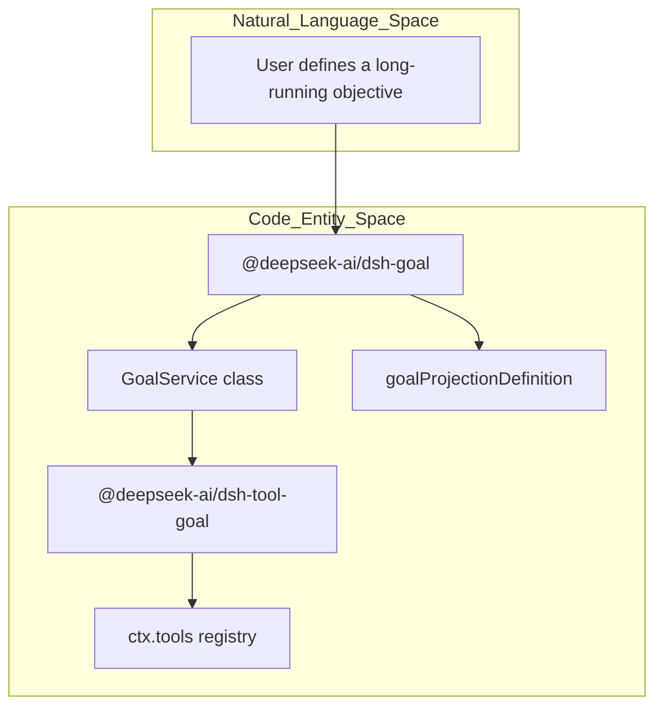
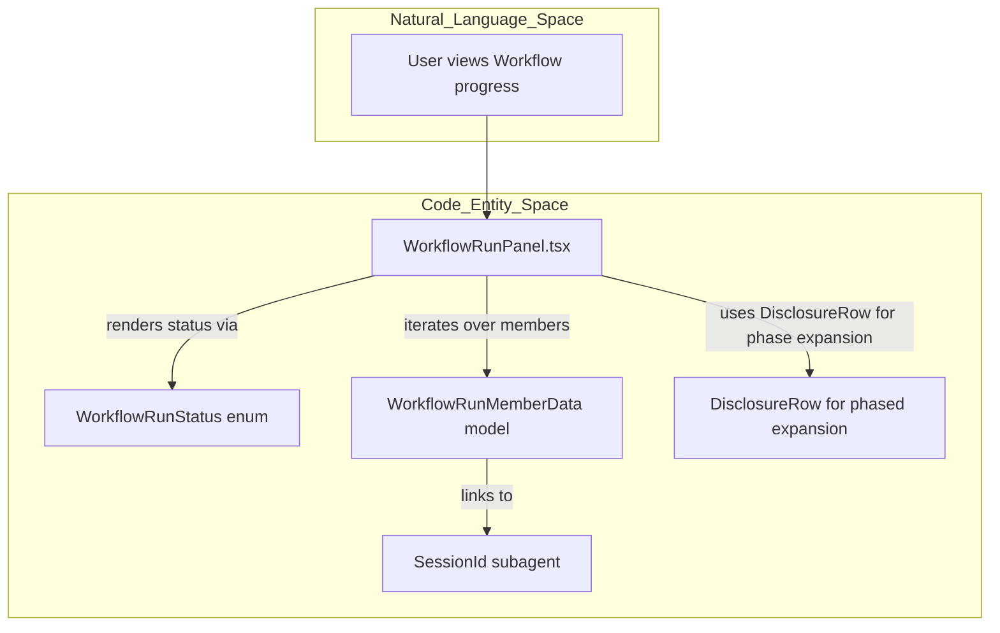
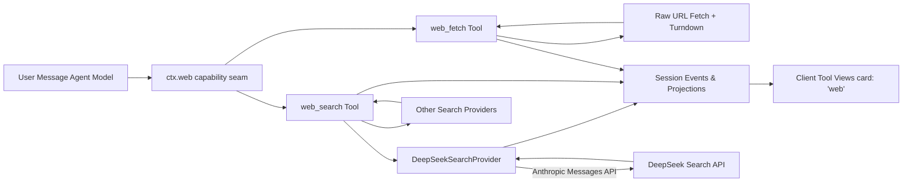
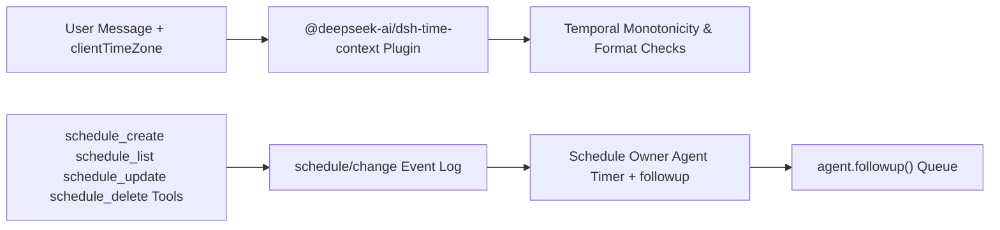
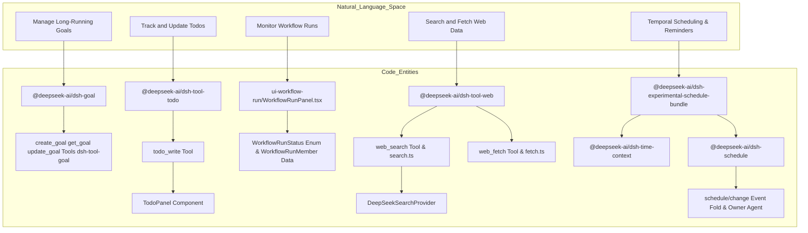

# Goals, Todos, Workflows & Web Tools

Relevant source files

The following files were used as context for generating this wiki page:

- [.agents/notes/implemented/architecture/2026-06-24-web-capability-seam.i18n.yaml](.agents/notes/implemented/architecture/2026-06-24-web-capability-seam.i18n.yaml)
- [.agents/notes/implemented/architecture/2026-06-24-web-capability-seam.md](.agents/notes/implemented/architecture/2026-06-24-web-capability-seam.md)
- [.agents/notes/implemented/architecture/2026-06-24-web-capability-seam.zh.md](.agents/notes/implemented/architecture/2026-06-24-web-capability-seam.zh.md)
- [.agents/notes/implemented/architecture/2026-09-16-host-schedule-storage.i18n.yaml](.agents/notes/implemented/architecture/2026-09-16-host-schedule-storage.i18n.yaml)
- [.agents/notes/implemented/architecture/2026-09-16-host-schedule-storage.md](.agents/notes/implemented/architecture/2026-09-16-host-schedule-storage.md)
- [.agents/notes/implemented/architecture/2026-09-16-host-schedule-storage.zh.md](.agents/notes/implemented/architecture/2026-09-16-host-schedule-storage.zh.md)
- [.agents/notes/implemented/architecture/2026-09-24-scheduled-message-framing.i18n.yaml](.agents/notes/implemented/architecture/2026-09-24-scheduled-message-framing.i18n.yaml)
- [.agents/notes/implemented/architecture/2026-09-24-scheduled-message-framing.md](.agents/notes/implemented/architecture/2026-09-24-scheduled-message-framing.md)
- [.agents/notes/implemented/architecture/2026-09-24-scheduled-message-framing.zh.md](.agents/notes/implemented/architecture/2026-09-24-scheduled-message-framing.zh.md)
- [.agents/notes/implemented/architecture/2026-09-24-shared-time-vocabulary.i18n.yaml](.agents/notes/implemented/architecture/2026-09-24-shared-time-vocabulary.i18n.yaml)
- [.agents/notes/implemented/architecture/2026-09-24-shared-time-vocabulary.md](.agents/notes/implemented/architecture/2026-09-24-shared-time-vocabulary.md)
- [.agents/notes/implemented/architecture/2026-09-24-shared-time-vocabulary.zh.md](.agents/notes/implemented/architecture/2026-09-24-shared-time-vocabulary.zh.md)
- [.agents/notes/implemented/architecture/2026-09-27-web-search-offered-by-provider-readiness.i18n.yaml](.agents/notes/implemented/architecture/2026-09-27-web-search-offered-by-provider-readiness.i18n.yaml)
- [.agents/notes/implemented/architecture/2026-09-27-web-search-offered-by-provider-readiness.md](.agents/notes/implemented/architecture/2026-09-27-web-search-offered-by-provider-readiness.md)
- [.agents/notes/implemented/architecture/2026-09-27-web-search-offered-by-provider-readiness.zh.md](.agents/notes/implemented/architecture/2026-09-27-web-search-offered-by-provider-readiness.zh.md)
- [apps/web/tests/assembled-remote.ts](apps/web/tests/assembled-remote.ts)
- [apps/web/tests/max-tokens-notice.expected.e2e.ts](apps/web/tests/max-tokens-notice.expected.e2e.ts)
- [apps/web/tests/schedule-after.e2e.ts](apps/web/tests/schedule-after.e2e.ts)
- [apps/web/tests/search-card.expected.e2e.ts](apps/web/tests/search-card.expected.e2e.ts)
- [apps/web/tests/todo-row.expected.e2e.ts](apps/web/tests/todo-row.expected.e2e.ts)
- [apps/web/tests/trajectory-image-display.expected.e2e.ts](apps/web/tests/trajectory-image-display.expected.e2e.ts)
- [docs/subsystems/schedule.i18n.yaml](docs/subsystems/schedule.i18n.yaml)
- [docs/subsystems/schedule.md](docs/subsystems/schedule.md)
- [docs/subsystems/schedule.zh.md](docs/subsystems/schedule.zh.md)
- [docs/subsystems/web.i18n.yaml](docs/subsystems/web.i18n.yaml)
- [docs/subsystems/web.md](docs/subsystems/web.md)
- [docs/subsystems/web.zh.md](docs/subsystems/web.zh.md)
- [packages/client/ui-entry-customization/src/client/locales.ts](packages/client/ui-entry-customization/src/client/locales.ts)
- [packages/client/ui-schedule/README.i18n.yaml](packages/client/ui-schedule/README.i18n.yaml)
- [packages/client/ui-schedule/README.md](packages/client/ui-schedule/README.md)
- [packages/client/ui-schedule/README.zh.md](packages/client/ui-schedule/README.zh.md)
- [packages/client/ui-schedule/src/client/DeleteToast.tsx](packages/client/ui-schedule/src/client/DeleteToast.tsx)
- [packages/client/ui-schedule/src/client/TaskManagerPage.module.css](packages/client/ui-schedule/src/client/TaskManagerPage.module.css)
- [packages/client/ui-schedule/src/client/TaskManagerPage.tsx](packages/client/ui-schedule/src/client/TaskManagerPage.tsx)
- [packages/client/ui-schedule/src/client/clear-ended.ts](packages/client/ui-schedule/src/client/clear-ended.ts)
- [packages/client/ui-schedule/src/client/task-manager-locales.ts](packages/client/ui-schedule/src/client/task-manager-locales.ts)
- [packages/client/ui-schedule/tests/browser-plugin.client.spec.ts](packages/client/ui-schedule/tests/browser-plugin.client.spec.ts)
- [packages/client/ui-schedule/tests/delete-toast.client.spec.tsx](packages/client/ui-schedule/tests/delete-toast.client.spec.tsx)
- [packages/client/ui-schedule/tests/task-manager-page.client.spec.tsx](packages/client/ui-schedule/tests/task-manager-page.client.spec.tsx)
- [packages/context/README.i18n.yaml](packages/context/README.i18n.yaml)
- [packages/context/README.md](packages/context/README.md)
- [packages/context/README.zh.md](packages/context/README.zh.md)
- [packages/context/time-context/README.i18n.yaml](packages/context/time-context/README.i18n.yaml)
- [packages/context/time-context/README.md](packages/context/time-context/README.md)
- [packages/context/time-context/README.zh.md](packages/context/time-context/README.zh.md)
- [packages/context/time-context/package.json](packages/context/time-context/package.json)
- [packages/context/time-context/src/index.ts](packages/context/time-context/src/index.ts)
- [packages/context/time-context/src/request-zone.ts](packages/context/time-context/src/request-zone.ts)
- [packages/context/time-context/tests/request-zone.spec.ts](packages/context/time-context/tests/request-zone.spec.ts)
- [packages/context/time-context/tests/time-context.e2e.ts](packages/context/time-context/tests/time-context.e2e.ts)
- [packages/context/time-context/tests/time-context.spec.ts](packages/context/time-context/tests/time-context.spec.ts)
- [packages/context/time-context/tsconfig.json](packages/context/time-context/tsconfig.json)
- [packages/goal/goal/tests/fixtures/domain/seed-goal.ts](packages/goal/goal/tests/fixtures/domain/seed-goal.ts)
- [packages/goal/goal/tests/goal.e2e.ts](packages/goal/goal/tests/goal.e2e.ts)
- [packages/schedule/schedule/README.i18n.yaml](packages/schedule/schedule/README.i18n.yaml)
- [packages/schedule/schedule/README.md](packages/schedule/schedule/README.md)
- [packages/schedule/schedule/README.zh.md](packages/schedule/schedule/README.zh.md)
- [packages/schedule/schedule/src/domain.ts](packages/schedule/schedule/src/domain.ts)
- [packages/schedule/schedule/src/index.ts](packages/schedule/schedule/src/index.ts)
- [packages/schedule/schedule/tests/cron.spec.ts](packages/schedule/schedule/tests/cron.spec.ts)
- [packages/schedule/schedule/tests/daily.spec.ts](packages/schedule/schedule/tests/daily.spec.ts)
- [packages/schedule/schedule/tests/domain.spec.ts](packages/schedule/schedule/tests/domain.spec.ts)
- [packages/schedule/schedule/tests/weekly.spec.ts](packages/schedule/schedule/tests/weekly.spec.ts)
- [packages/util/time/README.i18n.yaml](packages/util/time/README.i18n.yaml)
- [packages/util/time/README.md](packages/util/time/README.md)
- [packages/util/time/README.zh.md](packages/util/time/README.zh.md)
- [packages/util/time/src/duration.ts](packages/util/time/src/duration.ts)
- [packages/util/time/src/index.ts](packages/util/time/src/index.ts)
- [packages/util/time/src/instant.ts](packages/util/time/src/instant.ts)
- [packages/util/time/tests/duration.spec.ts](packages/util/time/tests/duration.spec.ts)
- [packages/util/time/tests/instant.spec.ts](packages/util/time/tests/instant.spec.ts)
- [packages/web/tool-web/README.i18n.yaml](packages/web/tool-web/README.i18n.yaml)
- [packages/web/tool-web/README.md](packages/web/tool-web/README.md)
- [packages/web/tool-web/README.zh.md](packages/web/tool-web/README.zh.md)
- [packages/web/tool-web/src/fetch.ts](packages/web/tool-web/src/fetch.ts)
- [packages/web/tool-web/src/index.ts](packages/web/tool-web/src/index.ts)
- [packages/web/tool-web/src/search.ts](packages/web/tool-web/src/search.ts)
- [packages/web/tool-web/tests/integration.spec.ts](packages/web/tool-web/tests/integration.spec.ts)
- [packages/web/tool-web/tests/tool-web.spec.ts](packages/web/tool-web/tests/tool-web.spec.ts)
- [packages/web/web-search-deepseek/README.i18n.yaml](packages/web/web-search-deepseek/README.i18n.yaml)
- [packages/web/web-search-deepseek/README.md](packages/web/web-search-deepseek/README.md)
- [packages/web/web-search-deepseek/README.zh.md](packages/web/web-search-deepseek/README.zh.md)
- [packages/web/web-search-deepseek/package.json](packages/web/web-search-deepseek/package.json)
- [packages/web/web-search-deepseek/src/index.ts](packages/web/web-search-deepseek/src/index.ts)
- [packages/web/web-search-deepseek/src/provider.ts](packages/web/web-search-deepseek/src/provider.ts)
- [packages/web/web-search-deepseek/tests/deepseek.spec.ts](packages/web/web-search-deepseek/tests/deepseek.spec.ts)
- [packages/web/web-search-deepseek/tsconfig.json](packages/web/web-search-deepseek/tsconfig.json)

This page documents the systems and tools for managing goals, todos, workflow runs, web environment observation, and temporal scheduling in DeepSeek Harness (`dsh`). Together, these subsystems enable autonomous agent planning, progress tracking, multi-step orchestration, external knowledge retrieval, and timed actions.

---

## 1. Goal System

The goal domain implements durable long-running objectives that agents autonomously advance through multiple conversational rounds. This system maintains persistent goal state with phases and revision control supporting concurrency and human-agent collaboration.

### Implementation & Components

- The goal system is implemented as the `@deepseek-ai/dsh-goal` plugin, initialized in `[packages/goal/goal/src/index.ts:1-184]`. It registers three core tools in the global tool registry (`ctx.tools`) via the companion package `@deepseek-ai/dsh-tool-goal` `[packages/goal/tool-goal/src/index.ts:1-343]`:
  - `create_goal`: initializes a new goal.
  - `get_goal`: retrieves the current goal state and metadata.
  - `update_goal`: manages transitions across goal phases (`edit`, `pause`, `resume`, `complete`, `blocked`).

- Core data constructs:
  - **GoalRef**: an identifier with ID and revision for concurrency control `[packages/goal/goal/src/types.ts:1-120]`.
  - **GoalProjectionState**: maintained via session projections for current goal state and validation `[packages/goal/goal/src/index.ts:162-169]`.
  - **GoalRuntimeState**: holds process-local activation and revision state `[packages/goal/goal/src/index.ts:180-184]`.

- Session events of type `goal/change` are strictly folded `[packages/goal/goal/src/index.ts:146-159]` ensuring invariants on phases, rounds, and input validation to produce consistent goal state projections.

- Input validation includes:
  - Rejecting empty or whitespace-only objectives.
  - Enforcing positive integer round caps and validating max rounds.
  - Enforcing exclusive tool execution mode to ensure serialized state updates `[packages/goal/tool-goal/tests/tool-goal.spec.ts:152-167]`.

### Usage & Behavior

- Goals evolve through multiple agent turns/rounds advancing phases `[packages/goal/goal/tests/goal.spec.ts:103-153]`.
- The system emits durable goal change events, from which goal state snapshots are derived.
- Process-local activations (e.g., armed, disarmed) manage continuation and steering states.
- The UI component `GoalBar` (client-side React) presents goal status inline with rich iconography and editing capabilities, utilizing projected goal snapshots and injected activations `[packages/client/ui-goal/src/client/GoalBar.tsx:1-100]`.

Sources:  
[packages/goal/goal/src/index.ts:1-184]()  
[packages/goal/goal/src/index.ts:146-169]()  
[packages/goal/goal/src/index.ts:180-184]()  
[packages/goal/tool-goal/src/index.ts:1-324]()  
[packages/goal/goal/tests/goal.spec.ts:103-153]()  
[packages/goal/tool-goal/tests/tool-goal.spec.ts:152-167]()  
[packages/client/ui-goal/src/client/GoalBar.tsx:1-100]()  
[packages/goal/goal/src/types.ts:1-120]()

---

## 2. Todo Tracking & Standing Plans

The Todo system offers agents a structured task list interface, which they update as a whole snapshot to plan and track progress through multi-step tasks.

### Core Tool: `todo_write`

- Registered by the `@deepseek-ai/dsh-tool-todo` package which depends on session projections for the `todos` state `[packages/todo/tool-todo/src/index.ts:1-100]`.
- The tool expects a complete list of TodoItems each with:
  - `content`: non-empty, trimmed string.
  - `status`: one of `'pending'`, `'in_progress'`, or `'completed'`.
- Validation enforces uniqueness of content strings and concurrency rules:
  - One or several `in_progress` items allowed depending on the deployment flag `allowParallelInProgress`.
- Calls append a `todo/write` event to the Session, and replay is last-write-wins.
- Todo state resets to `null` on each `turn/start` to indicate a new cycle `[packages/todo/tool-todo/src/index.ts:1-100]`.

### UI Integration

- The Todo list is surfaced in the conversation view via a `TodoPanel` React component.
- It displays counts of todo statuses and supports collapsed/expanded views.
- Tools middleware owns presentation rows keyed to each `todo_write` call, enabling consistent replay.
- The design favors session event-backed rendering rather than embedding todos as direct Surface nodes for composability and traceability.

Sources:  
[packages/todo/tool-todo/src/index.ts:1-100]()

---

## 3. Workflow Runs & UI

Workflows enable live monitoring and management of multi-step or multi-agent orchestration runs.

### WorkflowRunPanel (React Component)

- Displays workflow run phases, member session states, and overall status.
- Uses internal enums (`WorkflowRunStatus`) for consistent UI states (e.g., running, completed, failed).
- Auto-expands phases containing active or abnormal workflow members.
- Clicking a workflow member focuses the associated subagent session.
- Implementation located at `[packages/client/ui-workflow-run/src/client/WorkflowRunPanel.tsx]()`, with supporting model types in the same package.

### Data Model & Mapping

- Workflow run members are identified via subagent SessionIds.
- Workflow state is captured by `WorkflowRunStatus` enum and `WorkflowRunMemberData` models.
- Disclosure rows (`DisclosureRow`) provide phased UI expand/collapse behavior.

Sources:  
[packages/client/ui-workflow-run/src/client/WorkflowRunPanel.tsx]()

---

## 4. Web Fetch & Search Tools

The web search and fetch subsystem provides model-facing tools and a web capability seam to query and retrieve web content, integrated with session events and UI cards.

### Web Tools & Capability

- The `@deepseek-ai/dsh-tool-web` package registers two tools:  
  - `web_search`: accepts multiple queries, queries multiple providers concurrently, merges results, disables failing providers, and emits session events for UI cards.  
  - `web_fetch`: fetches raw URLs, converts HTML to Markdown, caps output size, and emits session events presenting fetched content as cards.

- Events emitted have card types `card: 'web'` and kinds `search` or `fetch` for specialized client rendering `[packages/web/tool-web/src/search.ts:1-100]`, `[packages/web/tool-web/src/fetch.ts:1-100]`.

### DeepSeek Search Provider

- Provided by `@deepseek-ai/dsh-web-search-deepseek` as `DeepSeekSearchProvider`.
- Integrates DeepSeek's native server tool identified as `web_search_20250305` `[packages/web/web-search-deepseek/src/provider.ts:15-174]`.
- Calls Anthropic's "Messages" API with formatted requests; maps results into standard `WebSearchResult` format including snippets and answer text.
- Detects availability based on presence of API key or account token resolver `[packages/web/web-search-deepseek/tests/deepseek.spec.ts:164-173]`.
- Maintains secret-free LLM request logs for debugging `[packages/web/web-search-deepseek/src/provider.ts:55-77]`.

### Architecture Diagram

Sources:  
[packages/web/tool-web/src/search.ts:1-100]()  
[packages/web/tool-web/src/fetch.ts:1-100]()  
[packages/web/web-search-deepseek/src/provider.ts:15-174]()  
[packages/web/web-search-deepseek/src/provider.ts:55-77]()  
[packages/web/web-search-deepseek/tests/deepseek.spec.ts:164-173]()

---

## 5. Schedule & Time Context System

The scheduling and time context subsystem combines temporal reasoning, durable reminders, and explicit time zone awareness integrated within conversation sessions. This functionality is optionally bundled and must be explicitly enabled.

### Time Context Plugin (`@deepseek-ai/dsh-time-context`)

- Injects durable clock readings as user messages into session logs per request step, providing timestamps and time zone context `[packages/context/time-context/src/index.ts:1-120]`.

- Computes derived information:
  - Browser or configured IANA time zone for display and interpretation `[packages/context/time-context/src/request-zone.ts:1-80]`.
  - Duration elapsed since previous model-visible user/assistant message for temporal awareness `[packages/context/time-context/src/index.ts:1-120]`.

- Registers a `timeContext` session projection maintaining timestamps and enforcing monotonicity and formatting invariants `[packages/context/time-context/src/invariant.ts:1-90]`.

- Clock readings are visible to models and durable, participating in replay, compaction, and export `[packages/experimental/schedule-bundle/README.md:1-100]`.

### Shared Time Vocabulary (`@deepseek-ai/dsh-util-time`)

- Handles parsing, validation, and domain translation of wall-clock selectors, offsets, and instants across schedule boundaries and time context components `[.agents/notes/implemented/architecture/2026-09-24-shared-time-vocabulary.md:1-32]`.
- `Duration` is implemented as an immutable class providing millisecond spans and whole-part decomposition (`decompose()`) `[.agents/notes/implemented/architecture/2026-09-24-shared-time-vocabulary.md:21]`.
- Parsers such as `parseOffsetInstant`, `parseLocalCalendar`, and `canonicalizeTimeZone` return discriminated results rather than raising errors directly across wire boundaries `[.agents/notes/implemented/architecture/2026-09-24-shared-time-vocabulary.md:15]`.

### Durable Scheduling (`@deepseek-ai/dsh-schedule`)

- Implements durable reminders of several kinds, persisted via `schedule/change` session events `[packages/schedule/schedule/src/index.ts:1-150]`:
  - `after`: reminders delayed some seconds after creation.
  - `at`: reminders scheduled at an absolute time with explicit time zone.
  - `every`: fixed-rate recurring reminders aligned on creation or update.

- Provides strict validation for dates, times, daylight-saving gaps, and progression of scheduled instants.

- A Schedule owner agent manages timers for root agent sessions and injects follow-ups when reminders become due `[packages/schedule/schedule/src/index.ts:1-150]`.

- Schedule tools (`schedule_create`, `schedule_list`, `schedule_update`, `schedule_delete`) are registered within agents' presets only if the schedule service is available `[packages/schedule/tool-schedule/README.md:1-118]`, `[packages/experimental/schedule-bundle/README.md:1-100]`.

- Client UI integration is tested extensively via React client specifications `[packages/client/ui-schedule/tests/task-manager-page.client.spec.tsx:1-138]` and web e2e scenarios `[apps/web/tests/schedule-after.e2e.ts:1-151]`.

### Time Context & Schedule Data Flow Diagram

Sources:  
[packages/context/time-context/src/index.ts:1-120]()  
[packages/context/time-context/src/request-zone.ts:1-80]()  
[packages/context/time-context/src/invariant.ts:1-90]()  
[packages/schedule/schedule/src/index.ts:1-150]()  
[packages/schedule/tool-schedule/README.md:1-118]()  
[packages/experimental/schedule-bundle/README.md:1-100]()  
[packages/client/ui-schedule/tests/task-manager-page.client.spec.tsx:1-138]()  
[apps/web/tests/schedule-after.e2e.ts:1-151]()  
[.agents/notes/implemented/architecture/2026-09-24-shared-time-vocabulary.md:1-32]()

---

## Summary Diagram: System Bridging Natural Language Space to Code Entities

Sources:  
[packages/goal/goal/src/index.ts:1-184]()  
[packages/goal/tool-goal/src/index.ts:1-324]()  
[packages/todo/tool-todo/src/index.ts:1-100]()  
[packages/client/ui-workflow-run/src/client/WorkflowRunPanel.tsx]()  
[packages/web/tool-web/src/search.ts:1-100]()  
[packages/web/tool-web/src/fetch.ts:1-100]()  
[packages/web/web-search-deepseek/src/provider.ts:15-174]()  
[packages/context/time-context/src/index.ts:1-120]()  
[packages/schedule/schedule/src/index.ts:1-150]()  
[packages/experimental/schedule-bundle/README.md:1-100]()

---

## References and Sources

### Goal Domain and Tools  
- [packages/goal/goal/src/index.ts:1-184]()  
- [packages/goal/tool-goal/src/index.ts:1-324]()  
- [packages/goal/goal/tests/goal.spec.ts:103-153]()  
- [packages/goal/tool-goal/tests/tool-goal.spec.ts:152-167]()

### Todo System  
- [packages/todo/tool-todo/src/index.ts:1-100]()  

### Workflow UI  
- [packages/client/ui-workflow-run/src/client/WorkflowRunPanel.tsx]()

### Web Fetch & Search Tools  
- [packages/web/tool-web/src/search.ts:1-100]()  
- [packages/web/tool-web/src/fetch.ts:1-100]()  
- [packages/web/web-search-deepseek/src/provider.ts:15-174]()  
- [packages/web/web-search-deepseek/tests/deepseek.spec.ts:164-173]()

### Schedule & Time Context  
- [packages/context/time-context/src/index.ts:1-120]()  
- [packages/schedule/schedule/src/index.ts:1-150]()  
- [packages/schedule/tool-schedule/README.md:1-118]()  
- [packages/experimental/schedule-bundle/README.md:1-100]()  
- [packages/client/ui-schedule/tests/task-manager-page.client.spec.tsx:1-138]()  
- [apps/web/tests/schedule-after.e2e.ts:1-151]()  
- [.agents/notes/implemented/architecture/2026-09-24-shared-time-vocabulary.md:1-32]()