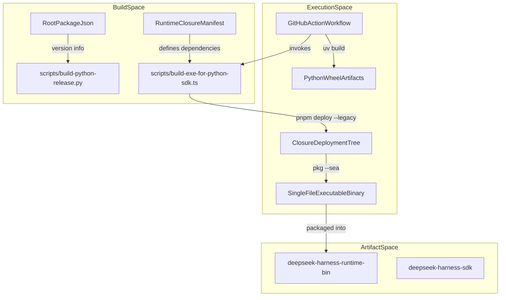

# Python SDK & Runtime Distribution

<details>
<summary>Relevant source files</summary>

The following files were used as context for generating this wiki page:

- [.agents/notes/implemented/architecture/2026-07-10-single-file-executable-sdk-runtime-distribution.i18n.yaml](.agents/notes/implemented/architecture/2026-07-10-single-file-executable-sdk-runtime-distribution.i18n.yaml)
- [.agents/notes/implemented/architecture/2026-07-10-single-file-executable-sdk-runtime-distribution.md](.agents/notes/implemented/architecture/2026-07-10-single-file-executable-sdk-runtime-distribution.md)
- [.agents/notes/implemented/architecture/2026-07-10-single-file-executable-sdk-runtime-distribution.zh.md](.agents/notes/implemented/architecture/2026-07-10-single-file-executable-sdk-runtime-distribution.zh.md)
- [.github/workflows/python-release.yml](.github/workflows/python-release.yml)
- [python/development.i18n.yaml](python/development.i18n.yaml)
- [python/development.md](python/development.md)
- [python/development.zh.md](python/development.zh.md)
- [python/sdk-runtime/README.i18n.yaml](python/sdk-runtime/README.i18n.yaml)
- [python/sdk-runtime/README.md](python/sdk-runtime/README.md)
- [python/sdk-runtime/README.zh.md](python/sdk-runtime/README.zh.md)
- [python/sdk-runtime/hatch_build.py](python/sdk-runtime/hatch_build.py)
- [python/sdk-runtime/src/deepseek_harness_runtime/__init__.py](python/sdk-runtime/src/deepseek_harness_runtime/__init__.py)
- [python/sdk/tests/test_release_version.py](python/sdk/tests/test_release_version.py)
- [python/sdk/tests/test_runtime_resolution.py](python/sdk/tests/test_runtime_resolution.py)
- [python/sdk/tests/test_smoke_model.py](python/sdk/tests/test_smoke_model.py)
- [scripts/build-exe-for-python-sdk.ts](scripts/build-exe-for-python-sdk.ts)
- [scripts/build-python-release.py](scripts/build-python-release.py)
- [scripts/smoke-python-runtime.py](scripts/smoke-python-runtime.py)

</details>


The Python SDK (`deepseek-harness-sdk`) and runtime binary distribution (`deepseek-harness-runtime-bin`) enable Python users to programmatically interact with the DeepSeek Harness (DSH) agent system, which is natively implemented in Node.js [python/sdk-runtime/README.md:5-6](). This ecosystem comprises two tightly coupled components that allow Python developers to invoke advanced agent workflows without requiring a manual Node.js installation [python/sdk-runtime/README.md:5-13]().

Sources: [python/sdk-runtime/README.md:5-13]()

---

## Architecture & Data Flow

The Python SDK acts as client software that lazily spawns the embedded Node.js runtime executable as a subprocess [python/sdk-runtime/README.md:9-10](). Communication occurs over a JSON-RPC protocol tunneled on the subprocess's standard IO streams (`stdin/stdout`) [.agents/notes/implemented/architecture/2026-07-10-single-file-executable-sdk-runtime-distribution.md:9-10](). The runtime subprocess embeds Cordis—the plugin-centric framework powering DSH—including the core agent loop, LLM adapters, and registered tools [.agents/notes/implemented/architecture/2026-07-10-single-file-executable-sdk-runtime-distribution.md:34-41]().

### Diagram: Python SDK & Runtime Component Bridge
```mermaid
graph TD
    subgraph "NaturalLanguageSpace"
        UserSessionRun["UserSessionRun"] -->|invokes| DeepSeekHarnessClient["DeepSeekHarnessClient"]
        DeepSeekHarnessClient -->|spawns| HarnessSubprocessRuntime["HarnessSubprocessRuntime"]
        HarnessSubprocessRuntime -->|JSON-RPC over stdio| SingleFileExecutable["SingleFileExecutable"]
    end

    subgraph "CodeEntitySpace"
        DeepSeekHarnessClient ---|"Defined in python/sdk/src/deepseek_harness/client.py"|
        DeepSeekHarnessAPI["DeepSeekHarness"] ---|"Defined in python/sdk/src/deepseek_harness/api.py"|
        RuntimeModuleAPI["bundled_runtime_path"] ---|"Defined in python/sdk-runtime/src/deepseek_harness_runtime/__init__.py"|
        SingleFileExecutable ---|"Built by scripts/build-exe-for-python-sdk.ts"|
    end

    subgraph "DistributionSpace"
        PkgSDK["deepseek-harness-sdk"] -->|depends on| PkgRuntime["deepseek-harness-runtime-bin"]
    end
```
Sources:  
[python/sdk/src/deepseek_harness/api.py:16-40](), [python/sdk/src/deepseek_harness/client.py:10-100](),  
[python/sdk-runtime/src/deepseek_harness_runtime/__init__.py:49-118](), [scripts/build-exe-for-python-sdk.ts:1-150]()

---

## Runtime Distribution (`deepseek-harness-runtime-bin`) & Resource Management

The runtime package delivers a self-contained Node.js executable embedded in a Python wheel, supporting Linux (x64, arm64), macOS (arm64, x64), and Windows (x64) [python/sdk-runtime/README.md:5-12]().

### Runtime Carriers

| Carrier Type | Description | Use Case |
| --- | --- | --- |
| **Single-File Executable (SEA)** | Native executable (`deepseek-harness-sdk-runtime-<platform>-<arch>`) bundling the Node runtime with a virtual filesystem (`/snapshot/`) of ESM modules [python/sdk-runtime/README.md:11-12](), [.agents/notes/implemented/architecture/2026-07-10-single-file-executable-sdk-runtime-distribution.md:17-20](). | Production runtime [python/sdk-runtime/README.md:39-41]() |
| **Node.js Closure (Development)** | Unpacked Node.js closure under `runtime/node/`; requires system Node.js ≥22 [python/sdk-runtime/README.md:39-41](). | Development and debugging [python/sdk-runtime/README.md:39-41](), [python/sdk-runtime/src/deepseek_harness_runtime/__init__.py:11-15]() |

The SEA executable is built using [@yao-pkg/pkg](https://github.com/yao-pkg/pkg) in enhanced SEA mode [.agents/notes/implemented/architecture/2026-07-10-single-file-executable-sdk-runtime-distribution.md:17-20](). This mode embeds a snapshot virtual filesystem while preserving Node ESM loader behavior, supporting dynamic imports and top-level `await` with no ESM-to-CJS transpilation [.agents/notes/implemented/architecture/2026-07-10-single-file-executable-sdk-runtime-distribution.md:17-20]().

### Module API & Resource Resolution

The runtime module exposes helpers to locate bundles, manage resource downloads, and execute launcher logic [python/sdk-runtime/README.md:43-51]():
- `bundled_package_dir() -> Path` returns the installed module-data root and verifies release metadata [python/sdk-runtime/README.md:45](), [python/sdk-runtime/src/deepseek_harness_runtime/__init__.py:49-55]().
- `bundled_runtime_path() -> Path` returns the platform executable path after validating sidecars (such as ripgrep and spawn helpers) [python/sdk-runtime/README.md:46](), [python/sdk-runtime/src/deepseek_harness_runtime/__init__.py:58-95]().
- `resolve_bundled_launch_args(mode=None) -> tuple[str, ...]` selects between `exe` and `node` modes based on explicit arguments or `DSH_RUNTIME_MODE` [python/sdk-runtime/README.md:47](), [python/sdk-runtime/src/deepseek_harness_runtime/__init__.py:98-118]().
- `download_office() -> Path` and `download_primary_runtime() -> Path` explicitly fetch optional authoring environments and Office sidecars with integrity hashing [python/sdk-runtime/README.md:24-27,48-49]().

Sources:  
[python/sdk-runtime/README.md:5-54](), [python/sdk-runtime/src/deepseek_harness_runtime/__init__.py:1-159](),  
[.agents/notes/implemented/architecture/2026-07-10-single-file-executable-sdk-runtime-distribution.md:17-41]()

---

## Internal Python Code Runtime Protocol (`code-runtime-python`)

The runtime supports executing Python code inside an agent turn (e.g., via the `run_code` tool) by forking a CPython subprocess. This subprocess communicates via a custom JSON-lines protocol over a separate file descriptor (`fd 3`), distinct from standard `stdin/stdout`.

### Protocol Frame Types

| Frame Type | Purpose |
| --- | --- |
| **BootMessage** | Host initiates boot parameters including resource policies. |
| **BootAckMessage** | Python process confirms readiness. |
| **CallMessage** | Python requests a remote method invocation in the runtime host. |
| **ReplyMessage** | Runtime host replies to Python call messages. |
| **LogMessage** | Streamed logs (partial or complete), including truncation indicators. |
| **DoneMessage** | Indicates completion, containing return values or error info. |

### Diagram: Python Code Runtime Protocol Data Flow
```mermaid
flowchart LR
    subgraph "NaturalLanguageSpace"
        HostNode["NodejsHostProcess"] -. spawns .-> PythonChild["PythonSubprocess"]
        HostNode -->|BootMessageFd3| PythonChild
        PythonChild -->|BootAckMessageFd3| HostNode
        PythonChild -->|CallMessageFd3| HostNode
        HostNode -->|ReplyMessageFd3| PythonChild
        PythonChild -->|LogMessageFd3| HostNode
        PythonChild -->|DoneMessageFd3| HostNode
    end

    subgraph "CodeEntitySpace"
        ProtocolDef["ProtocolDefinitions"] ---|"Defined in packages/experimental/code-runtime-python/src/protocol.ts"|
        ProtocolSpec["ProtocolTests"] ---|"Tested in packages/experimental/code-runtime-python/tests/protocol.spec.ts"|
    end
```
Sources:  
[packages/experimental/code-runtime-python/src/protocol.ts:1-155](),  
[packages/experimental/code-runtime-python/tests/protocol.spec.ts:11-110]()

---

## Build & Release Workflow

The build and release pipeline produces versioned Python wheels for `deepseek-harness-sdk` and `deepseek-harness-runtime-bin` [python/sdk-runtime/README.md:5-6](), [python/sdk-runtime/README.md:11-12](). It builds native Node.js single-file executable runtime binaries targeting Linux (x64, arm64), macOS (arm64, x64), and Windows (x64) [python/sdk-runtime/README.md:11-12](), [scripts/build-exe-for-python-sdk.ts:75-78]().

### Diagram: Build & Release Pipeline


### Implementation Details

- Target triples like `node24-linux-x64` are parsed and validated by `Target` in `scripts/build-exe-for-python-sdk.ts` [scripts/build-exe-for-python-sdk.ts:91-156]().
- Uses `pnpm deploy --legacy` to create a symlink-free closure deploy tree [.agents/notes/implemented/architecture/2026-07-10-single-file-executable-sdk-runtime-distribution.md:50-52]().
- Native addons (`node-pty`, ripgrep binaries) are bundled or rebuilt for compatibility [.agents/notes/implemented/architecture/2026-07-10-single-file-executable-sdk-runtime-distribution.md:50-52]().
- `scripts/build-python-release.py` stages release-form wheels and pins `deepseek-harness-sdk` to the exact runtime version [scripts/build-python-release.py:20-97]().

Sources:  
[scripts/build-exe-for-python-sdk.ts:1-156](), [scripts/build-python-release.py:20-97](),  
[.agents/notes/implemented/architecture/2026-07-10-single-file-executable-sdk-runtime-distribution.md:49-52]()