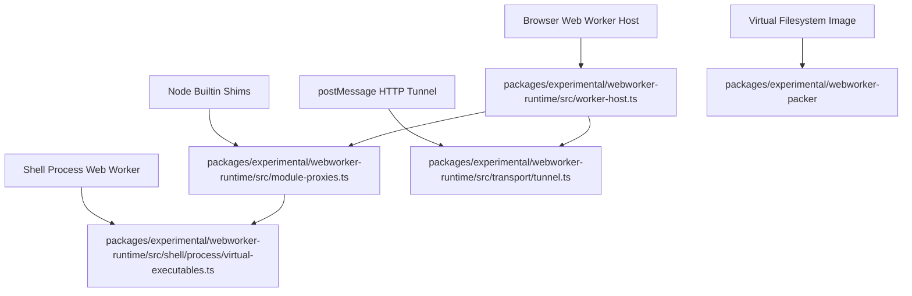
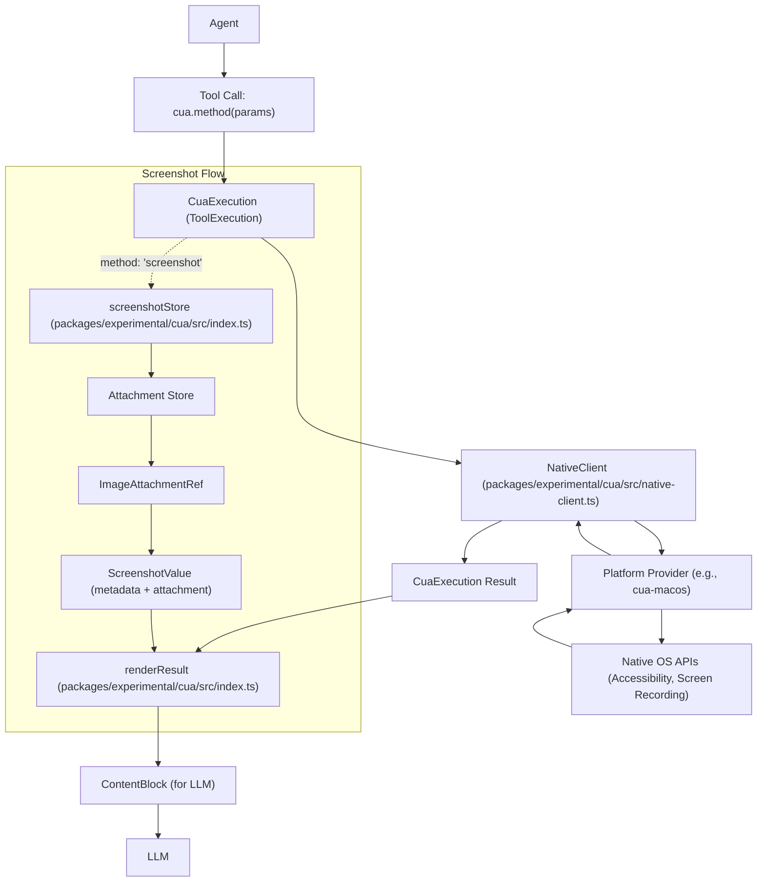

# Experimental Packages: Agent Teams, WebWorker Runtime & Inspector

<details>
<summary>Relevant source files</summary>

The following files were used as context for generating this wiki page:

- [.agents/notes/implemented/architecture/2026-09-21-experimental-capabilities-as-optional-bundles.i18n.yaml](.agents/notes/implemented/architecture/2026-09-21-experimental-capabilities-as-optional-bundles.i18n.yaml)
- [.agents/notes/implemented/architecture/2026-09-21-experimental-capabilities-as-optional-bundles.md](.agents/notes/implemented/architecture/2026-09-21-experimental-capabilities-as-optional-bundles.md)
- [.agents/notes/implemented/architecture/2026-09-21-experimental-capabilities-as-optional-bundles.zh.md](.agents/notes/implemented/architecture/2026-09-21-experimental-capabilities-as-optional-bundles.zh.md)
- [.agents/notes/implemented/architecture/2026-10-13-cua-continuous-hover.i18n.yaml](.agents/notes/implemented/architecture/2026-10-13-cua-continuous-hover.i18n.yaml)
- [.agents/notes/implemented/architecture/2026-10-13-cua-continuous-hover.md](.agents/notes/implemented/architecture/2026-10-13-cua-continuous-hover.md)
- [.agents/notes/implemented/architecture/2026-10-13-cua-continuous-hover.zh.md](.agents/notes/implemented/architecture/2026-10-13-cua-continuous-hover.zh.md)
- [.agents/notes/implemented/architecture/2026-10-19-client-plugin-package-assets.i18n.yaml](.agents/notes/implemented/architecture/2026-10-19-client-plugin-package-assets.i18n.yaml)
- [.agents/notes/implemented/architecture/2026-10-19-client-plugin-package-assets.md](.agents/notes/implemented/architecture/2026-10-19-client-plugin-package-assets.md)
- [.agents/notes/implemented/architecture/2026-10-19-client-plugin-package-assets.zh.md](.agents/notes/implemented/architecture/2026-10-19-client-plugin-package-assets.zh.md)
- [.agents/notes/implemented/feature/2026-08-05-agent-teams.i18n.yaml](.agents/notes/implemented/feature/2026-08-05-agent-teams.i18n.yaml)
- [.agents/notes/implemented/feature/2026-08-05-agent-teams.md](.agents/notes/implemented/feature/2026-08-05-agent-teams.md)
- [.agents/notes/implemented/feature/2026-08-05-agent-teams.zh.md](.agents/notes/implemented/feature/2026-08-05-agent-teams.zh.md)
- [apps/cli/tests/agent-team-headless.e2e.ts](apps/cli/tests/agent-team-headless.e2e.ts)
- [apps/cli/tests/profiles/headless/tests/fixtures/team-llm.mjs](apps/cli/tests/profiles/headless/tests/fixtures/team-llm.mjs)
- [apps/cli/tests/profiles/headless/tests/headless.expected.e2e.ts](apps/cli/tests/profiles/headless/tests/headless.expected.e2e.ts)
- [apps/web/tests/cot-translation-paid.e2e.ts](apps/web/tests/cot-translation-paid.e2e.ts)
- [apps/web/tests/cot-translation.e2e.ts](apps/web/tests/cot-translation.e2e.ts)
- [apps/web/tests/cua-optin.e2e.ts](apps/web/tests/cua-optin.e2e.ts)
- [apps/web/tests/cua-permissions.e2e.ts](apps/web/tests/cua-permissions.e2e.ts)
- [apps/web/tests/expected/cot-translation-paid/paid-choices.expected.md](apps/web/tests/expected/cot-translation-paid/paid-choices.expected.md)
- [apps/web/tests/expected/cot-translation/preferences.expected.md](apps/web/tests/expected/cot-translation/preferences.expected.md)
- [apps/web/tests/expected/cua-permissions/enabling.expected.md](apps/web/tests/expected/cua-permissions/enabling.expected.md)
- [apps/web/tests/expected/cua-permissions/missing.expected.md](apps/web/tests/expected/cua-permissions/missing.expected.md)
- [apps/web/tests/expected/forge-panel/changes-view.expected.md](apps/web/tests/expected/forge-panel/changes-view.expected.md)
- [apps/web/tests/expected/forge-panel/merge-stale.expected.md](apps/web/tests/expected/forge-panel/merge-stale.expected.md)
- [apps/web/tests/expected/plugin-install-cancel/highlight.expected.md](apps/web/tests/expected/plugin-install-cancel/highlight.expected.md)
- [apps/web/tests/expected/plugin-manager/exports-en.expected.md](apps/web/tests/expected/plugin-manager/exports-en.expected.md)
- [apps/web/tests/expected/plugin-manager/exports.expected.md](apps/web/tests/expected/plugin-manager/exports.expected.md)
- [apps/web/tests/expected/plugin-manager/missing-bundle.expected.md](apps/web/tests/expected/plugin-manager/missing-bundle.expected.md)
- [apps/web/tests/expected/plugin-manager/preview.expected.md](apps/web/tests/expected/plugin-manager/preview.expected.md)
- [apps/web/tests/expected/shared-inspector/metadata-en.expected.md](apps/web/tests/expected/shared-inspector/metadata-en.expected.md)
- [apps/web/tests/expected/shared-inspector/metadata-zh.expected.md](apps/web/tests/expected/shared-inspector/metadata-zh.expected.md)
- [apps/web/tests/forge-panel.e2e.ts](apps/web/tests/forge-panel.e2e.ts)
- [apps/web/tests/plugin-recommendations.e2e.ts](apps/web/tests/plugin-recommendations.e2e.ts)
- [apps/web/tests/preview-boot.e2e.ts](apps/web/tests/preview-boot.e2e.ts)
- [apps/web/tests/shared-inspector.e2e.ts](apps/web/tests/shared-inspector.e2e.ts)
- [docs/subsystems/agent-team.i18n.yaml](docs/subsystems/agent-team.i18n.yaml)
- [docs/subsystems/agent-team.md](docs/subsystems/agent-team.md)
- [docs/subsystems/agent-team.zh.md](docs/subsystems/agent-team.zh.md)
- [docs/subsystems/computer-use.i18n.yaml](docs/subsystems/computer-use.i18n.yaml)
- [docs/subsystems/computer-use.md](docs/subsystems/computer-use.md)
- [docs/subsystems/computer-use.zh.md](docs/subsystems/computer-use.zh.md)
- [docs/subsystems/forge.md](docs/subsystems/forge.md)
- [docs/subsystems/forge.zh.md](docs/subsystems/forge.zh.md)
- [packages/boot/hmr/tests/modules.spec.ts](packages/boot/hmr/tests/modules.spec.ts)
- [packages/client/modules/tests/package-assets.client.spec.ts](packages/client/modules/tests/package-assets.client.spec.ts)
- [packages/experimental/agent-team-profile/README.i18n.yaml](packages/experimental/agent-team-profile/README.i18n.yaml)
- [packages/experimental/agent-team-profile/README.md](packages/experimental/agent-team-profile/README.md)
- [packages/experimental/agent-team-profile/README.zh.md](packages/experimental/agent-team-profile/README.zh.md)
- [packages/experimental/agent-team-profile/cordis.patch.yml](packages/experimental/agent-team-profile/cordis.patch.yml)
- [packages/experimental/agent-team-profile/package.json](packages/experimental/agent-team-profile/package.json)
- [packages/experimental/agent-team-profile/tests/profile.spec.ts](packages/experimental/agent-team-profile/tests/profile.spec.ts)
- [packages/experimental/agent-team/README.i18n.yaml](packages/experimental/agent-team/README.i18n.yaml)
- [packages/experimental/agent-team/README.md](packages/experimental/agent-team/README.md)
- [packages/experimental/agent-team/README.zh.md](packages/experimental/agent-team/README.zh.md)
- [packages/experimental/agent-team/src/index.ts](packages/experimental/agent-team/src/index.ts)
- [packages/experimental/agent-team/src/journal.ts](packages/experimental/agent-team/src/journal.ts)
- [packages/experimental/agent-team/src/projection.ts](packages/experimental/agent-team/src/projection.ts)
- [packages/experimental/agent-team/src/task-board.ts](packages/experimental/agent-team/src/task-board.ts)
- [packages/experimental/agent-team/src/types.ts](packages/experimental/agent-team/src/types.ts)
- [packages/experimental/agent-team/tests/persistence.spec.ts](packages/experimental/agent-team/tests/persistence.spec.ts)
- [packages/experimental/agent-team/tests/projection-events.spec.ts](packages/experimental/agent-team/tests/projection-events.spec.ts)
- [packages/experimental/agent-team/tests/team.spec.ts](packages/experimental/agent-team/tests/team.spec.ts)
- [packages/experimental/client-ui-forge/README.i18n.yaml](packages/experimental/client-ui-forge/README.i18n.yaml)
- [packages/experimental/client-ui-forge/README.md](packages/experimental/client-ui-forge/README.md)
- [packages/experimental/client-ui-forge/README.zh.md](packages/experimental/client-ui-forge/README.zh.md)
- [packages/experimental/client-ui-forge/src/client/ChangeRequestCard.tsx](packages/experimental/client-ui-forge/src/client/ChangeRequestCard.tsx)
- [packages/experimental/client-ui-forge/src/client/ChangesTab.module.css](packages/experimental/client-ui-forge/src/client/ChangesTab.module.css)
- [packages/experimental/client-ui-forge/src/client/ChangesTab.tsx](packages/experimental/client-ui-forge/src/client/ChangesTab.tsx)
- [packages/experimental/client-ui-forge/src/client/DiffFile.tsx](packages/experimental/client-ui-forge/src/client/DiffFile.tsx)
- [packages/experimental/client-ui-forge/src/client/ForgeTab.tsx](packages/experimental/client-ui-forge/src/client/ForgeTab.tsx)
- [packages/experimental/client-ui-forge/src/client/checkout.ts](packages/experimental/client-ui-forge/src/client/checkout.ts)
- [packages/experimental/client-ui-forge/src/client/locales.ts](packages/experimental/client-ui-forge/src/client/locales.ts)
- [packages/experimental/client-ui-forge/src/client/mount.ts](packages/experimental/client-ui-forge/src/client/mount.ts)
- [packages/experimental/client-ui-forge/src/index.ts](packages/experimental/client-ui-forge/src/index.ts)
- [packages/experimental/client-ui-forge/src/worktree.ts](packages/experimental/client-ui-forge/src/worktree.ts)
- [packages/experimental/client-ui-forge/tests/change-request-card.client.spec.tsx](packages/experimental/client-ui-forge/tests/change-request-card.client.spec.tsx)
- [packages/experimental/client-ui-forge/tests/changes-tab.client.spec.tsx](packages/experimental/client-ui-forge/tests/changes-tab.client.spec.tsx)
- [packages/experimental/client-ui-forge/tests/controller.host.spec.ts](packages/experimental/client-ui-forge/tests/controller.host.spec.ts)
- [packages/experimental/client-ui-forge/tests/forge-tab.client.spec.tsx](packages/experimental/client-ui-forge/tests/forge-tab.client.spec.tsx)
- [packages/experimental/client-ui-forge/tests/mount.client.spec.ts](packages/experimental/client-ui-forge/tests/mount.client.spec.ts)
- [packages/experimental/client-ui-forge/tests/worktree.host.spec.ts](packages/experimental/client-ui-forge/tests/worktree.host.spec.ts)
- [packages/experimental/client-ui-plugin-recommendations/README.i18n.yaml](packages/experimental/client-ui-plugin-recommendations/README.i18n.yaml)
- [packages/experimental/client-ui-plugin-recommendations/README.md](packages/experimental/client-ui-plugin-recommendations/README.md)
- [packages/experimental/client-ui-plugin-recommendations/README.zh.md](packages/experimental/client-ui-plugin-recommendations/README.zh.md)
- [packages/experimental/client-ui-plugin-recommendations/src/client/Card.module.css](packages/experimental/client-ui-plugin-recommendations/src/client/Card.module.css)
- [packages/experimental/client-ui-plugin-recommendations/src/client/Card.tsx](packages/experimental/client-ui-plugin-recommendations/src/client/Card.tsx)
- [packages/experimental/client-ui-plugin-recommendations/src/client/locales.ts](packages/experimental/client-ui-plugin-recommendations/src/client/locales.ts)
- [packages/experimental/client-ui-plugin-recommendations/src/client/mount.ts](packages/experimental/client-ui-plugin-recommendations/src/client/mount.ts)
- [packages/experimental/client-ui-plugin-recommendations/tests/card.client.spec.tsx](packages/experimental/client-ui-plugin-recommendations/tests/card.client.spec.tsx)
- [packages/experimental/creation-recommendations/README.i18n.yaml](packages/experimental/creation-recommendations/README.i18n.yaml)
- [packages/experimental/creation-recommendations/README.md](packages/experimental/creation-recommendations/README.md)
- [packages/experimental/creation-recommendations/README.zh.md](packages/experimental/creation-recommendations/README.zh.md)
- [packages/experimental/creation-recommendations/skills/personalized-pages.md](packages/experimental/creation-recommendations/skills/personalized-pages.md)
- [packages/experimental/creation-recommendations/src/index.ts](packages/experimental/creation-recommendations/src/index.ts)
- [packages/experimental/creation-recommendations/src/skill.ts](packages/experimental/creation-recommendations/src/skill.ts)
- [packages/experimental/creation-recommendations/src/types.ts](packages/experimental/creation-recommendations/src/types.ts)
- [packages/experimental/creation-recommendations/tests/__snapshots__/creation.spec.ts.snap](packages/experimental/creation-recommendations/tests/__snapshots__/creation.spec.ts.snap)
- [packages/experimental/creation-recommendations/tests/creation.spec.ts](packages/experimental/creation-recommendations/tests/creation.spec.ts)
- [packages/experimental/cua-bundle/README.i18n.yaml](packages/experimental/cua-bundle/README.i18n.yaml)
- [packages/experimental/cua-bundle/README.md](packages/experimental/cua-bundle/README.md)
- [packages/experimental/cua-bundle/README.zh.md](packages/experimental/cua-bundle/README.zh.md)
- [packages/experimental/cua-bundle/package.json](packages/experimental/cua-bundle/package.json)
- [packages/experimental/cua-macos/README.i18n.yaml](packages/experimental/cua-macos/README.i18n.yaml)
- [packages/experimental/cua-macos/README.md](packages/experimental/cua-macos/README.md)
- [packages/experimental/cua-macos/README.zh.md](packages/experimental/cua-macos/README.zh.md)
- [packages/experimental/cua-macos/native/README.i18n.yaml](packages/experimental/cua-macos/native/README.i18n.yaml)
- [packages/experimental/cua-macos/native/README.md](packages/experimental/cua-macos/native/README.md)
- [packages/experimental/cua-macos/native/README.zh.md](packages/experimental/cua-macos/native/README.zh.md)
- [packages/experimental/cua-macos/native/Sources/CuaNative/AXWorker.swift](packages/experimental/cua-macos/native/Sources/CuaNative/AXWorker.swift)
- [packages/experimental/cua-macos/native/Sources/CuaNative/ApplicationAuthorization.swift](packages/experimental/cua-macos/native/Sources/CuaNative/ApplicationAuthorization.swift)
- [packages/experimental/cua-macos/native/Sources/CuaNative/NativePlatform.swift](packages/experimental/cua-macos/native/Sources/CuaNative/NativePlatform.swift)
- [packages/experimental/cua-macos/native/Sources/CuaNative/NativeProtocol.generated.swift](packages/experimental/cua-macos/native/Sources/CuaNative/NativeProtocol.generated.swift)
- [packages/experimental/cua-macos/native/Sources/CuaNative/WindowGeometry.swift](packages/experimental/cua-macos/native/Sources/CuaNative/WindowGeometry.swift)
- [packages/experimental/cua-macos/native/Sources/CuaNative/WindowPointerInput.swift](packages/experimental/cua-macos/native/Sources/CuaNative/WindowPointerInput.swift)
- [packages/experimental/cua-macos/native/protocol.schema.json](packages/experimental/cua-macos/native/protocol.schema.json)
- [packages/experimental/cua-macos/native/tests/Fixture.swift](packages/experimental/cua-macos/native/tests/Fixture.swift)
- [packages/experimental/cua-macos/native/tests/application_consent_e2e.py](packages/experimental/cua-macos/native/tests/application_consent_e2e.py)
- [packages/experimental/cua-macos/native/tests/capabilities_e2e.py](packages/experimental/cua-macos/native/tests/capabilities_e2e.py)
- [packages/experimental/cua-macos/native/tests/e2e.py](packages/experimental/cua-macos/native/tests/e2e.py)
- [packages/experimental/cua-macos/native/tests/electron_e2e.py](packages/experimental/cua-macos/native/tests/electron_e2e.py)
- [packages/experimental/cua-macos/native/tests/native_test_support.py](packages/experimental/cua-macos/native/tests/native_test_support.py)
- [packages/experimental/cua-macos/native/tests/swift/ApplicationDiscoveryTests.swift](packages/experimental/cua-macos/native/tests/swift/ApplicationDiscoveryTests.swift)
- [packages/experimental/cua-macos/native/tests/swift/PermissionIdentityTests.swift](packages/experimental/cua-macos/native/tests/swift/PermissionIdentityTests.swift)
- [packages/experimental/cua-macos/native/tests/swift/SystemHoverTests.swift](packages/experimental/cua-macos/native/tests/swift/SystemHoverTests.swift)
- [packages/experimental/cua-macos/src/guidance.ts](packages/experimental/cua-macos/src/guidance.ts)
- [packages/experimental/cua/README.i18n.yaml](packages/experimental/cua/README.i18n.yaml)
- [packages/experimental/cua/README.md](packages/experimental/cua/README.md)
- [packages/experimental/cua/README.zh.md](packages/experimental/cua/README.zh.md)
- [packages/experimental/cua/src/api.ts](packages/experimental/cua/src/api.ts)
- [packages/experimental/cua/src/application-types.ts](packages/experimental/cua/src/application-types.ts)
- [packages/experimental/cua/src/client/PermissionPanel.module.css](packages/experimental/cua/src/client/PermissionPanel.module.css)
- [packages/experimental/cua/src/client/PermissionPanel.tsx](packages/experimental/cua/src/client/PermissionPanel.tsx)
- [packages/experimental/cua/src/client/controller.ts](packages/experimental/cua/src/client/controller.ts)
- [packages/experimental/cua/src/client/locales.ts](packages/experimental/cua/src/client/locales.ts)
- [packages/experimental/cua/src/index.ts](packages/experimental/cua/src/index.ts)
- [packages/experimental/cua/src/protocol.ts](packages/experimental/cua/src/protocol.ts)
- [packages/experimental/cua/src/types.ts](packages/experimental/cua/src/types.ts)
- [packages/experimental/cua/tests/api.spec.ts](packages/experimental/cua/tests/api.spec.ts)
- [packages/experimental/cua/tests/controller.client.spec.ts](packages/experimental/cua/tests/controller.client.spec.ts)
- [packages/experimental/cua/tests/panel.client.spec.tsx](packages/experimental/cua/tests/panel.client.spec.tsx)
- [packages/experimental/cua/tests/protocol.spec.ts](packages/experimental/cua/tests/protocol.spec.ts)
- [packages/experimental/forge-session/README.i18n.yaml](packages/experimental/forge-session/README.i18n.yaml)
- [packages/experimental/forge-session/README.md](packages/experimental/forge-session/README.md)
- [packages/experimental/forge-session/README.zh.md](packages/experimental/forge-session/README.zh.md)
- [packages/experimental/forge-session/src/index.ts](packages/experimental/forge-session/src/index.ts)
- [packages/experimental/forge-session/src/types.ts](packages/experimental/forge-session/src/types.ts)
- [packages/experimental/forge-session/tests/service.spec.ts](packages/experimental/forge-session/tests/service.spec.ts)
- [packages/experimental/forge/README.i18n.yaml](packages/experimental/forge/README.i18n.yaml)
- [packages/experimental/forge/README.md](packages/experimental/forge/README.md)
- [packages/experimental/forge/README.zh.md](packages/experimental/forge/README.zh.md)
- [packages/experimental/forge/src/index.ts](packages/experimental/forge/src/index.ts)
- [packages/experimental/forge/tests/lifecycle.spec.ts](packages/experimental/forge/tests/lifecycle.spec.ts)
- [packages/experimental/forge/tests/registry.spec.ts](packages/experimental/forge/tests/registry.spec.ts)
- [packages/experimental/forge/tests/watch.spec.ts](packages/experimental/forge/tests/watch.spec.ts)
- [packages/experimental/plugin-recommendations/README.i18n.yaml](packages/experimental/plugin-recommendations/README.i18n.yaml)
- [packages/experimental/plugin-recommendations/README.md](packages/experimental/plugin-recommendations/README.md)
- [packages/experimental/plugin-recommendations/README.zh.md](packages/experimental/plugin-recommendations/README.zh.md)
- [packages/experimental/plugin-recommendations/skills/official-plugins.md](packages/experimental/plugin-recommendations/skills/official-plugins.md)
- [packages/experimental/plugin-recommendations/src/index.ts](packages/experimental/plugin-recommendations/src/index.ts)
- [packages/experimental/plugin-recommendations/src/types.ts](packages/experimental/plugin-recommendations/src/types.ts)
- [packages/experimental/plugin-recommendations/tests/__snapshots__/recommendations.spec.ts.snap](packages/experimental/plugin-recommendations/tests/__snapshots__/recommendations.spec.ts.snap)
- [packages/experimental/plugin-recommendations/tests/fixture.ts](packages/experimental/plugin-recommendations/tests/fixture.ts)
- [packages/experimental/plugin-recommendations/tests/recommendations.spec.ts](packages/experimental/plugin-recommendations/tests/recommendations.spec.ts)
- [packages/experimental/tool-agent-team/README.i18n.yaml](packages/experimental/tool-agent-team/README.i18n.yaml)
- [packages/experimental/tool-agent-team/README.md](packages/experimental/tool-agent-team/README.md)
- [packages/experimental/tool-agent-team/README.zh.md](packages/experimental/tool-agent-team/README.zh.md)
- [packages/experimental/tool-agent-team/src/index.ts](packages/experimental/tool-agent-team/src/index.ts)
- [packages/experimental/tool-agent-team/tests/tool-team.spec.ts](packages/experimental/tool-agent-team/tests/tool-team.spec.ts)
- [packages/experimental/webworker-packer/src/bin.ts](packages/experimental/webworker-packer/src/bin.ts)
- [packages/experimental/webworker-packer/src/repository.ts](packages/experimental/webworker-packer/src/repository.ts)
- [packages/experimental/webworker-packer/src/rules.ts](packages/experimental/webworker-packer/src/rules.ts)
- [packages/experimental/webworker-packer/tests/image-loadable.spec.ts](packages/experimental/webworker-packer/tests/image-loadable.spec.ts)
- [packages/experimental/webworker-runtime/README.i18n.yaml](packages/experimental/webworker-runtime/README.i18n.yaml)
- [packages/experimental/webworker-runtime/README.md](packages/experimental/webworker-runtime/README.md)
- [packages/experimental/webworker-runtime/README.zh.md](packages/experimental/webworker-runtime/README.zh.md)
- [packages/experimental/webworker-runtime/src/compile/transform.ts](packages/experimental/webworker-runtime/src/compile/transform.ts)
- [packages/experimental/webworker-runtime/src/module-proxies.ts](packages/experimental/webworker-runtime/src/module-proxies.ts)
- [packages/experimental/webworker-runtime/src/module-system/module-loader.ts](packages/experimental/webworker-runtime/src/module-system/module-loader.ts)
- [packages/experimental/webworker-runtime/src/node/builtin_modules/implemented/assert/strict.ts](packages/experimental/webworker-runtime/src/node/builtin_modules/implemented/assert/strict.ts)
- [packages/experimental/webworker-runtime/src/node/builtin_modules/implemented/module.ts](packages/experimental/webworker-runtime/src/node/builtin_modules/implemented/module.ts)
- [packages/experimental/webworker-runtime/src/node/builtin_modules/mock/https.ts](packages/experimental/webworker-runtime/src/node/builtin_modules/mock/https.ts)
- [packages/experimental/webworker-runtime/src/node/builtins.ts](packages/experimental/webworker-runtime/src/node/builtins.ts)
- [packages/experimental/webworker-runtime/src/node/external_packages/got.ts](packages/experimental/webworker-runtime/src/node/external_packages/got.ts)
- [packages/experimental/webworker-runtime/src/node/external_packages/replaced-externals.ts](packages/experimental/webworker-runtime/src/node/external_packages/replaced-externals.ts)
- [packages/experimental/webworker-runtime/tests/compile/transform-corpus-check.ts](packages/experimental/webworker-runtime/tests/compile/transform-corpus-check.ts)
- [packages/experimental/webworker-runtime/tests/compile/transform-corpus.spec.ts](packages/experimental/webworker-runtime/tests/compile/transform-corpus.spec.ts)
- [packages/experimental/webworker-runtime/tests/compile/transform.spec.ts](packages/experimental/webworker-runtime/tests/compile/transform.spec.ts)
- [packages/experimental/webworker-runtime/tests/node/assert-strict.spec.ts](packages/experimental/webworker-runtime/tests/node/assert-strict.spec.ts)
- [packages/experimental/webworker-runtime/tests/node/builtins-table.spec.ts](packages/experimental/webworker-runtime/tests/node/builtins-table.spec.ts)
- [packages/experimental/webworker-runtime/tests/node/node-stubs.spec.ts](packages/experimental/webworker-runtime/tests/node/node-stubs.spec.ts)
- [packages/experimental/webworker-runtime/tests/package-assets.spec.ts](packages/experimental/webworker-runtime/tests/package-assets.spec.ts)
- [packages/subprocess/subprocess-local/src/bin.ts](packages/subprocess/subprocess-local/src/bin.ts)
- [scripts/coverage-exempt.ts](scripts/coverage-exempt.ts)
- [scripts/optional-bundles.spec.ts](scripts/optional-bundles.spec.ts)
- [snapshots/session/cua-native/replay.override.json](snapshots/session/cua-native/replay.override.json)
- [snapshots/session/cua-native/session.v4.jsonl](snapshots/session/cua-native/session.v4.jsonl)
- [snapshots/session/cua-native/system-prompt.expected.md](snapshots/session/cua-native/system-prompt.expected.md)
- [snapshots/session/cua-native/tool-schemas.expected.json](snapshots/session/cua-native/tool-schemas.expected.json)
- [snapshots/session/cua-native/workspace/native-helper.mjs](snapshots/session/cua-native/workspace/native-helper.mjs)
- [snapshots/session/cua-ptc/consent-fixture.mjs](snapshots/session/cua-ptc/consent-fixture.mjs)
- [snapshots/session/cua-ptc/cordis.snapshot.yml](snapshots/session/cua-ptc/cordis.snapshot.yml)
- [snapshots/session/cua-ptc/cordis.yml](snapshots/session/cua-ptc/cordis.yml)
- [snapshots/session/cua-ptc/replay.override.json](snapshots/session/cua-ptc/replay.override.json)
- [snapshots/session/cua-ptc/session.v4.jsonl](snapshots/session/cua-ptc/session.v4.jsonl)
- [snapshots/session/cua-ptc/snapshot.yml](snapshots/session/cua-ptc/snapshot.yml)
- [snapshots/session/cua-ptc/system-prompt.expected.md](snapshots/session/cua-ptc/system-prompt.expected.md)
- [snapshots/session/cua-ptc/tool-schemas.expected.json](snapshots/session/cua-ptc/tool-schemas.expected.json)
- [snapshots/web/creation-recommendations/session.v4.jsonl](snapshots/web/creation-recommendations/session.v4.jsonl)
- [snapshots/web/creation-recommendations/tool-schemas.expected.json](snapshots/web/creation-recommendations/tool-schemas.expected.json)
- [snapshots/web/plugin-recommendations/dismissed.expected.md](snapshots/web/plugin-recommendations/dismissed.expected.md)
- [snapshots/web/plugin-recommendations/offered.expected.md](snapshots/web/plugin-recommendations/offered.expected.md)
- [snapshots/web/plugin-recommendations/session.v4.jsonl](snapshots/web/plugin-recommendations/session.v4.jsonl)
- [snapshots/web/plugin-recommendations/system-prompt.expected.md](snapshots/web/plugin-recommendations/system-prompt.expected.md)
- [snapshots/web/plugin-recommendations/tool-schemas.expected.json](snapshots/web/plugin-recommendations/tool-schemas.expected.json)

</details>


## Purpose and Scope

This page provides a technical overview of experimental packages located under `packages/experimental` in the DeepSeek Harness (`dsh`) monorepo. It covers:

- The **Agent Teams** system (`@deepseek-ai/dsh-experimental-agent-team` and `@deepseek-ai/dsh-experimental-tool-agent-team`), which enables a single coding session to act as a Lead managing a team of named teammates, with durable messaging and a shared persistent task board for collaboration [packages/experimental/agent-team/README.md:10-13](), [.agents/notes/implemented/feature/2026-08-05-agent-teams.md:7-19]().
- The **WebWorker Runtime** (`@deepseek-ai/dsh-experimental-webworker-runtime`), a specialized harness runtime hosting the entire plugin tree inside a browser dedicated Web Worker, using a virtual filesystem (VFS), Node builtin shims, a CommonJS loader, and a postMessage-based HTTP tunnel for page communication [packages/experimental/webworker-runtime/README.md:10-33]().
- The **Computer Use (CUA)** package (`@deepseek-ai/dsh-cua`), which provides tools for inspecting applications, retaining window objects, and sending actions through the normal tool pipeline, with platform providers supplying native execution [packages/experimental/cua/README.md:10-13]().
- The **Code Runtime Python** (`packages/experimental/code-runtime-python`), providing runtime facilities for executing Python code alongside the TypeScript harness [scripts/check-workspace-constraints.ts:162-165]().
- The **Cordis Inspector** (`packages/experimental/inspector`), a diagnostics tool for runtime introspection of the Cordis plugin framework.

Sources:
`packages/experimental/agent-team/README.md:10-13`
`packages/experimental/webworker-runtime/README.md:10-33`
`packages/experimental/cua/README.md:10-13`
`scripts/check-workspace-constraints.ts:162-165`

---

## 1. Agent Teams (`@deepseek-ai/dsh-experimental-agent-team` & `tool-agent-team`)

### Overview

The Agent Teams package implements a model where a single coding session acts as a **Lead** that can spawn named **teammates** (agents) which work collaboratively. This enables the transformation of a coding session into a small persistent team with durable message passing and task coordination. The system persists team member identities, messages, and task states durably in the append-only session log, ensuring recovery after crashes, reloads, or interruptions [packages/experimental/agent-team/README.md:10-13](), [.agents/notes/implemented/feature/2026-08-05-agent-teams.md:7-19]().

This package does not include tools natively; related tooling resides in `dsh-experimental-tool-agent-team` to enable teammate creation, messaging, and task operations driven by model agents.

### Implementation Architecture & Source Map

The package is modularized into logical components:

| Module | Responsibilities |
|---|---|
| `src/index.ts` | Plugin entry point; defines configuration schema (`TeamService`), registers services, and manages recovery scheduling [packages/experimental/agent-team/README.zh.md:115]() |
| `src/roster.ts` | Manages Team identity model, member resolution (`TeamMemberSnapshot`), provisioning lifecycle, and container cleanup [packages/experimental/agent-team/README.zh.md:116]() |
| `src/task-board.ts` | Implements Compare-And-Set (CAS) operations for task mutations, revision tracking, Directed Acyclic Graph (DAG) dependency validation, and task tombstone retention [packages/experimental/agent-team/README.zh.md:117]() |
| `src/journal.ts` | Serializes Lead log transactions and provides commit notification APIs [packages/experimental/agent-team/README.zh.md:118]() |
| `src/projection.ts` | Implements a strict replay projection for the `agentTeam` session projection to decode and validate team events and provide a client state view [packages/experimental/agent-team/README.zh.md:119]() |

Sources:
`packages/experimental/agent-team/README.md:10-13`
`packages/experimental/agent-team/README.zh.md:115-119`

### Data Flow & Teammate Lifecycle

```mermaid
graph TD
  LeadAgent["Agent (Lead)"]
  RosterMgr["TeamService.spawnTeammate()"]
  SessionLog["Session Log (Lead SessionId)"]
  ChildAgent["Agent (Teammate)"]
  Mailbox["TeamMailbox"]
  TaskBoard["TeamTaskBoard"]

  LeadAgent -->|spawnTeammate()| RosterMgr
  RosterMgr -->|append 'team/member' provisioning event| SessionLog
  SessionLog -->|start continuable child session| ChildAgent
  LeadAgent -->|sendMessage()| Mailbox
  Mailbox -->|append 'team/message/queued' event| SessionLog
  Mailbox -->|deliver via Agent.steer()| ChildAgent
  LeadAgent -->|create/update task| TaskBoard
  TaskBoard -->|append 'team/task' CAS events| SessionLog
```

- **TeamService** oversees roster and lifecycle management [packages/experimental/agent-team/src/index.ts]().
- **TeamTaskBoard** manages the shared task board enforcing correct revision and DAG constraints [packages/experimental/agent-team/src/task-board.ts]().

Sources:
`packages/experimental/agent-team/src/index.ts`
`packages/experimental/agent-team/src/task-board.ts`

### Natural Language Concepts to Code Entities (Agent Teams)

```mermaid
graph LR
  NL_TeamLead[""Lead Agent (Team Leader Concept)""]
  NL_Roster[""Named Teammates Roster""]
  NL_Mailbox[""Durable Cross-Agent Mailbox""]
  NL_TaskBoard[""Shared Task Board""]
  
  Code_AgentLoop["AgentLoop / Agent"]
  Code_TeamService["TeamService (packages/experimental/agent-team/src/index.ts)"]
  Code_Roster["Roster Management (packages/experimental/agent-team/src/roster.ts)"]
  Code_TaskBoard["TeamTaskBoard (packages/experimental/agent-team/src/task-board.ts)"]
  Code_SessionLog["Session Log Projection"]

  NL_TeamLead --> Code_AgentLoop
  NL_TeamLead --> Code_TeamService
  NL_Roster --> Code_Roster
  NL_TaskBoard --> Code_TaskBoard

  Code_Roster --> Code_SessionLog
  Code_TaskBoard --> Code_SessionLog
```

Sources:
`packages/experimental/agent-team/src/index.ts`
`packages/experimental/agent-team/src/roster.ts`
`packages/experimental/agent-team/src/task-board.ts`

---

## 2. Browser WebWorker Runtime (`@deepseek-ai/dsh-experimental-webworker-runtime`)

### Overview

This package hosts the entire harness plugin tree inside a dedicated **browser Web Worker**. It is designed for preview deployments and regression testing scenarios where no Node.js host environment is available. The worker inflates a packed Virtual FileSystem (VFS) image downloaded over the network, mounts it in memory, runs modules via a CommonJS wrapper loader, and serves the page backend via a postMessage tunnel speaking plain HTTP [packages/experimental/webworker-runtime/README.md:10-33]().

### Core Components

| Artifact | Role |
|---|---|
| **Assembly library (`lib/index.js`)** | Exposes `createWorkerHost` and `startWorkerHost` APIs. Mounts the base VFS image and ordered data overlays (`storage/`), installs the module loader (`module-system/`), and boots the plugin tree using the embedded `dsh-app-boot`. After booting, hands the HTTP-over-postMessage tunnel its serving seams. Manages `profileContext` for editable profiles under `home/profiles/preview/` supporting on-the-fly profile patch overlay and ConfigEditor integration (live config changes, HMR updates). The image layout contract (`image-layout.ts`) is shared with the packer [packages/experimental/webworker-runtime/README.md:30]() |
| **Worker bundle (`lib/worker.js`)** | Combines the assembly with Node compatibility layer. Includes a module proxy table (`module-proxies.ts`) that provides Node builtin modules (`node:*`) over the VFS, tunnel, and browser primitives or as structural stubs that explicitly fail unsupported calls with console errors. Native/binary package replacements are routed appropriately. Supplies `node:module` with `createRequire().resolve()` and `.resolve.paths()` facilitating unmodified package manifest resolution. Global `process` shim carries Node environment fields such as `title` for compatibility. VFS mutations drive the `node:fs` shim callback, poll, and promise watchers. Stream utilities and AsyncLocalStorage are supported [packages/experimental/webworker-runtime/README.md:31]() |
| **Shell subsystem (`src/shell/`)** | Implements a subprocess shim for `node:child_process`. Since browser workers cannot fork, `spawn()` launches a command inside a nested Web Worker running the same bundle but flagged as a shell worker. Supports `SIGKILL` termination and communicates with the parent worker over message passing to access the VFS. Supports executables compatible with Landlock protocols without coupling implementations tightly. Includes `xdg-open` that sends VFS text files to the page's read-only viewer for commands like "open configuration file" inside the UI. Supports a restricted subset of shell syntax based on `@yarnpkg/parsers` with coreutils command table [packages/experimental/webworker-runtime/README.md:32]() |
| **Page client connector (`lib/client.js`)** | Manages startup process in two independent stages: `chooseWorkerHostSource()` to select from configuration/fixture manifests or allow source selection UI; and `connectWorkerHost()` to establish the connection with the worker supplying base and ordered overlays. Handles bootstrap frame carrying structured index injection table and executes bundles as Blobs with inline sourcemaps fetched on demand. The tunnel exposes fetch transport, file upload carriers, and an API client. Request frames preserve Blob request bodies and transfer ReadableStream ownership. Streaming uplinks are implemented with `TunnelUplink` for high-throughput, reliable communication [packages/experimental/webworker-runtime/README.md:33]() |

Sources:
`packages/experimental/webworker-runtime/README.md:30-33`

### Natural Language Concepts to Code Entities (WebWorker Runtime)



Sources:
`packages/experimental/webworker-runtime/README.md:30-33`
`packages/experimental/webworker-runtime/src/module-proxies.ts`
`packages/experimental/webworker-runtime/src/transport/tunnel.ts`

---

## 3. Computer Use (CUA) (`@deepseek-ai/dsh-cua`)

### Overview

The `@deepseek-ai/dsh-cua` package provides a framework for agents to interact with the host operating system's graphical user interface. It allows inspecting applications, retaining window objects across calls, and sending actions through the normal tool pipeline. Platform-specific providers (e.g., `cua-macos`) supply the native execution, while `dsh-cua` handles the object API, request validation, application consent, and image admission [packages/experimental/cua/README.md:10-13](). The external PTC runtime is responsible for variable persistence [packages/experimental/cua/README.md:12-13]().

### Key Concepts and Functionality

- **Application Inspection and Control**: Agents can list running applications (`listApps`), find installed applications (`findApps`), and get a handle to a specific application (`getApp`) [packages/experimental/cua/README.md:43-46](). Once an application handle is obtained, agents can activate it (`activate`), get its windows (`getWindows`), or focus on a specific window (`getWindow`) [packages/experimental/cua/README.md:47-49]().
- **Accessibility State (AX State)**: The `getAXState` method allows agents to read the accessibility tree of an application or window, providing textual representation of UI elements, their roles, and available actions [packages/experimental/cua/README.md:55](). This is crucial for understanding the current UI state.
- **Screenshots**: Agents can capture screenshots of applications or specific windows using `getScreenshot` [packages/experimental/cua/README.md:56](). Screenshots are returned as `CuaScreenshot` objects containing `bytes`, `mimeType`, `pixelWidth`, `pixelHeight`, and `windowId` [packages/experimental/cua/README.md:38](). These images are then processed by the attachment pipeline and can be included in model content [packages/experimental/cua/README.md:33-34]().
- **Input Actions**: The package supports various input actions such as typing text (`typeText`), pressing keys (`pressKey`), pasting content (`paste`), hovering (`hover`), and clicking (`click`) [packages/experimental/cua/README.md:50-51](). Coordinate actions can be specified in pixels relative to the latest screenshot or as relative thousandths [packages/experimental/cua/README.md:38]().
- **Application Consent**: User consent is required before launching, observing, capturing, or inputting into applications. Revocation of consent closes affected agent connections [packages/experimental/cua/README.md:35]().
- **Tool Execution**: CUA operations are exposed as tools to the agent. The `cua` tool schema defines methods like `getCapabilities`, `listApps`, `getApp`, `getState`, `getScreenshot`, `hover`, `click`, `typeText`, `paste`, and `pressKey` [snapshots/session/cua-native/tool-schemas.expected.json:73-178]().
- **Configuration**: The `CuaConfig` interface defines various parameters for native executable and per-operation resource bounds, including `allowedApps`, `buildTimeoutMs`, `timeoutMs`, `maxResponseBytes`, `maxElements`, and `maxDepth` [packages/experimental/cua/src/index.ts:31-71]().

Sources:
`packages/experimental/cua/README.md:10-13`
`packages/experimental/cua/README.md:12-13`
`packages/experimental/cua/README.md:33-35`
`packages/experimental/cua/README.md:38`
`packages/experimental/cua/README.md:43-46`
`packages/experimental/cua/README.md:47-49`
`packages/experimental/cua/README.md:50-51`
`packages/experimental/cua/README.md:55`
`packages/experimental/cua/README.md:56`
`packages/experimental/cua/src/index.ts:31-71`
`snapshots/session/cua-native/tool-schemas.expected.json:73-178`

### Data Flow



The `NativeClient` handles request correlation, byte limits, cancellation, and failure settlement [packages/experimental/cua/README.md:48](). The `renderResult` function processes the output of CUA operations, especially for screenshots, where it extracts metadata and an `ImageAttachmentRef` for the model, rather than the raw bytes [packages/experimental/cua/src/index.ts:114-117]().

Sources:
`packages/experimental/cua/README.md:48`
`packages/experimental/cua/src/index.ts:114-117`
`packages/experimental/cua/src/native-client.ts`

### Model Experience

The model interacts with CUA through the `cua` tool. It receives structured JSON results for most operations and metadata plus an image attachment for screenshots. The system prompt provides detailed guidance on how to use the `cua` tool, including inspecting capabilities, selecting applications, reading AX state, capturing screenshots, and dispatching input [snapshots/session/cua-native/system-prompt.expected.md:32-59]().

Sources:
`snapshots/session/cua-native/system-prompt.expected.md:32-59`

---

## 4. Code Runtime Python (`packages/experimental/code-runtime-python`)

### Overview

The `code-runtime-python` package provides an experimental Python runtime for execution within the harness ecosystem, enabling Python-based tooling and runtime code execution alongside the TypeScript-based system.

The package bundles Python source modules under `py/**/*.py` [scripts/check-workspace-constraints.ts:162-165]().

Sources:
`scripts/check-workspace-constraints.ts:162-165`

---

## 5. Cordis Inspector (`packages/experimental/inspector`)

### Overview

The **Cordis Inspector** is an experimental runtime diagnostic tool based on the Cordis plugin framework. It provides detailed introspection and visualization of:

- The live Cordis plugin tree and component hierarchies,
- Service bindings,
- Session state projections,
- Agent event stream inspections.

It aids developers and maintainers in understanding runtime behavior, debugging complex interaction patterns like agent waits, subagent orchestration, and plugin configuration overrides.

The inspector leverages Cordis lifecycle hooks to build tree projections and supports navigable UI rendering for runtime diagnostics [packages/experimental/inspector/tests/integration.host.spec.ts]().

Sources:
`packages/experimental/inspector/tests/integration.host.spec.ts`

---

## Summary Table of Experimental Packages

| Package Name | Purpose | Key Implementation Location |
|---|---|---|
| `@deepseek-ai/dsh-experimental-agent-team` | Implements a durable multi-agent roster, mailbox, and task board for team collaboration | `packages/experimental/agent-team/src/index.ts` and related submodules |
| `@deepseek-ai/dsh-experimental-tool-agent-team` | Tool definitions scoped for agent teams interactions | `packages/experimental/tool-agent-team/src/index.ts` |
| `@deepseek-ai/dsh-experimental-webworker-runtime` | Provides browser Web Worker harness runtime with VFS and Node builtin shim support | `packages/experimental/webworker-runtime/src/worker-host.ts` and related |
| `@deepseek-ai/dsh-experimental-cua` | Provides tools for inspecting applications, retaining window objects, and sending actions through the normal tool pipeline | `packages/experimental/cua/src/index.ts` and related |
| `@deepseek-ai/dsh-experimental-code-runtime-python` | Python runtime execution facilities | `packages/experimental/code-runtime-python/py/` |
| `@deepseek-ai/dsh-experimental-inspector` | Cordis plugin tree runtime diagnostics, UI, and introspection | `packages/experimental/inspector/` |

Sources:
`packages/experimental/agent-team/src/index.ts`
`packages/experimental/tool-agent-team/src/index.ts`
`packages/experimental/webworker-runtime/src/worker-host.ts`
`packages/experimental/cua/src/index.ts`
`scripts/check-workspace-constraints.ts:162-165`