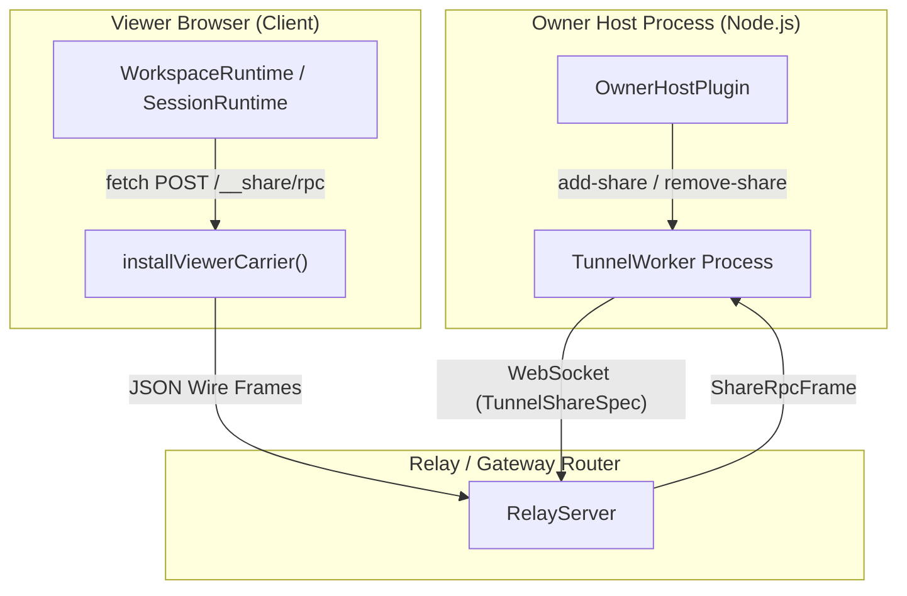
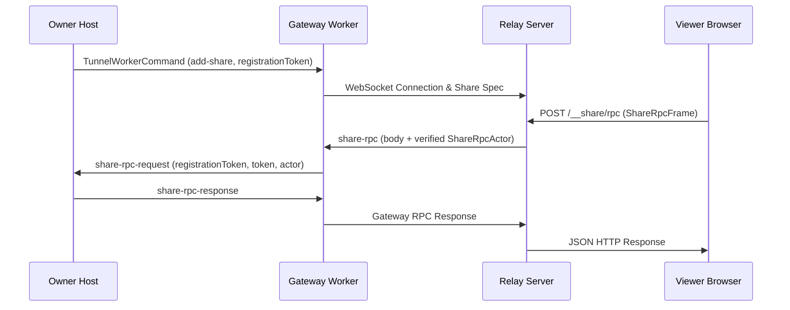

# LiveShare: Session Sharing & Tunnel Protocol

<details>
<summary>Relevant source files</summary>

The following files were used as context for generating this wiki page:

- [packages/experimental/liveshare-protocol/README.i18n.yaml](packages/experimental/liveshare-protocol/README.i18n.yaml)
- [packages/experimental/liveshare-protocol/README.md](packages/experimental/liveshare-protocol/README.md)
- [packages/experimental/liveshare-protocol/README.zh.md](packages/experimental/liveshare-protocol/README.zh.md)
- [packages/experimental/liveshare-protocol/package.json](packages/experimental/liveshare-protocol/package.json)
- [packages/experimental/liveshare-protocol/src/identity/index.ts](packages/experimental/liveshare-protocol/src/identity/index.ts)
- [packages/experimental/liveshare-protocol/src/identity/keys.ts](packages/experimental/liveshare-protocol/src/identity/keys.ts)
- [packages/experimental/liveshare-protocol/src/identity/types.ts](packages/experimental/liveshare-protocol/src/identity/types.ts)
- [packages/experimental/liveshare-protocol/src/tunnel-protocol.ts](packages/experimental/liveshare-protocol/src/tunnel-protocol.ts)
- [packages/experimental/liveshare-protocol/src/viewer-carrier.ts](packages/experimental/liveshare-protocol/src/viewer-carrier.ts)
- [packages/experimental/liveshare-protocol/tests/entrypoints.spec.ts](packages/experimental/liveshare-protocol/tests/entrypoints.spec.ts)
- [packages/experimental/liveshare-protocol/tests/frames/unknown/host-to-worker--unknown-access-mode.json](packages/experimental/liveshare-protocol/tests/frames/unknown/host-to-worker--unknown-access-mode.json)
- [packages/experimental/liveshare-protocol/tests/frames/unknown/relay-to-gateway--id-not-a-positive-integer.json](packages/experimental/liveshare-protocol/tests/frames/unknown/relay-to-gateway--id-not-a-positive-integer.json)
- [packages/experimental/liveshare-protocol/tests/frames/v1/gateway-to-relay--share-rpc-res.json](packages/experimental/liveshare-protocol/tests/frames/v1/gateway-to-relay--share-rpc-res.json)
- [packages/experimental/liveshare-protocol/tests/frames/v1/host-to-worker--add-share-minimal.json](packages/experimental/liveshare-protocol/tests/frames/v1/host-to-worker--add-share-minimal.json)
- [packages/experimental/liveshare-protocol/tests/frames/v1/host-to-worker--add-share.json](packages/experimental/liveshare-protocol/tests/frames/v1/host-to-worker--add-share.json)
- [packages/experimental/liveshare-protocol/tests/frames/v1/host-to-worker--remove-share.json](packages/experimental/liveshare-protocol/tests/frames/v1/host-to-worker--remove-share.json)
- [packages/experimental/liveshare-protocol/tests/frames/v1/host-to-worker--share-rpc-response.json](packages/experimental/liveshare-protocol/tests/frames/v1/host-to-worker--share-rpc-response.json)
- [packages/experimental/liveshare-protocol/tests/frames/v1/relay-to-gateway--share-rpc-cancel.json](packages/experimental/liveshare-protocol/tests/frames/v1/relay-to-gateway--share-rpc-cancel.json)
- [packages/experimental/liveshare-protocol/tests/frames/v1/relay-to-gateway--share-rpc.json](packages/experimental/liveshare-protocol/tests/frames/v1/relay-to-gateway--share-rpc.json)
- [packages/experimental/liveshare-protocol/tests/frames/v1/worker-to-host--ready.json](packages/experimental/liveshare-protocol/tests/frames/v1/worker-to-host--ready.json)
- [packages/experimental/liveshare-protocol/tests/frames/v1/worker-to-host--share-connected.json](packages/experimental/liveshare-protocol/tests/frames/v1/worker-to-host--share-connected.json)
- [packages/experimental/liveshare-protocol/tests/frames/v1/worker-to-host--share-error.json](packages/experimental/liveshare-protocol/tests/frames/v1/worker-to-host--share-error.json)
- [packages/experimental/liveshare-protocol/tests/frames/v1/worker-to-host--share-rpc-request.json](packages/experimental/liveshare-protocol/tests/frames/v1/worker-to-host--share-rpc-request.json)
- [packages/experimental/liveshare-protocol/tests/identity-mock.spec.ts](packages/experimental/liveshare-protocol/tests/identity-mock.spec.ts)
- [packages/experimental/liveshare-protocol/tests/identity.spec.ts](packages/experimental/liveshare-protocol/tests/identity.spec.ts)
- [packages/experimental/liveshare-protocol/tests/ipc-token.spec.ts](packages/experimental/liveshare-protocol/tests/ipc-token.spec.ts)
- [packages/experimental/liveshare-protocol/tests/protocol-frames.spec.ts](packages/experimental/liveshare-protocol/tests/protocol-frames.spec.ts)
- [packages/experimental/liveshare-protocol/tests/protocol-utilities.spec.ts](packages/experimental/liveshare-protocol/tests/protocol-utilities.spec.ts)
- [packages/experimental/liveshare-protocol/tests/share-access-state.spec.ts](packages/experimental/liveshare-protocol/tests/share-access-state.spec.ts)
- [packages/experimental/liveshare-protocol/tests/viewer-carrier.client.spec.ts](packages/experimental/liveshare-protocol/tests/viewer-carrier.client.spec.ts)
- [packages/experimental/liveshare-protocol/tsdown.config.ts](packages/experimental/liveshare-protocol/tsdown.config.ts)

</details>


## Purpose and Scope

The `dsh-experimental-liveshare-protocol` package (`packages/experimental/liveshare-protocol/`) implements the underlying wire and IPC frame protocols, identity contracts, and browser-side carriers required to securely expose a running DeepSeek Harness session to remote viewers. It establishes a strict boundary between the owner host instance, its gateway worker process, the central Relay server, and the browser viewer client. 

This page details the implementation of the tunnel protocol, gateway frame codecs, IPC correlation tokens (`TunnelRequestToken` and `TunnelRegistrationToken`), viewer carrier injection (`installViewerCarrier`), and access control modes (`view` vs. `write`, `open` vs. `selected`) that dictate whether shared sessions are exposed read-only or interactively.

Sources: [packages/experimental/liveshare-protocol/package.json:1-37](), [packages/experimental/liveshare-protocol/src/tunnel-protocol.ts:1-168](), [packages/experimental/liveshare-protocol/src/viewer-carrier.ts:1-43]()

---

## 1. System Architecture & Component Mapping

LiveShare decouples the owner's core execution environment from external traffic by interposing a Relay server and a dedicated gateway worker. The architecture coordinates across four primary execution domains: the **Owner Host Plugin** running inside the main DSH Node process, the **Gateway Worker** handling isolated socket forwarding, the **Relay Server** orchestrating discovery and TLS termination, and the **Viewer Browser** executing the injected carrier script.


*Figure 1.1: Code-entity mapping of the LiveShare transport topology.*

Sources: [packages/experimental/liveshare-protocol/src/tunnel-protocol.ts:54-97](), [packages/experimental/liveshare-protocol/src/viewer-carrier.ts:20-104]()

---

## 2. Tunnel Frame Protocol & IPC Architecture

Communication between the main DSH owner host and its gateway worker utilizes structured IPC commands and events. To prevent resource leakage and maintain secure request lineage across process restarts, two distinct token types are enforced via brand branding [packages/experimental/liveshare-protocol/src/tunnel-protocol.ts:7-11]().

### IPC Tokens and Correlators

1. **`TunnelRegistrationToken` (`Branded<'TunnelRegistrationToken'>`)**: A supervisor-issued UUID-v4 assigned to a logical share addition. It is retained across worker restarts and invalidated only upon explicit removal. It never traverses the Relay wire [packages/experimental/liveshare-protocol/src/tunnel-protocol.ts:10]().
2. **`TunnelRequestToken` (`Branded<'TunnelRequestToken'>`)**: A worker-issued identifier for a single request, never reused across sockets or worker processes [packages/experimental/liveshare-protocol/src/tunnel-protocol.ts:7-8]().

### Tunnel Commands and Events

The host commands the worker via [`TunnelWorkerCommand`](../../packages/experimental/liveshare-protocol/src/tunnel-protocol.ts), which include adding shares, removing shares, or responding to RPC calls:

```ts
export type TunnelWorkerCommand =
  | { readonly type: 'add-share'; readonly registrationToken: TunnelRegistrationToken; readonly share: TunnelShareSpec }
  | { readonly type: 'remove-share'; readonly shareId: string }
  | {
    readonly type: 'share-rpc-response'
    readonly registrationToken: TunnelRegistrationToken
    readonly token: TunnelRequestToken
    readonly id: number
    readonly shareId: string
    readonly status: number
    readonly body?: unknown
  }
  | { readonly type: 'shutdown' }
```
[packages/experimental/liveshare-protocol/src/tunnel-protocol.ts:100-113]()

Conversely, worker events report readiness, incoming RPC requests, cancellations, and connection health back to the host [packages/experimental/liveshare-protocol/src/tunnel-protocol.ts:121-144]().


*Figure 2.1: Sequence diagram of IPC and Relay frame routing.*

Sources: [packages/experimental/liveshare-protocol/src/tunnel-protocol.ts:7-144](), [packages/experimental/liveshare-protocol/tests/ipc-token.spec.ts:1-78]()

---

## 3. Gateway Wire Protocol & Share Specifications

When a session is shared, the owner publishes a [`TunnelShareSpec`](../../packages/experimental/liveshare-protocol/src/tunnel-protocol.ts) containing authorization parameters, tenant information, and access limits.

```ts
export interface TunnelShareSpec extends SharePermissions {
  readonly connection?: ShareConnection
  readonly shareId: string
  readonly sessionId: string
  readonly sessionTitle: string
  readonly accessMode: 'open' | 'selected'
  readonly relay: string
  readonly gatewayToken: string
  readonly ownerProviderId?: string
  readonly ownerTenantId?: string
  readonly ownerDisplayName: string
  readonly dshVersion?: string
  readonly ownerInstanceId?: string
  readonly allowsFork?: boolean
  readonly sessionMode?: 'view' | 'write'
  readonly ownerCredential?: string
  readonly allowedSubjectIds: readonly string[]
  readonly expiresAt?: string
}
```
[packages/experimental/liveshare-protocol/src/tunnel-protocol.ts:55-97]()

### Versioning and Compatibility
The wire protocol operates under `LIVESHARE_PROTOCOL_VERSION = 1` [packages/experimental/liveshare-protocol/src/tunnel-protocol.ts:14](). Optional peer capabilities are explicitly declared via `LIVESHARE_CAPABILITIES` to avoid unbounded release-matching shims:

```ts
export const LIVESHARE_CAPABILITIES = [
  'session-mode',
  'fork',
  'acl-subjects',
  'expiry',
  'owner-credential',
  'scoped-rpc-response',
  'unsupported-frame-refusal',
  'share-access-state',
  'actor-credential',
  'direct-connection',
] as const
```
[packages/experimental/liveshare-protocol/src/tunnel-protocol.ts:23-34]()

Sources: [packages/experimental/liveshare-protocol/src/tunnel-protocol.ts:14-97](), [packages/experimental/liveshare-protocol/tests/frames/v1/host-to-worker--add-share.json:1-30]()

---

## 4. Viewer Carrier & Browser Transport

The browser viewer runs an injected script managed by [`installViewerCarrier`](../../packages/experimental/liveshare-protocol/src/viewer-carrier.ts). It hooks `globalThis.__DSH_TRANSPORT__` to translate client-side RPC calls and streaming queries into Relay POST requests.

```ts
export function installViewerCarrier(options: ViewerCarrierOptions): void {
  // ... installs window.__DSH_LIVESHARE_VIEWER__ and window.__DSH_TRANSPORT__
}
```
[packages/experimental/liveshare-protocol/src/viewer-carrier.ts:40-43]()

### Stream Numbering and Error Classification
* **Stream Windows**: Each viewer page initializes its stream ID counter from a pseudo-random cryptographic draw (`crypto.getRandomValues`) within a non-overlapping window, preventing stream collisions when multiple viewers inspect the same share [packages/experimental/liveshare-protocol/src/viewer-carrier.ts:56]() (see also [packages/experimental/liveshare-protocol/tests/viewer-carrier.client.spec.ts:129-158]()).
* **Failure Classification**: The carrier categorizes network responses into *carrier loss* (retryable HTTP codes `408, 429, 502, 503, 504` or codes like `stream-not-found`) versus *terminal refusals* (such as `liveshare/read-refused` or `remote-access/denied`), which surface immediately to the user without infinite reconnection loops [packages/experimental/liveshare-protocol/src/viewer-carrier.ts:44-84]().

Sources: [packages/experimental/liveshare-protocol/src/viewer-carrier.ts:1-138](), [packages/experimental/liveshare-protocol/tests/viewer-carrier.client.spec.ts:1-127]()

---

## 5. Share Access Modes & Session Exposure

Shared sessions can be exposed under different privilege tiers governed by [`SharePermissions`](../../packages/experimental/liveshare-protocol/src/tunnel-protocol.ts):

```ts
export interface SharePermissions {
  readonly accessMode: 'open' | 'selected'
  readonly allowedSubjectIds: readonly string[]
  readonly sessionMode?: 'view' | 'write'
  readonly allowsFork?: boolean
  readonly expiresAt?: string
}
```
[packages/experimental/liveshare-protocol/src/tunnel-protocol.ts:46-52]()

### Access Tier Semantics
1. **`sessionMode` ('view' vs. 'write')**:
   * **`view`**: Reads the shared session and drives execution state inside the granted workspace without modifying backing files on disk [packages/experimental/liveshare-protocol/src/tunnel-protocol.ts:86-87]().
   * **`write`**: Grants permission to modify files and execute tools within the shared workspace container [packages/experimental/liveshare-protocol/src/tunnel-protocol.ts:87]().
2. **`accessMode` ('open' vs. 'selected')**:
   * **`open`**: Permits any authenticated subject through the Relay to access the session.
   * **`selected`**: Restricts access strictly to subject IDs listed in `allowedSubjectIds` [packages/experimental/liveshare-protocol/src/tunnel-protocol.ts:47-48]().
3. **Forking Control (`allowsFork`)**:
   * An independent boolean flag determining whether an admitted viewer is permitted to branch the shared session lineage into their own isolated workspace, regardless of whether the primary session tier is `view` or `write` [packages/experimental/liveshare-protocol/src/tunnel-protocol.ts:78-81]().

Sources: [packages/experimental/liveshare-protocol/src/tunnel-protocol.ts:40-97](), [packages/experimental/liveshare-protocol/tests/share-access-state.spec.ts:1-24]()