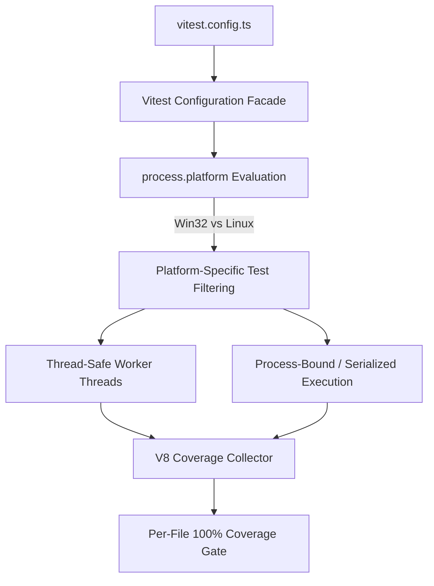
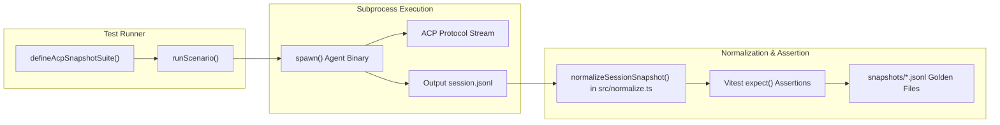
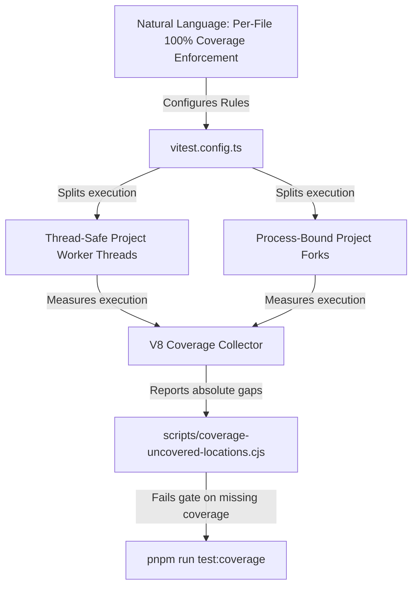
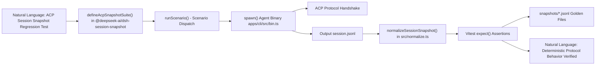

# Unit & Integration Testing

Relevant source files

The following files were used as context for generating this wiki page:

- [.agents/notes/implemented/architecture/2026-07-20-routed-model-context-and-compaction-policy.i18n.yaml](.agents/notes/implemented/architecture/2026-07-20-routed-model-context-and-compaction-policy.i18n.yaml)
- [.agents/notes/implemented/architecture/2026-07-20-routed-model-context-and-compaction-policy.md](.agents/notes/implemented/architecture/2026-07-20-routed-model-context-and-compaction-policy.md)
- [.agents/notes/implemented/architecture/2026-07-20-routed-model-context-and-compaction-policy.zh.md](.agents/notes/implemented/architecture/2026-07-20-routed-model-context-and-compaction-policy.zh.md)
- [.agents/skills/dsh-client-ui-ux/SKILL.md](.agents/skills/dsh-client-ui-ux/SKILL.md)
- [.agents/skills/dsh-code-review/SKILL.md](.agents/skills/dsh-code-review/SKILL.md)
- [.agents/skills/dsh-error-handling/SKILL.md](.agents/skills/dsh-error-handling/SKILL.md)
- [.agents/skills/dsh-responsive-ui/SKILL.md](.agents/skills/dsh-responsive-ui/SKILL.md)
- [apps/cli/tests/profiles/headless/tests/compaction.e2e.ts](apps/cli/tests/profiles/headless/tests/compaction.e2e.ts)
- [apps/cli/tests/profiles/headless/tests/harness.ts](apps/cli/tests/profiles/headless/tests/harness.ts)
- [apps/web/tests/details-session-lifecycle.e2e.ts](apps/web/tests/details-session-lifecycle.e2e.ts)
- [docs/AGENTS.md](docs/AGENTS.md)
- [docs/glossary.i18n.yaml](docs/glossary.i18n.yaml)
- [docs/glossary.md](docs/glossary.md)
- [docs/glossary.zh.md](docs/glossary.zh.md)
- [docs/subsystems/compaction.i18n.yaml](docs/subsystems/compaction.i18n.yaml)
- [docs/subsystems/compaction.md](docs/subsystems/compaction.md)
- [docs/subsystems/compaction.zh.md](docs/subsystems/compaction.zh.md)
- [docs/testing.i18n.yaml](docs/testing.i18n.yaml)
- [docs/testing.md](docs/testing.md)
- [docs/testing.zh.md](docs/testing.zh.md)
- [packages/AGENTS.md](packages/AGENTS.md)
- [packages/client/ui-sidebar-files/README.i18n.yaml](packages/client/ui-sidebar-files/README.i18n.yaml)
- [packages/client/ui-sidebar-files/README.md](packages/client/ui-sidebar-files/README.md)
- [packages/client/ui-sidebar-files/README.zh.md](packages/client/ui-sidebar-files/README.zh.md)
- [packages/client/ui-sidebar-files/src/client/FilesBody.tsx](packages/client/ui-sidebar-files/src/client/FilesBody.tsx)
- [packages/client/ui-sidebar-files/src/client/face.ts](packages/client/ui-sidebar-files/src/client/face.ts)
- [packages/client/ui-sidebar-files/src/client/store.ts](packages/client/ui-sidebar-files/src/client/store.ts)
- [packages/client/ui-sidebar-files/tests/face.client.spec.ts](packages/client/ui-sidebar-files/tests/face.client.spec.ts)
- [packages/client/ui-sidebar-files/tests/files-body.client.spec.tsx](packages/client/ui-sidebar-files/tests/files-body.client.spec.tsx)
- [packages/client/ui-sidebar-files/tests/mount.client.tsx](packages/client/ui-sidebar-files/tests/mount.client.tsx)
- [packages/compaction/compaction-basic/README.i18n.yaml](packages/compaction/compaction-basic/README.i18n.yaml)
- [packages/compaction/compaction-basic/README.md](packages/compaction/compaction-basic/README.md)
- [packages/compaction/compaction-basic/README.zh.md](packages/compaction/compaction-basic/README.zh.md)
- [packages/compaction/compaction-basic/src/config.ts](packages/compaction/compaction-basic/src/config.ts)
- [packages/compaction/compaction-basic/src/index.ts](packages/compaction/compaction-basic/src/index.ts)
- [packages/compaction/compaction-basic/src/region.ts](packages/compaction/compaction-basic/src/region.ts)
- [packages/compaction/compaction-basic/src/types.ts](packages/compaction/compaction-basic/src/types.ts)
- [packages/compaction/compaction-basic/tests/compaction-basic.spec.ts](packages/compaction/compaction-basic/tests/compaction-basic.spec.ts)
- [packages/subagent/subagent-spawn-in-process/tests/harness.ts](packages/subagent/subagent-spawn-in-process/tests/harness.ts)
- [packages/subagent/subagent/tests/working-directory.spec.ts](packages/subagent/subagent/tests/working-directory.spec.ts)
- [packages/test-support/session-snapshot/README.i18n.yaml](packages/test-support/session-snapshot/README.i18n.yaml)
- [packages/test-support/session-snapshot/README.md](packages/test-support/session-snapshot/README.md)
- [packages/test-support/session-snapshot/README.zh.md](packages/test-support/session-snapshot/README.zh.md)
- [packages/test-support/session-snapshot/src/harness.ts](packages/test-support/session-snapshot/src/harness.ts)
- [packages/test-support/session-snapshot/src/normalize.ts](packages/test-support/session-snapshot/src/normalize.ts)
- [packages/test-support/session-snapshot/src/suite.ts](packages/test-support/session-snapshot/src/suite.ts)
- [packages/test-support/session-snapshot/tests/harness.spec.ts](packages/test-support/session-snapshot/tests/harness.spec.ts)
- [packages/test-support/session-snapshot/tests/normalize.spec.ts](packages/test-support/session-snapshot/tests/normalize.spec.ts)
- [packages/test-support/session-snapshot/tests/suite.spec.ts](packages/test-support/session-snapshot/tests/suite.spec.ts)
- [scripts/doc-budgets.manifest.json](scripts/doc-budgets.manifest.json)
- [scripts/no-unknown-casts.baseline.json](scripts/no-unknown-casts.baseline.json)
- [snapshots/acp/acp.snapshot.ts](snapshots/acp/acp.snapshot.ts)
- [snapshots/session/model-switch-compaction/cordis.yml](snapshots/session/model-switch-compaction/cordis.yml)
- [snapshots/web/details-session-lifecycle/sidebar.expected.md](snapshots/web/details-session-lifecycle/sidebar.expected.md)

The DeepSeek Harness (`dsh`) testing infrastructure uses Vitest as the core test runner to enforce rigorous quality assurance across the monorepo’s packages [package.json:58-72](). Its testing strategy emphasizes deterministic reproducibility, concurrency management, and comprehensive coverage enforcement. Key components include:

- A Vitest configuration that splits tests into thread-safe and process-bound projects for safe concurrency [vitest.config.ts:1-160]().
- A strict per-file 100% coverage gate to identify dead code or uncovered paths [vitest.config.ts:10-14]().
- Snapshot testing of session event logs to verify agent interactions, using domain-specific normalization and redaction [packages/test-support/session-snapshot/src/normalize.ts:1-115]().
- An ACP-specific snapshot harness that runs real subprocesses to exercise the ACP protocol end-to-end [packages/test-support/session-snapshot/tests/harness.spec.ts:1-150]().
- Dedicated test-support packages for LLM mocking, replaying, and session snapshot management [packages/test-support/session-snapshot/README.md:1-76]().

This page details the implementation, data flows, and key functions/classes underpinning these features.

Sources:  
[package.json:58-72](),  
[vitest.config.ts:1-160](),  
[packages/test-support/session-snapshot/src/normalize.ts:1-115](),  
[packages/test-support/session-snapshot/tests/harness.spec.ts:1-150](),  
[packages/test-support/session-snapshot/README.md:1-76]()

---

## Vitest Configuration & Project Split

### Test Runner Setup

The main test configuration is defined in `vitest.config.ts`, which establishes project partitions based on test concurrency and isolation requirements [vitest.config.ts:1-160](). It configures `tsconfig-paths` using `./tsconfig.base.json` as a resolution facade so that workspace imports resolve cleanly to source files [vitest.config.ts:16-21]().

- **Thread-Safe Project:** Runs tests in parallel using Vitest’s worker threads across general packages (e.g., core agent loop logic, utility libraries, and Cordis plugin lifecycle tests).
- **Process-bound / Platform-filtered Tests:** Runs suites requiring exclusive access to process-global state, or those with strict platform constraints (e.g., POSIX shell dependent suites or Windows-only modules).

### Platform-Specific Test Filtering

The configuration explicitly filters out platform-incompatible packages or tests based on `process.platform` [vitest.config.ts:22-75]():

- **Windows Unsupported Packages:** Excludes POSIX shell-dependent packages like `packages/shell/bash-local`, `packages/shell/bash-sandbox`, and `packages/ssh/*` when running on Win32 [vitest.config.ts:22-41]().
- **Windows Unsupported Tests:** Excludes process inspector and spawn tests that rely on POSIX process modeling [vitest.config.ts:43-63]().
- **Coverage Exclusions:** Exempts platform-specific code (such as `packages/sandbox/sandbox-windows-acl/src/**/*.ts` on non-Windows hosts) from failing the per-file 100% coverage gate [vitest.config.ts:84-92]().

Sources:  
[vitest.config.ts:1-123]()

---

### Vitest Execution Flow Diagram

This diagram illustrates how `vitest.config.ts` evaluates platform constraints, filters suites, and dispatches tests to thread-safe or process-bound execution pools before feeding V8 coverage data into the quality gate.

Sources:  
[vitest.config.ts:1-160]()

---

## Quality Gates & Coverage Requirements

### Per-File 100% Coverage Policy

DeepSeek Harness enforces a strict **100% coverage requirement** per source file for lines, statements, branches, and functions [package.json:59](). 

- Enforced via `pnpm run test:coverage`, which executes Vitest with V8 coverage enabled [package.json:59]() (`vitest run --coverage`).
- A custom uncovered locations reporter (`scripts/coverage-uncovered-locations.cjs`, loaded in `vitest.config.ts:14`) prints exact `path:line:col` records for any uncovered statement or branch path when a file misses the per-file 100% threshold [vitest.config.ts:10-15]().
- Heavy or platform-exempt suites can be excluded using membership contracts defined in `scripts/coverage-exempt.ts` [vitest.config.ts:7-8]().

| Attribute | Details |
|---|---|
| Coverage Command | `pnpm run test:coverage` (`package.json`) |
| Threshold Requirement | 100% lines, statements, functions, branches per file under `src`|
| Custom Reporting | `scripts/coverage-uncovered-locations.cjs` |

Sources:  
[package.json:58-61](),  
[vitest.config.ts:1-15]()

---

## Snapshot Testing & Session Logs

### Session Event Snapshots

The system uses snapshot testing for session event logs, recording append-only interactions of the agent loop (turns, steps, messages, tool calls, and tool outputs).

- Snapshot suites are invoked via specific Vitest configuration files like `vitest.snapshot.config.ts` [package.json:70-72]().
- Controlled via the `DSH_SNAPSHOT` environment variable:
  - `replay` (default): Run against existing snapshots verifying identical output.
  - `record`: Generate fresh snapshots by calling live LLM models (`DSH_SNAPSHOT=record` via `package.json:71`).
  - `refresh`: Re-run replay inputs and update snapshots after code changes (`DSH_SNAPSHOT=refresh` via `package.json:72`).

The `packages/test-support/session-snapshot` package provides the core utilities for managing these snapshots [packages/test-support/session-snapshot/README.md:1-76](). It handles closed manifests, typed identity redaction, normalization, workspace comparison, fixture guards, and protocol adapters for various execution environments (headless, SDK, ACP, Web) [packages/test-support/session-snapshot/README.md:12]().

The `normalizeSessionSnapshot` function [packages/test-support/session-snapshot/src/normalize.ts:9]() is crucial for ensuring snapshot stability. It retains the complete session header and event payloads but omits top-level `seq`/`time` envelopes from committed fixtures after normalizing paths and scrubbing system-prompt text and tool schemas [packages/test-support/session-snapshot/README.md:73](). It also normalizes embedded stream clocks and historical packed-row `seq0`/`time0` envelopes, and catalog child-creation clocks [packages/test-support/session-snapshot/README.md:73]().

The `snapshots/` corpus contains the golden files for these tests. For example, `snapshots/session/headless.snapshot.ts` defines a recorded-session replay through the shipped headless `dsh` profile [snapshots/session/headless.snapshot.ts:1](). This file uses `defineAcpSnapshotSuite` to set up the test scenarios [packages/test-support/session-snapshot/README.md:58]().

Sources:  
[package.json:70-72](),  
[packages/test-support/session-snapshot/src/normalize.ts:1-115](),  
[packages/test-support/session-snapshot/README.md:1-76](),  
[packages/test-support/session-snapshot/README.md:12](),  
[packages/test-support/session-snapshot/README.md:73](),  
[snapshots/session/headless.snapshot.ts:1]()

---

### ACP Snapshot Harness

The ACP snapshot harness, implemented in `@deepseek-ai/dsh-session-snapshot`, defines suites that spawn real subprocesses running tested ACP profiles [packages/test-support/session-snapshot/tests/harness.spec.ts:1-150](). It exercises scenario scripts through the Agent Client Protocol, collects session logs, and verifies them against committed snapshots.

- **Normalization:** `normalizeSessionSnapshot()` in `packages/test-support/session-snapshot/src/normalize.ts` strips dynamic timestamps, variable PIDs, and local filesystem paths to ensure reproducible snapshot comparisons [packages/test-support/session-snapshot/src/normalize.ts:1-115]().
- **Tool Catalog Generation:** The `scripts/gen-tool-catalog.ts` script generates `docs/tool-catalog.md` by booting each tool plugin and collecting its runtime-computed schemas [scripts/gen-tool-catalog.ts:1-7](). This process is critical because tool schemas are not statically knowable due to runtime-spread enums, concatenated descriptions, and config-driven names [docs/tool-catalog.md:8](). The `collectToolCatalog` function in `scripts/gen-tool-catalog.ts` is responsible for this collection [packages/core/tools/tests/gen-tool-catalog.spec.ts:9](). The generated catalog is then used in system prompts and tool schema snapshots, such as `snapshots/web/fresh-round-trip/tool-schemas.expected.json` [snapshots/web/fresh-round-trip/tool-schemas.expected.json:1-154]().

Sources:  
[package.json:70-72](),  
[packages/test-support/session-snapshot/src/normalize.ts:1-115](),  
[packages/test-support/session-snapshot/tests/harness.spec.ts:1-150](),  
[scripts/gen-tool-catalog.ts:1-7](),  
[docs/tool-catalog.md:8](),  
[packages/core/tools/tests/gen-tool-catalog.spec.ts:9](),  
[snapshots/web/fresh-round-trip/tool-schemas.expected.json:1-154]()

---

### ACP Snapshot Architecture Diagram

**Explanation:**
- The suite builder initializes scenarios that spawn the agent CLI binary [packages/test-support/session-snapshot/tests/harness.spec.ts:1-150]().
- Execution produces JSONL session logs.
- `normalizeSessionSnapshot()` sanitizes volatile fields before Vitest compares them against committed golden files [packages/test-support/session-snapshot/src/normalize.ts:1-115]().

Sources:  
[package.json:70-72](),  
[packages/test-support/session-snapshot/src/normalize.ts:1-115](),  
[packages/test-support/session-snapshot/tests/harness.spec.ts:1-150]()

---

## Test Support Packages

| Package / Utility | Role & Implementation Details |
|---|---|
| `llm-mock-server` | Simulated local LLM API server for deterministic, offline testing [package.json:58-72](). |
| `llm-replay` | HTTP proxy that replays recorded dialog transcripts for snapshot testing [package.json:70-72](). |
| `dsh-session-snapshot` | Provides normalization, redaction, and snapshot suite adapters (`src/normalize.ts`) [packages/test-support/session-snapshot/src/normalize.ts:1-115](). |
| `gen-tool-catalog.ts` | Script to generate `docs/tool-catalog.md` by booting tool plugins and harvesting their runtime schemas [scripts/gen-tool-catalog.ts:1-7](). |

Sources:  
[package.json:58-72](),  
[packages/test-support/session-snapshot/src/normalize.ts:1-115](),  
[scripts/gen-tool-catalog.ts:1-7]()

---

# Bridging Concepts: Natural Language to Code Entities

### Diagram 1: Vitest Project & Coverage Architecture

This diagram bridges the natural language coverage mandate to the specific configuration (`vitest.config.ts`), V8 coverage collection, and the uncovered locations reporter script.

Sources:  
[vitest.config.ts:1-160](),  
[package.json:58-61]()

---

### Diagram 2: ACP Snapshot Execution Pipeline

This diagram connects the natural language requirement of deterministic ACP protocol regression testing to the concrete helper functions (`defineAcpSnapshotSuite`, `normalizeSessionSnapshot`) and golden files.

Sources:  
[packages/test-support/session-snapshot/src/normalize.ts:1-115](),  
[packages/test-support/session-snapshot/tests/harness.spec.ts:1-150]()

---

# References

- [`vitest.config.ts`](vitest.config.ts)
- [`package.json`](package.json)
- [`scripts/coverage-exempt.ts`](scripts/coverage-exempt.ts)
- [`packages/test-support/session-snapshot/src/normalize.ts`](packages/test-support/session-snapshot/src/normalize.ts)
- [`packages/test-support/session-snapshot/tests/harness.spec.ts`](packages/test-support/session-snapshot/tests/harness.spec.ts)
- [`scripts/gen-tool-catalog.ts`](scripts/gen-tool-catalog.ts)
- [`docs/tool-catalog.md`](docs/tool-catalog.md)

Sources:  
[vitest.config.ts:1-160](),  
[package.json:58-72](),  
[scripts/coverage-exempt.ts:1-59](),  
[packages/test-support/session-snapshot/src/normalize.ts:1-115](),  
[packages/test-support/session-snapshot/tests/harness.spec.ts:1-150](),  
[scripts/gen-tool-catalog.ts:1-7](),  
[docs/tool-catalog.md:1-30]()