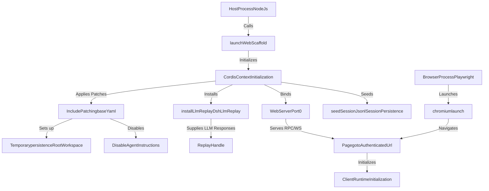
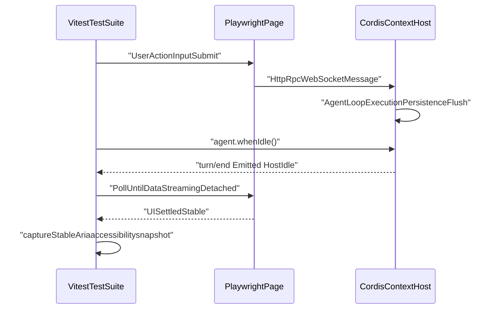
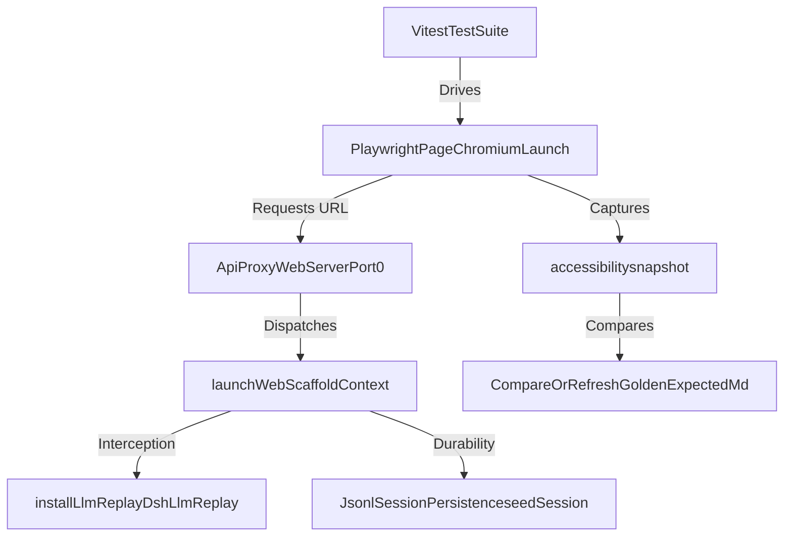

# Browser E2E Testing

Relevant source files

The following files were used as context for generating this wiki page:

- [.agents/notes/implemented/bug-fix/2026-09-20-session-open-read-coordination.i18n.yaml](.agents/notes/implemented/bug-fix/2026-09-20-session-open-read-coordination.i18n.yaml)
- [.agents/notes/implemented/bug-fix/2026-09-20-session-open-read-coordination.md](.agents/notes/implemented/bug-fix/2026-09-20-session-open-read-coordination.md)
- [.agents/notes/implemented/bug-fix/2026-09-20-session-open-read-coordination.zh.md](.agents/notes/implemented/bug-fix/2026-09-20-session-open-read-coordination.zh.md)
- [.agents/notes/implemented/testing/2026-07-24-web-gui-browser-e2e-lane.i18n.yaml](.agents/notes/implemented/testing/2026-07-24-web-gui-browser-e2e-lane.i18n.yaml)
- [.agents/notes/implemented/testing/2026-07-24-web-gui-browser-e2e-lane.md](.agents/notes/implemented/testing/2026-07-24-web-gui-browser-e2e-lane.md)
- [.agents/notes/implemented/testing/2026-07-24-web-gui-browser-e2e-lane.zh.md](.agents/notes/implemented/testing/2026-07-24-web-gui-browser-e2e-lane.zh.md)
- [apps/web/tests/README.i18n.yaml](apps/web/tests/README.i18n.yaml)
- [apps/web/tests/README.md](apps/web/tests/README.md)
- [apps/web/tests/README.zh.md](apps/web/tests/README.zh.md)
- [apps/web/tests/chat-continuous-conversation.e2e.ts](apps/web/tests/chat-continuous-conversation.e2e.ts)
- [apps/web/tests/chat-long-interactions.e2e.ts](apps/web/tests/chat-long-interactions.e2e.ts)
- [apps/web/tests/chat-scroll-fixture.ts](apps/web/tests/chat-scroll-fixture.ts)
- [apps/web/tests/complex-history.perf.ts](apps/web/tests/complex-history.perf.ts)
- [apps/web/tests/cordis-tool-round.e2e.ts](apps/web/tests/cordis-tool-round.e2e.ts)
- [apps/web/tests/declared-reasoning.e2e.ts](apps/web/tests/declared-reasoning.e2e.ts)
- [apps/web/tests/expected/composer-tab-geometry/geometry.expected.md](apps/web/tests/expected/composer-tab-geometry/geometry.expected.md)
- [apps/web/tests/expected/declared-reasoning/pointer-menu.expected.md](apps/web/tests/expected/declared-reasoning/pointer-menu.expected.md)
- [apps/web/tests/goal-command-presentation.e2e.ts](apps/web/tests/goal-command-presentation.e2e.ts)
- [apps/web/tests/idle-submission-handoff.e2e.ts](apps/web/tests/idle-submission-handoff.e2e.ts)
- [apps/web/tests/lifecycle-chrome.e2e.ts](apps/web/tests/lifecycle-chrome.e2e.ts)
- [apps/web/tests/live-interactions.e2e.ts](apps/web/tests/live-interactions.e2e.ts)
- [apps/web/tests/reference-composer.e2e.ts](apps/web/tests/reference-composer.e2e.ts)
- [apps/web/tests/scaffold.ts](apps/web/tests/scaffold.ts)
- [apps/web/tests/shortcuts-panels.e2e.ts](apps/web/tests/shortcuts-panels.e2e.ts)
- [apps/web/tests/steering.e2e.ts](apps/web/tests/steering.e2e.ts)
- [apps/web/tests/subagent-conversation.e2e.ts](apps/web/tests/subagent-conversation.e2e.ts)
- [apps/web/tests/support.ts](apps/web/tests/support.ts)
- [apps/web/tests/turn-tail-actions.e2e.ts](apps/web/tests/turn-tail-actions.e2e.ts)
- [apps/web/tsconfig.json](apps/web/tsconfig.json)
- [docs/capability-seams.i18n.yaml](docs/capability-seams.i18n.yaml)
- [docs/capability-seams.md](docs/capability-seams.md)
- [docs/capability-seams.zh.md](docs/capability-seams.zh.md)
- [docs/config-catalog.i18n.yaml](docs/config-catalog.i18n.yaml)
- [docs/config-catalog.md](docs/config-catalog.md)
- [docs/config-catalog.zh.md](docs/config-catalog.zh.md)
- [docs/event-producer-consumer.i18n.yaml](docs/event-producer-consumer.i18n.yaml)
- [docs/event-producer-consumer.md](docs/event-producer-consumer.md)
- [docs/event-producer-consumer.zh.md](docs/event-producer-consumer.zh.md)
- [docs/module-graph.i18n.yaml](docs/module-graph.i18n.yaml)
- [docs/module-graph.md](docs/module-graph.md)
- [docs/module-graph.zh.md](docs/module-graph.zh.md)
- [packages/client/ui-commands/src/client/PopupSelectView.module.css](packages/client/ui-commands/src/client/PopupSelectView.module.css)
- [packages/client/ui-subagent/README.i18n.yaml](packages/client/ui-subagent/README.i18n.yaml)
- [packages/client/ui-subagent/README.md](packages/client/ui-subagent/README.md)
- [packages/client/ui-subagent/README.zh.md](packages/client/ui-subagent/README.zh.md)
- [packages/client/ui-subagent/src/client/SubagentHeaderLineage.module.css](packages/client/ui-subagent/src/client/SubagentHeaderLineage.module.css)
- [packages/client/ui-subagent/src/client/SubagentHeaderLineage.tsx](packages/client/ui-subagent/src/client/SubagentHeaderLineage.tsx)
- [packages/client/ui-subagent/src/client/SubagentReadOnlyComposer.tsx](packages/client/ui-subagent/src/client/SubagentReadOnlyComposer.tsx)
- [packages/client/ui-subagent/src/client/index.ts](packages/client/ui-subagent/src/client/index.ts)
- [packages/client/ui-subagent/src/client/locales.ts](packages/client/ui-subagent/src/client/locales.ts)
- [packages/client/ui-subagent/src/client/sidebar-chat/index.tsx](packages/client/ui-subagent/src/client/sidebar-chat/index.tsx)
- [packages/client/ui-subagent/tests/browser-plugin.client.spec.ts](packages/client/ui-subagent/tests/browser-plugin.client.spec.ts)
- [packages/client/ui-subagent/tests/conversation-ui.client.spec.tsx](packages/client/ui-subagent/tests/conversation-ui.client.spec.tsx)
- [packages/extensions/tool-cordis/src/api-catalog.ts](packages/extensions/tool-cordis/src/api-catalog.ts)
- [pnpm-lock.yaml](pnpm-lock.yaml)
- [scripts/gen-cordis-catalog.ts](scripts/gen-cordis-catalog.ts)
- [scripts/gen-doc-graphs.ts](scripts/gen-doc-graphs.ts)
- [scripts/type-equiv.manifest.json](scripts/type-equiv.manifest.json)
- [scripts/verify-package-readme-model-experience.ts](scripts/verify-package-readme-model-experience.ts)
- [snapshots/web/lifecycle-chrome/connection-error.expected.md](snapshots/web/lifecycle-chrome/connection-error.expected.md)
- [tsconfig.base.json](tsconfig.base.json)
- [tsconfig.client.json](tsconfig.client.json)
- [tsconfig.host.json](tsconfig.host.json)

DeepSeek Harness (`dsh`) employs a hermetic Playwright-based end-to-end (E2E) testing infrastructure located in `apps/web/tests/` designed to validate the full stack, spanning from the browser UI through the host-side agent loop and tool execution [.agents/notes/implemented/testing/2026-07-24-web-gui-browser-e2e-lane.md:1-10](). This testing layer verifies real integration with persistence, the API gateway, and asynchronous model adapters using a deterministic replay mechanism and ARIA accessibility snapshot goldens.

Sources: [.agents/notes/implemented/testing/2026-07-24-web-gui-browser-e2e-lane.md:1-10]()

---

## The Web Scaffold (`launchWebScaffold`)

The keystone of browser-based E2E tests is the `launchWebScaffold()` function, defined in `apps/web/tests/scaffold.ts` [apps/web/tests/scaffold.ts:1-24](). This function boots the complete real web stack, applying configuration layers over an empty profile root.

`launchWebScaffold()` boots the real web composition from the shipped bundle configs through the vendored Loader's include mechanism [.agents/notes/implemented/testing/2026-07-24-web-gui-browser-e2e-lane.md:19](). It sets up temporary persistence roots, pins host-level `skill-filesystem` roots beneath the temp workspace with watching disabled, disables `agent-instructions` and `session-title-llm`, binds the webserver to port 0, and installs LLM replay handles [.agents/notes/implemented/testing/2026-07-24-web-gui-browser-e2e-lane.md:19]().

Cold sessions are seeded via `seedSession()` through the real persistence API—a throwaway `Context` mounting `SessionStore` and `JsonlSessionPersistence` against the host's root—ensuring valid durable state [.agents/notes/implemented/testing/2026-07-24-web-gui-browser-e2e-lane.md:23]().

### Scaffold Initialization Architecture

Sources: [.agents/notes/implemented/testing/2026-07-24-web-gui-browser-e2e-lane.md:15-24](), [apps/web/tests/scaffold.ts:1-24]()

---

## Replay, Record, and Refresh Modes

The `webSnapshotMode()` function encapsulates dispatch logic based on the `DSH_SNAPSHOT` environment variable [apps/web/tests/scaffold.ts:125-137]().

| Mode | Description |
| :--- | :--- |
| `replay` | **Default/CI Mode:** Uses `dsh-llm-replay` to replay LLM calls from prerecorded session fixture logs. |
| `record` | **Recording Mode:** Uses live adapters and credentials to record new session logs and fixtures. |
| `refresh` | **Refresh Mode:** Replays like normal but updates ARIA snapshot goldens without invoking new model calls. |

Sources: [apps/web/tests/scaffold.ts:125-137](), [.agents/notes/implemented/testing/2026-07-24-web-gui-browser-e2e-lane.md:43-45]()

---

## Determinism Barrier

Testing an asynchronous agent loop requires a strict two-phase synchronization barrier:

1. **Host-Side Barrier:** Await `agent.whenIdle()` under a timeout, keyed off the in-process `turn/end` event. This ensures the idle flip follows the persistence flush [.agents/notes/implemented/testing/2026-07-24-web-gui-browser-e2e-lane.md:27]().
2. **Browser-Side Barrier:** Poll until streaming selectors (`[data-streaming]`) detach and final text is visible, ensuring React has fully committed the render tree.

Polling persistence files or relying on Playwright's `networkidle` is strictly prohibited due to potential timing races and open SSE connections [.agents/notes/implemented/testing/2026-07-24-web-gui-browser-e2e-lane.md:27]().

### Determinism Barrier Flow

Sources: [.agents/notes/implemented/testing/2026-07-24-web-gui-browser-e2e-lane.md:27]()

---

## Playwright-based E2E Scenario Suites

Browser test suites drive Chromium and WebKit through complex workflows:

- **Lifecycle & Chrome:** Workspace-aware first-send flows, reload recovery, dark-mode token cascades [apps/web/tests/lifecycle-chrome.e2e.ts:1-49]().
- **Details Session Lifecycle:** Sidebar geometry management, panel resizing, pane states [apps/web/tests/details-session-lifecycle.e2e.ts:1-137]().
- **Cordis Historical Tool Rounds:** Historical generated-plugin card inspection without retired tool registration [apps/web/tests/cordis-tool-round.e2e.ts:1-66]().
- **Workspace Management:** Creating, renaming, grouping workspaces, and hover affordances [apps/web/tests/workspace-management.e2e.ts:1-40](). This includes driving the composed directory dialog, path editor, and handling session archiving.
- **Seeded History:** Rendering a recorded session purely from the log, including sidebar listing, history paging, tool views, and client's log-ordered transcript events [apps/web/tests/seeded-history.e2e.ts:1-31](). This also covers manual `/compact` lifecycle and command-row surfaces.
- **Navigation & Panes:** Trajectory view, timing overview, local details inspector, and sidebar search over rich seeded fixtures [apps/web/tests/navigation-panes.e2e.ts:1-36]().
- **Steering:** Testing both QueueDock and composer gestures for steering, using the question tool for deterministic pending-steering snapshots [apps/web/tests/steering.e2e.ts:1-37]().
- **Queue Actions:** Keyless browser coverage for pending queue actions, including editing and removing exact occurrences, and preserving the queue across stops [apps/web/tests/queue-actions.e2e.ts:1-33]().
- **Live Interactions:** Running-draft submission, cancellation, error surfacing, transient-retry recovery, and retry exhaustion [apps/web/tests/live-interactions.e2e.ts:1-46]().

Sources: [apps/web/tests/lifecycle-chrome.e2e.ts:1-49](), [apps/web/tests/details-session-lifecycle.e2e.ts:1-137](), [apps/web/tests/cordis-tool-round.e2e.ts:1-66](), [apps/web/tests/workspace-management.e2e.ts:1-40](), [apps/web/tests/seeded-history.e2e.ts:1-31](), [apps/web/tests/navigation-panes.e2e.ts:1-36](), [apps/web/tests/steering.e2e.ts:1-37](), [apps/web/tests/live-interactions.e2e.ts:1-46]()

---

## ARIA Accessibility Snapshot Goldens

Instead of fragile pixel-based snapshots, the E2E framework captures structured **ARIA accessibility snapshots** (`accessibility.snapshot()`) formatted as markdown trees [apps/web/tests/scaffold.ts:12-13](). These trees describe accessible roles, names, states, and text content while remaining color-blind and layout-agnostic. Discrepancies against stored `.expected.md` goldens cause test failures unless updated via `DSH_SNAPSHOT=refresh`.

For example, the `apps/web/tests/expected/plugin-manager/manager.expected.md` and `apps/web/tests/expected/plugin-manager/live-enabled.expected.md` files are examples of such goldens, capturing the ARIA tree for the plugin manager in different states.

Sources: [apps/web/tests/scaffold.ts:12-13](), [.agents/notes/implemented/testing/2026-07-24-web-gui-browser-e2e-lane.md:37-39](), [apps/web/tests/expected/plugin-manager/manager.expected.md:1-49](), [apps/web/tests/expected/plugin-manager/live-enabled.expected.md:1-49]()

---

## Web Snapshot CI Gate

All browser E2E tests run inside GitHub Actions CI on Node 24 Linux runners. They execute serially in replay mode, enforce complete fixture consumption via `ReplayHandle.assertConsumed()`, and monitor console errors or unexpected network warnings to catch regressions prior to merge [.agents/notes/implemented/testing/2026-07-24-web-gui-browser-e2e-lane.md:53]().

Sources: [.agents/notes/implemented/testing/2026-07-24-web-gui-browser-e2e-lane.md:53]()

---

## Natural Language to Code Entity Mapping

### System Components to Code Identifiers

Sources: [apps/web/tests/scaffold.ts:1-143](), [apps/web/tests/lifecycle-chrome.e2e.ts:1-68]()