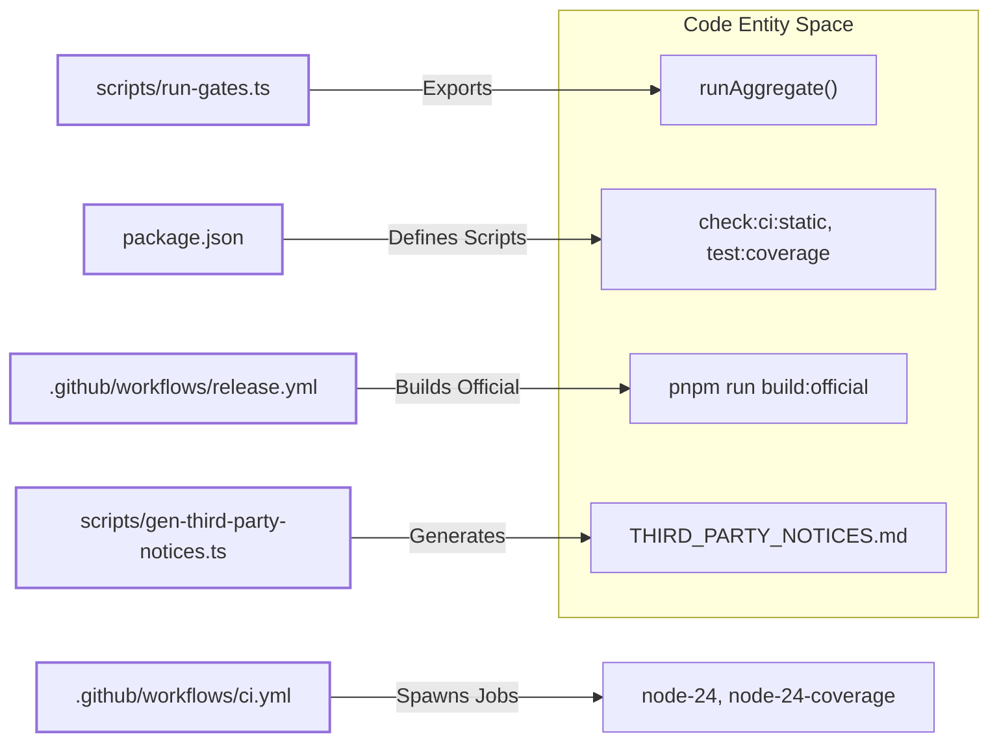

# CI/CD Pipeline

<details>
<summary>Relevant source files</summary>

The following files were used as context for generating this wiki page:

- [.agents/notes/implemented/process/2026-07-21-serial-cross-platform-ci-reference.i18n.yaml](.agents/notes/implemented/process/2026-07-21-serial-cross-platform-ci-reference.i18n.yaml)
- [.agents/notes/implemented/process/2026-07-21-serial-cross-platform-ci-reference.md](.agents/notes/implemented/process/2026-07-21-serial-cross-platform-ci-reference.md)
- [.agents/notes/implemented/process/2026-07-21-serial-cross-platform-ci-reference.zh.md](.agents/notes/implemented/process/2026-07-21-serial-cross-platform-ci-reference.zh.md)
- [.agents/notes/implemented/process/2026-07-26-ci-failover-runbook.i18n.yaml](.agents/notes/implemented/process/2026-07-26-ci-failover-runbook.i18n.yaml)
- [.agents/notes/implemented/process/2026-07-26-ci-failover-runbook.md](.agents/notes/implemented/process/2026-07-26-ci-failover-runbook.md)
- [.agents/notes/implemented/process/2026-07-26-ci-failover-runbook.zh.md](.agents/notes/implemented/process/2026-07-26-ci-failover-runbook.zh.md)
- [.agents/notes/implemented/process/2026-07-27-worktree-local-lefthook.i18n.yaml](.agents/notes/implemented/process/2026-07-27-worktree-local-lefthook.i18n.yaml)
- [.agents/notes/implemented/process/2026-07-27-worktree-local-lefthook.md](.agents/notes/implemented/process/2026-07-27-worktree-local-lefthook.md)
- [.agents/notes/implemented/process/2026-07-27-worktree-local-lefthook.zh.md](.agents/notes/implemented/process/2026-07-27-worktree-local-lefthook.zh.md)
- [.agents/notes/implemented/process/2026-07-30-generated-third-party-notices.i18n.yaml](.agents/notes/implemented/process/2026-07-30-generated-third-party-notices.i18n.yaml)
- [.agents/notes/implemented/process/2026-07-30-generated-third-party-notices.md](.agents/notes/implemented/process/2026-07-30-generated-third-party-notices.md)
- [.agents/notes/implemented/process/2026-07-30-generated-third-party-notices.zh.md](.agents/notes/implemented/process/2026-07-30-generated-third-party-notices.zh.md)
- [.agents/notes/implemented/process/2026-08-08-native-windows-pull-request-ci.i18n.yaml](.agents/notes/implemented/process/2026-08-08-native-windows-pull-request-ci.i18n.yaml)
- [.agents/notes/implemented/process/2026-08-08-native-windows-pull-request-ci.md](.agents/notes/implemented/process/2026-08-08-native-windows-pull-request-ci.md)
- [.agents/notes/implemented/process/2026-08-08-native-windows-pull-request-ci.zh.md](.agents/notes/implemented/process/2026-08-08-native-windows-pull-request-ci.zh.md)
- [.agents/notes/implemented/process/2026-08-10-npm-release-sequences.i18n.yaml](.agents/notes/implemented/process/2026-08-10-npm-release-sequences.i18n.yaml)
- [.agents/notes/implemented/process/2026-08-10-npm-release-sequences.md](.agents/notes/implemented/process/2026-08-10-npm-release-sequences.md)
- [.agents/notes/implemented/process/2026-08-10-npm-release-sequences.zh.md](.agents/notes/implemented/process/2026-08-10-npm-release-sequences.zh.md)
- [.agents/notes/implemented/process/2026-10-05-pr-artifact-typechecks.i18n.yaml](.agents/notes/implemented/process/2026-10-05-pr-artifact-typechecks.i18n.yaml)
- [.agents/notes/implemented/process/2026-10-05-pr-artifact-typechecks.md](.agents/notes/implemented/process/2026-10-05-pr-artifact-typechecks.md)
- [.agents/notes/implemented/process/2026-10-05-pr-artifact-typechecks.zh.md](.agents/notes/implemented/process/2026-10-05-pr-artifact-typechecks.zh.md)
- [.agents/notes/implemented/process/2026-10-20-weighted-approval-status-gate-with-check-run-label.i18n.yaml](.agents/notes/implemented/process/2026-10-20-weighted-approval-status-gate-with-check-run-label.i18n.yaml)
- [.agents/notes/implemented/process/2026-10-20-weighted-approval-status-gate-with-check-run-label.md](.agents/notes/implemented/process/2026-10-20-weighted-approval-status-gate-with-check-run-label.md)
- [.agents/notes/implemented/process/2026-10-20-weighted-approval-status-gate-with-check-run-label.zh.md](.agents/notes/implemented/process/2026-10-20-weighted-approval-status-gate-with-check-run-label.zh.md)
- [.agents/skills/dsh-pre-push-checks/SKILL.md](.agents/skills/dsh-pre-push-checks/SKILL.md)
- [.github/AGENTS.md](.github/AGENTS.md)
- [.github/review-ownership/README.md](.github/review-ownership/README.md)
- [.github/review-ownership/check-approval.mjs](.github/review-ownership/check-approval.mjs)
- [.github/review-ownership/check-approval.test.mjs](.github/review-ownership/check-approval.test.mjs)
- [.github/workflows/build-exe-for-python-sdk.yml](.github/workflows/build-exe-for-python-sdk.yml)
- [.github/workflows/build-preview-cloudflare.yml](.github/workflows/build-preview-cloudflare.yml)
- [.github/workflows/ci-master.yml](.github/workflows/ci-master.yml)
- [.github/workflows/ci.yml](.github/workflows/ci.yml)
- [.github/workflows/docs-pages.yml](.github/workflows/docs-pages.yml)
- [.github/workflows/e2e.yml](.github/workflows/e2e.yml)
- [.github/workflows/pi-ai-provider-e2e.yml](.github/workflows/pi-ai-provider-e2e.yml)
- [.github/workflows/pr-check-after-approve.yml](.github/workflows/pr-check-after-approve.yml)
- [.github/workflows/pr-check-on-base-branch.yml](.github/workflows/pr-check-on-base-branch.yml)
- [.github/workflows/pr-check-on-head-branch.yml](.github/workflows/pr-check-on-head-branch.yml)
- [.github/workflows/release-publish.yml](.github/workflows/release-publish.yml)
- [.github/workflows/release-vendor-publish.yml](.github/workflows/release-vendor-publish.yml)
- [.github/workflows/release-vendor.yml](.github/workflows/release-vendor.yml)
- [.github/workflows/release.yml](.github/workflows/release.yml)
- [.github/workflows/sandbox.yml](.github/workflows/sandbox.yml)
- [.github/workflows/weighted-approval.yml](.github/workflows/weighted-approval.yml)
- [.gitlab-ci.yml](.gitlab-ci.yml)
- [AGENTS.md](AGENTS.md)
- [THIRD_PARTY_NOTICES.md](THIRD_PARTY_NOTICES.md)
- [apps/desktop/scripts/runtime-patch-policy.ts](apps/desktop/scripts/runtime-patch-policy.ts)
- [apps/desktop/tests/prepare-runtime-patches.spec.ts](apps/desktop/tests/prepare-runtime-patches.spec.ts)
- [docs/development.i18n.yaml](docs/development.i18n.yaml)
- [docs/development.md](docs/development.md)
- [docs/development.zh.md](docs/development.zh.md)
- [lefthook.yml](lefthook.yml)
- [package.json](package.json)
- [packages/README.i18n.yaml](packages/README.i18n.yaml)
- [packages/README.md](packages/README.md)
- [packages/README.zh.md](packages/README.zh.md)
- [packages/experimental/README.i18n.yaml](packages/experimental/README.i18n.yaml)
- [packages/experimental/README.md](packages/experimental/README.md)
- [packages/experimental/README.zh.md](packages/experimental/README.zh.md)
- [packages/experimental/forge-session/tests/commands.spec.ts](packages/experimental/forge-session/tests/commands.spec.ts)
- [packages/experimental/forge-session/tests/reference-lookup.spec.ts](packages/experimental/forge-session/tests/reference-lookup.spec.ts)
- [packages/llm/llm-pi-ai/package.json](packages/llm/llm-pi-ai/package.json)
- [packages/llm/llm-pi-ai/tests/provider-apis.e2e.ts](packages/llm/llm-pi-ai/tests/provider-apis.e2e.ts)
- [packages/llm/llm-pi-ai/tests/sdk-options.spec.ts](packages/llm/llm-pi-ai/tests/sdk-options.spec.ts)
- [packages/sandbox/sandbox-local/tests/packed-install.e2e.ts](packages/sandbox/sandbox-local/tests/packed-install.e2e.ts)
- [pnpm-workspace.yaml](pnpm-workspace.yaml)
- [scripts/build.spec.ts](scripts/build.spec.ts)
- [scripts/build.ts](scripts/build.ts)
- [scripts/ci-workflow.spec.ts](scripts/ci-workflow.spec.ts)
- [scripts/compile-referenced-projects.ts](scripts/compile-referenced-projects.ts)
- [scripts/gen-third-party-notices.spec.ts](scripts/gen-third-party-notices.spec.ts)
- [scripts/gen-third-party-notices.ts](scripts/gen-third-party-notices.ts)
- [scripts/install-lefthook.mjs](scripts/install-lefthook.mjs)
- [scripts/install-lefthook.spec.ts](scripts/install-lefthook.spec.ts)
- [scripts/pre-merge-check.spec.ts](scripts/pre-merge-check.spec.ts)
- [scripts/pre-merge-check.ts](scripts/pre-merge-check.ts)
- [scripts/preview-workflow.spec.ts](scripts/preview-workflow.spec.ts)
- [scripts/release/bump.ts](scripts/release/bump.ts)
- [scripts/release/families.spec.ts](scripts/release/families.spec.ts)
- [scripts/release/families.ts](scripts/release/families.ts)
- [scripts/release/pack.ts](scripts/release/pack.ts)
- [scripts/release/process.ts](scripts/release/process.ts)
- [scripts/release/publish.spec.ts](scripts/release/publish.spec.ts)
- [scripts/release/publish.ts](scripts/release/publish.ts)
- [scripts/release/tarball.ts](scripts/release/tarball.ts)
- [scripts/release/verify-packed-install.ts](scripts/release/verify-packed-install.ts)
- [scripts/release/verify.ts](scripts/release/verify.ts)
- [scripts/run-gates.spec.ts](scripts/run-gates.spec.ts)
- [scripts/run-gates.ts](scripts/run-gates.ts)
- [scripts/tests/ci-release-selfhosted.spec.ts](scripts/tests/ci-release-selfhosted.spec.ts)
- [scripts/verify-version-sync.spec.ts](scripts/verify-version-sync.spec.ts)
- [scripts/verify-version-sync.ts](scripts/verify-version-sync.ts)
- [scripts/wine-windows-gates.sh](scripts/wine-windows-gates.sh)
- [tsconfig.json](tsconfig.json)
- [vitest.config.ts](vitest.config.ts)

</details>


The DeepSeek Harness (DSH) CI/CD infrastructure provides a multi-platform verification system driven by GitHub Actions workflows. It balances throughput, verification fidelity, and resource efficiency by orchestrating concurrent Linux and Windows jobs across hosted and self-hosted runner pools. Low-latency feedback loops are enforced via strict quality gates, including per-file test coverage, failover runners, and automated review/issue governance.

---

## Pipeline Architecture & Triggering

The primary CI orchestration is defined in `.github/workflows/ci.yml` [.github/workflows/ci.yml:1-76](). Linux verification consolidates into concurrent runner jobs, while Windows verification uses dual-path execution consisting of Wine-based compatibility checks on Linux runners and native Windows tests on dedicated hosts.

- **Triggers:** The main validation workflow runs on pull requests (`pull_request` event) [.github/workflows/ci.yml:3-4]().
- **Concurrency Control:** Executions are grouped by workflow and git reference (`${{ github.workflow }}-${{ github.ref }}`) [.github/workflows/ci.yml:17-19](). Superseded runs are automatically cancelled to reduce runner queue congestion [.github/workflows/ci.yml:14-19]().
- **Environment Settings:** `PRIMARY_NODE_VERSION` is pinned to `'24'` [.github/workflows/ci.yml:9](), and `DSH_TELEMETRY_DISABLED` is set to `'1'` to prevent telemetry emission in CI [.github/workflows/ci.yml:11-12]().

| Variable | Purpose |
| --- | --- |
| `PRIMARY_NODE_VERSION` | Fixed Node.js version (`24`) enforced across CI jobs [.github/workflows/ci.yml:9]() |
| `DSH_TELEMETRY_DISABLED` | Disables telemetry reporting inside tests and build artifacts (`1`) [.github/workflows/ci.yml:11-12]() |
| `DSH_CI_FAILOVER_LINUX` | Retargets Linux jobs onto self-hosted (`selfhosted`) or Blacksmith pools (`blacksmith`) [.github/workflows/ci.yml:27-41]() |
| `DSH_CI_FAILOVER_WINDOWS` | Switches native Windows jobs to internal self-hosted runner pools [.github/workflows/ci.yml:39-40]() |

Sources:
- [.github/workflows/ci.yml:1-57]()
- [scripts/ci-workflow.spec.ts:47-54]()

---

## Key CI Jobs & Execution Topology

Verification splits execution into distinct enterprise jobs that isolate static analysis, coverage partitions, and consumer builds.

| Job | Platform | Functionality | Blocking for Merge |
| --- | --- | --- | --- |
| `node-24` | Linux (16-core) | Static analysis, linting, typechecks, and docs verification | Yes [.github/workflows/ci.yml:41-49]() |
| `node-24-coverage` | Linux (16-core) | Partitioned test execution enforcing 100% per-file coverage | Yes [.github/workflows/ci.yml:108-116]() |
| `node-24-consumers` | Linux (16-core) | downstream consumers, archive gates, and package integrity | Yes |

### Linux Primary Job (`node-24`)
- **Runner:** Executes on `dsh-ubuntu-24-04-16core` (or failover pools) [.github/workflows/ci.yml:43-48]().
- **Configuration:** Sets `DSH_GATE_CONCURRENCY=8` and `DSH_GATE_FAIL_FAST=1` to abort early on blocking failures [.github/workflows/ci.yml:52-55]().
- **Execution:** Fetches full commit history (`fetch-depth: 0`) and runs `pnpm run check:ci:static` [.github/workflows/ci.yml:63-107]().

### Coverage Job (`node-24-coverage`)
- **Runner:** Shares the 16-core Linux hosted pool [.github/workflows/ci.yml:110-115]().
- **Parameters:** Configures `DSH_COVERAGE_MAX_WORKERS=6`, `DSH_COVERAGE_PARTITIONS=4`, `DSH_GATE_CONCURRENCY=3`, and an extended test timeout `DSH_COVERAGE_TEST_TIMEOUT_MS='90000'` [.github/workflows/ci.yml:119-129]().

Sources:
- [.github/workflows/ci.yml:41-134]()

---

## Failover and Resilience Runbook

Failover is implemented via repository variables to handle interruptions in hosted runner availability.

- **Linux Failover (`DSH_CI_FAILOVER_LINUX`):** Setting this repository variable to `'selfhosted'` routes Linux jobs (`node-24`, `node-24-coverage`, `node-24-consumers`) to the `vm-backup` pool [.github/workflows/ci.yml:27-48](). Setting it to `'blacksmith'` routes jobs to Blacksmith's hosted runners [.github/workflows/ci.yml:35-37]().
- **Windows Failover (`DSH_CI_FAILOVER_WINDOWS`):** Retargets native Windows execution to internal standby infrastructure.
- **Standby Validation:** Master push pipelines continuously run serial selfhosted standby lanes to guarantee failover pool readiness [.github/workflows/ci.yml:38-39]().

Sources:
- [.github/workflows/ci.yml:27-41]()
- [.github/workflows/ci.yml:93-94]()

---

## Gate Orchestration (`scripts/run-gates.ts`)

The gate orchestrator `scripts/run-gates.ts` manages aggregate execution modes, dependency resolution, and process diagnostics.

- **Modes:** Defines explicit execution aggregates such as `ci-primary`, `ci-static`, `ci-coverage`, `ci-unit`, `ci-bench`, and `check-all` [scripts/run-gates.ts:19-39]().
- **Scheduler:** Executes registered `Gate` definitions using `runAggregate()` and `runGates()`, respecting worker concurrency limits set by `DSH_GATE_CONCURRENCY` [scripts/run-gates.ts:126-136]().
- **Fail-Fast:** When `DSH_GATE_FAIL_FAST=1` or `cliGateOptions()` is invoked with `failFast: true`, the scheduler aborts pending tasks and cleans up child processes upon the first blocking failure [scripts/run-gates.ts:132-152]().

Sources:
- [scripts/run-gates.ts:1-1712]()
- [scripts/run-gates.spec.ts:1-1392]()

---

## Vitest Configuration for CI (`vitest.config.ts`)

`vitest.config.ts` partitions test execution across platforms, isolating environment-specific suites:

- **Platform Exclusions:** Platform-conditional arrays filter out suites that require POSIX shells or Unix sockets when running natively on Windows (`windowsUnsupportedPackages`, `windowsUnsupportedTests`) [vitest.config.ts:24-65]().
- **Coverage Exclusions:** Excludes native Windows-only dynamic libraries (e.g., `sandbox-windows-acl`) and isolated child-process runners from Linux per-file coverage requirements [vitest.config.ts:78-121]().

Sources:
- [vitest.config.ts:1-126]()

---

## Release and Publish Workflows

Publishing and distribution are handled by specialized GitHub Actions workflows:

- **Official Builds:** Workflows like `release.yml` invoke `pnpm run build:official` or `pnpm run build:artifacts --profile official` to compile verified binaries [package.json:21-25]().
- **Vendor Libraries:** `release-vendor.yml` compiles host reference libraries via `pnpm run build:lib:host` [package.json:27]().
- **Python SDK Executable Builder (`build-exe-for-python-sdk.yml`):** Orchestrates a multi-stage workflow consisting of `plan`, `sdk-wheel`, and a matrix-driven `build` job to produce standalone Python SDK executables [scripts/ci-workflow.spec.ts:70-86]().

Sources:
- [package.json:21-51]()
- [scripts/ci-workflow.spec.ts:51-124]()

---

## Lefthook Hooks and Local Quality Gates

Local hooks enforce style, linter, and type checks before code is committed or pushed.

- **Hook Installation:** During `pnpm install`, `scripts/install-lefthook.mjs` configures worktree-local Lefthook hooks [docs/development.md:33-36](). If required, hooks can be re-installed manually via `node scripts/install-lefthook.mjs` [docs/development.md:39-44]().
- **Configuration:** `lefthook.yml` maps git lifecycle events (such as `pre-commit` and `pre-push`) to linter and typecheck commands.

Sources:
- [docs/development.md:33-44]()
- [lefthook.yml]()

---

## Third-Party Notices Generation

The pipeline ensures legal compliance and dependency transparency through automated notice verification.

- **Generator:** `scripts/gen-third-party-notices.ts` compiles direct dependencies, runtime npm closures, and vendored code licenses into `THIRD_PARTY_NOTICES.md` [THIRD_PARTY_NOTICES.md:1-10]().
- **Test Assertion:** `scripts/gen-third-party-notices.spec.ts` enforces that committed documentation matches generated outputs during CI check runs [THIRD_PARTY_NOTICES.md:8]().

Sources:
- [THIRD_PARTY_NOTICES.md:1-15]()
- [scripts/gen-third-party-notices.ts]()
- [scripts/gen-third-party-notices.spec.ts]()

---

## Issue and Review-Ownership Automation

Repository governance is maintained via automated test suites located in `.github/review-ownership/` and `.github/issue-management/`.

- **Approval Policy Tests:** `pnpm test:approval-policy` executes `check-approval.test.mjs`, `blame-ownership.test.mjs`, and `author-weight.test.mjs` to validate review ownership [package.json:70]().
- **Issue Policy Tests:** `pnpm test:issue-management` runs `policy.test.mjs` to ensure issue triage and labelling conform to repository rules [package.json:71]().

Sources:
- [package.json:70-72]()
- [.github/review-ownership/check-approval.test.mjs]()

---

# Natural Language to Code Entity Mapping Diagrams

## Pipeline Job to Gate Orchestrator Mapping

```mermaid
graph TD
  "StaticAnalysisJob" -->|"Invokes"| node24["node-24"]
  "CoveragePartitionJob" -->|"Invokes"| node24cov["node-24-coverage"]
  "ConsumerBuildJob" -->|"Invokes"| node24cons["node-24-consumers"]
  "GateRunner" -->|"Executes"| runAggregate["runAggregate()"]
  "VitestRunner" -->|"Configures"| vitestCfg["vitest.config.ts"]

  subgraph "Code Entity Space"
    node24
    node24cov
    node24cons
    runAggregate
    vitestCfg
  end

  style node24 stroke-width: 2px
  style node24cov stroke-width: 2px
  style node24cons stroke-width: 2px
  style runAggregate stroke-width: 2px
  style vitestCfg stroke-width: 2px
```
Sources:
- [.github/workflows/ci.yml:41-134]()
- [scripts/run-gates.ts:126-141]()
- [vitest.config.ts:1-10]()

## CI Configuration and Scripts to Implementation Modules


Sources:
- [.github/workflows/ci.yml:1-134]()
- [scripts/run-gates.ts:1-141]()
- [package.json:21-95]()
- [.github/workflows/release.yml]()
- [scripts/gen-third-party-notices.ts]()

---

# Summary

The DeepSeek Harness CI/CD pipeline enforces high-reliability software delivery through:
- Multi-platform GitHub Actions workflows with concurrency cancellation [.github/workflows/ci.yml:14-19]().
- Partitioned per-file 100% test coverage checks [scripts/run-gates.ts:126-141]().
- Configurable failover pools for Linux and Windows runners [.github/workflows/ci.yml:27-41]().
- Programmatic gate scheduling via `scripts/run-gates.ts` [scripts/run-gates.ts:1-1712]().
- Integrated release packaging, Lefthook pre-commit protection, automated third-party notice generation, and review governance [package.json:70-72]().

Sources:
- [.github/workflows/ci.yml:1-584]()
- [scripts/run-gates.ts:1-1712]()
- [package.json:21-95]()