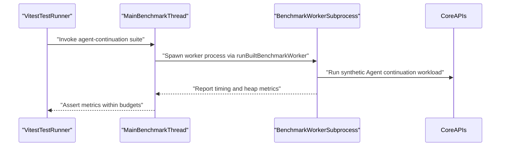
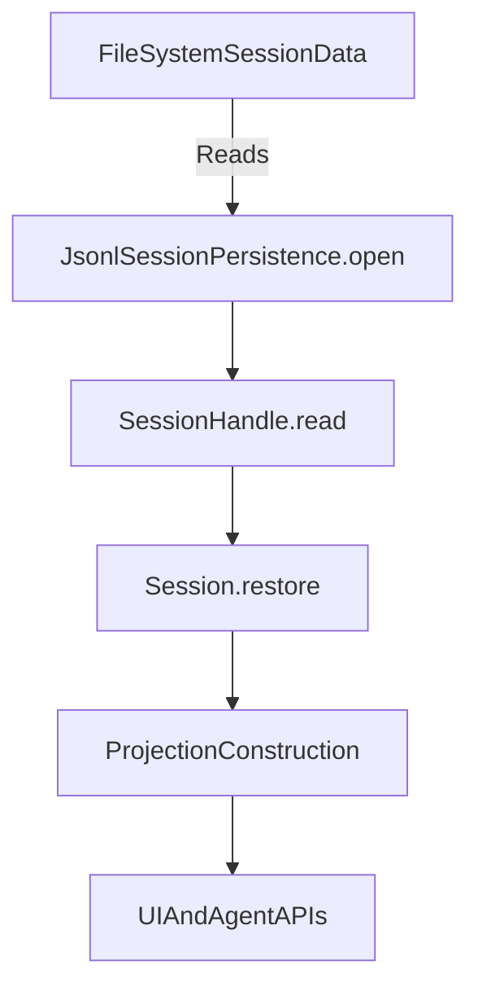
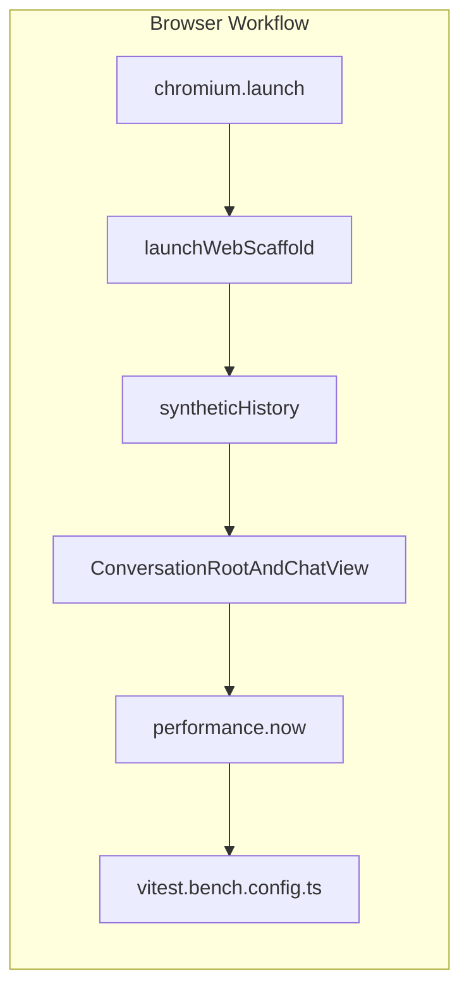
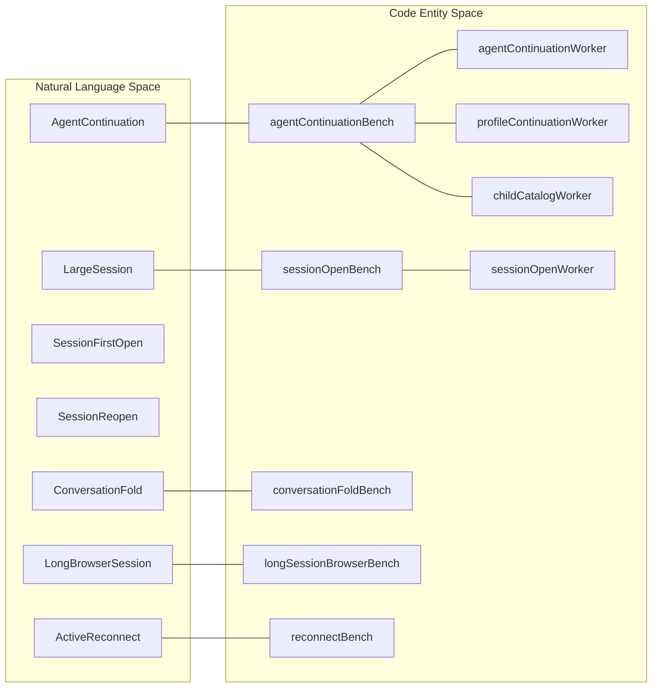

# Performance Benchmarks & Budgets

Relevant source files

The following files were used as context for generating this wiki page:

- [.agents/notes/implemented/testing/2026-09-06-frontend-performance-budgets.i18n.yaml](.agents/notes/implemented/testing/2026-09-06-frontend-performance-budgets.i18n.yaml)
- [.agents/notes/implemented/testing/2026-09-06-frontend-performance-budgets.md](.agents/notes/implemented/testing/2026-09-06-frontend-performance-budgets.md)
- [.agents/notes/implemented/testing/2026-09-06-frontend-performance-budgets.zh.md](.agents/notes/implemented/testing/2026-09-06-frontend-performance-budgets.zh.md)
- [benchmarks/active-stream-reconnect/README.i18n.yaml](benchmarks/active-stream-reconnect/README.i18n.yaml)
- [benchmarks/active-stream-reconnect/README.md](benchmarks/active-stream-reconnect/README.md)
- [benchmarks/active-stream-reconnect/README.zh.md](benchmarks/active-stream-reconnect/README.zh.md)
- [benchmarks/long-session-browser/README.i18n.yaml](benchmarks/long-session-browser/README.i18n.yaml)
- [benchmarks/long-session-browser/README.md](benchmarks/long-session-browser/README.md)
- [benchmarks/long-session-browser/README.zh.md](benchmarks/long-session-browser/README.zh.md)
- [benchmarks/long-session-browser/long-session.bench.ts](benchmarks/long-session-browser/long-session.bench.ts)
- [benchmarks/long-session-browser/synthetic-history.ts](benchmarks/long-session-browser/synthetic-history.ts)

This page documents the performance benchmark suites and budgets implemented in the DeepSeek Harness (`dsh`) codebase, primarily under the `benchmarks/` workspace. It covers benchmark categories including backend agent continuation, session opening, conversation folding, and frontend long-session browser interaction. This page also explains the architecture of the benchmark infrastructure, the performance gate enforcement, and the frontend performance budgets including the session-open performance gate.

---

## 1. Purpose and Scope

The DeepSeek Harness project includes several explicit benchmark suites measuring key user-path performance scenarios in isolation and under CI. These benchmarks quantify runtime and resource usage of backend and frontend components relating to user interaction with Sessions, Agents, and Conversations.

- **Backend benchmarks**: Validate efficient handling of long session histories, cold tool-heavy agent continuation, and catalog processing [benchmarks/AGENTS.md:1-18]().
- **Session open benchmarks**: Critical CI gate enforcing that large Sessions can open within strict time and memory budgets [.agents/notes/implemented/testing/2026-09-04-session-open-performance-gate.md:7-15]().
- **Conversation fold benchmarks**: Measure folding (reduction) of large conversation histories for display or processing [benchmarks/session-open/session-open.bench.ts:32-33]().
- **Frontend long-session browser benchmarks**: Measure browser rendering and responsiveness in interactive conversation use cases including streaming replies and pagination [.agents/notes/implemented/testing/2026-09-06-frontend-performance-budgets.md:13-19]().

Budgets are established as upper bounds on timing, heap retention, and other memory metrics and are enforced within CI to prevent regressions.

Sources:
- [benchmarks/AGENTS.md:1-18]()
- [.agents/notes/implemented/testing/2026-09-04-session-open-performance-gate.md:7-15]()
- [.agents/notes/implemented/testing/2026-09-06-frontend-performance-budgets.md:13-19]()

---

## 2. Benchmarks Overview and Workspace Layout

All benchmark code and related fixtures reside under the top-level `benchmarks/` directory, grouped by scenario:

- `agent-continuation/`: Benchmarks backend Agent continuation performance involving large histories, tool pipelines, and catalog processing [benchmarks/AGENTS.md:1-18]().
- `session-open/`: Benchmarks the performance of opening large Session persistence data, including migration, reading, Session state restoration, and data projections [.agents/notes/implemented/testing/2026-09-04-session-open-performance-gate.md:27-31]().
- `conversation-fold/`: Measures folding performance of large conversation histories via the real `ConversationNodeAssembler` and chat definitions in Node.js [.agents/notes/implemented/testing/2026-09-04-session-open-performance-gate.md:32]().
- `long-session-browser/`: Executes a Chromium-based browser workflow measuring interactive performance of opening, navigating, and interacting with long conversation sessions in the real UI [benchmarks/long-session-browser/long-session.bench.ts:28-32]().
- `active-stream-reconnect/`: Measures production client folding when a reconnect carries an unfinished reasoning prefix [benchmarks/active-stream-reconnect/README.md:1-6]().

Key design points:
- Backend benchmarks run on compiled JavaScript under plain Node without `NODE_OPTIONS` or TypeScript runtime overhead [benchmarks/AGENTS.md:7]().
- Frontend benchmarks run with Playwright against fully built Web app bundles in headless Chromium [benchmarks/long-session-browser/long-session.bench.ts:5-9]().
- Each benchmark spawns fresh child processes or browser instances per sample to avoid state leakage [benchmarks/AGENTS.md:10]().
- Measurements include wall-clock time endpoints, forced GC and heap snapshots, and memory RSS metrics [benchmarks/AGENTS.md:10-11]().

Sources:
- [benchmarks/AGENTS.md:1-18]()
- [benchmarks/long-session-browser/long-session.bench.ts:1-33]()
- [benchmarks/active-stream-reconnect/README.md:1-7]()
- [.agents/notes/implemented/testing/2026-09-04-session-open-performance-gate.md:27-32]()

---

## 3. Agent Continuation Benchmarks

### 3.1 Purpose

The `agent-continuation` benchmark suite measures backend performance of resuming Agents with large session histories and tool execution workflows, including discovering inactive fork child Agents without reliance on network or real users [benchmarks/AGENTS.md:1-18]().

### 3.2 Implementation Details

- Synthetic workloads seed persistent data directories with Sessions of 100+ turns and tool calls to create realistic load [benchmarks/AGENTS.md:9]().
- Benchmark workers run via `runBuiltBenchmarkWorker()` [benchmarks/support/built-worker.ts]() which spawns isolated Node child processes [benchmarks/AGENTS.md:7]().
- Timings recorded include scenarios like request history, catalog processing, and tool continuation.
- Budgets enforce strict CPU time ceilings and retained heap limits after forced garbage collection [benchmarks/AGENTS.md:10-11]().

### 3.3 Data Flow and Key Entities

Title: "Agent Continuation Execution Flow"

Sources:
- [benchmarks/AGENTS.md:1-18]()
- [benchmarks/support/built-worker.ts]()

---

## 4. Session Open Benchmarks and Performance Gate

### 4.1 Purpose

This suite benchmarks the time and memory costs of opening large Sessions from disk, including migrating from earlier formats, reading persistence stores, restoring Session state, and constructing client-visible data projections [.agents/notes/implemented/testing/2026-09-04-session-open-performance-gate.md:7-9]().

It is a required CI gate preventing regressions that might increase first-open times from ~35 ms to multiple seconds on large 127,400-event synthetic logs [.agents/notes/implemented/testing/2026-09-04-session-open-performance-gate.md:7-9]().

### 4.2 Benchmark Description

- Uses synthetic released-v0 session data with 127,400 logical events constructed deterministically [.agents/notes/implemented/testing/2026-09-04-session-open-performance-gate.md:19]().
- Benchmarks two lifecycle points: `first-open` (includes migration and initial read) and `post-upgrade-reopen` (simulates subsequent open reading migrated data without migration overhead) [.agents/notes/implemented/testing/2026-09-04-session-open-performance-gate.md:20-22]().
- Measures timings for `openMs`, `readMs`, `sessionRestoreMs`, and `projectionMs` individually [.agents/notes/implemented/testing/2026-09-04-session-open-performance-gate.md:28-29]().

### 4.3 Data Flow Diagram

Title: "Session Open Persistence Data Flow"

Sources:
- [.agents/notes/implemented/testing/2026-09-04-session-open-performance-gate.md:7-32]()
- [benchmarks/session-open/session-open.bench.ts:1-35]()

---

## 5. Conversation Fold Benchmarks

### 5.1 Purpose

Measure efficiency in folding large conversation histories to reduce data size for UI rendering and processing [.agents/notes/implemented/testing/2026-09-04-session-open-performance-gate.md:32]().

### 5.2 Implementation Details

- Uses the real `ConversationNodeAssembler` and full Chat Definition to fold conversation chat history [.agents/notes/implemented/testing/2026-09-04-session-open-performance-gate.md:32]().
- Benchmarks fold both small and large V2 history windows for accurate scaling measurement [.agents/notes/implemented/testing/2026-09-04-session-open-performance-gate.md:32]().
- Runs in Node.js without UI rendering to isolate computation time [benchmarks/AGENTS.md:7]().

Sources:
- [.agents/notes/implemented/testing/2026-09-04-session-open-performance-gate.md:32]()
- [benchmarks/AGENTS.md:7]()

---

## 6. Frontend Long-Session Browser Benchmarks and Budgets

### 6.1 Purpose

Validate browser responsiveness and rendering performance during realistic user workflows involving long conversation opening, older-page pagination, Trajectory activation, chat return, streamed partial replies, and trusted draft typing [.agents/notes/implemented/testing/2026-09-06-frontend-performance-budgets.md:13-17]().

### 6.2 Implementation Details

- Runs fully built Web shell artifacts loaded in headless Chromium via Playwright [benchmarks/long-session-browser/long-session.bench.ts:5-9]().
- Sequential workflow involves cold open, older page navigation to nine earlier pages, trajectory activation, chat return, and paced, trusted keyboard reply entry [.agents/notes/implemented/testing/2026-09-06-frontend-performance-budgets.md:13-17]().
- Input dataset contains 240 closed turns, 40 tool results, 20 code fences, mixed language prose, and reasoning events [.agents/notes/implemented/testing/2026-09-06-frontend-performance-budgets.md:17]().

### 6.3 Data Flow Diagram

Title: "Browser Workflow Architecture and Execution"

Sources:
- [benchmarks/long-session-browser/long-session.bench.ts:1-120]()
- [.agents/notes/implemented/testing/2026-09-06-frontend-performance-budgets.md:13-19]()

---

## 7. Performance Gate Enforcement and CI Integration

- Benchmarks run in a dedicated CI job on Linux hosted runners [.agents/notes/implemented/testing/2026-09-04-session-open-performance-gate.md:15]().
- Enforce median timing and heap budgets calibrated from reference hardware and prior CI data [.agents/notes/implemented/testing/2026-09-04-session-open-performance-gate.md:40]().
- Vitest runs each benchmark file independently, launching multiple fresh-process samples per test to ensure isolation [benchmarks/AGENTS.md:10]().
- Forced garbage collection before and after measurement isolates heap used by live Session data from transient allocations [.agents/notes/implemented/testing/2026-09-04-session-open-performance-gate.md:36]().

Sources:
- [.agents/notes/implemented/testing/2026-09-04-session-open-performance-gate.md:15-40]()
- [benchmarks/AGENTS.md:10-18]()

---

## 8. Glossary: Natural Language Terms to Code Entities

This diagram bridges user-facing concepts to concrete code entities and benchmark files.

Title: "Concept to Code Mapping"

Sources:
- [benchmarks/session-open/session-open.bench.ts:1-30]()
- [benchmarks/long-session-browser/long-session.bench.ts:1-35]()

---

## 9. Summary Table of Benchmarks and Budgets

| Benchmark Suite | Context | Environment | Key Metrics | Typical Budget (Median) |
|---|---|---|---|---|
| Agent Continuation | Backend agent resume | Node.js workers | CPU time (ms), heap retention (MB) | ~900 ms for continuation, ~23 MB heap |
| Session Open | Large Session disk open | Node.js workers | `openMs`, `readMs`, `sessionRestoreMs`, `projectionMs` | ~550 ms (first-open `openMs`), 63 ms (current generation `openMs`), 20 ms (read), 60 ms (restore), 35 ms (projection) |
| Conversation Fold | Conversation folding in Node | Node.js client files | Fold time (ms) | 40 ms (absolute), 3.125x delta scaling |
| Long-Session Browser | Browser rendering & input | Headless Chromium | Wall time, main thread tasks, typing latency | 1125 ms (open), 875 ms (slowest page), 650 ms (trajectory), 2750 ms (first reply) |
| Active Reconnect | Client stream reconstruction | Node.js child workers | Replacement time (ms), retained heap (MiB) | 40 ms (replacement), 30 MiB (heap) |

Sources:
- [.agents/notes/implemented/testing/2026-09-06-frontend-performance-budgets.md:27-37]()
- [.agents/notes/implemented/testing/2026-09-04-session-open-performance-gate.md:65-75]()

---

## 10. Further Reading

- Backend continuation benchmarks and infrastructure: `benchmarks/agent-continuation/README.md`
- Session open CI gate and detailed benchmarks: `.agents/notes/implemented/testing/2026-09-04-session-open-performance-gate.md`
- Frontend browser performance budgets and workflow: `.agents/notes/implemented/testing/2026-09-06-frontend-performance-budgets.md`

Sources:
- [benchmarks/AGENTS.md:1-18]()
- [.agents/notes/implemented/testing/2026-09-04-session-open-performance-gate.md:1-125]()
- [.agents/notes/implemented/testing/2026-09-06-frontend-performance-budgets.md:1-107]()