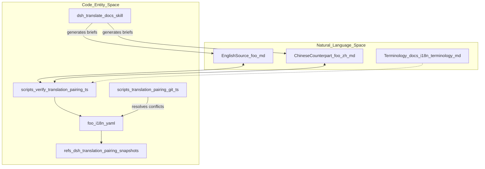
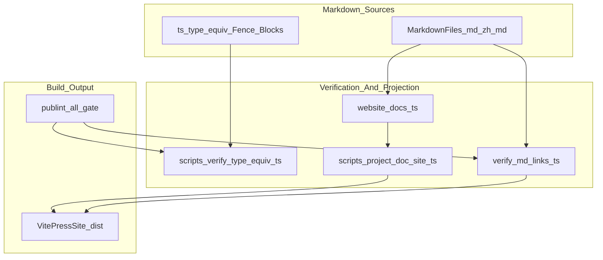
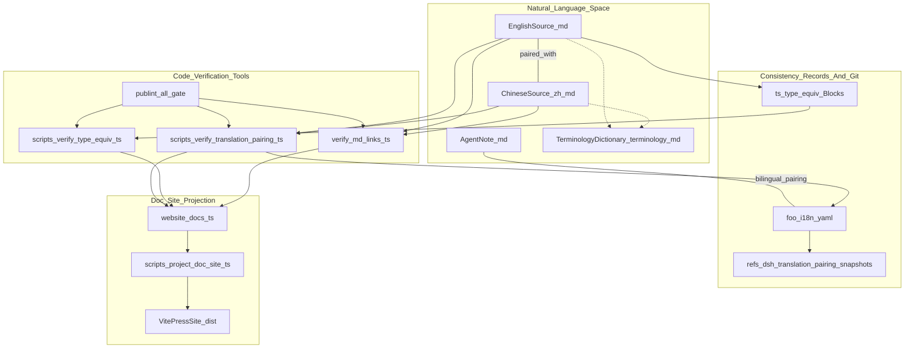

# Documentation & Internationalization

Relevant source files

The following files were used as context for generating this wiki page:

- [.agents/skills/dsh-translate-docs/SKILL.md](.agents/skills/dsh-translate-docs/SKILL.md)
- [README.i18n.yaml](README.i18n.yaml)
- [README.md](README.md)
- [README.zh.md](README.zh.md)
- [docs/i18n/README.i18n.yaml](docs/i18n/README.i18n.yaml)
- [docs/i18n/README.md](docs/i18n/README.md)
- [docs/i18n/README.zh.md](docs/i18n/README.zh.md)
- [docs/i18n/style-samples.md](docs/i18n/style-samples.md)
- [docs/i18n/terminology.md](docs/i18n/terminology.md)
- [docs/i18n/translation-rules.i18n.yaml](docs/i18n/translation-rules.i18n.yaml)
- [docs/i18n/translation-rules.md](docs/i18n/translation-rules.md)
- [docs/i18n/translation-rules.zh.md](docs/i18n/translation-rules.zh.md)
- [scripts/doc-typecheck.ts](scripts/doc-typecheck.ts)
- [scripts/markdown.spec.ts](scripts/markdown.spec.ts)
- [scripts/markdown.ts](scripts/markdown.ts)
- [scripts/persistence-artifacts.ts](scripts/persistence-artifacts.ts)
- [scripts/snapshots/translation-prompt-v4/request-response.expected.json](scripts/snapshots/translation-prompt-v4/request-response.expected.json)
- [scripts/translation-links.spec.ts](scripts/translation-links.spec.ts)
- [scripts/translation-links.ts](scripts/translation-links.ts)
- [scripts/translation-pairing-git.ts](scripts/translation-pairing-git.ts)
- [scripts/translation-pairing-record.ts](scripts/translation-pairing-record.ts)
- [scripts/translation-pairing.manifest.json](scripts/translation-pairing.manifest.json)
- [scripts/translation-pairing.spec.ts](scripts/translation-pairing.spec.ts)
- [scripts/translation-pairing.ts](scripts/translation-pairing.ts)
- [scripts/type-equiv-prefilter.spec.ts](scripts/type-equiv-prefilter.spec.ts)
- [scripts/type-equiv-prefilter.ts](scripts/type-equiv-prefilter.ts)
- [scripts/verify-package-readme-limitations.ts](scripts/verify-package-readme-limitations.ts)
- [scripts/verify-translation-pairing.ts](scripts/verify-translation-pairing.ts)
- [scripts/verify-type-equiv.ts](scripts/verify-type-equiv.ts)

The DeepSeek Harness (`dsh`) documentation system is designed for a bilingual environment supporting collaboration between human engineers and AI agents. It enforces a rigorous **Bilingual Pairing contract** and incorporates automated quality gates, ensuring that all technical documentation, type declarations, and translations remain consistent and accurate throughout development [docs/i18n/README.md:1-5]().

This parent page provides a high-level overview of the main components of the documentation system: bilingual pairing, type equivalence verification, the VitePress doc site, and the use of agent notes as canonical records. Detailed explanations and technical specifics reside in linked child pages [docs/AGENTS.md:1-4]().

---

## Bilingual Documentation & Translation Pairing

DeepSeek Harness maintains all in-scope documentation (including READMEs, architecture files, and Agent Notes) strictly in two languages: English and Simplified Chinese. Both languages have equal authority; a document may originate in either language and the counterpart is translated accordingly [docs/i18n/README.md:9-10](). The bilingual pairing consists of a *triplet* of files in the same directory [docs/i18n/README.md:10-10]():

- The English source: `foo.md` [docs/i18n/README.md:10-10]()
- Its Chinese counterpart: `foo.zh.md` [docs/i18n/README.md:10-10]()
- A consistency record: `foo.i18n.yaml` [docs/i18n/README.md:10-10]()

This triplet ensures that both language versions say exactly the same thing, preserving the document’s structure and semantic integrity [docs/i18n/README.md:11-12](). The `.i18n.yaml` consistency record stores **Git blob hashes** of each side’s content from the last confirmed state to detect out-of-sync translations, even before committing [docs/i18n/README.md:13-18](). A custom Git merge driver (`scripts/translation-pairing-git.ts`) automates conflict resolution for these records with three-way merges over the recorded blobs [scripts/translation-pairing-git.ts:1-10]().

**Structural checks** in `scripts/verify-translation-pairing.ts` ensure strict equivalence of headings, list items, table dimensions, link targets (with query and fragment suffixes), and byte-identical fenced code blocks between language pairs [docs/i18n/README.md:26-27](). Special care is taken for *language switcher lines* that link each language file to its counterpart to facilitate seamless navigation [docs/i18n/README.md:25-25]().

Additionally, the agent skill `dsh-translate-docs` supports minimal, patch-based bilingual updates by generating "briefs" of changes from one side and applying minimal edits to the other, drastically improving translation maintenance efficiency [.agents/skills/dsh-translate-docs/SKILL.md:20-30]().

### Diagram: Bilingual Pairing Workflow

Sources: [docs/i18n/README.md:9-27](), [docs/i18n/terminology.md:1-10](), [.agents/skills/dsh-translate-docs/SKILL.md:20-30](), [scripts/verify-translation-pairing.ts:1-11](), [scripts/translation-pairing-git.ts:1-10]()

For details, see [Bilingual Documentation & Translation Pairing](#9.1).

---

## Type Equivalence & Documentation Verification Gates

To maintain accurate, up-to-date documentation tightly coupled to the code, `dsh` employs *Type Equivalence* gates. Developers embed TypeScript declarations directly in Markdown files as fenced code blocks tagged with attributes like `ts type-equiv` or `ts public-api` [docs/AGENTS.md:42-42](). The script `scripts/verify-type-equiv.ts` continuously checks that these snippets exactly match the authoritative source code definitions, preventing documentation drift [docs/AGENTS.md:43-43]().

Additional verification tools enforce quality and structural correctness:

- **Wordcount budgets** limit file lengths to avoid excessive verbosity [scripts/doc-budgets.manifest.json:1-9]().
- **Markdown verification scripts** (`verify-md-links`, `verify-md-wrap`, and `verify-md-mermaid`) check links, line wraps, and diagram correctness [docs/i18n/README.md:27-27]().
- **Publint-all** aggregates all these checks alongside linting.

The entire documentation corpus is projected into a **bilingual VitePress website**. The manifest file `website/docs.ts` maps repository Markdown sources to site routes per locale, ensuring coherent navigation and language consistency [website/docs.ts:1-44](). The script `scripts/project-doc-site.ts` generates the localized site source by rewriting links and file references to point to finalized published routes or specific GitHub blob snapshots, guarding against stale references [scripts/project-doc-site.ts:1-17]().

### Diagram: Documentation Verification & Site Build Pipeline

Sources: [website/docs.ts:1-44](), [scripts/project-doc-site.ts:1-17](), [scripts/verify-translation-pairing.ts:22-33](), [docs/AGENTS.md:42-43](), [docs/i18n/README.md:27-27](), [scripts/doc-budgets.manifest.json:1-9]()

For details, see [Type Equivalence & Doc Verification Gates](#9.2).

---

## Documentation Tiers and Agent Notes

The `dsh` documentation system uses a clear and precise stratification of content types to avoid duplication and confusion—maintaining exactly one authoritative home per fact or contract [docs/AGENTS.md:16-16]().

| Tier | Purpose | File/Path |
|---|---|---|
| **Standing Orders** | Essential rules for agent behavior across all sessions | `docs/AGENTS.md` |
| **Architecture Docs** | Conceptual overviews of seams, loops, and core packages | `docs/architecture.md` |
| **Terminology Source**| Centralized bilingual terminology definitions and style conventions | `docs/i18n/terminology.md` |
| **Agent Notes** | Authoritative records of implemented and proposed decisions, rationale | `.agents/notes/` directory |
| **Package Contracts** | Configuration semantics and README for individual packages | `packages/**/README.md` |
| **Website Manifest** | Structured manifest controlling docs published to the bilingual site | `website/docs.ts` |

Agent Notes are themselves bilingual paired documents that serve as formal, trackable decisions and history logs for the project’s design and implementation rationale [docs/AGENTS.md:25-25]().

Sources: [docs/AGENTS.md:16-32](), [docs/i18n/README.md:5-5](), [docs/i18n/terminology.md:1-10]()

---

## Summary Diagram: Bridging Natural Language & Code Spaces across the Doc System

Sources: [docs/i18n/README.md:9-39](), [docs/i18n/terminology.md:1-154](), [docs/AGENTS.md:16-45](), [scripts/verify-translation-pairing.ts:1-45](), [scripts/translation-pairing-git.ts:1-10](), [scripts/doc-budgets.manifest.json:1-9](), [scripts/project-doc-site.ts:1-17](), [website/docs.ts:1-44](), [.agents/skills/dsh-translate-docs/SKILL.md:20-30]()

---

## Child Pages for Deep Dive

- [Bilingual Documentation & Translation Pairing](#9.1) — Explore the `.i18n.yaml` sidecar format, the detailed `verify-translation-pairing` gate mechanics, the custom Git merge driver for paired docs, translation rules and style guides, and the `dsh-translate-docs` agent skill workflow [docs/i18n/README.md:1-45]().
- [Type Equivalence & Doc Verification Gates](#9.2) — Learn about the `verify-type-equiv` gate which ensures embedded TypeScript declarations remain equivalent to source; doc budgets and linting; Markdown verification tools; and the VitePress documentation site build process [docs/AGENTS.md:40-44]().
- [User Guides & Cookbooks](#9.3) — Discover the end-user documentation sets including user guides for providers and development, plus practical cookbook-style recipes for adding packages, tools, and vendored dependencies [docs/AGENTS.md:28-30]().

Sources: [docs/AGENTS.md:28-44](), [docs/i18n/README.md:1-45]()