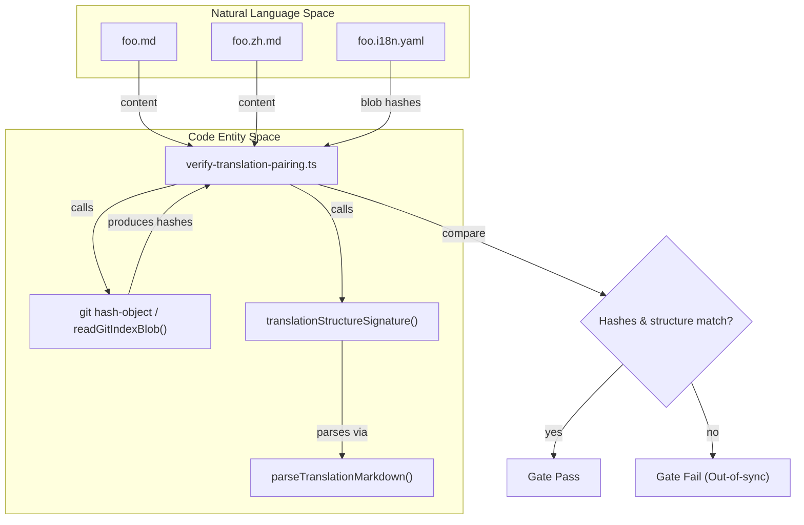
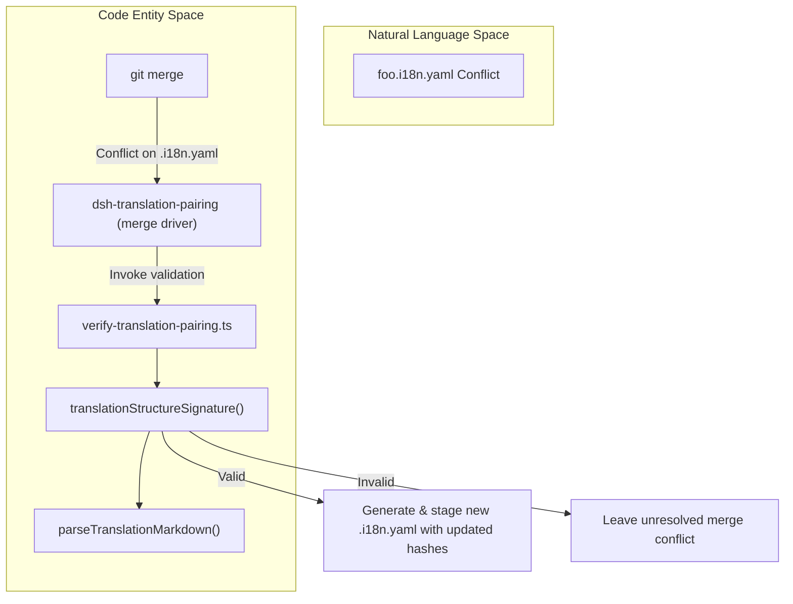

# Bilingual Documentation & Translation Pairing

<details>
<summary>Relevant source files</summary>

The following files were used as context for generating this wiki page:

- [.agents/skills/dsh-translate-docs/SKILL.md](.agents/skills/dsh-translate-docs/SKILL.md)
- [README.i18n.yaml](README.i18n.yaml)
- [README.md](README.md)
- [README.zh.md](README.zh.md)
- [docs/i18n/README.i18n.yaml](docs/i18n/README.i18n.yaml)
- [docs/i18n/README.md](docs/i18n/README.md)
- [docs/i18n/README.zh.md](docs/i18n/README.zh.md)
- [docs/i18n/style-samples.md](docs/i18n/style-samples.md)
- [docs/i18n/terminology.md](docs/i18n/terminology.md)
- [docs/i18n/translation-rules.i18n.yaml](docs/i18n/translation-rules.i18n.yaml)
- [docs/i18n/translation-rules.md](docs/i18n/translation-rules.md)
- [docs/i18n/translation-rules.zh.md](docs/i18n/translation-rules.zh.md)
- [scripts/doc-typecheck.ts](scripts/doc-typecheck.ts)
- [scripts/markdown.spec.ts](scripts/markdown.spec.ts)
- [scripts/markdown.ts](scripts/markdown.ts)
- [scripts/persistence-artifacts.ts](scripts/persistence-artifacts.ts)
- [scripts/snapshots/translation-prompt-v4/request-response.expected.json](scripts/snapshots/translation-prompt-v4/request-response.expected.json)
- [scripts/translation-links.spec.ts](scripts/translation-links.spec.ts)
- [scripts/translation-links.ts](scripts/translation-links.ts)
- [scripts/translation-pairing-git.ts](scripts/translation-pairing-git.ts)
- [scripts/translation-pairing-record.ts](scripts/translation-pairing-record.ts)
- [scripts/translation-pairing.manifest.json](scripts/translation-pairing.manifest.json)
- [scripts/translation-pairing.spec.ts](scripts/translation-pairing.spec.ts)
- [scripts/translation-pairing.ts](scripts/translation-pairing.ts)
- [scripts/type-equiv-prefilter.spec.ts](scripts/type-equiv-prefilter.spec.ts)
- [scripts/type-equiv-prefilter.ts](scripts/type-equiv-prefilter.ts)
- [scripts/verify-package-readme-limitations.ts](scripts/verify-package-readme-limitations.ts)
- [scripts/verify-translation-pairing.ts](scripts/verify-translation-pairing.ts)
- [scripts/verify-type-equiv.ts](scripts/verify-type-equiv.ts)

</details>


DeepSeek Harness (`dsh`) implements a rigorous bilingual documentation methodology where English and Simplified Chinese documents maintain equal authority and are mechanically enforced for consistency through a specialized sidecar system and a dedicated verification gate [docs/i18n/README.md:9-38](). This page details the sidecar `.i18n.yaml` pairing system, the `verify-translation-pairing` gate, the custom Git merge driver for pairing records, the translation rules and style guide, and the advanced `dsh-translate-docs` agent skill for managing bilingual document workflows.

Sources: [docs/i18n/README.md:9-38]()

---

## The Sidecar System & Pairing Contract

Bilingual documentation units are organized as triplets of sibling files co-located in the same directory:

- English Markdown source: `foo.md`
- Simplified Chinese Markdown counterpart: `foo.zh.md`
- Consistency record sidecar: `foo.i18n.yaml`

Each triplet forms a bilingual pairing unit that maintains the **semantic and structural equivalence** of the two language versions, with signing hashes recorded in the sidecar for mechanical consistency verification [docs/i18n/README.md:10-18]().

### Consistency Record (.i18n.yaml)

The `.i18n.yaml` sidecar stores the **Git blob hashes** of the paired English and Chinese files at the last confirmed consistent state per heading section. The format keys are section slugs (derived from English headings), each containing an `en` and `zh` hash, for example:

```yaml
/foo:
  en: 41d772192075e133
  zh: dda91c6c670cfd9d
/foo/usage:
  en: 86940bea4a3c7ed6
  zh: de78429597783c7f
```

- These hashes cover all top-level Markdown blocks in the section **excluding fenced code blocks and generated regions**, which must be identical on both sides and are therefore omitted from the hash [docs/i18n/README.md:11-22](), [scripts/translation-pairing.ts:20-172]().
- This signing mechanism ensures granular content coherence.
- If a section lacks language-specific content after excluding fences and generated regions, it receives no hash entry.
- The system uses these hashes to detect out-of-sync pairs and restricts PRs that break pairing consistency without updating the record.

Sources: [docs/i18n/README.md:11-22](), [scripts/translation-pairing.ts:20-172]()

### Sidecar Triplet Cohesion

- The three files—English `.md`, Chinese `.zh.md`, and `.i18n.yaml`—must exist together in the same directory [docs/i18n/README.md:10-10]().
- Pull requests modifying one side must update the others and the `.i18n.yaml` record atomically [docs/i18n/README.md:10-24]().
- This strategy prevents orphaned or inconsistent translations.

Sources: [docs/i18n/README.md:10-24]()

### Language Switcher Lines

To provide clear bidirectional navigation between language versions, each document includes a **language switcher line** located immediately below the top-level heading (`#` header):

| Language | Switcher Line Syntax | Notes |
|----------|----------------------|-------|
| Chinese  | `[English](foo.md) \| 中文` | Always links back to the English source file [README.zh.md:23]() |
| English  | `English \| [中文](foo.zh.md)` | Links to Chinese counterpart; omitted for generated English docs [docs/i18n/README.md:25]() |

These lines are required for all authored documents and support both human readers and tooling for navigation and pairing.

Sources: [README.zh.md:23](), [docs/i18n/README.md:25]()

### Structural Mirroring Rules

The bilingual pair system enforces **strict structural parity** between the English and Chinese Markdown files. This ensures that tooling can treat identical constructs (especially fenced code blocks) as line-to-line derivatives, facilitating tooling like code compilation and coverage [docs/i18n/README.md:26](), [scripts/translation-pairing.spec.ts:36-58]().

Key enforced structural equivalences include:

- Heading depth and order
- List types (ordered/unordered), start indices, and item counts
- Table rows and column counts
- Verbatim fenced code blocks — info strings and exact byte-for-byte content (including comments)
- Semantic relative document links must use locale-appropriate targets (`.md` for English, `.zh.md` for Chinese), preserving query and fragment suffixes

This strict mirroring maintains sentence-level bilingual synchrony and enables tooling optimizations such as treating Chinese fenced blocks as byte-exact copies of English code fences, avoiding duplication of work [docs/i18n/README.md:26]().

Sources: [docs/i18n/README.md:26](), [scripts/translation-pairing.spec.ts:36-58]()

Sources: [docs/i18n/README.md:10-27](), [scripts/translation-pairing.ts:20-172](), [scripts/translation-pairing.spec.ts:36-58]()

---

## Quality Gates & Verification

### The `verify-translation-pairing` Gate

The `verify-translation-pairing` CLI tool is a core element of the `doc-sync` quality gate. Contributors run it locally when modifying documentation, and CI runs it thoroughly on the entire corpus [docs/i18n/README.md:29-40](), [scripts/verify-translation-pairing.ts:1-100]().

This tool performs the following verifications per paired document triplet:

- **Completeness Check**: Ensures every in-scope Markdown document has the complete bilingual triple: `.md`, `.zh.md`, `.i18n.yaml` [docs/i18n/README.md:32-33]().
- **Blob Hash Validation**: Computes Git blob hashes of current English and Chinese file contents using `readGitIndexBlob()` / `git hash-object` and compares with the recorded `.i18n.yaml` hashes [docs/i18n/README.md:33-33](), [scripts/translation-pairing-git.ts:1-50](). Any mismatch indicates out-of-sync content.
- **Structural Signature Comparison**: Compares the detailed Markdown structural signatures of the two files via `translationStructureSignature()` and `parseTranslationMarkdown()` — headings, lists, tables, code fences, semantic links — ensuring exact parity [docs/i18n/README.md:33-33](), [scripts/translation-pairing.ts:20-172]().
- **Language Switcher Validation**: Checks the presence and correctness of language switcher lines using `languageSwitcherTargets()`, excluding generated English sources [docs/i18n/README.md:33-33](), [scripts/translation-pairing.ts:20-172]().
- **Scope and Exclusion Enforcement**: Respects explicit exclusions declared in `scripts/translation-pairing.manifest.json`, parsed via `parseTranslationPairingManifest()` [scripts/translation-pairing.manifest.json:1-13](), [scripts/translation-pairing.ts:20-172]().

The CLI supports:
- Listing pairing status of all documents (`--list`) [docs/i18n/README.md:40-40]().
- Writing updated pairing records (`--write <pair>`) [docs/i18n/README.md:24-42]().
- Scoping checks to specific pairs or staged git snapshots [docs/i18n/README.md:40-42]().

Sources: [docs/i18n/README.md:29-42](), [scripts/verify-translation-pairing.ts:1-100](), [scripts/translation-pairing.ts:20-172](), [scripts/translation-pairing-git.ts:1-50](), [scripts/translation-pairing.manifest.json:1-13]()

### verify-translation-pairing Gate Data Flow Diagram

Diagram mapping Natural Language files to Code Entity Space verification functions:



Sources: [docs/i18n/README.md:29-42](), [scripts/verify-translation-pairing.ts:1-100](), [scripts/translation-pairing.ts:20-172](), [scripts/translation-pairing-git.ts:1-50]()

---

## Custom Git Merge Driver for `.i18n.yaml`

Concurrent edits on `.i18n.yaml` pairing records commonly produce merge conflicts. DeepSeek Harness integrates a **custom Git merge driver**, registered as `dsh-translation-pairing`, to facilitate automatic and safe merging of these sidecar files [docs/i18n/README.md:20-22]().

### How the Merge Driver Works

- When a `.i18n.yaml` file conflict arises during a Git merge, the driver triggers automatically.
- It reads the three-way merge versions (base, current, and incoming branches) of the `.i18n.yaml` records and their referenced `.md` and `.zh.md` files.
- The driver performs Git’s textual merge on the English and Chinese Markdown files independently.
- It then validates that the merged Markdown files:
  - Retain valid bilingual structure and language switchers.
  - Satisfy the structural mirroring rules via `translationStructureSignature()` [scripts/translation-pairing.ts:20-172]().
  - Produce consistent blob hashes with the merged `.i18n.yaml`.
- On successful validation, it emits and stages a new `.i18n.yaml` record reflecting the merged hashes, resolving the conflict transparently.
- If the validation fails, the conflict remains for manual resolution.

Sources: [docs/i18n/README.md:20-22](), [scripts/translation-pairing.ts:20-172]()

### Manual Conflict Resolution Command

Users can invoke an integrated script to assist with manual merging and resolution:

```bash
pnpm run resolve-translation-pairing-conflicts
```

This script attempts fail-closed automatic resolutions and stages any fixable `.i18n.yaml` merges, leaving unresolvable conflicts for human handling.

Sources: [docs/i18n/README.md:20-24]()

### Git Merge Driver Flowchart

Diagram mapping merge conflicts to validation code entities:



Sources: [docs/i18n/README.md:20-24](), [scripts/verify-translation-pairing.ts:1-100](), [scripts/translation-pairing.ts:20-172]()

---

## Translation Rules & Style Guide

### Terminology Source (`terminology.md`)

The repository maintains a canonical bilingual **terminology table** to ensure consistent translations and avoid drift [docs/i18n/terminology.md:1-156]().

Categories include:
- **Abbreviations:** Always preserved in English in both languages (e.g., ACP, LLM, CLI) [docs/i18n/terminology.md:11-30]().
- **English-only Terms:** Domain-specific technical terms are not translated in Chinese documents (e.g., `agent`, `Typert`, `Cordis`) [docs/i18n/terminology.md:31-74]().
- **Bilingual Terms:** Standard terms with prescribed Chinese translations to use consistently (e.g., adapter → 适配器, capability → 能力) [docs/i18n/terminology.md:75-154]().

The terminology table also provides rules for first occurrence annotations, prohibited translation forms, and guidance on spacing and compound terms [docs/i18n/terminology.md:5-9]().

Sources: [docs/i18n/terminology.md:1-156]()

### Prose and Structural Requirements

- **Code Blocks:** Fenced code blocks in English and Chinese must be **byte-for-byte identical**, including fence markers, info strings, code content, and comments [docs/i18n/README.md:22-26]().
- **Natural Language Text:** Sentence structure and phrasing may vary, but structural units (sections, headings, lists) must mirror precisely [docs/i18n/README.md:26-26]().
- **Link Targets:** Relative links to other bilingual documents must use locale-specific targets consistently (`.md` or `.zh.md`), preserving query/fragments exactly [docs/i18n/README.md:26-26]().
- **Language Switchers:** Must be present and correct as described above [docs/i18n/README.md:25-27]().

Authoring style guidance and calibration samples are provided in `docs/i18n/translation-rules.md` and `docs/i18n/style-samples.md`.

Sources: [docs/i18n/README.md:22-27](), [docs/i18n/terminology.md:1-156]()

---

## The `dsh-translate-docs` Agent Skill

For ordinary paired-document updates, dsh uses a lean manual procedure supported by the sidecar and verify gate [.agents/skills/dsh-translate-docs/SKILL.md:10-12](). For complex rewrites or new document pairs, an advanced agent skill `dsh-translate-docs` orchestrates an extended bilingual translation workflow [.agents/skills/dsh-translate-docs/SKILL.md:1-6]().

### Skill Purpose and Invocation

- It is **explicitly user-invocable only**, not triggered automatically during routine or inferred translation scenarios [.agents/skills/dsh-translate-docs/SKILL.md:4-12]().
- Provides a robust orchestration of:
  - Generating minimal "translation briefs" via `gen-translation-brief` summarizing precise changes [.agents/skills/dsh-translate-docs/SKILL.md:30-30]().
  - Delegating prose translation tasks to subagents with contextual diffs and terminology guidance [.agents/skills/dsh-translate-docs/SKILL.md:32-32]().
  - Scoped verification and hash re-recording operations via `verify-translation-pairing --write` [.agents/skills/dsh-translate-docs/SKILL.md:34-34]().
- Designed to preserve reviewer-approved phrasing and minimize re-translation effort [.agents/skills/dsh-translate-docs/SKILL.md:16-20]().

Sources: [.agents/skills/dsh-translate-docs/SKILL.md:1-35]()

### Workflow Overview

1. **Generate Translation Briefing**

   Execute:
   ```bash
   pnpm run gen-translation-brief <file>
   ```
   This creates a structured briefing highlighting the minimal safely aligned granularity of changes (paragraphs, table rows, list items, headings), current side diffs, last confirmed versions, terminology rows touched, and binding rules [.agents/skills/dsh-translate-docs/SKILL.md:30-30]().

2. **Automatic Fence-Only Patch Application**

   If all changes are within byte-identical fenced code blocks, the briefing allows automatic application:
   ```bash
   pnpm run gen-translation-brief --apply <file>
   ```
   This patches the counterpart directly, ensuring structural validity without manual edits or subagent involvement [.agents/skills/dsh-translate-docs/SKILL.md:31-31]().

3. **Delegated Translation for Prose Changes**

   For prose diffs, the briefing is passed to a translator subagent, with all necessary context and term bindings inline [.agents/skills/dsh-translate-docs/SKILL.md:32-32]().

4. **Verification and Record Update**

   After applying translations, re-run:
   ```bash
   pnpm run verify-translation-pairing --write <file>
   ```
   to update the `.i18n.yaml` with the new confirmed blob hashes, ensuring pair consistency integrity [.agents/skills/dsh-translate-docs/SKILL.md:34-34]().

Sources: [.agents/skills/dsh-translate-docs/SKILL.md:30-35]()

---

## Summary of Key Commands & Tools

| Command | Purpose |
|---------|---------|
| `pnpm run verify-translation-pairing --list` | List sync status of all translation pairs [docs/i18n/README.md:40-40]() |
| `pnpm run verify-translation-pairing --write <file>` | Re-record current blob hashes to confirm pair consistency [docs/i18n/README.md:24-42]() |
| `pnpm run gen-translation-brief <file>` | Generate minimal, diff-aligned translation briefing [.agents/skills/dsh-translate-docs/SKILL.md:30-30]() |
| `pnpm run gen-translation-brief --apply <file>` | Automatically apply fence-only diffs from briefing [.agents/skills/dsh-translate-docs/SKILL.md:31-31]() |
| `pnpm run resolve-translation-pairing-conflicts` | Assist with manual merge resolution of `.i18n.yaml` files [docs/i18n/README.md:20-24]() |
| `pnpm run verify-translation-prompt` | Validate translation prompt template correctness [docs/i18n/README.md:69]() |

Sources: [docs/i18n/README.md:24-69](), [.agents/skills/dsh-translate-docs/SKILL.md:30-31]()