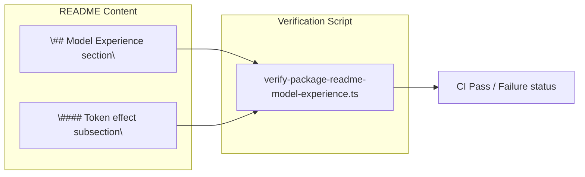
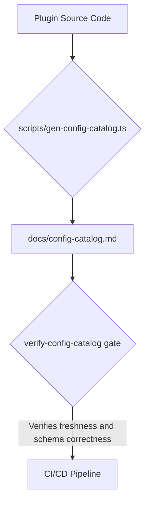
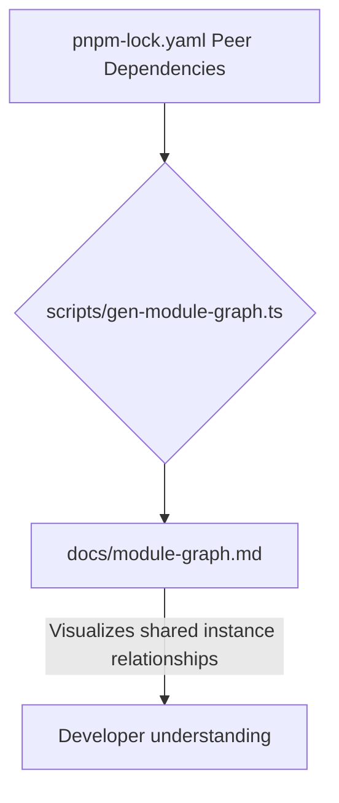

# Type Equivalence & Doc Verification Gates

<details>
<summary>Relevant source files</summary>

The following files were used as context for generating this wiki page:

- [.agents/skills/dsh-client-ui-ux/SKILL.md](.agents/skills/dsh-client-ui-ux/SKILL.md)
- [.agents/skills/dsh-code-review/SKILL.md](.agents/skills/dsh-code-review/SKILL.md)
- [.agents/skills/dsh-error-handling/SKILL.md](.agents/skills/dsh-error-handling/SKILL.md)
- [.agents/skills/dsh-responsive-ui/SKILL.md](.agents/skills/dsh-responsive-ui/SKILL.md)
- [apps/cli/tests/optional-bundle-transitions.e2e.ts](apps/cli/tests/optional-bundle-transitions.e2e.ts)
- [docs/AGENTS.md](docs/AGENTS.md)
- [docs/glossary.i18n.yaml](docs/glossary.i18n.yaml)
- [docs/glossary.md](docs/glossary.md)
- [docs/glossary.zh.md](docs/glossary.zh.md)
- [docs/persistence-catalog.i18n.yaml](docs/persistence-catalog.i18n.yaml)
- [docs/persistence-catalog.md](docs/persistence-catalog.md)
- [docs/persistence-catalog.zh.md](docs/persistence-catalog.zh.md)
- [docs/persistence-changes/historical-formats/README.i18n.yaml](docs/persistence-changes/historical-formats/README.i18n.yaml)
- [docs/persistence-changes/historical-formats/README.md](docs/persistence-changes/historical-formats/README.md)
- [docs/persistence-changes/historical-formats/README.zh.md](docs/persistence-changes/historical-formats/README.zh.md)
- [docs/persistence-schema.json](docs/persistence-schema.json)
- [docs/testing.i18n.yaml](docs/testing.i18n.yaml)
- [docs/testing.md](docs/testing.md)
- [docs/testing.zh.md](docs/testing.zh.md)
- [docs/tool-catalog.i18n.yaml](docs/tool-catalog.i18n.yaml)
- [docs/tool-catalog.md](docs/tool-catalog.md)
- [docs/tool-catalog.zh.md](docs/tool-catalog.zh.md)
- [packages/AGENTS.md](packages/AGENTS.md)
- [packages/core/tools/tests/gen-tool-catalog.spec.ts](packages/core/tools/tests/gen-tool-catalog.spec.ts)
- [scripts/doc-budgets.manifest.json](scripts/doc-budgets.manifest.json)
- [scripts/gen-tool-catalog.ts](scripts/gen-tool-catalog.ts)
- [scripts/project-doc-site.spec.ts](scripts/project-doc-site.spec.ts)
- [scripts/project-doc-site.ts](scripts/project-doc-site.ts)
- [scripts/snapshots/python-sdk-single-exe/minimal/model-visible.json](scripts/snapshots/python-sdk-single-exe/minimal/model-visible.json)
- [scripts/snapshots/python-sdk-single-exe/minimal/win-x64/model-visible.json](scripts/snapshots/python-sdk-single-exe/minimal/win-x64/model-visible.json)
- [snapshots/sdk/desktop-context/tool-schemas.expected.json](snapshots/sdk/desktop-context/tool-schemas.expected.json)
- [snapshots/sdk/desktop-ptc-context/system-prompt.expected.md](snapshots/sdk/desktop-ptc-context/system-prompt.expected.md)
- [snapshots/web/cordis-tool-round/tool-schemas.expected.json](snapshots/web/cordis-tool-round/tool-schemas.expected.json)
- [snapshots/web/fresh-round-trip/tool-schemas.expected.json](snapshots/web/fresh-round-trip/tool-schemas.expected.json)
- [snapshots/web/minimal-preset/tool-schemas.expected.json](snapshots/web/minimal-preset/tool-schemas.expected.json)
- [snapshots/web/official-subagent-bundle/system-prompt.expected.md](snapshots/web/official-subagent-bundle/system-prompt.expected.md)
- [snapshots/web/optional-string-editor/session.v4.jsonl](snapshots/web/optional-string-editor/session.v4.jsonl)
- [snapshots/web/optional-string-editor/system-prompt.expected.md](snapshots/web/optional-string-editor/system-prompt.expected.md)
- [snapshots/web/optional-string-editor/tool-schemas.expected.json](snapshots/web/optional-string-editor/tool-schemas.expected.json)
- [snapshots/web/ptc-round/system-prompt.expected.md](snapshots/web/ptc-round/system-prompt.expected.md)
- [website/.vitepress/config.ts](website/.vitepress/config.ts)
- [website/.vitepress/theme/index.ts](website/.vitepress/theme/index.ts)
- [website/.vitepress/theme/page-markdown-actions.css](website/.vitepress/theme/page-markdown-actions.css)
- [website/.vitepress/theme/page-markdown-actions.ts](website/.vitepress/theme/page-markdown-actions.ts)
- [website/.vitepress/theme/table-filter.css](website/.vitepress/theme/table-filter.css)
- [website/.vitepress/theme/table-filter.ts](website/.vitepress/theme/table-filter.ts)
- [website/AGENTS.md](website/AGENTS.md)
- [website/docs.ts](website/docs.ts)
- [website/tests/expected/page-markdown-actions.en-US.html](website/tests/expected/page-markdown-actions.en-US.html)
- [website/tests/expected/page-markdown-actions.zh-CN.html](website/tests/expected/page-markdown-actions.zh-CN.html)
- [website/tests/expected/page-markdown-menu.en-US.html](website/tests/expected/page-markdown-menu.en-US.html)
- [website/tests/expected/page-markdown-menu.zh-CN.html](website/tests/expected/page-markdown-menu.zh-CN.html)
- [website/tests/expected/table-filter.en-US.html](website/tests/expected/table-filter.en-US.html)
- [website/tests/expected/table-filter.zh-CN.html](website/tests/expected/table-filter.zh-CN.html)
- [website/tests/page-markdown-actions.spec.ts](website/tests/page-markdown-actions.spec.ts)
- [website/tests/table-filter.spec.ts](website/tests/table-filter.spec.ts)

</details>


The documentation pipeline within DeepSeek Harness (DSH) enforces strict synchronization between Markdown documentation and the codebase to maintain accuracy, currency, and quality. Central to this synchronization are the **Type Equivalence** checks and comprehensive **documentation verification gates** that validate Markdown content, structure, and generated catalogs. This page details the implementation, data flow, and key processes involved in these verification gates, including the `verify-type-equiv` gate, documentation budget enforcement, generated catalogs (config, module graph, tool, persistence), doc-site fragment integrity, and the VitePress documentation site build.

---

## 1. Type Equivalence Gate (`verify-type-equiv`)

### 1.1 Purpose and Overview

The `verify-type-equiv` gate verifies that TypeScript code blocks embedded in Markdown documentation exactly correspond to live code symbols from the repository source. This gate prevents stale or divergent documentation caused by manual copying errors or outdated snippets.

The gate operates on fenced Markdown code blocks annotated with:

- ```` ```ts type-equiv ```` — full type declarations including JSDoc comments.
- ```` ```ts public-api ```` — publicly exposed type declarations with implementation details stripped.

Each snippet corresponds in a **1:1 mapping** to a TypeScript source declaration, enforced by a manifest file (`scripts/type-equiv.manifest.json`) that records:

- `doc`: Markdown source file path containing the snippet.
- `symbol`: the TypeScript symbol name declared.
- `source`: the source file location for the original declaration.

The gate’s failure triggers continuous integration (CI) failures, requiring documentation corrections.

### 1.2 Implementation Details

Implemented in `scripts/verify-type-equiv.ts` [scripts/type-equiv.manifest.json:1-10](), the gate performs the following steps:

- Parses all Markdown documents, extracting every fenced snippet tagged as `ts type-equiv` or `ts public-api`.
- For each snippet, consults the manifest to identify the source file and symbol.
- Parses the corresponding TypeScript source file to locate the declared symbol and extract its canonical declaration text.
- Compares the source declaration’s text to the snippet’s exact text byte-for-byte.
- Reports any mismatch with detailed diagnostics: snippet location, symbol name, and source file.

This precise comparison ensures that documentation snippets never drift from real source code.

In parallel, the complementary `scripts/doc-typecheck.ts` performs full TypeScript compilation and typechecking of all fenced `ts` code blocks in Markdown [scripts/doc-typecheck.ts:1-126](). This guarantees syntactic and semantic correctness of documentation snippets.

### 1.3 Data Flow and Diagram

The diagram below depicts how Markdown documentation snippets are mapped and verified against the live TypeScript source declarations:

```mermaid
flowchart TD
    subgraph NaturalLanguageSpace["Natural Language Space (Markdown Files)"]
        MD["docs/subsystems/*.md"]
        FENCE["\"```ts type-equiv / public-api\nTypeScript snippet\""]
    end

    subgraph CodeEntitySpace["Code Entity Space (TypeScript Source)"]
        SRC["packages/*/src/**/*.ts"]
        SYMBOL["\"Symbol declarations (e.g., interface, class)\""]
    end

    GATE["scripts/verify-type-equiv.ts"]
    TYPECHECK["scripts/doc-typecheck.ts"]

    MD -->|contains| FENCE
    FENCE -->|validated by| GATE
    FENCE -->|typechecked by| TYPECHECK
    SRC -->|defines| SYMBOL
    SYMBOL -->|comparison target| GATE
    GATE -->|pass/fail result| CI["CI / Dev feedback"]
```

Sources: `scripts/type-equiv.manifest.json`(), `scripts/doc-typecheck.ts`(), `docs/AGENTS.md`()

---

## 2. Documentation Budgets & Formatting Gates

### 2.1 Documentation Budgets (`doc-budgets.manifest.json`)

To maintain concise, focused documentation, DSH enforces strict character limits on important documents, encoded in the budgets manifest `scripts/doc-budgets.manifest.json` [scripts/doc-budgets.manifest.json:1-9](). Examples include:

| Document | Character Limit |
| :--------------------- | :-------------- |
| `AGENTS.md` | 2080 |
| `docs/AGENTS.md` | 1430 |
| `docs/architecture.md` | 2410 |
| `docs/testing.md` | 1350 |
| `packages/README.md` | 994 |

This manifest is checked during the `doc-sync` verification suite, preventing unchecked growth in key documentation files.

### 2.2 Formatting and Linting Gates

Several formatting checks run alongside budgets to maintain clean, review-friendly Markdown:

- **`verify-md-wrap`** — enforces "one physical line per paragraph" (`verify-md-wrap`) for succinct diffs and consistent formatting [docs/AGENTS.md:41-43]().
- **`verify-md-links`** — ensures all Markdown links are valid and resolvable within the repository.
- **`verify-mermaid`** — validates embedded Mermaid diagram syntax.

These gates collectively form a robust Markdown quality assurance system integrated into the CI pipeline.

Sources: `scripts/doc-budgets.manifest.json`(), `docs/AGENTS.md`()

---

## 3. The Model Experience Documentation Standard

Each package README must include a **Model Experience** section describing:

- The exact model-facing API contract.
- Token and key-value store (KV) cache consumption per interaction.
- Stability notes and behavioral constraints.

This contract binds model-aware tooling to the package’s runtime behavior as mandated by the documentation conventions in `docs/AGENTS.md` [docs/AGENTS.md:29]().

The verification script `verify-package-readme-model-experience.ts` parses README Markdown files to ensure:

- Presence of the `## Model Experience` heading.
- Properly structured subsections detailing resource consumption.
- Completeness and internal consistency.

Packages without model-facing APIs explicitly declare exemption, bypassing the check.

### 3.1 Model Experience Verification Flow



Sources: `docs/AGENTS.md`(), `packages/AGENTS.md`()

---

## 4. Generated Catalogs

Several catalogs are automatically generated to centralize and synchronize critical metadata relevant for runtime and documentation.

### 4.1 Config Catalog (`docs/config-catalog.md`)

The config catalog enumerates every `config:` block declared in `cordis.yml` entries across loadable harness packages. It includes:

- The verbatim interface type declarations with JSDoc comments [docs/config-catalog.md:21-32]().
- All referenced dependent types [docs/config-catalog.md:17-18]().

This catalog acts as the **deployment reference** for configuration authors, showing constraints and expected shape. Additional validation scripts like `scripts/verify-cordis-config.ts` ensure configuration metadata consistency [scripts/verify-cordis-config.ts:1-89]().

Generation is automated by `scripts/gen-config-catalog.ts`, which:

- Extracts interface declarations from package source typings.
- Validates completeness against schema validations [docs/config-catalog.md:8]().
- Produces `docs/config-catalog.md` [docs/config-catalog.md:1]().
- Is enforced by the `verify-config-catalog` gate to guarantee freshness [docs/config-catalog.md:8]().



Sources: `docs/config-catalog.md`(), `docs/config-catalog.zh.md`(), `docs/config-catalog.i18n.yaml`()

### 4.2 Module Graph Catalog (`docs/module-graph.md`)

This catalog visualizes the peer dependency graph among `@deepseek-ai/dsh-*` packages, identifying which packages share instances as dependencies.

- Dependencies from `pnpm-lock.yaml` peerDeps inform nodes and edges [pnpm-lock.yaml:1-174]().
- Packages are grouped by directory folder for readability [docs/module-graph.md:10-29]().

It is generated by `scripts/gen-module-graph.ts` directly from `package.json`, aiding developers in dependency management [docs/module-graph.md:1]().



Sources: `docs/module-graph.md`(), `docs/module-graph.zh.md`(), `docs/module-graph.i18n.yaml`(), `pnpm-lock.yaml`()

### 4.3 Tool and Persistence Catalogs

Two additional catalogs are pivotal:

- **Tool Catalog (`docs/tool-catalog.md`)**: Lists all model-facing tools contributed by shipped packages [docs/tool-catalog.md:4-8](). Generated by `scripts/gen-tool-catalog.ts` [scripts/gen-tool-catalog.ts:1-7], it boots each tool plugin in a real context via `Context` [scripts/gen-tool-catalog.ts:11-12] to extract JSON Schemas and metadata, ensuring schema completeness and no missing tools.

- **Persistence Catalog (`docs/persistence-catalog.md`)**: Documents all durable session event types, their schema fingerprints [docs/persistence-schema.json:1-8], and source code locations [docs/persistence-catalog.md:4-10]. This underpins session replay and persistence upgrades. It is generated by `scripts/gen-persistence-catalog.ts`.

All these generated catalogs are rigorously checked during CI gating.

Sources: `scripts/verify-cordis-config.ts`(), `docs/AGENTS.md`(), `docs/tool-catalog.md`(), `docs/persistence-catalog.md`(), `scripts/gen-tool-catalog.ts`()

---

## 5. Doc-site Fragment Checks & VitePress Site Build

### 5.1 Doc-site Fragment Validation (`scripts/project-doc-site.ts`)

The `project-doc-site.ts` script processes Markdown fragments for the documentation site build, implementing:

- **Frontmatter Injection:** Adds precise `editSource` URLs linking back to exact GitHub source lines, enabling “Edit this page” prompts with file + position.
- **Reference Rewriting:** Normalizes internal Markdown links and source URLs to stable site-relative or GitHub URLs.
- **Image Reference Validation:** Ensures all referenced images exist under allowed repository subtrees, preventing broken images on the site.
- **Bilingual Pairing:** Cross-check with `.i18n.yaml` files against translated pairs (e.g., `docs/testing.i18n.yaml`), ensuring synchronized English/Chinese documentation [docs/testing.i18n.yaml:1-34]().

Unit tests verify these functionalities.

### 5.2 Manifest-driven Site Projection (`website/docs.ts`)

This manifest file explicitly maps source Markdown files to VitePress routes, supporting:

- Locale-aware site navigation with English and Chinese pairing.
- Grouping by logical page collections and sections.
- Functions like `pairedPages` and `mirroredPages` to determine locale visibility.

This approach centralizes control of doc site structure and internationalization.

### 5.3 VitePress Configuration (`website/.vitepress/config.ts`)

The VitePress site loads the manifest on startup to:

- Construct sidebars dynamically per locale with route disambiguation by collection.
- Enable Mermaid diagram rendering inside Markdown pages.
- Support live hot reload during doc fragment edits.

This integrates content manifest and build to provide a robust, maintainable documentation website.

Sources: `docs/testing.i18n.yaml`(), `scripts/doc-typecheck.ts`()

---

## Summary Diagram: Verification Ecosystem Bridging Docs and Code

```mermaid
flowchart TB
    subgraph NaturalLanguageSpace["Natural Language Space (Markdown & Docs)"]
        DOCS["\"docs/\nAGENTS.md, README.md, subsystems/*.md\""]
        MD_FENCES["\"`ts type-equiv`, `ts public-api` fences\""]
        DOC_BUDGETS["\"doc-budgets.manifest.json\n + formatting gates\""]
        MODEL_EXPERIENCE["\"Model Experience sections in package READMEs\""]
        DOC_SITE_MANIFEST["\"website/docs.ts manifest\""]
        I18N_YAML["\"docs/*.i18n.yaml\""]
    end

    subgraph VerificationSystems["Verification Systems & Scripts"]
        V_TYPE_EQUIV["scripts/verify-type-equiv.ts"]
        DOC_TYPECHECK["scripts/doc-typecheck.ts"]
        V_MD_LINKS["verify-md-links"]
        V_MD_WRAP["verify-md-wrap"]
        V_MERMAID["verify-mermaid"]
        V_MODEL_EXP["verify-package-readme-model-experience.ts"]
        PROJECT_SITE["scripts/project-doc-site.ts"]
        PUBLISH_LINT["publint-all"]
        V_TRANSLATION_PAIRING["verify-translation-pairing"]
        GEN_CONFIG_CATALOG["scripts/gen-config-catalog.ts"]
        GEN_MODULE_GRAPH["scripts/gen-module-graph.ts"]
        GEN_TOOL_CATALOG["scripts/gen-tool-catalog.ts"]
    end

    subgraph CodeEntitySpace["Code Entity Space (Packages & Source)"]
        TS_SRC["\"TypeScript source\npackages/*/src/\""]
        PACKAGE_READMES["\"package/README.md files\""]
        TYPE_DECLS["\"Public API types & classes\""]
        PKG_CONFIG["\"package.json and exports\""]
        CORDIS_YML_CONFIG["\"cordis.yml config blocks\""]
        PACKAGE_JSON_DEPS["\"package.json dependencies\""]
        TOOL_DEFINITIONS["\"Tool definitions\""]
        PERSISTENCE_SCHEMAS["\"Persistence schemas\""]
    end

    DOCS --> MD_FENCES
    MD_FENCES --> V_TYPE_EQUIV
    MD_FENCES --> DOC_TYPECHECK

    DOC_BUDGETS --> V_MD_WRAP
    DOC_BUDGETS --> V_MD_LINKS
    DOC_BUDGETS --> V_MERMAID

    MODEL_EXPERIENCE --> V_MODEL_EXP

    DOC_SITE_MANIFEST --> PROJECT_SITE
    I18N_YAML --> V_TRANSLATION_PAIRING

    TS_SRC --> TYPE_DECLS
    PACKAGE_READMES --> MODEL_EXPERIENCE
    PKG_CONFIG --> PUBLISH_LINT
    CORDIS_YML_CONFIG --> GEN_CONFIG_CATALOG
    PACKAGE_JSON_DEPS --> GEN_MODULE_GRAPH
    TOOL_DEFINITIONS --> GEN_TOOL_CATALOG
    PERSISTENCE_SCHEMAS --> GEN_TOOL_CATALOG

    V_TYPE_EQUIV -->|Checks snippet equivalence| TYPE_DECLS
    DOC_TYPECHECK -->|Typechecks fences| TYPE_DECLS
    V_MODEL_EXP -->|Validates Model Experience| PACKAGE_READMES
    PROJECT_SITE -->|Builds documentation site| DOCS
    PUBLISH_LINT -->|Validates package exports| PKG_CONFIG
    V_TRANSLATION_PAIRING -->|Ensures bilingual consistency| DOCS
    GEN_CONFIG_CATALOG -->|Generates| DOCS
    GEN_MODULE_GRAPH -->|Generates| DOCS
    GEN_TOOL_CATALOG -->|Generates| DOCS
```

Sources: `scripts/type-equiv.manifest.json`(), `scripts/doc-typecheck.ts`(), `scripts/doc-budgets.manifest.json`(), `docs/AGENTS.md`(), `scripts/verify-cordis-config.ts`(), `docs/testing.i18n.yaml`()

---

## References and Sources

- `[scripts/type-equiv.manifest.json:1-10]()`
- `[scripts/doc-typecheck.ts:1-126]()`
- `[scripts/doc-budgets.manifest.json:1-9]()`
- `[docs/AGENTS.md:29-45]()`
- `[scripts/verify-cordis-config.ts:1-89]()`
- `[docs/testing.i18n.yaml:1-34]()`
- `[docs/config-catalog.md:1-4801]()`
- `[docs/config-catalog.zh.md:1-4803]()`
- `[docs/config-catalog.i18n.yaml:1-19]()`
- `[docs/module-graph.md:1-1776]()`
- `[docs/module-graph.zh.md:1-1778]()`
- `[docs/module-graph.i18n.yaml:1-10]()`
- `[pnpm-lock.yaml:1-174]()`