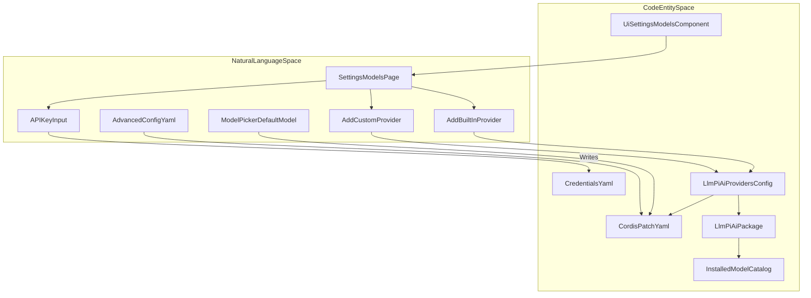
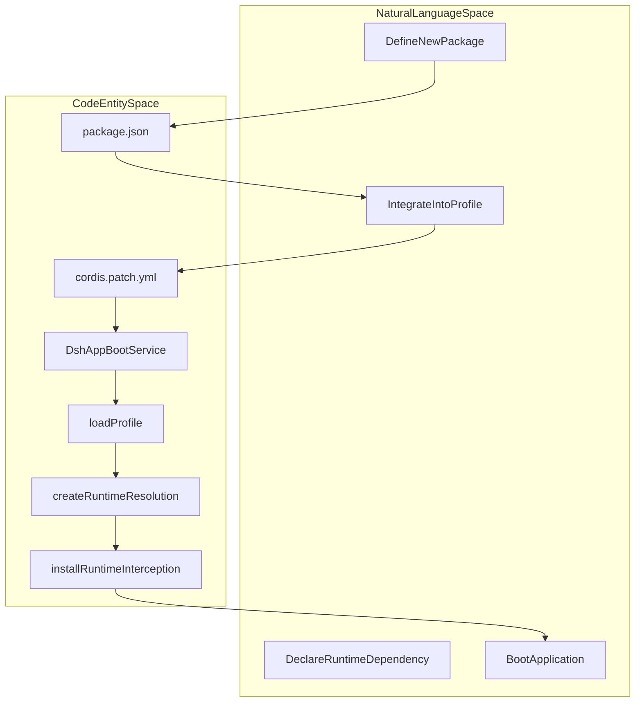

# User Guides & Cookbooks

<details>
<summary>Relevant source files</summary>

The following files were used as context for generating this wiki page:

- [docs/cookbook/adding-a-package.i18n.yaml](docs/cookbook/adding-a-package.i18n.yaml)
- [docs/cookbook/adding-a-package.md](docs/cookbook/adding-a-package.md)
- [docs/cookbook/adding-a-package.zh.md](docs/cookbook/adding-a-package.zh.md)
- [docs/cookbook/adding-a-vendored-package.i18n.yaml](docs/cookbook/adding-a-vendored-package.i18n.yaml)
- [docs/cookbook/adding-a-vendored-package.zh.md](docs/cookbook/adding-a-vendored-package.zh.md)
- [docs/user/guide/providers.i18n.yaml](docs/user/guide/providers.i18n.yaml)
- [docs/user/guide/providers.md](docs/user/guide/providers.md)
- [docs/user/guide/providers.zh.md](docs/user/guide/providers.zh.md)
- [packages/boot/plugin-market/README.i18n.yaml](packages/boot/plugin-market/README.i18n.yaml)
- [packages/boot/plugin-market/README.md](packages/boot/plugin-market/README.md)
- [packages/boot/plugin-market/README.zh.md](packages/boot/plugin-market/README.zh.md)
- [scripts/check-workspace-constraints.spec.ts](scripts/check-workspace-constraints.spec.ts)
- [scripts/check-workspace-constraints.ts](scripts/check-workspace-constraints.ts)

</details>


This documentation section "User Guides & Cookbooks" (9.3) provides technical guidance specifically targeted at end-users and developers working with DeepSeek Harness (`dsh`). It focuses on user-facing documentation, such as how to configure providers in the Web UI, and on cookbook-style recipes for extending the codebase by adding new workspace packages, tools, session format versions, and vendored dependencies.

These guides serve two main roles:

- **User Guides** describe setup and usage patterns, especially configuration of models and providers to use DeepSeek in various workflows [docs/user/guide/providers.md:1-49]().
- **Cookbooks** provide practical patterns, checklists, and code reference implementations to help developers author extensions, such as new workspace packages, vendored dependencies, tools, or session log format version migrations, consistent with the `dsh` architecture [docs/cookbook/adding-a-package.md:1-29](), [docs/cookbook/adding-a-vendored-package.md:1-35]().

Sources: `docs/user/guide/providers.md` (lines 1-49), `docs/cookbook/adding-a-package.md` (lines 1-29), `docs/cookbook/adding-a-vendored-package.md` (lines 1-35)

---

## 1. User Guides Overview

The user guides cover essential steps for working with `dsh` in real scenarios, focusing primarily on *provider configuration* in the Web UI. This includes adding built-in or custom LLM providers, managing API keys, selecting models, and adjusting advanced settings like image input support, reasoning effort, and compatibility tweaks [docs/user/guide/providers.md:7-187]().

### 1.1 Configuring Providers in the Web UI

The primary user-facing entry for model configuration is the **Settings → Models** page in the `dsh` Web UI [docs/user/guide/providers.md:8-9](). Key points:

- **API Keys** are write-only: upon save, keys are stored securely under `$DSH_HOME/.credentials.yaml` and only masked descriptors are exposed to the client page [docs/user/guide/providers.md:13-14]().
- **Built-in Providers** can be selected from a predefined catalog (`anthropic`, `openai`, `moonshotai`, `zai`, etc.) with endpoint, protocol, and models configured automatically [docs/user/guide/providers.md:16-18]().
- **Custom Providers** support company gateways or self-hosted endpoints [docs/user/guide/providers.md:21-24](). Key required fields:
  - Lowercase Provider ID (permanent, used in requests, saved sessions, and credential references) [docs/user/guide/providers.md:23-27]()
  - Base URL [docs/user/guide/providers.md:23]()
  - API Protocol: one of `openai-completions`, `openai-responses`, or `anthropic-messages` [docs/user/guide/providers.md:23]()
  - Credential (API key) [docs/user/guide/providers.md:23]()
  - Models: at least one model with its ID and attributes [docs/user/guide/providers.md:23]()
  
A custom provider can ask the endpoint for a list of available models via **Model catalog → Fetch available models**, which populates a searchable picker interface [docs/user/guide/providers.md:29-31]().

If the discovery fails or is unsupported, users can manually enter model IDs and configure their attributes [docs/user/guide/providers.md:31-33](). Selecting a model on this page sets the **default model for new sessions**; existing sessions retain their selected model [docs/user/guide/providers.md:35-37]().

Sources: `docs/user/guide/providers.md` (lines 8-37)

### 1.2 Advanced Model Configuration Fields

Advanced users can directly edit `$DSH_HOME/profiles/<profile>/cordis.patch.yml` or open it from the UI when the browser runs locally, enabling on-the-fly changes without restarting `dsh` [docs/user/guide/providers.md:46-48](). The `dsh-app-boot` package is responsible for loading these profile patches and composing them into the running application's configuration [packages/boot/app-boot/README.md:12]().

Important advanced fields include:

- **Image input support:** To enable image input support for a model, add an `input` attribute listing supported modalities, e.g., `[text, image]` [docs/user/guide/providers.md:53-71]().

  ```yaml
  - id: llm-pi-ai
    config:
      providers:
        my-gateway:
          apiKeyEnv: GATEWAY_API_KEY
          api: openai-completions
          baseURL: https://gateway.example/v1
          models:
            - id: legacy-chat
            - id: vision-preview
              input: [text, image]
  ```
  [docs/user/guide/providers.md:60-71]()

- **Reasoning Effort Levels:** Models can declare different reasoning effort levels via the `reasoningEfforts` map [docs/user/guide/providers.zh.md:113-130]().

  ```yaml
        models:
          - id: my-reasoner
            reasoningEfforts:
              off:
              high: high
              max: max
  ```
  [docs/user/guide/providers.zh.md:126-130]()

  The special `off` level's behavior can be customized (including sending a special thinking format like `compat.thinkingFormat: deepseek`) to support compatibility quirks of various gateways [docs/user/guide/providers.zh.md:134-145]().

Sources: `docs/user/guide/providers.md` (lines 41-94), `docs/user/guide/providers.zh.md` (lines 111-187), `packages/boot/app-boot/README.md` (line 12)

---

## 2. Cookbooks: Expansion Patterns and Recipes

Cookbooks offer step-by-step guidance for engineers to extend `dsh` by adding workspace packages, vendored packages, tools, and session format versions.

### 2.1 Adding a Workspace Package

When introducing a new `@deepseek-ai/dsh-<name>` package to the monorepo, developers follow a strict checklist enforced by workspace invariant checks [docs/cookbook/adding-a-package.md:1-27]():

1. **Create the Package Structure:** Create a directory under `packages/<group>/<pkg>/` containing `package.json`, `tsconfig.json`, `src/index.ts`, `locale/en.json`, `locale/zh.json`, and `README.md` [docs/cookbook/adding-a-package.md:7-23]().
2. **Package.json Invariants:** Ensure `private: true`, version matching the root `package.json`, `type: module`, `main: "lib/index.js"`, `types: "lib/types/index.d.ts"`, and `@deepseek-ai/cordis` in both peerDependencies and devDependencies [docs/cookbook/adding-a-package.md:27]().
3. **Register in Root Configs:** Add project references in `tsconfig.host.json` or `tsconfig.client.json` as appropriate [docs/cookbook/adding-a-package.md:31-37]().
4. **Determine Topology & Role:** Follow naming conventions (e.g., using suffixes like `Controller`, `Store`, `Registry`, `Runtime`, `Engine`, `Policy`) [docs/cookbook/adding-a-package.md:43-71]().

Sources: `docs/cookbook/adding-a-package.md` (lines 1-71), `scripts/check-workspace-constraints.ts` (lines 1-112)

### 2.2 Adding a Vendored Package

When the harness requires an upstream Cordis package (such as `@cordisjs/plugin-http`), it is added as a fixed-version source under `vendor/` rather than an ordinary npm dependency [docs/cookbook/adding-a-vendored-package.zh.md:5-15]():

1. **Copy the Source:** Place upstream files into `vendor/<dir>/` with a rescoped package name, keeping exports and types, and ensuring `private` is not set (since vendored packages are publishable release members) [docs/cookbook/adding-a-vendored-package.zh.md:9-32]().
2. **Register Root Configurations:** Add path mappings in `tsconfig.base.json` (`"<npm-name>": ["./vendor/<dir>/src"]`) and references in `tsconfig.host.json`, and update `vendor/README.md` [docs/cookbook/adding-a-vendored-package.zh.md:36-44]().
3. **Manifest Guards:** Ensure pre-commit hook constraints (`scripts/check-vendor-manifest.sh`) pass by updating `vendor/README.md` alongside source modifications [docs/cookbook/adding-a-vendored-package.zh.md:47-49]().

Sources: `docs/cookbook/adding-a-vendored-package.zh.md` (lines 5-59)

---

## 3. Diagram: Natural Language Space to Code Entities — Provider Configuration

This diagram maps user-facing concepts in the Web UI to the relevant code entities and configuration files involved in provider setup.



**Explanation:**  
Users configure providers through the Web UI's Settings page, entering API keys and provider details. Keys are stored securely in `.credentials.yaml`. Provider definitions, including custom or built-in models, are persisted in `cordis.patch.yml` under the `llm-pi-ai:providers` key. The `llm-pi-ai` package loads this to resolve runtime behaviors and model catalogs.

Sources: `docs/user/guide/providers.md` (lines 8-94), `docs/user/guide/providers.zh.md` (lines 9-183)

---

## 4. Diagram: Natural Language Space to Code Entities — Package Integration

This diagram illustrates the flow from defining a new package to its integration and runtime resolution within `dsh` profiles.



**Explanation:**
A new package is defined with its `package.json`. If it's a bundle, its `cordis.patch.yml` specifies configuration. `dsh-app-boot`'s `loadProfile` function reads these configurations. `createRuntimeResolution` then builds a dependency graph, which `installRuntimeInterception` uses to modify Node's module resolution, making the new package available at application boot.

Sources: `packages/boot/app-boot/README.md` (lines 12, 49-50, 67-68), `packages/boot/app-boot/src/profile.ts` (lines 58-75, 400-402), `packages/boot/app-boot/src/profile-resolution/resolver.ts` (lines 190-191)

---

## 5. Summary Tables

### 5.1 User Guide – Configuring Providers

| Operation | UI Location | Config Files/Keys | Related Package/Code |
|---|---|---|---|
| Add built-in provider | Settings → Models → Add provider | `$DSH_HOME/.credentials.yaml`, `$DSH_HOME/profiles/<profile>/cordis.patch.yml` | `packages/llm/llm-pi-ai` [docs/user/guide/providers.md:9-48]() |
| Add custom provider | Settings → Models → Add custom provider | Same as above plus protocol and model fields | `llm-pi-ai` config loader [docs/user/guide/providers.md:21-27]() |
| Fetch model catalog | Models page "Fetch available models" button | API call to provider endpoint | Provider adapter implementations [docs/user/guide/providers.md:29-33]() |
| Advanced configuration | `$DSH_HOME/profiles/<profile>/cordis.patch.yml` | `input` modalities, reasoning levels, compatibility flags | See config catalog & pi-ai adapter [docs/user/guide/providers.md:43-46]() |

Sources: `docs/user/guide/providers.md` (lines 8-94)

---

### 5.2 Cookbook – Adding a New Package Checklist

| Step | Files / Location | Description & Remarks |
|---|---|---|
| 1. Create Package Structure | `packages/<new-package-name>/` | `package.json`, source files, plugin entry point if applicable [docs/cookbook/adding-a-package.md:7-23](). |
| 2. Define Profile Integration | `package.json`, `cordis.patch.yml` | If a bundle, define configuration patches [docs/cookbook/adding-a-package.md:31-37](). |
| 3. Configure Runtime Resolution | `package.json` dependencies | Declare dependencies; `dsh-app-boot` handles resolution [docs/cookbook/adding-a-package.md:27](). |
| 4. Test Integration | `packages/boot/app-boot/tests/` | Write tests for profile loading and module resolution [docs/cookbook/adding-a-package.md:40](). |

Sources: `docs/cookbook/adding-a-package.md` (lines 7-40), `packages/boot/app-boot/README.md` (lines 12, 49-50)