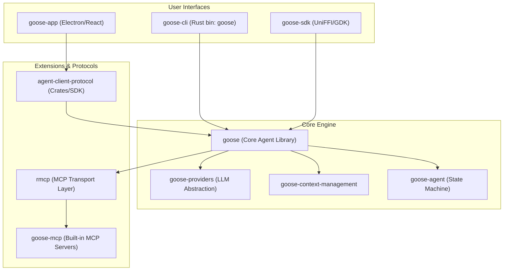
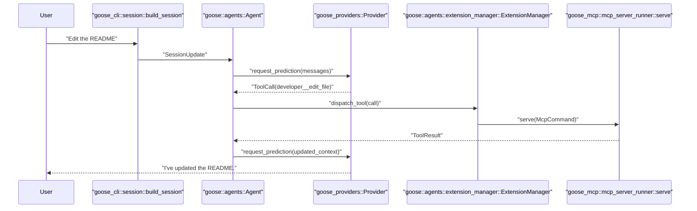

# Goose Overview

Relevant source files

The following files were used as context for generating this wiki page:

- [.github/copilot-instructions.md](.github/copilot-instructions.md)
- [.github/pull_request_template.md](.github/pull_request_template.md)
- [.github/workflows/goose-issue-solver.yml](.github/workflows/goose-issue-solver.yml)
- [.github/workflows/goose-pr-reviewer.yml](.github/workflows/goose-pr-reviewer.yml)
- [.gitignore](.gitignore)
- [.goosehints](.goosehints)
- [AGENTS.md](AGENTS.md)
- [CONTRIBUTING.md](CONTRIBUTING.md)
- [Cargo.lock](Cargo.lock)
- [Cargo.toml](Cargo.toml)
- [README.md](README.md)
- [crates/goose-cli/Cargo.toml](crates/goose-cli/Cargo.toml)
- [crates/goose-cli/src/cli.rs](crates/goose-cli/src/cli.rs)
- [crates/goose-cli/src/commands/mod.rs](crates/goose-cli/src/commands/mod.rs)
- [crates/goose-cli/src/commands/session.rs](crates/goose-cli/src/commands/session.rs)
- [crates/goose-cli/src/lib.rs](crates/goose-cli/src/lib.rs)
- [crates/goose-cli/src/main.rs](crates/goose-cli/src/main.rs)
- [crates/goose-mcp/Cargo.toml](crates/goose-mcp/Cargo.toml)
- [crates/goose-provider-types/src/canonical/data/canonical_models.json](crates/goose-provider-types/src/canonical/data/canonical_models.json)
- [crates/goose-provider-types/src/canonical/data/provider_metadata.json](crates/goose-provider-types/src/canonical/data/provider_metadata.json)
- [crates/goose-providers/src/declarative/definitions/meta.json](crates/goose-providers/src/declarative/definitions/meta.json)
- [crates/goose/Cargo.toml](crates/goose/Cargo.toml)
- [crates/goose/src/providers/inventory/registrations.rs](crates/goose/src/providers/inventory/registrations.rs)
- [crates/goose/src/providers/kimicode.rs](crates/goose/src/providers/kimicode.rs)
- [crates/goose/src/providers/muse_code_def.rs](crates/goose/src/providers/muse_code_def.rs)
- [crates/goose/src/providers/oauth_device_flow.rs](crates/goose/src/providers/oauth_device_flow.rs)
- [crates/goose/src/providers/xai_oauth.rs](crates/goose/src/providers/xai_oauth.rs)
- [crates/goose/src/session/chat_history_search.rs](crates/goose/src/session/chat_history_search.rs)
- [crates/goose/src/session/mod.rs](crates/goose/src/session/mod.rs)
- [crates/goose/src/session/session_manager.rs](crates/goose/src/session/session_manager.rs)
- [documentation/AGENTS.md](documentation/AGENTS.md)
- [documentation/blog/2025-03-31-goose-benchmark/index.md](documentation/blog/2025-03-31-goose-benchmark/index.md)
- [documentation/blog/2025-09-26-hacktoberfest-2025/index.md](documentation/blog/2025-09-26-hacktoberfest-2025/index.md)
- [documentation/blog/2025-12-19-goose-mobile-terminal/index.md](documentation/blog/2025-12-19-goose-mobile-terminal/index.md)
- [documentation/blog/2025-12-19-goose-mobile-terminal/mobile_shots.png](documentation/blog/2025-12-19-goose-mobile-terminal/mobile_shots.png)
- [documentation/blog/2025-12-19-goose-mobile-terminal/shell.png](documentation/blog/2025-12-19-goose-mobile-terminal/shell.png)
- [documentation/docs/assets/guides/interactive-loop.png](documentation/docs/assets/guides/interactive-loop.png)
- [documentation/docs/experimental/_category_.json](documentation/docs/experimental/_category_.json)
- [documentation/docs/experimental/goose-mobile.md](documentation/docs/experimental/goose-mobile.md)
- [documentation/docs/experimental/index.md](documentation/docs/experimental/index.md)
- [documentation/docs/experimental/mobile-access.md](documentation/docs/experimental/mobile-access.md)
- [documentation/docs/experimental/ollama.md](documentation/docs/experimental/ollama.md)
- [documentation/docs/experimental/remote-access/index.md](documentation/docs/experimental/remote-access/index.md)
- [documentation/docs/experimental/remote-access/mobile-access.md](documentation/docs/experimental/remote-access/mobile-access.md)
- [documentation/docs/experimental/remote-access/telegram-gateway.md](documentation/docs/experimental/remote-access/telegram-gateway.md)
- [documentation/docs/experimental/vs-code-extension.md](documentation/docs/experimental/vs-code-extension.md)
- [documentation/docs/goose-architecture/extensions-design.md](documentation/docs/goose-architecture/extensions-design.md)
- [documentation/docs/goose-architecture/goose-architecture.md](documentation/docs/goose-architecture/goose-architecture.md)
- [documentation/docs/guides/tool-shim.md](documentation/docs/guides/tool-shim.md)
- [documentation/docs/mcp/vs-code-mcp.md](documentation/docs/mcp/vs-code-mcp.md)
- [documentation/src/pages/recipes/data/recipes/README.md](documentation/src/pages/recipes/data/recipes/README.md)
- [flake.lock](flake.lock)
- [flake.nix](flake.nix)
- [ui/desktop/package.json](ui/desktop/package.json)
- [ui/desktop/scripts/prepare-platform-binaries.js](ui/desktop/scripts/prepare-platform-binaries.js)

Goose is an open-source, extensible AI agent designed to automate engineering tasks directly on a developer's machine [README.md:20-23](). It functions as an autonomous assistant capable of building projects, executing code, debugging, and orchestrating complex workflows [README.md:5-7]().

Goose is built primarily in Rust for performance and safety, with a desktop interface powered by Electron and React [crates/goose/Cargo.toml:1-10](), [ui/desktop/package.json:1-5]().

Sources: [README.md:5-23](), [crates/goose/Cargo.toml:1-10](), [ui/desktop/package.json:1-5]()

## High-Level Architecture

The Goose ecosystem is composed of several major subsystems that bridge the gap between user intent (Natural Language) and system execution (Code/Tools). It supports over 15 LLM providers and connects to over 70 extensions via the Model Context Protocol (MCP) [README.md:24-28]().

### System Component Map
This diagram maps high-level system responsibilities to the specific Rust crates and TypeScript packages in the codebase.

Goose Component Architecture

Sources: [crates/goose/Cargo.toml:170-174](), [crates/goose-cli/Cargo.toml:28-32](), [crates/goose-mcp/Cargo.toml:26-27](), [ui/desktop/package.json:53](), [Cargo.toml:21-24]()

## Key Components

### 1. The Agent Core (`goose` crate)
The central intelligence of the system. It manages the session lifecycle, handles context window management (compaction and truncation), and dispatches tool calls to various extensions [crates/goose/Cargo.toml:2-10](). It defines the core logic for the interaction loop between users and models. The agent loop is implemented in the `goose-agent` crate [crates/goose/Cargo.toml:174]().
*   For details, see [Core Concepts & Terminology](#1.2).

### 2. Providers & Model Registry
Goose abstracts LLM interactions through the `goose-providers` crate, supporting OpenAI, Anthropic, Google, and many others [crates/goose/Cargo.toml:171](), [README.md:27-28](). It uses a canonical model registry (`crates/goose-provider-types/src/canonical/data/canonical_models.json`) to normalize model metadata like context limits and capabilities [crates/goose-provider-types/src/canonical/data/canonical_models.json:1-283406]().
*   For details, see [Architecture & Core Crates](#2).

### 3. Extension System (MCP)
Goose leverages the **Model Context Protocol (MCP)** to extend its capabilities. The `goose-mcp` crate includes built-in extensions for file manipulation (`developer`), computer control, and memory [crates/goose-mcp/Cargo.toml:1-41](), [crates/goose-cli/src/cli.rs:12-13]().
*   For details, see [MCP Extension System](#3).

### 4. Client Interfaces & ACP
Goose provides multiple ways to interact, utilizing the **Agent Client Protocol (ACP)** for communication between frontends and the agent backend:
*   **CLI**: A terminal interface supporting interactive sessions, slash commands, and recipe execution [crates/goose-cli/Cargo.toml:14-16](). The main entry point is `crates/goose-cli/src/main.rs` [crates/goose-cli/src/main.rs:1-10]().
*   **Desktop**: An Electron-based GUI for session management and visual tool feedback [ui/desktop/package.json:1-5]().
*   **SDK**: The `goose-sdk-types` crate defines types for SDKs, enabling Goose to be embedded in other applications [crates/goose/Cargo.toml:173]().

Sources: [crates/goose/Cargo.toml:2-10](), [crates/goose/Cargo.toml:174](), [crates/goose/Cargo.toml:171](), [README.md:27-28](), [crates/goose-provider-types/src/canonical/data/canonical_models.json:1-283406](), [crates/goose-mcp/Cargo.toml:1-41](), [crates/goose-cli/src/cli.rs:12-13](), [crates/goose-cli/Cargo.toml:14-16](), [crates/goose-cli/src/main.rs:1-10](), [ui/desktop/package.json:1-5](), [crates/goose/Cargo.toml:173]().

## Request Lifecycle
This diagram illustrates how a natural language request flows through code entities to result in an action, mapping user intent directly to specific internal module functions and structs.

Natural Language to Execution Flow

Sources: [crates/goose/src/session/session_manager.rs:66-109](), [crates/goose-cli/src/cli.rs:41](), [crates/goose-cli/src/cli.rs:15](), [crates/goose-mcp/src/mcp_server_runner.rs:1-10]()

## Next Steps

To dive deeper into Goose, explore the following child pages:

*   **[Getting Started & Installation](#1.1)**: Instructions for setting up the CLI and Desktop apps across macOS, Linux, and Windows [README.md:31-39]().
*   **[Core Concepts & Terminology](#1.2)**: Definitions for Sessions, Turns, MCP, ACP, and the internal Agent Loop logic.

Sources: [README.md:31-39]()