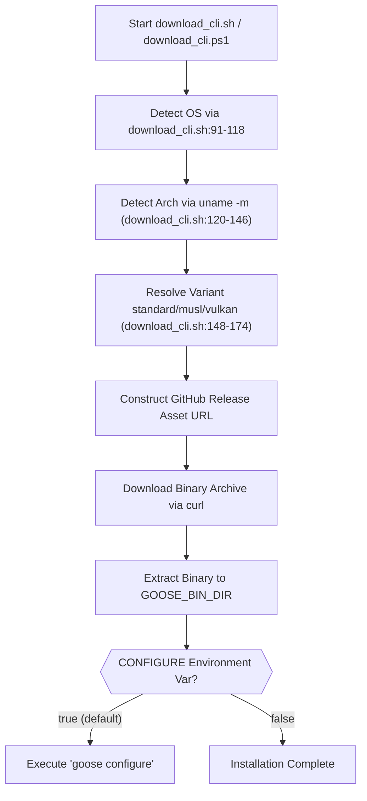
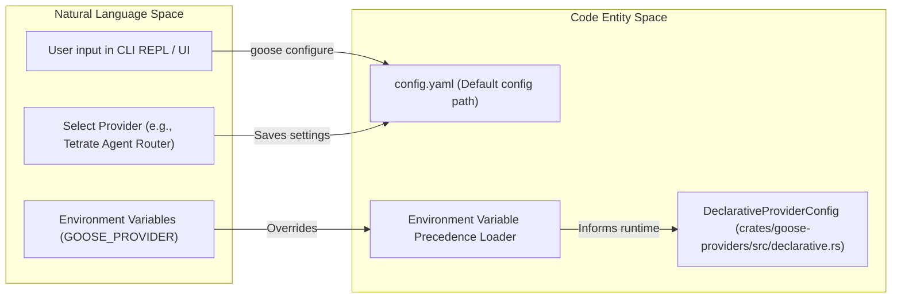
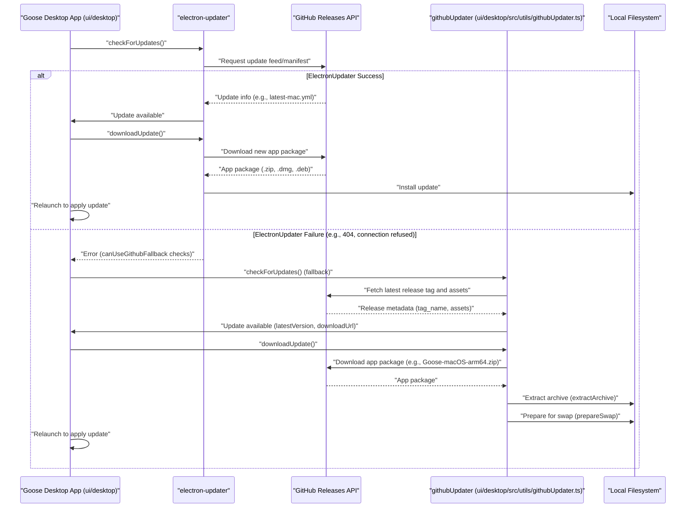

# Getting Started & Installation

<details>
<summary>Relevant source files</summary>

The following files were used as context for generating this wiki page:

- [.github/workflows/build-cli.yml](.github/workflows/build-cli.yml)
- [.github/workflows/canary.yml](.github/workflows/canary.yml)
- [.github/workflows/publish-ask-ai-bot.yml](.github/workflows/publish-ask-ai-bot.yml)
- [.github/workflows/publish-docker.yml](.github/workflows/publish-docker.yml)
- [.github/workflows/release.yml](.github/workflows/release.yml)
- [CUSTOM_DISTROS.md](CUSTOM_DISTROS.md)
- [RISCV_SETUP.md](RISCV_SETUP.md)
- [crates/goose-cli/src/commands/update.rs](crates/goose-cli/src/commands/update.rs)
- [documentation/docs/getting-started/installation.md](documentation/docs/getting-started/installation.md)
- [documentation/docs/guides/custom-distributions.md](documentation/docs/guides/custom-distributions.md)
- [documentation/docs/guides/updating-goose.md](documentation/docs/guides/updating-goose.md)
- [documentation/docs/quickstart.md](documentation/docs/quickstart.md)
- [documentation/docs/tutorials/cicd.md](documentation/docs/tutorials/cicd.md)
- [documentation/src/components/LinuxDesktopInstallButtons.js](documentation/src/components/LinuxDesktopInstallButtons.js)
- [documentation/src/components/MacDesktopInstallButtons.js](documentation/src/components/MacDesktopInstallButtons.js)
- [documentation/src/components/SupportedEnvironments.js](documentation/src/components/SupportedEnvironments.js)
- [documentation/src/components/WindowsDesktopInstallButtons.js](documentation/src/components/WindowsDesktopInstallButtons.js)
- [download_cli.ps1](download_cli.ps1)
- [download_cli.sh](download_cli.sh)
- [services/ask-ai-bot/.gitignore](services/ask-ai-bot/.gitignore)
- [services/ask-ai-bot/clients/ai.ts](services/ask-ai-bot/clients/ai.ts)
- [services/ask-ai-bot/index.ts](services/ask-ai-bot/index.ts)
- [ui/desktop/src/components/settings/app/UpdateSection.tsx](ui/desktop/src/components/settings/app/UpdateSection.tsx)
- [ui/desktop/src/utils/autoUpdater.ts](ui/desktop/src/utils/autoUpdater.ts)
- [ui/desktop/src/utils/githubUpdater.target.test.ts](ui/desktop/src/utils/githubUpdater.target.test.ts)
- [ui/desktop/src/utils/githubUpdater.ts](ui/desktop/src/utils/githubUpdater.ts)
- [ui/desktop/vite.main.config.mts](ui/desktop/vite.main.config.mts)

</details>


This page provides technical details on the installation, first-time configuration, and update mechanisms for Goose, covering both the Desktop (Electron-based) and CLI (Rust-based) versions across macOS, Linux, and Windows.

## Installation Overview & Architecture

Goose is distributed as two primary interfaces:
1.  **Goose Desktop**: An Electron application that manages the background process lifecycle and provides a React-based user interface [documentation/docs/getting-started/installation.md:21-29]().
2.  **Goose CLI**: A standalone compiled Rust binary designed for terminal-based REPL and script automation [documentation/docs/getting-started/installation.md:51-60]().

### System Requirements & Binary Distribution
Goose targets `x86_64` and `aarch64` architectures. Installation handles platform-specific directory structures for configuration and binary storage [download_cli.sh:56-67]().

| Platform | Desktop Distribution | CLI Distribution | Default Config Path |
| :--- | :--- | :--- | :--- |
| **macOS** | `.zip`, Homebrew (`block-goose`) | Shell Script, Homebrew | `~/.config/goose/config.yaml` |
| **Linux** | `.deb`, Package scripts | Shell Script (`download_cli.sh`) | `~/.config/goose/config.yaml` |
| **Windows** | `.zip` (Portable) | PowerShell / Bash Script | `%APPDATA%\Block\goose\config\config.yaml` |

Sources: [documentation/docs/getting-started/installation.md:16-159](), [download_cli.sh:56-67]()

---

## Installation Procedures

### 1. macOS
Goose supports both Intel (`x86_64`) and Apple Silicon (`aarch64`) architectures.
*   **Desktop**: Installed via direct download bundle or Homebrew cask: `brew install --cask block-goose` [documentation/docs/getting-started/installation.md:38]().
*   **CLI**: Installed via `download_cli.sh`, which automatically inspects `uname -m` and fetches the corresponding release archive [download_cli.sh:119-146]().

### 2. Linux
*   **Desktop**: Distributed as a Debian package (`.deb`) for Debian/Ubuntu distributions [documentation/docs/getting-started/installation.md:95-99]().
*   **CLI**: Installed via the universal installation script with automatic `glibc` / `musl` variant detection [download_cli.sh:148-174]().

### 3. Windows
*   **Desktop**: Distributed as a portable `.zip` archive containing the Electron runtime structure [ui/desktop/src/utils/githubUpdater.ts:103-120]().
*   **CLI**: Supports native execution in PowerShell (`download_cli.ps1`) or Git Bash / MSYS2 via `download_cli.sh` [documentation/docs/getting-started/installation.md:150-175]().

### Data Flow: CLI Installation Script Execution
The installation script orchestrates OS detection, architecture resolution, release tag validation, and unpacking.

Title: CLI Download and Extraction Logic

Sources: [download_cli.sh:56-174](), [documentation/docs/getting-started/installation.md:54-66]()

---

## First-Time Configuration

Upon initial execution, Goose requires an LLM provider configuration. Settings are managed interactively via `goose configure` or initialized through the Desktop onboarding flow [documentation/docs/quickstart.md:112-124]().

### Provider Setup & Declarative Configuration
Goose supports numerous API-backed and local inference providers:
*   **API Key Providers**: Anthropic, OpenAI, Google Gemini [documentation/docs/quickstart.md:160-168]().
*   **Enterprise/Cloud**: Amazon Bedrock, Databricks, Azure AI Foundry [documentation/docs/quickstart.md:160-168]().
*   **Declarative Backends**: Pre-defined provider configurations defined in `crates/goose-providers/src/declarative.rs` that map engine parameters.

Title: Configuration Logic Entity Mapping

Sources: [documentation/docs/quickstart.md:112-175](), [crates/goose-providers/src/declarative.rs:15-61]()

---

## Quickstart Guide

To start a development session immediately following installation:

1.  **Initialize Configuration**: Run `goose configure` in your terminal [documentation/docs/quickstart.md:132-136]().
2.  **Select Provider**: Choose the `Tetrate Agent Router Service` (or your preferred provider) [documentation/docs/quickstart.md:151-168]().
3.  **Start an Interactive Session**:
    ```bash
    goose session -n my-first-project
    ```
4.  **Execute Non-Interactive Tasks**:
    ```bash
    goose run -t "Analyze the current repository file layout"
    ```

Sources: [documentation/docs/quickstart.md:18-175]()

---

## Updating Goose & Provenance Verification

Goose components are updated differently depending on whether the CLI binary or Desktop app is deployed.

### CLI Updates & Sigstore Verification
The `goose update` command uses Rust's `reqwest` client and Sigstore verification libraries to fetch and verify binary updates [crates/goose-cli/src/commands/update.rs:9-17](). It determines the correct platform binary via compile-time target inspections in `asset_name()` [crates/goose-cli/src/commands/update.rs:24-63]().

Title: CLI Update Command Execution
```mermaid
graph TD
    A[User executes "goose update"] --> B{Determine OS and Architecture};
    B --> C[Call asset_name() to get platform-specific asset name];
    C --> D[Construct GitHub Release API URL for latest stable/canary release];
    D --> E[Fetch release metadata from GitHub];
    E --> F[Extract download URL and SHA256 digest for relevant asset];
    F --> G[Download asset (e.g., goose-x86_64-apple-darwin.tar.bz2)];
    G --> H[Fetch attestation bundles for the downloaded asset];
    H --> I[Verify attestation bundles using Sigstore's TrustedRoot];
    I -- "Verification Success" --> J[Extract new Goose binary to a temporary location];
    J --> K[Atomically replace old Goose binary with new one];
    K --> L[Report update success];
    I -- "Verification Failure" --> M[Report update failure and abort];
```
Sources: [crates/goose-cli/src/commands/update.rs:24-63](), [crates/goose-cli/src/commands/update.rs:129-165]()

### Desktop Updates
Goose Desktop utilizes an Electron-based updater workflow defined in `ui/desktop/src/utils/githubUpdater.ts` which inspects GitHub releases and safely swaps unpacked app bundles [ui/desktop/src/utils/githubUpdater.ts:10-77](). The `autoUpdater` module from `electron-updater` is primarily used, with a fallback to a custom `githubUpdater` if the primary mechanism fails (e.g., due to network issues or missing update manifests) [ui/desktop/src/utils/autoUpdater.ts:61-69](). The `githubUpdater` handles downloading and extracting the correct archive based on the operating system and architecture [ui/desktop/src/utils/githubUpdater.ts:67-78]().

Title: Desktop Update Flow

Sources: [ui/desktop/src/utils/autoUpdater.ts:61-69](), [ui/desktop/src/utils/githubUpdater.ts:10-77](), [ui/desktop/src/utils/githubUpdater.ts:67-78]()