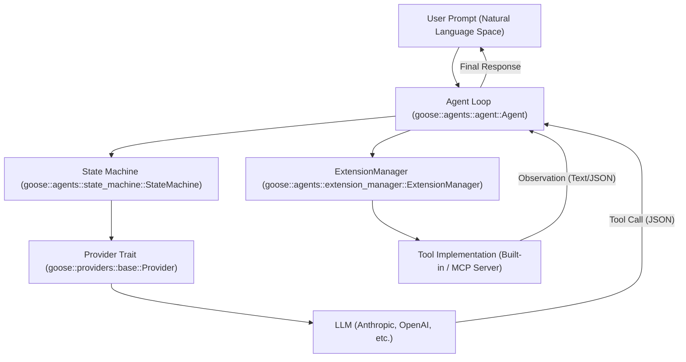
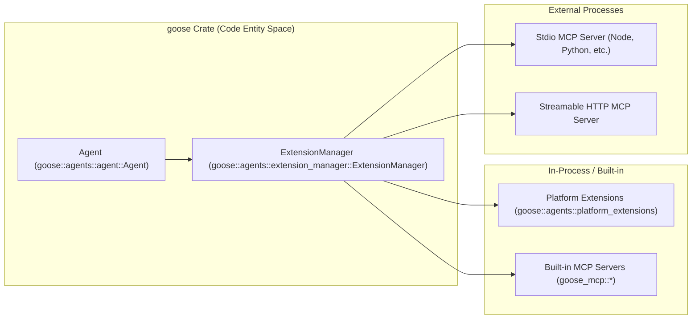
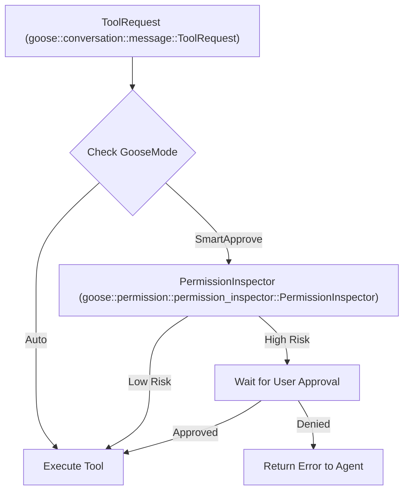

# Core Concepts & Terminology

Relevant source files

The following files were used as context for generating this wiki page:

- [crates/goose/src/skills/builtins/web_search.md](crates/goose/src/skills/builtins/web_search.md)
- [documentation/docs/getting-started/using-extensions.md](documentation/docs/getting-started/using-extensions.md)
- [documentation/docs/guides/config-files.md](documentation/docs/guides/config-files.md)
- [documentation/docs/guides/context-engineering/subagents.mdx](documentation/docs/guides/context-engineering/subagents.mdx)
- [documentation/docs/guides/context-engineering/using-skills.md](documentation/docs/guides/context-engineering/using-skills.md)
- [documentation/docs/guides/environment-variables.md](documentation/docs/guides/environment-variables.md)
- [documentation/docs/guides/goose-cli-commands.md](documentation/docs/guides/goose-cli-commands.md)
- [documentation/docs/guides/managing-tools/_category_.json](documentation/docs/guides/managing-tools/_category_.json)
- [documentation/docs/guides/managing-tools/adjust-tool-output.md](documentation/docs/guides/managing-tools/adjust-tool-output.md)
- [documentation/docs/guides/managing-tools/code-mode.md](documentation/docs/guides/managing-tools/code-mode.md)
- [documentation/docs/guides/managing-tools/index.md](documentation/docs/guides/managing-tools/index.md)
- [documentation/docs/guides/managing-tools/tool-permissions.md](documentation/docs/guides/managing-tools/tool-permissions.md)
- [documentation/docs/guides/multi-model/index.mdx](documentation/docs/guides/multi-model/index.mdx)
- [documentation/docs/guides/recipes/index.mdx](documentation/docs/guides/recipes/index.mdx)
- [documentation/docs/guides/recipes/recipe-reference.md](documentation/docs/guides/recipes/recipe-reference.md)
- [documentation/docs/guides/recipes/session-recipes.md](documentation/docs/guides/recipes/session-recipes.md)
- [documentation/docs/guides/recipes/storing-recipes.md](documentation/docs/guides/recipes/storing-recipes.md)
- [documentation/docs/guides/recipes/subrecipes.md](documentation/docs/guides/recipes/subrecipes.md)
- [documentation/docs/guides/running-tasks.md](documentation/docs/guides/running-tasks.md)
- [documentation/docs/guides/sessions/in-session-actions.md](documentation/docs/guides/sessions/in-session-actions.md)
- [documentation/docs/guides/sessions/session-management.md](documentation/docs/guides/sessions/session-management.md)
- [documentation/docs/guides/sessions/smart-context-management.md](documentation/docs/guides/sessions/smart-context-management.md)
- [documentation/docs/guides/tips.md](documentation/docs/guides/tips.md)
- [documentation/docs/mcp/code-mode-mcp.md](documentation/docs/mcp/code-mode-mcp.md)
- [documentation/docs/mcp/skills-mcp.md](documentation/docs/mcp/skills-mcp.md)
- [documentation/docs/mcp/summon-mcp.md](documentation/docs/mcp/summon-mcp.md)
- [documentation/docs/troubleshooting/known-issues.md](documentation/docs/troubleshooting/known-issues.md)
- [documentation/docs/tutorials/playwright-skill.md](documentation/docs/tutorials/playwright-skill.md)
- [documentation/docs/tutorials/recipes-tutorial.md](documentation/docs/tutorials/recipes-tutorial.md)
- [documentation/docs/tutorials/remotion-video-creation.md](documentation/docs/tutorials/remotion-video-creation.md)
- [documentation/src/components/RecipeFields.js](documentation/src/components/RecipeFields.js)
- [documentation/src/components/VideoCarousel.js](documentation/src/components/VideoCarousel.js)
- [documentation/static/files/thoughts/plans/2025-12-23-remove-tool-selection-strategy.raw](documentation/static/files/thoughts/plans/2025-12-23-remove-tool-selection-strategy.raw)
- [documentation/static/files/thoughts/research/2025-12-22-llm-tool-selection-strategy.raw](documentation/static/files/thoughts/research/2025-12-22-llm-tool-selection-strategy.raw)
- [documentation/static/img/summon-retro-site.png](documentation/static/img/summon-retro-site.png)

## Purpose & Scope
This page provides a technical reference for the fundamental concepts and entities within the Goose ecosystem. It bridges the gap between high-level user features and the underlying implementation details found in the Rust workspace, detailing data structures, control flow, and architecture components such as Sessions, Turns, Extensions, Tools, Recipes, GooseMode, MCP, ACP, Skills, Hooks, and the core agent loop.

Sources: [documentation/docs/guides/sessions/session-management.md:11-12](), [documentation/docs/guides/recipes/session-recipes.md:12-13]()

---

## The Agent Loop & State Machine

The core of Goose is an autonomous agent loop that facilitates interaction between a user, a Large Language Model (LLM), and a set of tools. This loop is primarily managed by the `Agent` struct in the `goose` crate, which orchestrates the transition between reasoning (LLM inference) and action (tool execution) [crates/goose/src/agents/agent.rs:1-50]().

1. **Input**: The loop begins with a user prompt or a scheduled trigger.
2. **Reasoning**: The `Agent` sends the conversation history and available tool schemas to the `Provider`. This is initialized via `prepare_tools_and_prompt` [crates/goose/src/agents/reply_parts.rs:197-205]().
3. **Action**: If the LLM returns a tool call, the `Agent` dispatches it via the `ExtensionManager` [crates/goose/src/agents/extension_manager.rs:192-200]().
4. **Observation**: The tool output (observation) is captured, formatted, and added to the session conversation history.
5. **Iteration**: The loop repeats until the LLM provides a final text response or the `DEFAULT_MAX_TURNS` limit (default 1000) is reached [crates/goose/src/agents/agent.rs:87-87]().

### Agent Loop Data Flow

**Diagram: Natural Language to Code Entity Space — Agent Loop**

Sources: [crates/goose/src/agents/agent.rs:35-44](), [crates/goose/src/agents/extension_manager.rs:192-200](), [crates/goose/src/agents/reply_parts.rs:197-205]()

---

## Sessions and Turns

* **Session**: A single, continuous interaction stored in a local SQLite database (`sessions.db`) [documentation/docs/guides/goose-cli-commands.md:197-199](). It provides an isolated space for conversation history, metadata, and context [crates/goose-cli/src/session/mod.rs:50-55]().
* **Turn**: A single cycle in the agent loop [documentation/docs/guides/sessions/smart-context-management.md:17-18](). `GOOSE_MAX_TURNS` limits how many autonomous iterations (tool calls) Goose can perform without user input (default 1000) [documentation/docs/guides/environment-variables.md:137-137]().

### Session Persistence and Identification

Sessions are managed by the `SessionManager` and identified by a session identifier (`session-id`) or a human-readable name [documentation/docs/guides/goose-cli-commands.md:17-20]().

| Entity | Code Reference | Storage |
| :--- | :--- | :--- |
| **Session** | `goose::session::Session` | `sessions.db` (SQLite) |
| **Message** | `goose::conversation::message::Message` | `messages` table |
| **Metadata** | `goose::session::Metadata` | `sessions` table |

Sources: [documentation/docs/guides/goose-cli-commands.md:197-199](), [crates/goose-cli/src/session/mod.rs:50-55](), [crates/goose-cli/src/cli.rs:17-20]()

---

## Extensions and Tools

Goose uses an extensible architecture to interact with the external environment, primarily built on top of the **Model Context Protocol (MCP)** [documentation/docs/getting-started/using-extensions.md:10-13]().

### Extension Categories
1. **Built-in Extensions**: Compiled directly into Goose or provided through built-in MCP servers (e.g., `developer`, `computercontroller`, `memory`) [documentation/docs/getting-started/using-extensions.md:21-29]().
2. **Platform Extensions**: In-process extensions providing essential runtime features like `analyze`, `apps`, `chatrecall`, `code-mode`, `extension-manager`, `skills`, `summon`, `todo`, and `tom` [documentation/docs/getting-started/using-extensions.md:34-47]().
3. **External MCP Servers**: Third-party servers connected via `stdio` processes or HTTP transports [documentation/docs/getting-started/using-extensions.md:109-122]().

**Diagram: Extension Architecture and Code Mapping**

Sources: [documentation/docs/getting-started/using-extensions.md:21-47](), [crates/goose/src/agents/extension_manager.rs:192-200](), [crates/goose-cli/src/session/builder.rs:89-154]()

---

## Recipes and Subagents

### Recipes
A **Recipe** is a reusable YAML or JSON configuration file that packages instructions, prompts, required extensions, goals, parameters, and success checks [documentation/docs/guides/recipes/session-recipes.md:37-60](), [documentation/docs/guides/recipes/recipe-reference.md:13-54]().
* **Parameters**: Dynamic variables defined in the recipe using `{{ variable_name }}` syntax [documentation/docs/guides/recipes/session-recipes.md:73-76]().
* **Sub-recipes**: Reusable workflows that can be composed or triggered hierarchically under `sub_recipes` [documentation/docs/guides/recipes/recipe-reference.md:53-53]().

### Subagents
Subagents are independent child Goose instances spawned to execute isolated tasks via the `summon` platform extension and `SubagentHandler` [documentation/docs/getting-started/using-extensions.md:44-44](), [crates/goose/src/agents/mod.rs:38-39]().

Sources: [documentation/docs/guides/recipes/session-recipes.md:37-76](), [documentation/docs/guides/recipes/recipe-reference.md:37-54](), [documentation/docs/getting-started/using-extensions.md:44-44](), [crates/goose/src/agents/mod.rs:38-39]()

---

## GooseMode & Permission System

Goose implements a risk-based permission and security enforcement pipeline (`GooseMode`) to govern tool execution and resource access [documentation/docs/guides/config-files.md:52-52]().

| Mode | Behavior |
| :--- | :--- |
| `Auto` | Full autonomy; Goose executes tools without manual confirmation prompts [documentation/docs/getting-started/using-extensions.md:30-31](). |
| `Approve` | Manual user approval is required for all tool invocations. |
| `SmartApprove` | Automatically approves low-risk operations while flagging high-risk actions for user review. |
| `Chat` | Conversational mode only; tool execution capabilities are disabled. |

**Diagram: Permission Inspection Pipeline**

Sources: [documentation/docs/guides/config-files.md:52-52](), [documentation/docs/getting-started/using-extensions.md:30-31](), [crates/goose/src/agents/agent.rs:61-64]()

---

## Protocols: MCP and ACP

### Model Context Protocol (MCP)
MCP is an open standard that enables AI models to connect securely to data sources and tools [documentation/docs/getting-started/using-extensions.md:12-13]().
* **MCP Servers**: Expose standardized tool definitions, prompts, and resources.
* **MCP Client**: Goose acts as an MCP client through the `McpClientTrait` interface managed by the `ExtensionManager` [crates/goose/src/agents/extension_manager.rs:40-41]().

### Agent Client Protocol (ACP)
While MCP connects **Agents to Tools**, ACP connects **Clients to Agents** (such as the Electron Desktop app or the CLI to the Goose server architecture) [crates/goose/Cargo.toml]().
* Goose operates as an ACP Server when running server commands or background sessions.

Sources: [documentation/docs/getting-started/using-extensions.md:12-13](), [crates/goose/src/agents/extension_manager.rs:40-41](), [crates/goose/Cargo.toml]()

---

## Skills and Hooks

* **Skills**: Reusable capabilities or prompt instructions bundled into extensions (`~/.agents/skills/`) that guide the model on how to perform specific domain tasks [documentation/docs/guides/context-engineering/using-skills.md:7-13]().
* **Hooks**: Lifecycle interception points (such as entry hooks, exit hooks, and stop hooks) that can inspect conversation state, validate actions, or block turn completion based on policy rules [crates/goose/src/agents/agent.rs:35-44]().

Sources: [documentation/docs/guides/context-engineering/using-skills.md:7-13](), [crates/goose/src/agents/agent.rs:35-44]()