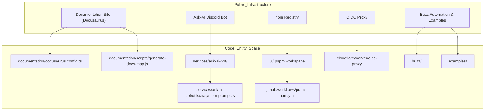
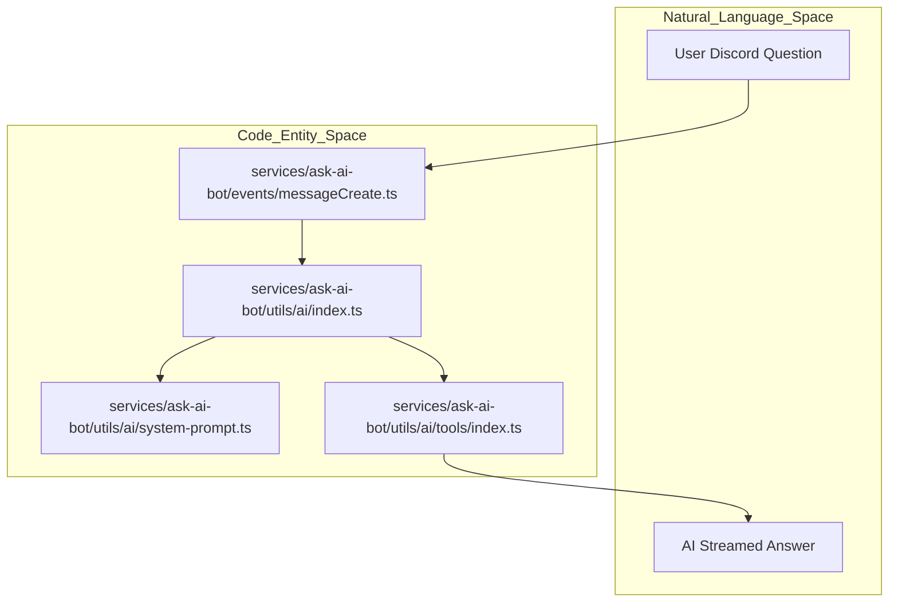

# Supporting Services & Infrastructure

Relevant source files

The following files were used as context for generating this wiki page:

- [.github/workflows/deploy-docs-and-extensions.yml](.github/workflows/deploy-docs-and-extensions.yml)
- [.github/workflows/pr-website-preview.yml](.github/workflows/pr-website-preview.yml)
- [documentation/.gitignore](documentation/.gitignore)
- [documentation/docusaurus.config.ts](documentation/docusaurus.config.ts)
- [documentation/package-lock.json](documentation/package-lock.json)
- [documentation/package.json](documentation/package.json)
- [documentation/plugins/custom-webpack.cjs](documentation/plugins/custom-webpack.cjs)
- [documentation/src/components/HomepageFeatures/index.tsx](documentation/src/components/HomepageFeatures/index.tsx)
- [documentation/src/css/custom.css](documentation/src/css/custom.css)
- [documentation/src/pages/deeplink-generator.tsx](documentation/src/pages/deeplink-generator.tsx)
- [documentation/src/pages/index.module.css](documentation/src/pages/index.module.css)
- [documentation/src/pages/index.tsx](documentation/src/pages/index.tsx)
- [documentation/static/img/logo-codename-goose.svg](documentation/static/img/logo-codename-goose.svg)
- [documentation/static/img/logo_codename_goose.png](documentation/static/img/logo_codename_goose.png)
- [services/ask-ai-bot/.dockerignore](services/ask-ai-bot/.dockerignore)
- [services/ask-ai-bot/.env.example](services/ask-ai-bot/.env.example)
- [services/ask-ai-bot/Dockerfile](services/ask-ai-bot/Dockerfile)
- [services/ask-ai-bot/bun.lock](services/ask-ai-bot/bun.lock)
- [services/ask-ai-bot/clients/discord.ts](services/ask-ai-bot/clients/discord.ts)
- [services/ask-ai-bot/commands/ping.ts](services/ask-ai-bot/commands/ping.ts)
- [services/ask-ai-bot/events/error.ts](services/ask-ai-bot/events/error.ts)
- [services/ask-ai-bot/events/messageCreate.ts](services/ask-ai-bot/events/messageCreate.ts)
- [services/ask-ai-bot/package.json](services/ask-ai-bot/package.json)
- [services/ask-ai-bot/utils/ai/index.ts](services/ask-ai-bot/utils/ai/index.ts)
- [services/ask-ai-bot/utils/ai/system-prompt.ts](services/ask-ai-bot/utils/ai/system-prompt.ts)
- [services/ask-ai-bot/utils/ai/tools/codebase-search.ts](services/ask-ai-bot/utils/ai/tools/codebase-search.ts)
- [services/ask-ai-bot/utils/ai/tools/codebase-viewer.ts](services/ask-ai-bot/utils/ai/tools/codebase-viewer.ts)
- [services/ask-ai-bot/utils/ai/tools/github.ts](services/ask-ai-bot/utils/ai/tools/github.ts)
- [services/ask-ai-bot/utils/ai/tools/index.ts](services/ask-ai-bot/utils/ai/tools/index.ts)
- [services/ask-ai-bot/utils/discord/server-context.ts](services/ask-ai-bot/utils/discord/server-context.ts)

The Goose ecosystem is supported by a suite of auxiliary services, distribution channels, and community automation workflows that help manage public documentation, provide community assistance, secure CI/CD integration, distribute binaries and SDKs, and offer example projects. These components bridge the core Rust-based Goose system with end-user experiences on web, chat, CLI, and package consumption platforms under the Agentic AI Foundation (AAIF).

## System Overview: Service Space to Code Entity Space

This diagram maps key infrastructure services on the public-facing side to their respective code directories or configuration files within the repository, illustrating how they connect code entities to natural language systems and infrastructure.

**Sources:** [documentation/docusaurus.config.ts:17-51](), [services/ask-ai-bot/package.json:1-28](), [services/ask-ai-bot/utils/ai/system-prompt.ts:1-19]()

---

## 10.1 Documentation Site (Docusaurus)

Goose’s primary online documentation site is built using [Docusaurus](https://docusaurus.io/), an open-source React-based static site generator tailored for technical docs [documentation/docusaurus.config.ts:17-51]().

- **Purpose:** Serves guides, tutorials, extension catalogs, blog posts, and community pages at [goose-docs.ai](https://goose-docs.ai/).
- **Configuration:** The site metadata, URL base, localization (currently English), sidebar generation, and blog options are specified in `docusaurus.config.ts` [documentation/docusaurus.config.ts:17-141]().
- **Customization:** Supports custom React components for install buttons, provider setup, recipe cards, and extension catalogs, integrated with TailwindCSS and Prism for styling and code highlighting.
- **Deployment Workflow:** CI/CD pipelines automatically build and deploy documentation previews, generate ACP protocol docs, and publish to GitHub Pages and Cloudflare Pages [ .github/workflows/deploy-docs-and-extensions.yml:1-83 ](), [ .github/workflows/pr-website-preview.yml:1-122 ]().

For detailed configuration, extension, and deployment instructions, see the child page [Documentation Site (Docusaurus)](#10.1).

**Sources:** [documentation/docusaurus.config.ts:17-141](), [.github/workflows/deploy-docs-and-extensions.yml:1-82](), [.github/workflows/pr-website-preview.yml:1-121]()

---

## 10.2 OIDC Proxy & Ask-AI Discord Bot

To secure community support and CI/CD workflows, Goose employs Cloudflare Worker-based OIDC proxy functionality alongside a Discord bot for user interaction and AI-assisted help.

- **OIDC Proxy:** A Cloudflare Worker component acts as an OpenID Connect proxy allowing GitHub Actions workflows to authenticate securely with LLM API services without storing sensitive secrets directly in repository settings.
- **Ask-AI Discord Bot:** Located under `services/ask-ai-bot/`, this Bun-powered TypeScript service integrates with Discord’s API to provide real-time, AI-augmented responses and community support [services/ask-ai-bot/package.json:1-28]().

### Mapping Natural Language Requests to Code Entities in the Discord Bot

This flow shows how user messages received on Discord trigger event handlers that execute an AI agent loop powered by system prompt templates and custom tools, producing streamed answers back into the thread [services/ask-ai-bot/utils/ai/index.ts:19-179]().

For implementation details and rate limiting mechanisms, see [OIDC Proxy & Ask-AI Discord Bot](#10.2).

**Sources:** [services/ask-ai-bot/package.json:1-28](), [services/ask-ai-bot/utils/ai/index.ts:19-179](), [services/ask-ai-bot/utils/ai/system-prompt.ts:1-19](), [services/ask-ai-bot/events/messageCreate.ts:1-50]()

---

## 10.3 npm & ACP Package Distribution

Goose distributes client libraries, native binaries, and interop SDKs via npm registries to facilitate consumption across JavaScript, Python, and Kotlin development environments.

- **Workspace:** The `ui/` directory hosts a pnpm monorepo including `@aaif/goose-acp` and `goose-acp-client`, which implement the Agent Client Protocol (ACP) for seamless client-server communication.
- **Binaries:** Platform-specific Goose binaries are managed alongside native build scripts.
- **Publishing:** Changeset tools coordinate version management and publishing workflows within GitHub Actions `.github/workflows/publish-npm.yml`.

This infrastructure enables Goose to maintain synchronized releases, ensuring usability of the TypeScript TUI and SDK across supported platforms.

For an in-depth overview, visit [npm & ACP Package Distribution](#10.3).

**Sources:** [documentation/blog/2026-04-08-goose-acp-and-new-tui/index.md:44-50](), [.github/workflows/publish-npm.yml]() (referenced in context)

---

## 10.4 Buzz Community Automation & Examples

Goose integrates community-led automation tools and curated example projects for ecosystem engagement and developer onboarding.

- **Buzz Automation:** The `buzz/` directory contains configuration and scripts to automate GitHub issue management, including the `github_issue_manager.yaml` recipe, issue channels, roster sync, and an hourly daemon process to streamline triaging.
- **Goose-maintains-Goose:** Automated workflows enforce Goose's self-hosting and self-maintenance principles to keep the project continuously evolving.
- **Examples:** The `examples/` directory provides exemplar MCP server implementations like the `mcp-wiki` and the `hello-hooks` plugin, showcasing extension development and integration patterns.

These resources facilitate community contribution, smoother onboarding, and practical demonstrations of Goose capabilities.

For full details, see [Buzz Community Automation & Examples](#10.4).

**Sources:** [buzz/github_issue_manager.yaml]() (implied), [services/ask-ai-bot/utils/ai/system-prompt.ts:11-19]() (for examples reference)

---

This page provides a high-level view of auxiliary services and infrastructure that enhance, support, and distribute Goose. For each area, detailed technical and operational insights are available in the respective child pages listed above.