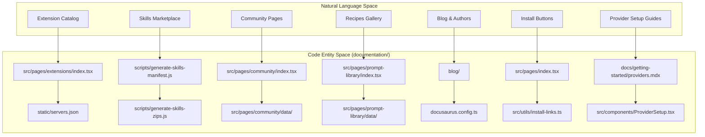
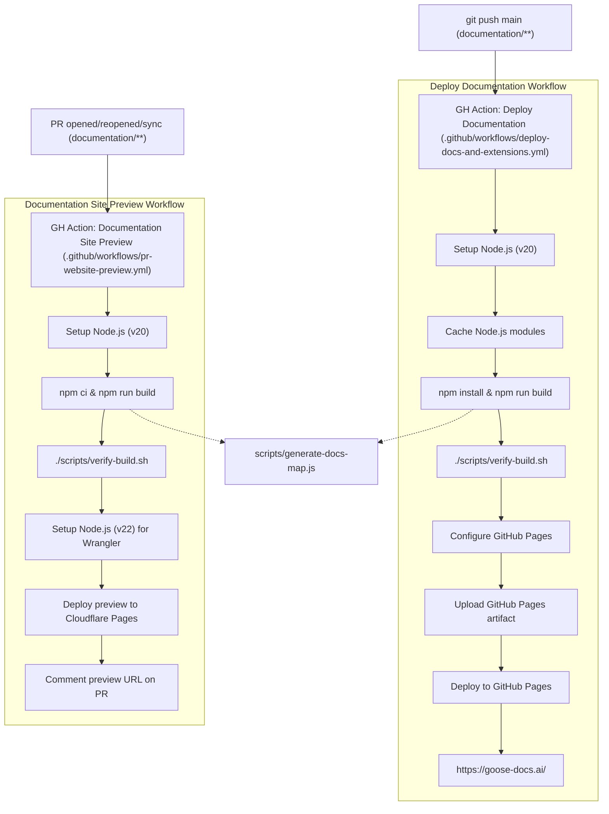

# Documentation Site (Docusaurus)

Relevant source files

The following files were used as context for generating this wiki page:

- [.github/workflows/deploy-docs-and-extensions.yml](.github/workflows/deploy-docs-and-extensions.yml)
- [.github/workflows/pr-website-preview.yml](.github/workflows/pr-website-preview.yml)
- [documentation/.gitignore](documentation/.gitignore)
- [documentation/blog/2024-11-22-screenshot-driven-development/index.md](documentation/blog/2024-11-22-screenshot-driven-development/index.md)
- [documentation/blog/2024-12-06-previewing-goose-v10-beta/index.md](documentation/blog/2024-12-06-previewing-goose-v10-beta/index.md)
- [documentation/blog/2024-12-10-connecting-ai-agents-to-your-systems-with-mcp/index.md](documentation/blog/2024-12-10-connecting-ai-agents-to-your-systems-with-mcp/index.md)
- [documentation/blog/2024-12-11-resolving-ci-issues-with-goose-a-practical-walkthrough/index.md](documentation/blog/2024-12-11-resolving-ci-issues-with-goose-a-practical-walkthrough/index.md)
- [documentation/blog/2025-01-28-introducing-codename-goose/index.md](documentation/blog/2025-01-28-introducing-codename-goose/index.md)
- [documentation/blog/2025-01-28-introducing-codename-goose/introducing-codename-goose.png](documentation/blog/2025-01-28-introducing-codename-goose/introducing-codename-goose.png)
- [documentation/blog/2025-03-14-goose-ollama/gooseollama.png](documentation/blog/2025-03-14-goose-ollama/gooseollama.png)
- [documentation/blog/2025-03-14-goose-ollama/index.md](documentation/blog/2025-03-14-goose-ollama/index.md)
- [documentation/blog/2025-06-05-whats-in-my-goosehints-file/blog-banner.png](documentation/blog/2025-06-05-whats-in-my-goosehints-file/blog-banner.png)
- [documentation/blog/2025-06-05-whats-in-my-goosehints-file/goosehints-vs-memory.png](documentation/blog/2025-06-05-whats-in-my-goosehints-file/goosehints-vs-memory.png)
- [documentation/blog/2025-06-05-whats-in-my-goosehints-file/index.md](documentation/blog/2025-06-05-whats-in-my-goosehints-file/index.md)
- [documentation/blog/2025-06-16-multi-model-in-goose/index.md](documentation/blog/2025-06-16-multi-model-in-goose/index.md)
- [documentation/blog/2025-08-11-llm-tag-team-lead-worker-model/header-image.png](documentation/blog/2025-08-11-llm-tag-team-lead-worker-model/header-image.png)
- [documentation/blog/2025-08-11-llm-tag-team-lead-worker-model/index.md](documentation/blog/2025-08-11-llm-tag-team-lead-worker-model/index.md)
- [documentation/blog/2025-08-18-understanding-context-windows/contextwindow.png](documentation/blog/2025-08-18-understanding-context-windows/contextwindow.png)
- [documentation/blog/2025-08-18-understanding-context-windows/index.md](documentation/blog/2025-08-18-understanding-context-windows/index.md)
- [documentation/blog/2025-08-27-get-started-for-free-with-tetrate/index.md](documentation/blog/2025-08-27-get-started-for-free-with-tetrate/index.md)
- [documentation/blog/2026-03-19-use-goose-with-your-ai-subscription/index.md](documentation/blog/2026-03-19-use-goose-with-your-ai-subscription/index.md)
- [documentation/blog/2026-04-08-how-to-break-up-with-your-agent/header.png](documentation/blog/2026-04-08-how-to-break-up-with-your-agent/header.png)
- [documentation/blog/2026-04-08-how-to-break-up-with-your-agent/index.md](documentation/blog/2026-04-08-how-to-break-up-with-your-agent/index.md)
- [documentation/blog/2026-06-17-self-improving-agents-need-humans/index.md](documentation/blog/2026-06-17-self-improving-agents-need-humans/index.md)
- [documentation/blog/authors.yml](documentation/blog/authors.yml)
- [documentation/docs/guides/acp-providers.md](documentation/docs/guides/acp-providers.md)
- [documentation/docs/guides/cli-providers.md](documentation/docs/guides/cli-providers.md)
- [documentation/docs/tutorials/headless-goose.md](documentation/docs/tutorials/headless-goose.md)
- [documentation/docusaurus.config.ts](documentation/docusaurus.config.ts)
- [documentation/package-lock.json](documentation/package-lock.json)
- [documentation/package.json](documentation/package.json)
- [documentation/plugins/custom-webpack.cjs](documentation/plugins/custom-webpack.cjs)
- [documentation/scripts/community_stars.py](documentation/scripts/community_stars.py)
- [documentation/scripts/community_stars_teams.txt](documentation/scripts/community_stars_teams.txt)
- [documentation/src/components/HomepageFeatures/index.tsx](documentation/src/components/HomepageFeatures/index.tsx)
- [documentation/src/css/custom.css](documentation/src/css/custom.css)
- [documentation/src/pages/community/data/README.md](documentation/src/pages/community/data/README.md)
- [documentation/src/pages/community/data/april-2025.json](documentation/src/pages/community/data/april-2025.json)
- [documentation/src/pages/community/data/august-2025.json](documentation/src/pages/community/data/august-2025.json)
- [documentation/src/pages/community/data/community-content.json](documentation/src/pages/community/data/community-content.json)
- [documentation/src/pages/community/data/config.json](documentation/src/pages/community/data/config.json)
- [documentation/src/pages/community/data/july-2025.json](documentation/src/pages/community/data/july-2025.json)
- [documentation/src/pages/community/data/june-2025.json](documentation/src/pages/community/data/june-2025.json)
- [documentation/src/pages/community/data/may-2025.json](documentation/src/pages/community/data/may-2025.json)
- [documentation/src/pages/community/data/november-2025.json](documentation/src/pages/community/data/november-2025.json)
- [documentation/src/pages/community/data/october-2025.json](documentation/src/pages/community/data/october-2025.json)
- [documentation/src/pages/community/data/september-2025.json](documentation/src/pages/community/data/september-2025.json)
- [documentation/src/pages/community/data/template.json](documentation/src/pages/community/data/template.json)
- [documentation/src/pages/community/index.tsx](documentation/src/pages/community/index.tsx)
- [documentation/src/pages/deeplink-generator.tsx](documentation/src/pages/deeplink-generator.tsx)
- [documentation/src/pages/index.module.css](documentation/src/pages/index.module.css)
- [documentation/src/pages/index.tsx](documentation/src/pages/index.tsx)
- [documentation/static/img/authors/douwe-osinga.png](documentation/static/img/authors/douwe-osinga.png)
- [documentation/static/img/blog/self-improving-agents-need-humans.png](documentation/static/img/blog/self-improving-agents-need-humans.png)
- [documentation/static/img/logo-codename-goose.svg](documentation/static/img/logo-codename-goose.svg)
- [documentation/static/img/logo_codename_goose.png](documentation/static/img/logo_codename_goose.png)

The Goose documentation site is a [Docusaurus](https://docusaurus.io/)-based static website that serves as the primary hub for user guides, API references, the MCP extension catalog, and community engagement. Located in the `documentation/` directory of the repository, it leverages a combination of Markdown/MDX and custom React components to provide interactive features such as one-click extension installation and recipe browsing.

---

## System Architecture

The documentation site is implemented using Docusaurus version 3, specifically leveraging `@docusaurus/core` and `@docusaurus/preset-classic` dependencies at version `^3.9.2` [documentation/package-lock.json:11](), [documentation/package.json:20-22](). To augment styling capabilities, the site integrates Tailwind CSS via a custom plugin, as configured in `docusaurus.config.ts` [documentation/docusaurus.config.ts:4](). The use of the "classic" preset enables standard documentation and blog features [documentation/docusaurus.config.ts:61-141](). The configuration enforces strict link integrity with build failure on broken links [documentation/docusaurus.config.ts:33-38]().

### Core Configuration Highlights

- **Site Metadata:** Title set as "goose | Your open source AI agent" with tagline and favicon [documentation/docusaurus.config.ts:17-20]()  
- **Base URL:** Dynamically set via environment variable `TARGET_PATH` to handle deployments in subpaths [documentation/docusaurus.config.ts:23-26]()  
- **Internationalization:** Default locale "en", single locale supported [documentation/docusaurus.config.ts:44-47]()  
- **Redirects:** Redirects support legacy URLs to current doc locations to maintain backward compatibility [documentation/docusaurus.config.ts:143-210]()  
- **Presets:** Classic preset configured with custom sidebar generation to inject context-specific docs like "Memory Extension" and tutorials into the sidebar dynamically [documentation/docusaurus.config.ts:65-108]()  
- **Custom CSS:** Multiple CSS files including Tailwind and extensions styles [documentation/docusaurus.config.ts:125-131]()  
- **Google Analytics (gtag):** Enabled for production builds with anonymized IP tracking [documentation/docusaurus.config.ts:132-137]()

### Tailwind CSS Integration

The site uses a custom plugin `tailwind-config.cjs` to enable Tailwind with Docusaurus, allowing a modern utility-first styling approach alongside Docusaurus's default Infima CSS system.

---

### Documentation Site Entity Map

The following diagram relates the natural language features of the Goose documentation site to their code entities, showing high-level pages, components, and data sources.

Sources:  
[documentation/docusaurus.config.ts:17-108](),  
[documentation/src/pages/extensions/index.tsx:1-100](),  
[documentation/src/pages/community/index.tsx:1-181](),  
[documentation/src/pages/index.tsx:1-192](),  
[documentation/blog/authors.yml:1-257]()

---

## Key Interactive Components

### Extension Catalog & Deep Links

The extension catalog, located under `src/pages/extensions/`, presents a browsable interface for MCP extensions. This catalog relies on JSON data from the static `servers.json` which enumerates known MCP servers and extensions [documentation/docusaurus.config.ts:181-187](), [documentation/static/servers.json (implied)]().

- **Deep Link Generator:** The page `src/pages/deeplink-generator.tsx` implements deep link generation for the `goose://` protocol. It creates one-click install URLs that users can trigger from the web to install MCP extensions directly into their Goose agents [documentation/src/pages/deeplink-generator.tsx:1-50]().

- **Provider Setup Components:** Interactive guides and UI components for provider configuration are implemented, assisting users in setting up popular AI providers like OpenAI, Anthropic, and Ollama. The `docs/getting-started/providers.mdx` provides documentation content, while the React components in `src/components/ProviderSetup.tsx` contain the UI logic and integration for these setup flows.

---

### Skills & Recipes

Goose enables advanced automation via "skills" and "recipes":

- **Skills Packaging:** Build-time Node scripts `generate-skills-manifest.js` and `generate-skills-zips.js` package skill assets used by the documentation site and in Goose clients [documentation/package.json:scripts section]().

- **Recipe Discovery:** Users browse recipe YAML configurations through pages like `src/pages/prompt-library/index.tsx` and supporting data files. Recipes include subrecipes, parameters, and templates for repeatable workflows [documentation/src/pages/prompt-library/index.tsx:1-80]().

- Interactive recipe cards embed usage instructions and integration points for quick adoption.

---

### LLM Context Optimization Documentation

To assist developers in understanding and optimizing language model usage, the site provides a dedicated `llms.txt` context file served from the static directory, referenced in the `headTags` array in the main Docusaurus config. This helps LLMs crawl and parse relevant context info efficiently [documentation/docusaurus.config.ts:49-59]().

---

## Community & Engagement

The community pages in `src/pages/community/index.tsx` are modular and data-driven, separating UI logic from static JSON contributor data:

| Component              | File Path                               | Purpose                                                    |
|------------------------|---------------------------------------|------------------------------------------------------------|
| Community All-Stars     | `src/pages/community/index.tsx`       | Interactive monthly contributor showcase with month filter |
| Community Content      | `src/pages/community/data/community-content.json` | Catalog of blogs, videos, tutorials, with tags support     |
| Event Calendar         | `src/pages/community/index.tsx`       | Embedded community calendar iframe                         |
| Contributor Data       | `src/pages/community/data/*.json`     | Monthly JSON files with contributor detail                 |
| Blog Authors Registry  | `blog/authors.yml`                     | Author metadata and social links                            |

The community content supports filtering by content type (blog, video) and special events like Hacktoberfest, enhancing discoverability [documentation/src/pages/community/index.tsx:7-181](), [documentation/src/pages/community/data/community-content.json:1-206](), [documentation/blog/authors.yml:1-257]().

---

## Deployment & Preview Workflows

The documentation site's CI/CD process is managed with GitHub Actions workflows to build, test, and deploy the site continuously and on pull request updates.

### Deployment Workflow

The `.github/workflows/deploy-docs-and-extensions.yml` workflow triggers on pushes to `main` or manual dispatch, or after successful release workflows. It performs:

1. Checkout main branch  
2. Node.js setup (version 20)  
3. Generation of released ACP reference docs using `generate-released-acp-docs.sh` script [documentation/scripts/generate-released-acp-docs.sh]  
4. Caching and installation of Node.js modules  
5. Running tests and building the documentation with `npm run build`  
6. Verification of the build output [documentation/scripts/verify-build.sh]()  
7. Configuration of GitHub Pages deployment  
8. Upload and deploy the static site to GitHub Pages branch  

### Preview Workflow

The `.github/workflows/pr-website-preview.yml` workflow runs on PR open, reopen, and synchronize events targeting changes in `documentation/**` or ACP schema files. It performs:

1. Checkout PR branch  
2. Setup Node.js environment (v20) and install dependencies with CI mode  
3. Generate ACP reference docs (`generate-acp-docs.js`)  
4. Build and verify the docs  
5. Setup Node.js v22 for Cloudflare Wrangler CLI  
6. Deploy preview to Cloudflare Pages on a branch named by the PR number  
7. Post a comment on the PR with the preview URL (managing existing comments for updates)  

### Workflow Diagram

### Deployment Details

- The deployment steps inject environment variables for the Inkeep AI search integration key, integration ID, and organization ID during the build [documentation/docusaurus.config.ts:8-12](), [.github/workflows/deploy-docs-and-extensions.yml:45-47]().
- The preview builds ensure contributors get a real-time feedback URL posted as a comment on their pull requests for review and validation [.github/workflows/pr-website-preview.yml:1-121]().
- Redirects facilitate smooth migration and usability as the documentation evolves [documentation/docusaurus.config.ts:140-227]().

Sources:  
[.github/workflows/deploy-docs-and-extensions.yml:1-67](),  
[.github/workflows/pr-website-preview.yml:1-121](),  
[documentation/docusaurus.config.ts:8-142](),  
[documentation/package.json:5-18]()

---

This comprehensive documentation infrastructure enables Goose to maintain an up-to-date, interactive, and engaging user and developer experience for exploring its agent capabilities, MCP extensions, recipes, community contributions, and provider integrations.