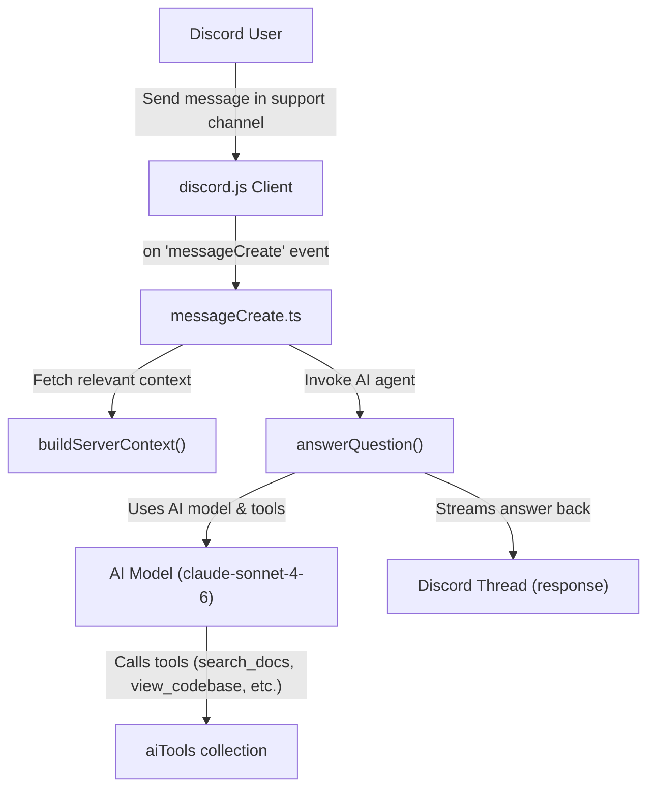
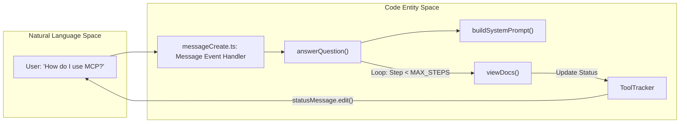

# OIDC Proxy & Ask-AI Discord Bot

<details>
<summary>Relevant source files</summary>

The following files were used as context for generating this wiki page:

- [.github/workflows/build-cli.yml](.github/workflows/build-cli.yml)
- [.github/workflows/canary.yml](.github/workflows/canary.yml)
- [.github/workflows/publish-ask-ai-bot.yml](.github/workflows/publish-ask-ai-bot.yml)
- [.github/workflows/publish-docker.yml](.github/workflows/publish-docker.yml)
- [.github/workflows/release.yml](.github/workflows/release.yml)
- [RISCV_SETUP.md](RISCV_SETUP.md)
- [crates/goose-cli/src/commands/update.rs](crates/goose-cli/src/commands/update.rs)
- [download_cli.ps1](download_cli.ps1)
- [download_cli.sh](download_cli.sh)
- [services/ask-ai-bot/.dockerignore](services/ask-ai-bot/.dockerignore)
- [services/ask-ai-bot/.env.example](services/ask-ai-bot/.env.example)
- [services/ask-ai-bot/.gitignore](services/ask-ai-bot/.gitignore)
- [services/ask-ai-bot/Dockerfile](services/ask-ai-bot/Dockerfile)
- [services/ask-ai-bot/bun.lock](services/ask-ai-bot/bun.lock)
- [services/ask-ai-bot/clients/ai.ts](services/ask-ai-bot/clients/ai.ts)
- [services/ask-ai-bot/clients/discord.ts](services/ask-ai-bot/clients/discord.ts)
- [services/ask-ai-bot/commands/ping.ts](services/ask-ai-bot/commands/ping.ts)
- [services/ask-ai-bot/events/error.ts](services/ask-ai-bot/events/error.ts)
- [services/ask-ai-bot/events/messageCreate.ts](services/ask-ai-bot/events/messageCreate.ts)
- [services/ask-ai-bot/index.ts](services/ask-ai-bot/index.ts)
- [services/ask-ai-bot/package.json](services/ask-ai-bot/package.json)
- [services/ask-ai-bot/utils/ai/index.ts](services/ask-ai-bot/utils/ai/index.ts)
- [services/ask-ai-bot/utils/ai/system-prompt.ts](services/ask-ai-bot/utils/ai/system-prompt.ts)
- [services/ask-ai-bot/utils/ai/tools/codebase-search.ts](services/ask-ai-bot/utils/ai/tools/codebase-search.ts)
- [services/ask-ai-bot/utils/ai/tools/codebase-viewer.ts](services/ask-ai-bot/utils/ai/tools/codebase-viewer.ts)
- [services/ask-ai-bot/utils/ai/tools/github.ts](services/ask-ai-bot/utils/ai/tools/github.ts)
- [services/ask-ai-bot/utils/ai/tools/index.ts](services/ask-ai-bot/utils/ai/tools/index.ts)
- [services/ask-ai-bot/utils/discord/server-context.ts](services/ask-ai-bot/utils/discord/server-context.ts)

</details>


This page covers the auxiliary infrastructure supporting the Goose ecosystem, focusing on two key components:

- The **OIDC Proxy**, a Cloudflare Worker service that enables GitHub Actions workflows to securely access LLM provider APIs without storing secrets directly, leveraging GitHub's OIDC tokens for authentication and secure key injection.

- The **Ask-AI Discord Bot** (`goose-ask-ai-bot`), a community support bot integrated in the Goose Discord server, allowing users to query documentation and the codebase interactively with advanced AI tooling powered by Vercel’s AI SDK.

---

## OIDC Proxy (GitHub Actions → LLM API)

The OIDC Proxy is implemented as a Cloudflare Worker designed to securely bridge GitHub Actions workflows and LLM provider APIs (such as OpenAI, Anthropic) without the need to store permanent API keys in CI secrets. It uses GitHub's OpenID Connect (OIDC) tokens for authentication, enabling secure and ephemeral authorization.

### Purpose and Benefits

- **Security**: Avoids embedding long-lived secret keys in GitHub Actions secrets, minimizing credential leakage risk.
- **Dynamic Key Injection**: Injects provider API keys stored securely in Cloudflare Secrets on-demand.
- **Rate Limiting**: Guards against abuse or excessive usage with global rate limits maintained via Durable Objects.

### Data Flow & Authentication Steps

```mermaid
graph TD
    subgraph "Natural Language Space"
        GHAction["GitHub Actions Workflow"] -->| "Request LLM Completion with OIDC Token" | ProxyReq["HTTP Request with OIDC Token & Prompt"]
    end

    subgraph "Code Entity Space"
        ProxyReq --> CFWorker["Cloudflare Worker (fetch handler)"]
        CFWorker -->| "Validate JWT Claims (aud, sub)" | VerifyJWT["JWT Verification"]
        VerifyJWT --> DO["Durable Object (Rate Limiter)"]
        DO -->| "Check and decrement quota" | QuotaDecision{"Quota Allowed?"}
        QuotaDecision -- Yes --> SecretStore["Cloudflare Secrets API"]
        SecretStore -->| "Fetch LLM API Key" | InjectKey["Inject Authorization Header"]
        InjectKey --> LLMClient["LLM Provider HTTP Client"]
        QuotaDecision -- No --> Reject["Return 429 Rate Limit Error"]
        Reject --> CFWorker
    end
```

1. **GitHub Actions** emits an OIDC token (requires `permissions: id-token: write`).
2. The request to the proxy includes the OIDC token and the prompt for the LLM.
3. The Cloudflare Worker validates the JWT token claims, ensuring audience and subject correctness.
4. Rate limiting via Durable Object checks usage quotas to prevent abuse.
5. If allowed, the Worker fetches the relevant LLM API key from secure storage.
6. The LLM request is forwarded to the provider with injected credentials.

### Rate Limiting via Durable Objects

- Durable Objects keep a consistent global state across Cloudflare Worker instances.
- They implement a token bucket or quota system per repository or workflow to limit usage.
- This prevents spikes during automated workflows or high-volume events from exhausting provider quotas or incurring unexpected costs.

### Component Responsibilities Table

| Component                | Responsibility                                  |
|-------------------------|------------------------------------------------|
| Cloudflare Worker Script | Request handling, JWT validation, response mapping |
| Durable Object           | Global rate limiting state and quota checking   |
| Cloudflare Secrets       | Secure storage of LLM API keys                   |
| LLM Provider Client      | Proxies requests to the actual LLM API endpoint |

Sources:  
- [services/ask-ai-bot/bun.lock:28-28]()

---

## Ask-AI Discord Bot

The Ask-AI Discord Bot is called `goose-ask-ai-bot` internally. It is a Node.js service powered by Bun runtime that provides an interactive AI assistant within the Goose Discord community by helping users find documentation, answer questions, and explore the codebase.

### Purpose and Core Features

- Delivers AI-driven answers in Discord threads.
- Uses a multi-step tool-calling AI agent to research questions (e.g. searching docs, codebase, GitHub).
- Provides summarized, concise answers with source links.
- Maintains thread memory and private support notes for context.
- Supports server-aware responses by enumerating public channels.

### Architecture Overview



- `discord.js` client listens for messages.
- On a message, the bot creates or retrieves a thread named after the question.
- The bot's core AI agent is constructed with tools and system prompts.
- The agent performs several steps, calling tools, generating answer snippets.
- Responses are chunked in Markdown and sent back to the Discord thread.
- Memory is updated per thread with private notes to retain session context.

Sources:  
- [services/ask-ai-bot/package.json:6-27]()  
- [services/ask-ai-bot/events/messageCreate.ts:24-116]()  
- [services/ask-ai-bot/utils/ai/index.ts:25-165]()  
- [services/ask-ai-bot/utils/ai/tools/index.ts]()

---

### AI Agent and Tool Loop

The bot uses Vercel's `ToolLoopAgent` with a maximum of 8 AI reasoning steps to research and formulate responses. The system prompt guides the assistant to keep replies concise, prioritize sources, and avoid verbosity.

Key implementation points in `answerQuestion` function:

- Reads memory note for the thread.
- Builds agent with the system prompt (`buildSystemPrompt()`).
- Passes question and previous context to the model.
- Tracks tool executions and step progress with logging.
- Splits answer text into chunks for Discord message size limits.
- Writes updated private support note to thread memory.

Example snippet from the system prompt:

```typescript
// Keeps answers under 120 words and leads with the answer or next step
export function buildSystemPrompt(): string {
  return `You help users of goose, the open-source AI agent, in Discord. Write goose in lowercase.

Keep replies under 120 words by default: lead with the answer or one useful next step, then a brief reason and 1–2 relevant source links. ...
...`;
}
```

Sources:  
- [services/ask-ai-bot/utils/ai/index.ts:27-179]()  
- [services/ask-ai-bot/utils/ai/system-prompt.ts:5-19]()

---

### Tooling and Research Capabilities

The bot implements the following AI tools to aid answer generation:

| Tool Name       | Description                                                |
|-----------------|------------------------------------------------------------|
| `search_docs`   | Text grep search of Docusaurus markdown docs.               |
| `view_docs`     | Reads and returns relevant Markdown doc file sections.      |
| `search_codebase`| Searches Rust source code for relevant snippets.            |
| `view_codebase` | Reads source files to explain internal implementation.      |
| `search_github` | Finds relevant GitHub issues and PRs in the Goose repo.     |
| `get_server_channels` | Lists public Discord channels in the server for navigation help. |

These allow the bot to construct evidence-backed answers citing real source links, aiding users in support questions related to Goose.

Sources:  
- [services/ask-ai-bot/utils/ai/tools/index.ts]()  
- [services/ask-ai-bot/utils/discord/server-context.ts:4-38]()

---

### Thread & Context Management

- When a user posts in a specific **question channel**, the bot creates a dedicated **thread**, named after the user's question for focused discussion [services/ask-ai-bot/events/messageCreate.ts:104-115]().
- For follow-up questions in that thread, the last 10 messages are fetched to maintain conversational context [services/ask-ai-bot/events/messageCreate.ts:76-84]().
- The `ThreadMemory` class stores private memory notes associated with each thread ID, enabling the bot to recall prior interactions.
- Context includes listing server channels visible to everyone to help users navigate Discord resources [services/ask-ai-bot/utils/discord/server-context.ts:9-37]().

---

### Natural Language to Code Flow Diagram



Sources:  
- [services/ask-ai-bot/utils/ai/index.ts:46-157]()  
- [services/ask-ai-bot/utils/ai/system-prompt.ts:1-19]()  
- [services/ask-ai-bot/events/messageCreate.ts:36-116]()  
- [services/ask-ai-bot/utils/discord/server-context.ts:4-38]()  
- [services/ask-ai-bot/utils/ai/tool-tracker.ts]()

---

## Configuration & Deployment

### Environment Variables

The bot requires the following environment variables to operate correctly:

| Variable           | Purpose                                           |
|--------------------|--------------------------------------------------|
| `DISCORD_TOKEN`    | Discord API token for bot authentication.        |
| `QUESTION_CHANNEL_ID` | Discord channel ID where the bot listens for questions. |
| `ANTHROPIC_API_KEY`| API key for the Claude model backend.             |
| `DOCS_PATH`        | Filesystem path to the local repository’s documentation in Markdown. |
| `CODEBASE_PATH`    | Root path to the Goose source repository for codebase searches. |

These are documented in the example environment file `.env.example`.

### Docker Containerization

- The bot runs within a Docker container built via the Dockerfile in `services/ask-ai-bot/Dockerfile`.
- The container image is published to GitHub Container Registry automatically on pushes to main branch or relevant changes [/.github/workflows/publish-ask-ai-bot.yml:1-59]().

### Installation & Run

- The bot can be started with the Bun runtime using the `discraft` framework commands.
- Entry point is `index.ts` which boots the Discord client and registers event handlers.

Sources:  
- [services/ask-ai-bot/.env.example:1-21]()  
- [services/ask-ai-bot/package.json:2-28]()  
- [.github/workflows/publish-ask-ai-bot.yml:1-59]()  

---

This infrastructure enables secure, scalable, and interactive access to Goose's AI capabilities both in the CI/CD pipeline via OIDC Proxy and in the community environment via the Ask-AI Discord bot.

# End of Page