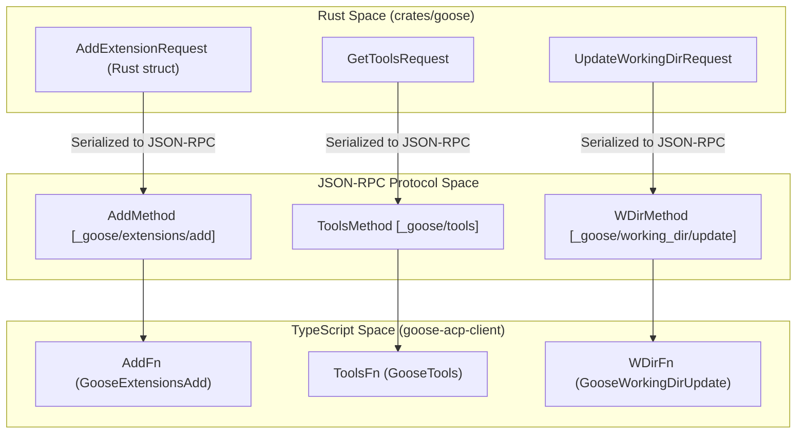
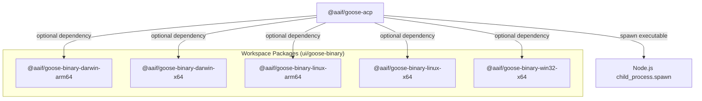
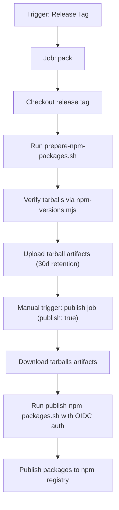

# npm & ACP Package Distribution

<details>
<summary>Relevant source files</summary>

The following files were used as context for generating this wiki page:

- [ui/desktop/src/acp/__tests__/acpConnection.test.ts](ui/desktop/src/acp/__tests__/acpConnection.test.ts)
- [ui/desktop/src/acp/__tests__/gooseAcpClient.test.ts](ui/desktop/src/acp/__tests__/gooseAcpClient.test.ts)
- [ui/desktop/src/acp/acpConnection.ts](ui/desktop/src/acp/acpConnection.ts)
- [ui/desktop/src/acp/gooseAcpClient.ts](ui/desktop/src/acp/gooseAcpClient.ts)
- [ui/desktop/src/hooks/useProviderDeviceCode.ts](ui/desktop/src/hooks/useProviderDeviceCode.ts)
- [ui/desktop/src/test/radixSingleVersion.test.ts](ui/desktop/src/test/radixSingleVersion.test.ts)
- [ui/goose-acp-client/package.json](ui/goose-acp-client/package.json)
- [ui/goose-acp/package.json](ui/goose-acp/package.json)
- [ui/goose-binary/goose-binary-darwin-arm64/package.json](ui/goose-binary/goose-binary-darwin-arm64/package.json)
- [ui/goose-binary/goose-binary-darwin-x64/package.json](ui/goose-binary/goose-binary-darwin-x64/package.json)
- [ui/goose-binary/goose-binary-linux-arm64/package.json](ui/goose-binary/goose-binary-linux-arm64/package.json)
- [ui/goose-binary/goose-binary-linux-x64/package.json](ui/goose-binary/goose-binary-linux-x64/package.json)
- [ui/goose-binary/goose-binary-win32-x64/package.json](ui/goose-binary/goose-binary-win32-x64/package.json)
- [ui/package.json](ui/package.json)
- [ui/pnpm-lock.yaml](ui/pnpm-lock.yaml)
- [ui/pnpm-workspace.yaml](ui/pnpm-workspace.yaml)

</details>


This page provides a detailed technical overview of the npm package distribution system for Goose, focusing on the `ui/` pnpm workspace setup, the key npm packages (`@aaif/goose-acp`, `goose-acp-client`), the platform-specific `goose-binary` packages, the integration with Changesets for version and release management, native build scripts, and the automated `publish-npm` GitHub Actions workflow.

---

## Overview of the `ui/` pnpm Workspace

The `ui/` directory in the Goose repository is structured as a pnpm workspace, managing multiple interdependent frontend packages and binary wrappers. This workspace employs a hoisted node linker configuration with offline-preferential resolves to optimize development and build reliability.

Key aspects of the workspace include:

- **Packages Managed:**
  - `goose-acp-client` — TypeScript client library for interacting with Goose over the Agent Client Protocol (ACP).
  - `goose-acp` — Provides the main npm package to install and resolve the Goose executable and associated bindings.
  - `desktop` — The Electron desktop frontend application.
  - `goose-binary/*` — Platform-specific native binary packages wrapping the Goose Rust executable for different OS/CPU architectures.

- **Dependency and Version Management:**
  - Versions and dependencies are pinned and coordinated through Changesets (`@changesets/cli`), ensuring consistent version bumps and changelog generation across the packages.
  - Key peer and direct dependencies are locked in the `ui/pnpm-lock.yaml`, including React 19.2.8, Radix UI primitives pinned to versions that avoid duplicate import conflicts, and Mousetraps to enforce single-version dependencies critical for React UI consistency.

- **Workspace Configuration:**
  - The `ui/pnpm-workspace.yaml` lists individual package folders and applies repository-wide dependency overrides to enforce versions, especially for UI libraries to prevent subtle runtime errors due to duplicate Radix UI copies.
  - Supported CPU architectures and operating system targets include macOS (arm64, x64), Linux (arm64, x64), and Windows (x64), matching the binary packages supported.

- **Build and CI Integration:**
  - The `ui/scripts/npm-versions.mjs` script validates that package tarballs produced in the workspace obey the expected semantic versioning constraints before publishing, preventing accidental mismatches.
  - CI pipelines run these validations as essential prepublish checks to maintain package integrity.

Sources: [ui/pnpm-workspace.yaml:1-34](), [ui/pnpm-lock.yaml:13-25, 130-140](), [.github/workflows/ci.yml:35-68]()

---

## ACP Client & Wrapper Packages (`@aaif/goose-acp` and `goose-acp-client`)

### Package Roles

- **`@aaif/goose-acp-client`**  
  This package contains the fully typed TypeScript client library that interacts with Goose over the ACP JSON-RPC protocol. It depends on `@agentclientprotocol/sdk` and generates bindings from ACP protocol schemas, exposing methods and types for frontend and external clients to connect to and control Goose through ACP.

- **`@aaif/goose-acp`**  
  Acts as the main npm wrapper package that installs and resolves the Goose executable for the user’s platform from the relevant `goose-binary-*` packages. It exposes a CLI binary (`goose`) under `bin/goose.mjs` as an ES module shim that delegates to the native binary, enabling seamless usage without manually downloading or building.

### Implementation Details

- **Binary Dependencies:**  
  `@aaif/goose-acp` uses optional dependencies on the platform-specific binary wrapper packages such as `@aaif/goose-binary-darwin-arm64`, `@aaif/goose-binary-linux-x64`, etc. These platform packages embed only their respective native executable binaries.

- **Exports & Types:**
  Both packages export compiled JavaScript and TypeScript declaration files from a `dist/` folder and declare `type: module` for ESM support.

- **Build and Packaging:**
  The client package builds TypeScript sources (`tsc`), generates the ACP JSON schemas into types (using a custom script `generate-schema.ts`), and includes formatting and linting scripts for maintainability.

---

### ACP Protocol Typing and Message Flow

The communication between Rust backend, the ACP JSON-RPC protocol, and the TypeScript client package follows a strict type mapping:



This design ensures type safety and consistent request/response handling in ACP client implementations.

Sources: [ui/goose-acp/package.json:1-52](), [ui/goose-acp-client/package.json:1-53](), [.github/workflows/ci.yml:58-64](), [ui/pnpm-lock.yaml:21-26]()

---

## Multi-Platform Binary Packages (`goose-binary-*`)

### Purpose and Distribution

To provide easy native executable access without requiring users to build Goose from source, the repository packages prebuilt native executables inside npm packages targeting specific OS and CPU architectures.

### Packages

Each `goose-binary-*` package contains:

- A `package.json` defining:
  - The package name under the `@aaif` scope, e.g., `@aaif/goose-binary-linux-arm64`.
  - The package version aligned with the main Goose version (e.g., `"1.55.0"`).
  - OS and CPU constraints for NPM de-duplication and tooling.
  - The binary executable inside a `bin/` folder.
  - The `bin` field to expose the executable name for npm bin resolution, such as `"goose-binary-linux-arm64": "./bin/goose"`.

Example package.json snippet for macOS ARM64:

```json
{
  "name": "@aaif/goose-binary-darwin-arm64",
  "version": "1.55.0",
  "description": "Goose binary for macOS ARM64",
  "bin": {
    "goose-binary-darwin-arm64": "./bin/goose"
  },
  "os": ["darwin"],
  "cpu": ["arm64"],
  "files": ["bin/goose"]
}
```

### Resolution and Spawning Flow

The main `@aaif/goose-acp` package references these binaries as optional peer dependencies, which are resolved and installed according to the current platform.



This architecture abstracts platform specifics from users and ensures Goose binaries are correctly resolved and spawned on the host environment.

Sources:  
[ui/goose-binary/goose-binary-darwin-arm64/package.json:1-28](),  
[ui/goose-binary/goose-binary-darwin-x64/package.json:1-28](),  
[ui/goose-binary/goose-binary-linux-arm64/package.json:1-28](),  
[ui/goose-binary/goose-binary-linux-x64/package.json:1-28](),  
[ui/goose-binary/goose-binary-win32-x64/package.json:1-28](),  
[ui/goose-acp/package.json:1-52]()

---

## Changesets Integration & Native Build Scripts

The workspace leverages [Changesets](https://github.com/changesets/changesets) via the `@changesets/cli` package (locked at version 2.30.0) for unified versioning and changelog management across all npm packages.

- Changesets are configured as a dev dependency in the workspace, indicated in `ui/pnpm-lock.yaml` [lines 15-18].
- The release process reads changesets to determine version bumps and generate changelog files automatically.

Native build scripts involved in preparing packages include:

- Shell scripts like `ui/scripts/prepare-npm-packages.sh` that handle creation and verification of package tarballs.
- Publishing scripts like `ui/scripts/publish-npm-packages.sh` integrate OIDC authentication tokens to securely publish packages to npm.
- TypeScript build steps as defined in `package.json` scripts, including linting, formatting, and type generation.

These scripts are invoked as steps in the GitHub Actions CI/CD pipeline to automate package release lifecycle management.

Sources: [ui/pnpm-lock.yaml:15-18](), [.github/workflows/publish-npm.yml:26-74]()

---

## Publishing Pipeline & Workflow (`.github/workflows/publish-npm.yml`)

The `publish-npm.yml` GitHub Actions workflow automates packaging and publishing of all npm packages in the workspace.

### Workflow Structure

The workflow defines two crucial jobs:

1. **Pack Job**  
   - Triggered on release tags.
   - Checks out the repository at the release tag.
   - Calls the native shell script `ui/scripts/prepare-npm-packages.sh` to build and verify npm tarballs.
   - Uploads these artifacts for later use.
   - Retains artifacts for 30 days.

2. **Publish Job**  
   - Requires manual dispatch with a `publish: true` input.
   - Uses OIDC token permissions (`id-token: write`) to authenticate with npm securely.
   - Downloads artifacts produced by the "pack" job.
   - Executes `ui/scripts/publish-npm-packages.sh` to publish the packages to the npm registry.
   - This guarantees reproducible releases with prebuilt verified artifacts.

### Execution Details

- **Prepack & Build:** All packages include a `prepack` script that builds TypeScript or bundles assets before publishing.
- **Version Control:** Changesets orchestrate the versioning consistency checked during the "pack" task.
- **Security:** Use of OIDC tokens secures publishing credentials, reducing the risk of accidental secret leaks.

### Publish Workflow Diagram



Sources: [.github/workflows/publish-npm.yml:1-74](), [.github/workflows/ci.yml:35-68]()

---

## Additional Notes: ACP Client Connection (Context)

The `ui/desktop/src/acp/acpConnection.ts` file manages runtime connection logic for the ACP client in the desktop environment, handling connection establishment, recovery, backoff, and subscription to connection states.

While not directly part of distribution, this code is integral to the `goose-acp-client` usage and integration in desktop and other frontend clients.

Key features:

- Maintains a single active connection or a shared pending connection promise.
- Implements exponential backoff reconnects on connection failure.
- Detects Goose server exit signals to stop reconnecting.
- Exposes API to subscribe to recovery status changes.
- Uses Electron IPC to fetch connection URL and open the WebSocket stream.
- Calls `connectGooseAcpClient` to instantiate the ACP client.

This module enables robust ACP communication for UI packages distributed through npm.

Sources: [ui/desktop/src/acp/acpConnection.ts:1-217]()

---

# Summary Table of Key Packages

| Package Name                   | Purpose                                                   | Platform/Language         | Location                |
|-------------------------------|-----------------------------------------------------------|--------------------------|-------------------------|
| `@aaif/goose-acp`            | Main Goose npm package, installs/resolves Goose binary    | Node.js (ESM)            | `ui/goose-acp`          |
| `@aaif/goose-acp-client`     | TypeScript ACP client library for frontend communication  | TypeScript (ESM)         | `ui/goose-acp-client`   |
| `@aaif/goose-binary-*`       | Native Goose binary wrappers per OS/CPU                   | Native executable zip + npm wrapper | `ui/goose-binary/*`      |
| `ui/desktop`                 | Electron desktop UI integrating ACP client                | TypeScript/Electron      | `ui/desktop`            |

---

This architecture and distribution strategy ensures that Goose is consumable both as a native executable with platform-tailored builds and as high-level TypeScript libraries facilitating integration across desktop and other client environments.

# End of 10.3 npm & ACP Package Distribution

Sources:  
[ui/pnpm-lock.yaml:15-18,130-140](),  
[ui/pnpm-workspace.yaml:1-34](),  
[ui/goose-acp/package.json:1-52](),  
[ui/goose-acp-client/package.json:1-53](),  
[ui/goose-binary/goose-binary-darwin-arm64/package.json:1-28](),  
[ui/goose-binary/goose-binary-darwin-x64/package.json:1-28](),  
[ui/goose-binary/goose-binary-linux-arm64/package.json:1-28](),  
[ui/goose-binary/goose-binary-linux-x64/package.json:1-28](),  
[ui/goose-binary/goose-binary-win32-x64/package.json:1-28](),  
[.github/workflows/publish-npm.yml:1-74](),  
[.github/workflows/ci.yml:35-68](),  
[ui/desktop/src/acp/acpConnection.ts:1-217]()