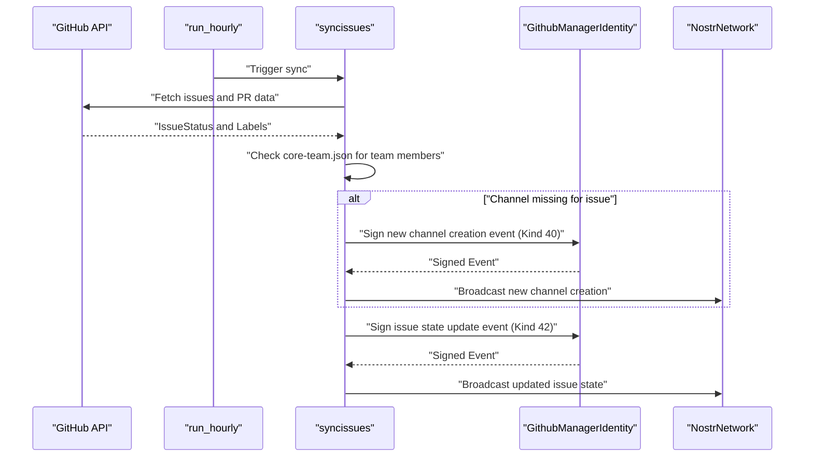
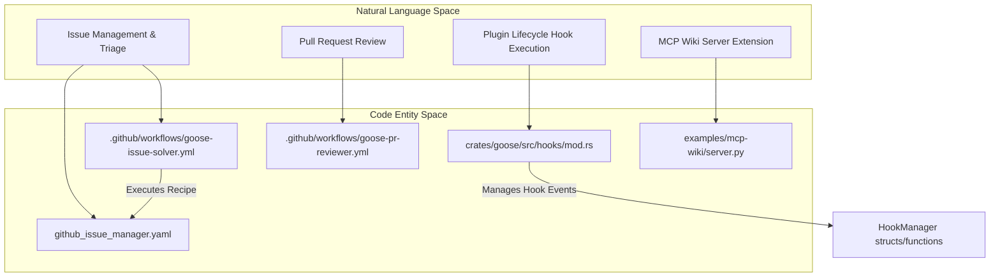

# Buzz Community Automation & Examples

Relevant source files

The following files were used as context for generating this wiki page:

- [.github/DISCUSSION_TEMPLATE/qa.yml](.github/DISCUSSION_TEMPLATE/qa.yml)
- [.github/ISSUE_TEMPLATE/bug_report.md](.github/ISSUE_TEMPLATE/bug_report.md)
- [.github/ISSUE_TEMPLATE/config.yml](.github/ISSUE_TEMPLATE/config.yml)
- [.github/ISSUE_TEMPLATE/feature_request.md](.github/ISSUE_TEMPLATE/feature_request.md)
- [.github/workflows/buzz-automation.yml](.github/workflows/buzz-automation.yml)
- [GOVERNANCE.md](GOVERNANCE.md)
- [MAINTAINERS.md](MAINTAINERS.md)
- [buzz/README.md](buzz/README.md)
- [buzz/assets/GithubManager.png](buzz/assets/GithubManager.png)
- [buzz/core-team.json](buzz/core-team.json)
- [buzz/create_github_manager](buzz/create_github_manager)
- [buzz/create_issue_channel](buzz/create_issue_channel)
- [buzz/github_issue_manager.yaml](buzz/github_issue_manager.yaml)
- [buzz/github_manager.mjs](buzz/github_manager.mjs)
- [buzz/github_manager.test.mjs](buzz/github_manager.test.mjs)
- [buzz/list_issue_work](buzz/list_issue_work)
- [documentation/blog/2025-08-25-goose-became-its-own-watchdog/goose-security-scanner.png](documentation/blog/2025-08-25-goose-became-its-own-watchdog/goose-security-scanner.png)
- [documentation/blog/2025-08-25-goose-became-its-own-watchdog/index.md](documentation/blog/2025-08-25-goose-became-its-own-watchdog/index.md)
- [documentation/blog/2025-09-15-subrecipes-in-goose/goose-subrecipes.png](documentation/blog/2025-09-15-subrecipes-in-goose/goose-subrecipes.png)
- [documentation/blog/2025-09-15-subrecipes-in-goose/index.md](documentation/blog/2025-09-15-subrecipes-in-goose/index.md)
- [documentation/blog/2025-10-08-recipe-cookbook-generator/index.md](documentation/blog/2025-10-08-recipe-cookbook-generator/index.md)
- [documentation/blog/2025-10-08-recipe-cookbook-generator/recipe-cookbook-generator.png](documentation/blog/2025-10-08-recipe-cookbook-generator/recipe-cookbook-generator.png)
- [documentation/blog/2025-10-24-intro-to-agent-client-protocol-acp/choose-your-ide.png](documentation/blog/2025-10-24-intro-to-agent-client-protocol-acp/choose-your-ide.png)
- [documentation/blog/2025-10-24-intro-to-agent-client-protocol-acp/index.md](documentation/blog/2025-10-24-intro-to-agent-client-protocol-acp/index.md)
- [documentation/docs/gdk/acp/_category_.json](documentation/docs/gdk/acp/_category_.json)
- [documentation/docs/gdk/acp/index.md](documentation/docs/gdk/acp/index.md)
- [documentation/docs/gdk/acp/zed.md](documentation/docs/gdk/acp/zed.md)
- [documentation/docs/guides/interactive-chat/_category_.json](documentation/docs/guides/interactive-chat/_category_.json)
- [documentation/docs/guides/interactive-chat/index.mdx](documentation/docs/guides/interactive-chat/index.mdx)
- [documentation/docs/guides/interactive-chat/mcp-ui.md](documentation/docs/guides/interactive-chat/mcp-ui.md)
- [documentation/docs/mcp/apps-mcp.md](documentation/docs/mcp/apps-mcp.md)
- [documentation/docs/mcp/chatrecall-mcp.md](documentation/docs/mcp/chatrecall-mcp.md)
- [documentation/docs/mcp/extension-manager-mcp.md](documentation/docs/mcp/extension-manager-mcp.md)
- [documentation/docs/mcp/todo-mcp.md](documentation/docs/mcp/todo-mcp.md)
- [documentation/docs/tutorials/building-mcp-apps.md](documentation/docs/tutorials/building-mcp-apps.md)
- [documentation/docs/tutorials/custom-extensions.md](documentation/docs/tutorials/custom-extensions.md)
- [documentation/src/components/PlatformExtensionNote.js](documentation/src/components/PlatformExtensionNote.js)
- [documentation/static/img/apps-extension-results.png](documentation/static/img/apps-extension-results.png)
- [documentation/static/videos/plan-trip-demo.mp4](documentation/static/videos/plan-trip-demo.mp4)

The `buzz/` directory implements a specialized automation layer for managing GitHub issues within the Goose community using the Nostr/Buzz protocol. In addition to community triage and synchronization, the repository features "Goose-maintains-Goose" workflows (`.github/workflows/goose-issue-solver.yml`, `.github/workflows/goose-pr-reviewer.yml`) and an `examples/` directory containing reference implementations such as the `mcp-wiki` server and hook-driven plugins.

## Purpose and Scope

The Buzz automation system is designed to maintain the "Issues-first" contribution workflow required by the project `[CONTRIBUTING.md:12-23]().` It ensures that every open issue is tracked on the public Goose Issues board and that issue states (Inbox, Needs info, Ready, etc.) synchronize with Buzz community channels. Furthermore, Goose uses its own agent recipes and workflows to automate issue resolution and pull request reviews.

### Key Objectives
- **Automated Triage**: Moving new issues into the `Inbox`.
- **Nostr Integration**: Using the Nostr protocol to create issue channels for community discussion.
- **State Synchronization**: Reflecting GitHub labels and project board status in the Buzz platform.
- **Self-Maintenance**: Autonomous issue resolution and pull request review workflows.

Sources: `[CONTRIBUTING.md:12-23]()`, `[.github/workflows/goose-issue-solver.yml:1-25]()`

---

## Buzz Community Automation Components

The automation is driven by a set of scripts, keys, and recipes that interact with both the GitHub API and the Buzz (Nostr) network.

### 1. `github_issue_manager.yaml` Recipe

This Goose recipe defines the agent instructions to manage GitHub issues’ lifecycle stages in coordination with the Buzz community. It guides the Goose agent to:

- Perform batch issue triage.
- Manage issue states aligned with GitHub project board columns.
- Update channel topics and memberships accordingly.
- Use the `developer` built-in extension for source code interactions.
- Employ the `todo` platform extension for task tracking.

The recipe is referenced and executed as part of the GitHub Actions workflow that drives issue automation `[.github/workflows/goose-issue-solver.yml:14-25]()`. It orchestrates phases such as understanding the issue, research (including code search and analysis), planning, implementation, verifying tests and linters, and final confirmation.

### 2. Synchronization Scripts & Hourly Daemon

Four key synchronization scripts maintain the integration between GitHub and Buzz:

- **`create_issue_channel`**: When a new GitHub issue appears, this script creates a corresponding permanent Nostr channel in the Buzz community, sets initial metadata (e.g., channel topic as `⚪ GitHub phase: Inbox`), and adds relevant identities. It uses the Github Manager identity to sign and publish events securely.

- **`syncissues`**: This script queries the GitHub API for issues and their status, reconciles labels and board columns with the Buzz channels, and updates the Buzz network state.

- **`list_issue_work`**: Aggregates issues currently "in progress" or "ready" for community overviews and reporting.

- **`run_hourly`**: A cron-like wrapper that executes the above synchronization and update scripts on a fixed hourly schedule, ensuring up-to-date synchronization.

These scripts use environment variables to locate tools (`buzz` CLI, `gh` CLI, `goose` CLI), connect to the Buzz relay URL, and load keys for signing. They enable continuous, hands-off maintenance of the community issue workflow.

### 3. Identity and Core Team Roster

- **Github Manager Identity**: A dedicated Nostr ed25519 keypair controlled by the `github_manager` scripts. It acts as the authoritative identity creating and managing issue channels and signing related events. The key pair lives encrypted outside the repository and can be generated using the provided `create_github_manager` utility.

- **Core Team Roster**: Defined in `core-team.json`, it maps GitHub usernames to Buzz public keys and bot keys. The core team members are automatically added to each issue channel, providing social and technical triage insight. Capacities and topics of interest are included to facilitate equitable assignment and routing. Members' associated bots with the `bot` role are also added automatically.

### Data Flow: Issue Triage and Tracking

This data flow ensures all open issues are mirrored into Buzz community channels, reflecting live status from GitHub, with social control from the core team.

Sources: `[CONTRIBUTING.md:12-23]()`, `buzz/core-team.json`, `buzz/create_issue_channel`, `buzz/syncissues`, `buzz/run_hourly`, `[.github/workflows/goose-issue-solver.yml:1-35]()`

---

## Goose-Maintains-Goose Workflows

Goose uses automation workflows extensively to maintain and improve its own codebase with minimal human intervention.

### 1. Issue Solver (`goose-issue-solver.yml`)

This GitHub Actions workflow runs a Goose agent configured with the `github_issue_manager.yaml` recipe to perform triage, research, planning, implementation, and verification of new issues automatically.

- It runs inside a containerized environment.
- Accesses the GitHub API using the `gh` CLI.
- Uses Goose agent's built-in extensions (`developer`, `todo`) to inspect code and schedule sub-tasks.
- Posts detailed progress and findings back as issue comments.

Its multi-phase execution model brings systematic inspection and a recorded decision trail for each issue, improving community transparency and workflow reliability.

### 2. PR Reviewer (`goose-pr-reviewer.yml`)

Triggered on pull requests, this workflow runs Goose as a strict code reviewer. It performs:

- Static analysis of code changes.
- Checks code style, error handling approaches, and redundant patterns.
- Assigns severity annotations such as 🔴 BLOCKING, 🟡 WARNING, 🟢 SUGGESTION, ✅ HIGHLIGHT.
- Produces detailed review comments to speed human reviewer efforts.

Together, these workflows demonstrate "Goose-maintains-Goose" principles — leveraging Goose itself to orchestrate ongoing project quality and contribution vetting.

Sources: `[.github/workflows/goose-issue-solver.yml:1-143]()`, `[.github/workflows/goose-pr-reviewer.yml:1-155]()`

---

## Examples & Extensions Directory (`examples/`)

### Overview

The `examples/` directory hosts reference implementations demonstrating key Goose extension and plugin capabilities, particularly via the Model Context Protocol (MCP).

---

### 1. MCP Wiki Server (`examples/mcp-wiki`)

This Python-based MCP server provides a Wikipedia article reader and converter to Markdown using a custom tool.

#### Key Implementation Details

- Uses the `FastMCP` class from the MCP Python SDK to expose a tool called `read_wikipedia_article`.
- The tool fetches articles from Wikipedia URLs, sanitizes the input with SSRF protection (allowing only Wikipedia domains), parses the HTML content with BeautifulSoup, and converts it to Markdown via `html2text`.
- Handles errors by raising MCP error objects (`McpError`) with structured error codes (`INTERNAL_ERROR`, `INVALID_PARAMS`).

#### Server Files

- `server.py`: Tool implementation with HTTP fetching, parsing, and conversion logic.
- `__init__.py` and `__main__.py`: Provide CLI execution entry points to run the MCP server.
- `pyproject.toml`: Project configuration declaring Python dependencies.

This example is a reference for building custom MCP extensions in Python that can integrate tightly with Goose.

Sources: `[documentation/docs/tutorials/custom-extensions.md:65-145]()`

---

### 2. Hello Hooks Plugin (`examples/hello-hooks`)

Goose supports the Open Plugins hooks specification enabling shell-script-based lifecycle hooks.

#### Hook Features

- Hooks can be defined in `hooks/hooks.json` inside plugin directories.
- Goose triggers hooks on lifecycle events such as `PreToolUse`, `PostToolUse`, `SessionStart`, `Stop`.
- Each hook is an executable script receiving a JSON event on `stdin`.
- If configured with `on_failure: block`, the hook can abort operations by returning a non-zero exit code.
- Hooks facilitate operational customization, external integrations, or additional tool validation.

#### Hook Manager

The hook mechanism is implemented in the core Goose crate under `crates/goose/src/hooks/mod.rs`, which manages the registration, invocation, and error handling of hooks `[crates/goose/src/hooks/mod.rs:1-68]()`

---

## Code Entity Mapping: Buzz Automation and Examples

---

# Summary

The Buzz Community Automation system tightly couples the Goose GitHub issue management lifecycle with a Nostr-based community platform, using a combination of:

- Goose agent recipes (`github_issue_manager.yaml`),
- CLI synchronization scripts,
- Core team rosters,
- Dedicated Nostr identities.

This supports continuous issue triage and community discussion channels.

The self-hosted Goose workflows automate issue resolution and code review with GitHub Actions.

The `examples/` directory provides canonical MCP extension implementations, such as the `mcp-wiki` server to demonstrate custom tool creation, and the `hello-hooks` example to illustrate lifecycle hook integration.

This page documents the full chain of automation enhancing community collaboration and Goose’s own maintenance using its AI-powered agents.

---

Sources:  
`buzz/README.md`, `buzz/core-team.json`, `buzz/create_issue_channel`, `buzz/syncissues`, `buzz/list_issue_work`, `buzz/run_hourly`, `.github/workflows/goose-issue-solver.yml`, `.github/workflows/goose-pr-reviewer.yml`, `[crates/goose/src/hooks/mod.rs:1-68]()`, `[documentation/docs/tutorials/custom-extensions.md:65-145]()`