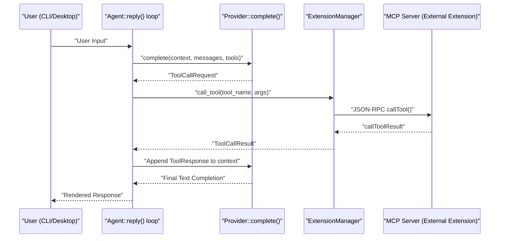

# Glossary

Relevant source files

The following files were used as context for generating this wiki page:

- [.github/copilot-instructions.md](.github/copilot-instructions.md)
- [.github/pull_request_template.md](.github/pull_request_template.md)
- [.github/workflows/goose-issue-solver.yml](.github/workflows/goose-issue-solver.yml)
- [.github/workflows/goose-pr-reviewer.yml](.github/workflows/goose-pr-reviewer.yml)
- [.gitignore](.gitignore)
- [.goosehints](.goosehints)
- [AGENTS.md](AGENTS.md)
- [CONTRIBUTING.md](CONTRIBUTING.md)
- [README.md](README.md)
- [crates/goose-cli/src/commands/configure.rs](crates/goose-cli/src/commands/configure.rs)
- [crates/goose-cli/src/session/builder.rs](crates/goose-cli/src/session/builder.rs)
- [crates/goose-cli/src/session/completion.rs](crates/goose-cli/src/session/completion.rs)
- [crates/goose-cli/src/session/editor.rs](crates/goose-cli/src/session/editor.rs)
- [crates/goose-cli/src/session/input.rs](crates/goose-cli/src/session/input.rs)
- [crates/goose-cli/src/session/mod.rs](crates/goose-cli/src/session/mod.rs)
- [crates/goose-cli/src/session/output.rs](crates/goose-cli/src/session/output.rs)
- [crates/goose-providers/src/declarative/definitions/meta.json](crates/goose-providers/src/declarative/definitions/meta.json)
- [crates/goose/src/agents/agent.rs](crates/goose/src/agents/agent.rs)
- [crates/goose/src/agents/extension.rs](crates/goose/src/agents/extension.rs)
- [crates/goose/src/agents/mod.rs](crates/goose/src/agents/mod.rs)
- [crates/goose/src/agents/reply_parts.rs](crates/goose/src/agents/reply_parts.rs)
- [crates/goose/src/config/extensions.rs](crates/goose/src/config/extensions.rs)
- [crates/goose/src/config/mod.rs](crates/goose/src/config/mod.rs)
- [crates/goose/src/execution/manager.rs](crates/goose/src/execution/manager.rs)
- [crates/goose/src/providers/inventory/registrations.rs](crates/goose/src/providers/inventory/registrations.rs)
- [crates/goose/src/providers/kimicode.rs](crates/goose/src/providers/kimicode.rs)
- [crates/goose/src/providers/muse_code_def.rs](crates/goose/src/providers/muse_code_def.rs)
- [crates/goose/src/providers/oauth_device_flow.rs](crates/goose/src/providers/oauth_device_flow.rs)
- [crates/goose/src/providers/xai_oauth.rs](crates/goose/src/providers/xai_oauth.rs)
- [crates/goose/tests/agent.rs](crates/goose/tests/agent.rs)
- [documentation/AGENTS.md](documentation/AGENTS.md)
- [documentation/blog/2025-09-26-hacktoberfest-2025/index.md](documentation/blog/2025-09-26-hacktoberfest-2025/index.md)
- [documentation/docs/guides/config-files.md](documentation/docs/guides/config-files.md)
- [documentation/docs/guides/context-engineering/subagents.mdx](documentation/docs/guides/context-engineering/subagents.mdx)
- [documentation/docs/guides/environment-variables.md](documentation/docs/guides/environment-variables.md)
- [documentation/docs/guides/goose-cli-commands.md](documentation/docs/guides/goose-cli-commands.md)
- [documentation/docs/guides/multi-model/index.mdx](documentation/docs/guides/multi-model/index.mdx)
- [documentation/docs/guides/recipes/index.mdx](documentation/docs/guides/recipes/index.mdx)
- [documentation/docs/guides/recipes/recipe-reference.md](documentation/docs/guides/recipes/recipe-reference.md)
- [documentation/docs/guides/recipes/session-recipes.md](documentation/docs/guides/recipes/session-recipes.md)
- [documentation/docs/guides/recipes/storing-recipes.md](documentation/docs/guides/recipes/storing-recipes.md)
- [documentation/docs/guides/recipes/subrecipes.md](documentation/docs/guides/recipes/subrecipes.md)
- [documentation/docs/guides/running-tasks.md](documentation/docs/guides/running-tasks.md)
- [documentation/docs/guides/sessions/smart-context-management.md](documentation/docs/guides/sessions/smart-context-management.md)
- [documentation/docs/troubleshooting/known-issues.md](documentation/docs/troubleshooting/known-issues.md)
- [documentation/docs/tutorials/recipes-tutorial.md](documentation/docs/tutorials/recipes-tutorial.md)
- [documentation/src/components/RecipeFields.js](documentation/src/components/RecipeFields.js)
- [documentation/src/components/VideoCarousel.js](documentation/src/components/VideoCarousel.js)
- [documentation/src/pages/recipes/data/recipes/README.md](documentation/src/pages/recipes/data/recipes/README.md)
- [documentation/static/files/thoughts/plans/2025-12-23-remove-tool-selection-strategy.raw](documentation/static/files/thoughts/plans/2025-12-23-remove-tool-selection-strategy.raw)
- [documentation/static/files/thoughts/research/2025-12-22-llm-tool-selection-strategy.raw](documentation/static/files/thoughts/research/2025-12-22-llm-tool-selection-strategy.raw)
- [flake.lock](flake.lock)
- [flake.nix](flake.nix)
- [ui/desktop/scripts/prepare-platform-binaries.js](ui/desktop/scripts/prepare-platform-binaries.js)

## Purpose and Scope
This glossary defines the core technical terms, architectural components, abbreviations, and domain-specific concepts used across the Goose codebase (`aaif-goose/goose`). It bridges natural language descriptions with code entities in Rust crates (`goose`, `goose-agent`, `goose-providers`, `goose-roaming`, etc.) and TypeScript packages (`ui/desktop`, `ui/`).

---

## Core Domain Concepts

### Agent
The central autonomous entity managing conversation turns, tool execution, and context. It orchestrates communication between the LLM provider, extensions, permissions, and the scheduler.
- **Implementation**: `Agent` struct in [crates/goose/src/agents/agent.rs:147-187]() and related methods.
- **Configuration**: `AgentConfig` holds session manager, permissions, scheduler, MCP host info, and providers [crates/goose/src/agents/agent.rs:97-144]().
- **Reply Loop**: The main processing loop is implemented inside `Agent::reply()` (see [crates/goose/src/agents/agent.rs:327]() for callflow).
  
**Role in Dataflow:**
User input enters through CLI or desktop UI, reaching the `Agent` which builds context, invokes providers, executes tools via extensions, and emits message events back.

Sources: [crates/goose/src/agents/agent.rs:97-187]()

### Session
A saved history of message exchanges between user and agent representing a conversation context.
- **Implementation**: `Session` and `SessionManager` handle creation, persistence (SQLite), and retrieval of sessions.
- **CLI Handling**: `CliSession` manages interactive REPL state, history, and I/O [crates/goose-cli/src/session/mod.rs:180-213]().

Sessions support resuming, forking (copying), naming, and metadata annotations, tracked in a DB file (`sessions.db`).

Sources: [crates/goose/src/session/mod.rs](), [crates/goose-cli/src/session/mod.rs:190-213]()

### GooseMode
Mode controlling agent autonomy and approval workflow for tool invocations:
- **`Request`**: user must approve all tool calls.
- **`Auto`**: automatic tool calls without explicit approval.
- Other modes define varying permission levels.
- **Defined in**: [crates/goose/src/config/base.rs:42-42]() and used widely for permission checks.

Sources: [crates/goose/src/config/base.rs:42-42]()

### Recipe & Subrecipe
Recipes define task orchestration workflows combining goals, instructions, parameters, extensions, and scheduling.
- **Recipe**: top-level workflow definition.
- **Subrecipe**: reusable nested workflow component.
- **Implementation**: `Recipe` struct and parsing in [crates/goose/src/recipe/mod.rs]().

Recipes can be run interactively or scheduled, integrating tightly with the agent’s extension system.

Sources: [crates/goose/src/recipe/mod.rs](), [documentation/docs/guides/recipes/subrecipes.md]()

### Skill & Hook
- **Skill**: specialized agent procedural capabilities exposed as modular extensions or tools.
- **Hook**: interceptors that can modify or halt execution at specific lifecycle points (e.g., stop hooks).
- Implemented via operations (`ops_skills`) in the Goose agent state machine ([crates/goose-agent]) and by extension manager support.

Sources: [crates/goose/src/agents/extension_manager.rs:190-210](), [crates/goose-agent/src/lib.rs]()

### Extension & Platform Extension
An Extension is a module exposing tools and functionality callable by the agent.
- **Platform Extensions** are built-in, native modules such as developer shell/edit, code executor, summon skills.
- **Implementation**: `ExtensionConfig` enum describes extensions (Builtin, Platform, Stdio, HTTP) in [crates/goose/src/agents/extension.rs:90-124]().
- Managed by `ExtensionManager`: loading, activation, tool exposure [crates/goose/src/agents/extension_manager.rs:150-200]().

Sources: [crates/goose/src/agents/extension.rs:90-124](), [crates/goose/src/agents/extension_manager.rs:150-200]()

### ToolShim
An adapter layer that normalizes provider-specific wire protocol tool schemas and outputs into a consistent interface for Goose and MCP.
- Translates between provider formats (OpenAI, Anthropic, Bedrock, etc.) and Goose internal `Tool` structs.
- Ensures the agent can use tool calls uniformly across providers.
- **Implementation**: present throughout `goose-providers` crates, e.g., in `wire` translation modules.

Sources: [crates/goose-providers]()

### CanonicalModel
A registry system defining a normalized set of language model metadata including:
- Pricing info
- Context length limits
- Supported modalities (text, code, audio, chat, etc.)
- Used for adaptive prompt building, cost estimation, and switching.
- **Data file**: `canonical_models.json` in `goose-provider-types`
- **Usage**: managed by crate modules reading canonical models [crates/goose-provider-types/src/canonical/data/canonical_models.json]().

Sources: [crates/goose-provider-types/src/canonical/data/canonical_models.json]()

### RoamingNode, ConnectionCard, TrustBook
- **RoamingNode**: A P2P network node in the `goose-roaming` crate that enables session sharing and decentralized communication.
- **ConnectionCard**: A secure metadata representation used by nodes to establish connections.
- **TrustBook**: A registry of trusted peer identities permitting TOFU (Trust On First Use) and maintaining connection trustworthiness.
- **Use case**: enabling roaming sessions, remote agent collaboration, and session transport over iroh/QUIC.
- **Crate**: `goose-roaming` [crates/goose-cli/Cargo.toml:32-32]().

Sources: [crates/goose-cli/Cargo.toml:32-32]()

### Buzz & Harbor
- **Buzz**: GitHub issue management automation layer facilitating community workflows, issue triage, and sync operations via recipes.
- **Harbor**: The benchmarking and evaluation framework for measuring agent accuracy, cost, and reliability using `evals/harbor` suite.
These components support agent quality governance and continuous improvement.

Sources: [documentation/docs/guides/running-tasks.md](), [Cargo.toml]()

### GooseApp / MCP Apps
MCP Servers can serve custom HTML/JS UI components called `GooseApp`s in the frontend.
- Rendered by `McpAppRenderer` in the desktop UI to provide rich interaction overlays.
- Allow embedding of advanced workflows, visualization, or app-like behavior inside the chat.
- **Located in**: highlighted in extension manager and UI dependencies.

Sources: [crates/goose/src/agents/extension_manager.rs:176-188](), [ui/desktop/package.json:54-55]()

### Lease Registry & TOFU (Trust-On-First-Use)
- Mechanisms to manage ephemeral leases and trusted identities for extensions or roaming nodes.
- TOFU permits establishing trust based on first connection authentication.
- These concepts secure session continuity and extension trust during decentralized communication.

Sources: [crates/goose-cli/Cargo.toml]()

### SLSA (Supply-chain Levels for Software Artifacts)
- Security framework used in Goose release pipelines, builds, and updates for provenance and artifact verification.
- Enforced to ensure Goose binary integrity and safe distribution.
- Referenced in build/CI workflows and Goose CLI package metadata.

Sources: [crates/goose-cli/Cargo.toml:72-72]()

### GDK (Goose Development Kit)
- Collection of build scripts, packaging tools, and release infrastructure to build Goose binaries, SDKs, and native extensions.
- Provides reusable components for integrating Goose into developer workflows.

Sources: [Cargo.toml]()

### UniFFI
- A multi-language Foreign Function Interface (FFI) binding generator.
- Used to expose `goose-sdk` Rust APIs to Python and Kotlin clients via bindings generated with UniFFI.
- Enables Goose SDK consumption beyond Rust and TypeScript.

Sources: [Cargo.toml]()

---

## Goose Agent State Machine (`goose-agent`)

Goose uses a state machine model for turn execution sequencing, implemented in the `goose-agent` crate. This engine controls the lifecycle of:
- Planning LLM prompts (`ops_llm`)
- Tool calls (`ops_toolcalling`)
- Tool approval prompts (`ops_tool_approval`)
- Recipe orchestration (`ops_recipe`)
- Skill execution (`ops_skills`)
- Hook/interceptor invocation and usage accounting

This model ensures robust flow control, retries, user interaction, and extension dispatch.

Sources: [crates/goose/Cargo.toml:143-143]()

---

## Data Flow: User Request to Tool Execution

This diagram illustrates the end-to-end processing of a user input in Goose, through the agent logic, invoking tools/extensions (often via MCP), and returning the result:

Sources: [crates/goose/src/agents/agent.rs:327-327](), [crates/goose/src/agents/extension_manager.rs:150-200](), [crates/goose-cli/src/session/mod.rs:190-213]()

---

## System Mapping: Natural Language to Code Entity Space

This diagram bridges Goose’s system components (natural language terms) to internal code entities to enable rapid code navigation and understanding.

```mermaid
graph TD
    subgraph "NaturalLanguageSpace" ["Natural Language Space"]
        UserInterface["User Interface"]
        AgentLogic["Agent Logic"]
        Extensions["Extensions & Tools"]
        ModelProviders["Language Model Providers"]
        PeerCoordination["Peer-to-peer Coordination"]
    end

    subgraph "CodeEntitySpace" ["Code Entity Space"]
        DesktopUI["ui/desktop (Electron/React)"]
        CLIUI["crates/goose-cli (Rust CLI)"]

        AgentCore["crates/goose::agents::agent::Agent"]
        ExtensionManager["crates/goose::agents::extension_manager::ExtensionManager"]
        
        MCPProtocol["rmcp crate (Model Context Protocol)"]
        ACPProtocol["agent-client-protocol crate (Agent Client Protocol)"]

        ProviderTrait["crates/goose_providers::base::Provider Trait"]

        RoamingNode["crates/goose-roaming::RoamingNode"]
    end

    UserInterface --> DesktopUI
    UserInterface --> CLIUI

    AgentLogic --> AgentCore
    Extensions --> ExtensionManager
    Extensions --> MCPProtocol
    ModelProviders --> ProviderTrait
    ModelProviders --> ACPProtocol
    PeerCoordination --> RoamingNode
```

Sources: [crates/goose/src/agents/agent.rs:100-150](), [crates/goose/src/agents/extension_manager.rs:150-200](), [crates/goose-cli/src/session/mod.rs:180-213](), [Cargo.toml:23-25]()

---

## Abbreviations & Terms Reference

| Term                 | Definition | Code Pointer |
|----------------------|------------|--------------|
| **ACP**              | Agent Client Protocol for high-level client-agent communication. Powers ACP server, transport, and SDK layers. | [Cargo.toml:24-25]() |
| **MCP**              | Model Context Protocol enabling extension tool and resource interaction. | [Cargo.toml:23-23]() |
| **GooseMode**         | Operational mode of Goose controlling autonomy and permission flow. | [crates/goose/src/config/base.rs:42-42]() |
| **Recipe**            | YAML-defined reusable workflow including tools and parameters. | [crates/goose/src/recipe/mod.rs]() |
| **Subrecipe**         | A reusable nested recipe workflow fragment. | [documentation/docs/guides/recipes/subrecipes.md]() |
| **Skill**             | Specialized procedural extension capabilities. | [crates/goose/src/agents/extension_manager.rs:190-200]() |
| **Hook**              | Execution interception points (e.g., stop hooks). | [crates/goose/src/agents/extension_manager.rs:190-200]() |
| **Platform Extension**| Built-in native extensions like developer shell or code executor. | [crates/goose/src/agents/extension.rs:90-124]() |
| **ToolShim**          | Adapter layer translating provider-specific tool formats to Goose standard. | [crates/goose-providers] |
| **CanonicalModel**    | Normalized model metadata registry (prices, limits). | [crates/goose-provider-types/src/canonical/data/canonical_models.json]() |
| **RoamingNode**       | Peer-to-peer node facilitating decentralized session sharing. | [crates/goose-cli/Cargo.toml:32-32]() |
| **ConnectionCard**    | Secure metadata for establishing roaming connections. | [crates/goose-cli/src/commands/roam.rs]() |
| **TrustBook**         | Registry to maintain trusted peers for secure roaming. | [crates/goose-cli/src/commands/roam.rs]() |
| **Buzz**              | Community and GitHub issue automation workflows. | [Cargo.toml]() |
| **Harbor**            | Benchmarking and evaluation test framework in `evals/harbor`. | [documentation/docs/guides/running-tasks.md]() |
| **GooseApp**          | HTML UI components served by MCP servers into the frontend UI. | [crates/goose/src/agents/extension_manager.rs:176-188](), [ui/desktop/package.json:54-55]() |
| **Lease Registry**    | Infrastructure for managing extension leases. | [crates/goose-cli/Cargo.toml]() |
| **TOFU**              | Trust-On-First-Use security model for roaming/trust establishment. | [crates/goose-cli/Cargo.toml]() |
| **SLSA**              | Supply-chain Levels for Software Artifacts, used for Goose release security. | [crates/goose-cli/Cargo.toml:72-72]() |
| **GDK**               | Goose Development Kit for building and packaging Goose. | [Cargo.toml]() |
| **UniFFI**            | Binding generator to expose Goose SDK in Python/Kotlin. | [Cargo.toml]() |

---

This technical glossary aims to ensure clear understanding of Goose's architecture by linking concepts directly to the codebase for effective developer onboarding and maintenance.

Sources:  
- [crates/goose/src/agents/agent.rs:97-187](), [crates/goose/src/session/mod.rs](), [crates/goose-cli/src/session/mod.rs:180-213](),  
- [crates/goose/src/config/base.rs:40-45](), [crates/goose/src/recipe/mod.rs](), [documentation/docs/guides/recipes/subrecipes.md]()  
- [crates/goose/src/agents/extension_manager.rs:150-200](), [crates/goose/src/agents/extension.rs:90-124](), [crates/goose-providers]()  
- [crates/goose-provider-types/src/canonical/data/canonical_models.json](), [crates/goose-cli/Cargo.toml:32-32](), [Cargo.toml:23-25](), [ui/desktop/package.json:54-55]()