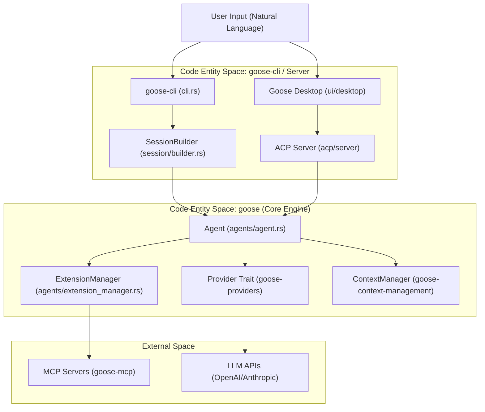
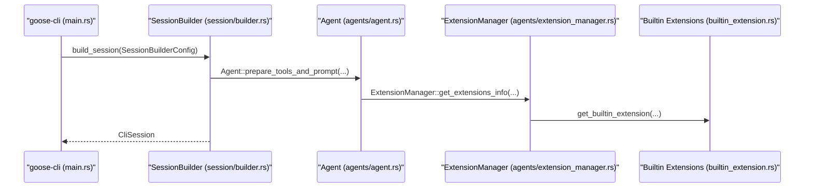

# Architecture & Core Crates

Relevant source files

The following files were used as context for generating this wiki page:

- [Cargo.lock](Cargo.lock)
- [Cargo.toml](Cargo.toml)
- [crates/goose-agent/CHANGELOG.md](crates/goose-agent/CHANGELOG.md)
- [crates/goose-agent/Cargo.toml](crates/goose-agent/Cargo.toml)
- [crates/goose-cli/Cargo.toml](crates/goose-cli/Cargo.toml)
- [crates/goose-cli/src/cli.rs](crates/goose-cli/src/cli.rs)
- [crates/goose-cli/src/commands/mod.rs](crates/goose-cli/src/commands/mod.rs)
- [crates/goose-cli/src/commands/session.rs](crates/goose-cli/src/commands/session.rs)
- [crates/goose-cli/src/lib.rs](crates/goose-cli/src/lib.rs)
- [crates/goose-cli/src/main.rs](crates/goose-cli/src/main.rs)
- [crates/goose-context-management/CHANGELOG.md](crates/goose-context-management/CHANGELOG.md)
- [crates/goose-context-management/Cargo.toml](crates/goose-context-management/Cargo.toml)
- [crates/goose-download-manager/Cargo.toml](crates/goose-download-manager/Cargo.toml)
- [crates/goose-local-inference/Cargo.toml](crates/goose-local-inference/Cargo.toml)
- [crates/goose-mcp/Cargo.toml](crates/goose-mcp/Cargo.toml)
- [crates/goose-provider-types/CHANGELOG.md](crates/goose-provider-types/CHANGELOG.md)
- [crates/goose-provider-types/Cargo.toml](crates/goose-provider-types/Cargo.toml)
- [crates/goose-provider-types/src/canonical/data/canonical_models.json](crates/goose-provider-types/src/canonical/data/canonical_models.json)
- [crates/goose-provider-types/src/canonical/data/provider_metadata.json](crates/goose-provider-types/src/canonical/data/provider_metadata.json)
- [crates/goose-providers/CHANGELOG.md](crates/goose-providers/CHANGELOG.md)
- [crates/goose-providers/Cargo.toml](crates/goose-providers/Cargo.toml)
- [crates/goose-sdk-types/Cargo.toml](crates/goose-sdk-types/Cargo.toml)
- [crates/goose-sdk/Cargo.toml](crates/goose-sdk/Cargo.toml)
- [crates/goose-sdk/python/pyproject.toml](crates/goose-sdk/python/pyproject.toml)
- [crates/goose/Cargo.toml](crates/goose/Cargo.toml)
- [crates/goose/src/session/chat_history_search.rs](crates/goose/src/session/chat_history_search.rs)
- [crates/goose/src/session/mod.rs](crates/goose/src/session/mod.rs)
- [crates/goose/src/session/session_manager.rs](crates/goose/src/session/session_manager.rs)
- [documentation/src/data/gdk-api.json](documentation/src/data/gdk-api.json)
- [ui/desktop/package.json](ui/desktop/package.json)

Goose is organized as a Rust workspace containing several specialized crates that separate the agent's core logic, provider abstractions, extension systems, context management, and CLI interfaces. This modularity allows Goose to run as a standalone terminal application, a background runtime, or the engine behind the Goose Desktop application.

## Workspace Structure & Crate Responsibilities

The Goose repository is a Rust workspace defined in the root [Cargo.toml:1-5](). It partitions the system into distinct responsibilities across specialized crates:

| Crate | Path | Responsibility |
| :--- | :--- | :--- |
| `goose` | `crates/goose` | The core engine: agent loop, provider abstractions, session logic, tools, and hooks. |
| `goose-agent` | `crates/goose-agent` | State-machine-based turn execution engine, operations, and event model. |
| `goose-providers` | `crates/goose-providers` | Concrete implementations for LLM backends (Anthropic, OpenAI, etc.) and wire format translation. |
| `goose-provider-types` | `crates/goose-provider-types` | Shared types, metadata, and canonical model definitions. |
| `goose-context-management` | `crates/goose-context-management` | LLM context window management, token counting, auto-compaction, and summarization. |
| `goose-sdk` | `crates/goose-sdk` | UniFFI bindings and SDK capabilities for embedding Goose in Python and Kotlin. |
| `goose-local-inference` | `crates/goose-local-inference` | Local inference backends (`candle`, `llama-cpp-2`, `MLX`), model discovery, and tool emulation. |
| `goose-roaming` | `crates/goose-roaming` | P2P transport and roaming node infrastructure using `iroh`. |
| `goose-cli` | `crates/goose-cli` | The interactive terminal REPL and command-line binary (`goose`). |
| `goose-mcp` | `crates/goose-mcp` | Built-in Model Context Protocol (MCP) servers and tool implementations. |

Sources: [Cargo.toml:1-5](), [crates/goose/Cargo.toml:1-10](), [crates/goose-cli/Cargo.toml:2-9]()

### System Data Flow

The following diagram illustrates how user requests flow from client interfaces through core orchestration layers out to external LLM providers and tool servers.

**Natural Language to Code Entity Mapping: Data Flow**

Sources: [crates/goose-cli/src/session/mod.rs:21](), [crates/goose/src/agents/agent.rs:186](), [crates/goose/src/agents/extension_manager.rs:22]()

---

## Core Subsystems & Child Pages

As a parent page, this section provides a high-level overview of the major subsystems. For complete technical details, consult the respective child pages:

### 1. Agent Core (`goose`) {#2.1}
The `goose` crate is the heart of the execution loop, managing the `Agent` struct lifecycle, conversation history, and tool dispatch [crates/goose/src/agents/agent.rs:186](). It integrates platform extensions, built-in tools, and context compaction mechanisms [crates/goose/src/agents/extension_manager.rs:42]().
* For details, see [Agent Core (`goose` crate)](#2.1)

### 2. Provider Layer {#2.2}
Abstracts LLM interactions via the `Provider` trait and `ProviderRegistry`, handling wire translation across various model providers, streaming responses, and canonical model catalogs.
* For details, see [Provider Layer](#2.2)

### 3. Configuration System {#2.3}
Manages user settings, API keys via keyring storage, environment variable precedence, and execution modes (`GooseMode`) [crates/goose/src/config.rs]().
* For details, see [Configuration System](#2.3)

### 4. Session & Storage {#2.4}
Persists conversations using SQLite (`sessions.db`) via `SessionManager`, supporting session naming, chat history search, and state resumption [crates/goose/src/session/mod.rs]().
* For details, see [Session & Storage](#2.4)

### 5. Security & Permission System {#2.5}
Inspects tool calls and egress traffic using `SecurityInspector` and prompt injection detection routines before executing operations under user approval flows [crates/goose/src/security/mod.rs]().
* For details, see [Security & Permission System](#2.5)

Sources: [crates/goose/src/agents/agent.rs:186](), [crates/goose/src/agents/extension_manager.rs:42](), [crates/goose/src/config.rs](), [crates/goose/src/session/mod.rs](), [crates/goose/src/security/mod.rs]()

---

## Process Architecture & Inter-dependencies

Goose components interact through well-defined protocol boundaries and shared workspace crates. 

**Natural Language to Code Entity Mapping: Initialization & Lifecycle**

Sources: [crates/goose-cli/src/session/mod.rs:21](), [crates/goose-cli/src/main.rs:19](), [crates/goose/src/agents/agent.rs:187](), [crates/goose/src/agents/extension_manager.rs:42]()

Key shared dependencies powering the workspace include:
* **`rmcp`**: Protocol implementation for Model Context Protocol communication [Cargo.toml:21]().
* **`agent-client-protocol`**: Standardized wire protocol for agent-to-client operations [Cargo.toml:23]().
* **`sqlx`**: SQLite database connectivity for session persistence [crates/goose/Cargo.toml:179-186]().
* **`goose-mcp`**: Built-in tool servers providing file system, memory, and controller capabilities [crates/goose-mcp/Cargo.toml:2-23]().

Sources: [Cargo.toml:21-23](), [crates/goose/Cargo.toml:179-186](), [crates/goose-mcp/Cargo.toml:2-23]()