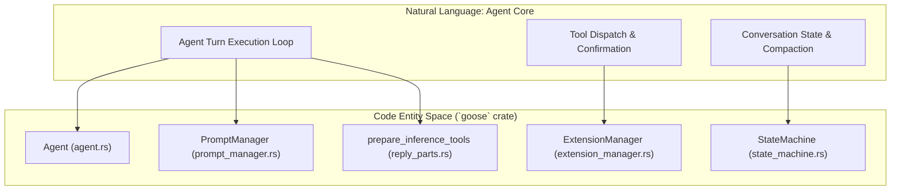
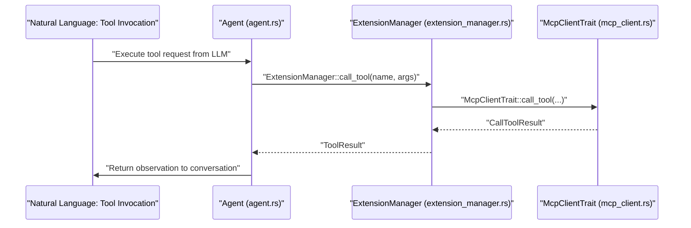

# Agent Core (`goose` crate)

Relevant source files

The following files were used as context for generating this wiki page:

- [crates/goose-cli/src/commands/configure.rs](crates/goose-cli/src/commands/configure.rs)
- [crates/goose-cli/src/session/builder.rs](crates/goose-cli/src/session/builder.rs)
- [crates/goose-cli/src/session/completion.rs](crates/goose-cli/src/session/completion.rs)
- [crates/goose-cli/src/session/editor.rs](crates/goose-cli/src/session/editor.rs)
- [crates/goose-cli/src/session/input.rs](crates/goose-cli/src/session/input.rs)
- [crates/goose-cli/src/session/mod.rs](crates/goose-cli/src/session/mod.rs)
- [crates/goose-cli/src/session/output.rs](crates/goose-cli/src/session/output.rs)
- [crates/goose-test-support/src/otel.rs](crates/goose-test-support/src/otel.rs)
- [crates/goose/src/agents/agent.rs](crates/goose/src/agents/agent.rs)
- [crates/goose/src/agents/extension.rs](crates/goose/src/agents/extension.rs)
- [crates/goose/src/agents/mod.rs](crates/goose/src/agents/mod.rs)
- [crates/goose/src/agents/moim.rs](crates/goose/src/agents/moim.rs)
- [crates/goose/src/agents/prompt_manager.rs](crates/goose/src/agents/prompt_manager.rs)
- [crates/goose/src/agents/reply_parts.rs](crates/goose/src/agents/reply_parts.rs)
- [crates/goose/src/agents/snapshots/goose__agents__prompt_manager__tests__all_platform_extensions.snap](crates/goose/src/agents/snapshots/goose__agents__prompt_manager__tests__all_platform_extensions.snap)
- [crates/goose/src/agents/snapshots/goose__agents__prompt_manager__tests__basic.snap](crates/goose/src/agents/snapshots/goose__agents__prompt_manager__tests__basic.snap)
- [crates/goose/src/agents/snapshots/goose__agents__prompt_manager__tests__one_extension.snap](crates/goose/src/agents/snapshots/goose__agents__prompt_manager__tests__one_extension.snap)
- [crates/goose/src/agents/snapshots/goose__agents__prompt_manager__tests__typical_setup.snap](crates/goose/src/agents/snapshots/goose__agents__prompt_manager__tests__typical_setup.snap)
- [crates/goose/src/config/extensions.rs](crates/goose/src/config/extensions.rs)
- [crates/goose/src/config/mod.rs](crates/goose/src/config/mod.rs)
- [crates/goose/src/execution/manager.rs](crates/goose/src/execution/manager.rs)
- [crates/goose/src/otel/otlp.rs](crates/goose/src/otel/otlp.rs)
- [crates/goose/src/permission/permission_inspector.rs](crates/goose/src/permission/permission_inspector.rs)
- [crates/goose/src/permission/permission_judge.rs](crates/goose/src/permission/permission_judge.rs)
- [crates/goose/src/prompts/system.md](crates/goose/src/prompts/system.md)
- [crates/goose/tests/agent.rs](crates/goose/tests/agent.rs)
- [documentation/docs/tutorials/langfuse.md](documentation/docs/tutorials/langfuse.md)

The `goose` crate contains the central orchestration logic for the Goose platform. It defines the `Agent` struct, which serves as the primary engine for the "Sense-Plan-Act" loop, managing the lifecycle of conversations, tool discovery, and execution [crates/goose/src/agents/agent.rs:146-148]().

## Purpose & Scope

This page provides a high-level overview of the agent core in the `goose` crate, detailing how the `Agent` struct coordinates conversations, dispatches tools via the `ExtensionManager`, interacts with providers, and handles subagents and scheduling.

For deep technical details on specific subsystems, refer to the child pages:
- [Platform Extensions & Built-in Tools](#2.1.1) — Platform extension system, built-in tools, hooks, and plugins.
- [Context Management & Compaction](#2.1.2) — LLM context window management, token counting, and auto-compaction (`goose-context-management` crate).
- [Agent State Machine (`goose-agent`)](#2.1.3) — Turn execution engine, state machine operations, tool approvals, and event model.

Sources: [crates/goose/src/agents/agent.rs:146-148]()

## The Agent Loop & Reply Lifecycle

The core of Goose is an iterative loop where the `Agent` processes user input, determines necessary actions through LLM tool calls, executes them, and provides a final response [crates/goose/src/agents/agent.rs:146-148]().

When a message is received, the `Agent` executes a reply lifecycle:
1.  **Context Preparation**: Gathering tools, system prompts, and conversation history via `prepare_inference_tools` [crates/goose/src/agents/reply_parts.rs:184-206]().
2.  **LLM Interaction**: Streaming or querying the `Provider` for model outputs [crates/goose/src/agents/agent.rs:107-108]().
3.  **Tool Dispatch**: Parsing tool requests and routing them through `ExtensionManager` [crates/goose/src/agents/agent.rs:150]().
4.  **Observation & State Machine**: Feeding results back into the conversation state machine [crates/goose/src/agents/agent.rs:19-23]().

**Natural Language Space to Code Entity Space: Agent Core Architecture**

Sources: [crates/goose/src/agents/agent.rs:19-23](), [crates/goose/src/agents/agent.rs:107-108](), [crates/goose/src/agents/agent.rs:146-150](), [crates/goose/src/agents/reply_parts.rs:184-206]()

## Extension Management (`ExtensionManager`)

The `ExtensionManager` manages the registration, discovery, and lifecycle of tools available to the agent [crates/goose/src/agents/agent.rs:150](). It handles three main extension categories:
-   **Built-in Extensions**: Extensions compiled directly into the Goose binary [crates/goose/src/agents/extension.rs:181-184]().
-   **Platform Extensions**: Core platform capabilities (such as developer shell/edit and execution tools) defined in `PLATFORM_EXTENSIONS` [crates/goose/src/agents/extension.rs:16-17]().
-   **MCP Extensions**: External servers connected via Stdio or HTTP transports [crates/goose/src/agents/extension.rs:158-180]().

For details on platform extensions and built-in tools, see [Platform Extensions & Built-in Tools](#2.1.1).

**Natural Language Space to Code Entity Space: Tool Dispatch Flow**

Sources: [crates/goose/src/agents/agent.rs:150](), [crates/goose/src/agents/extension.rs:16-17](), [crates/goose/src/agents/extension.rs:158-184]()

## Context & Session Integration

The `Agent` relies on session persistence and context window management to maintain conversation history across turns [crates/goose/src/agents/agent.rs:98]().

-   **Prompt Management**: The `PromptManager` compiles system prompts and dynamic instructions for the LLM [crates/goose/src/agents/prompt_manager.rs:18-20]().
-   **Compaction**: When conversation token usage approaches model limits, `COMPACT_TRIGGERS` define conditions for trimming or summarizing older context [crates/goose/src/agents/mod.rs:34]().

For deep technical coverage, see [Context Management & Compaction](#2.1.2).

Sources: [crates/goose/src/agents/agent.rs:98](), [crates/goose/src/agents/mod.rs:34](), [crates/goose/src/agents/prompt_manager.rs:18-20]()

## Subagents and Multi-Agent Orchestration

Goose supports multi-agent execution, allowing a lead agent to spawn and delegate tasks to subagents [crates/goose/src/agents/mod.rs:24](). This is coordinated via the `SubagentHandler` and `TaskConfig`, enabling isolated task execution within recipes or interactive sessions [crates/goose/src/agents/mod.rs:24-25]().

Sources: [crates/goose/src/agents/mod.rs:24-25]()

## Scheduler Integration

The scheduler system allows Goose to run predefined recipes automatically on a cron schedule [crates/goose/src/agents/agent.rs:100]().

| Entity | Description | File |
| :--- | :--- | :--- |
| `ScheduledJob` | Metadata and cron configuration for recurring tasks | [crates/goose/tests/agent.rs:24]() |
| `SchedulerTrait` | Abstraction layer for scheduler operations used by the agent | [crates/goose/src/agents/agent.rs:35]() |
| `ScheduleTool` | Tool exposed to the LLM to manage jobs | [crates/goose/src/agents/mod.rs:41]() |

Sources: [crates/goose/src/agents/agent.rs:35](), [crates/goose/src/agents/agent.rs:100](), [crates/goose/src/agents/mod.rs:41](), [crates/goose/tests/agent.rs:24]()

## Child Pages

-   [Platform Extensions & Built-in Tools](#2.1.1) — Detailed coverage of platform extensions, developer tools, execution, and hooks.
-   [Context Management & Compaction](#2.1.2) — Deep dive into token counting, conversation fixing, and compaction.
-   [Agent State Machine (`goose-agent`)](#2.1.3) — Turn execution engine, state machine operations, tool approvals, and events.