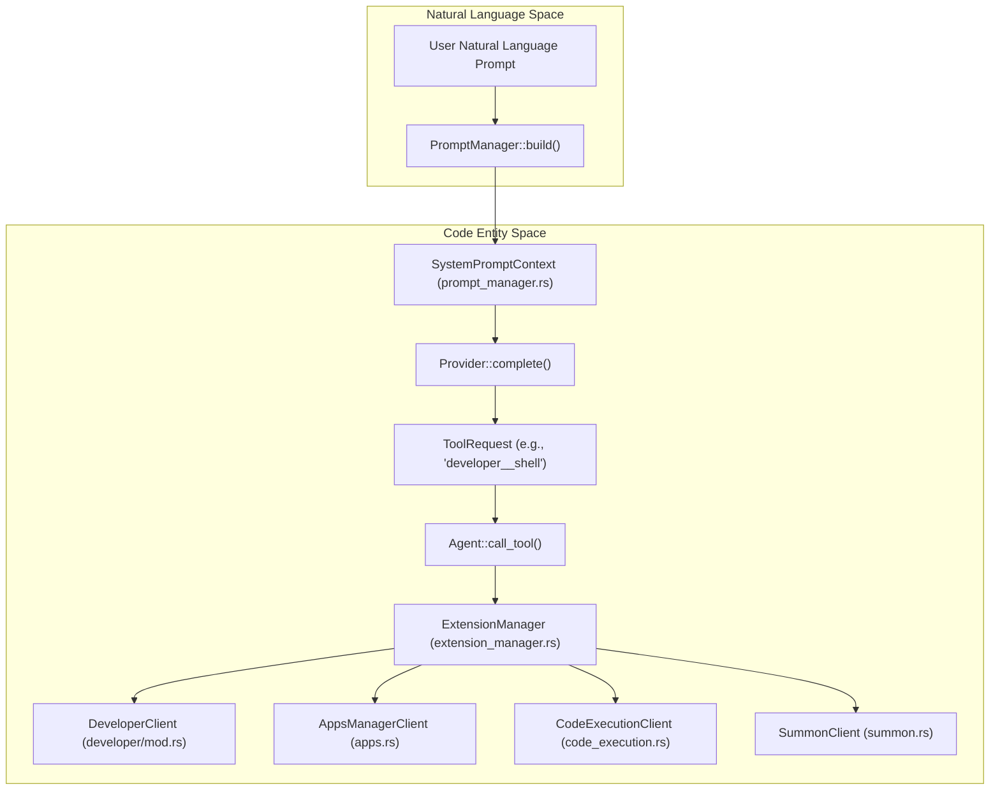
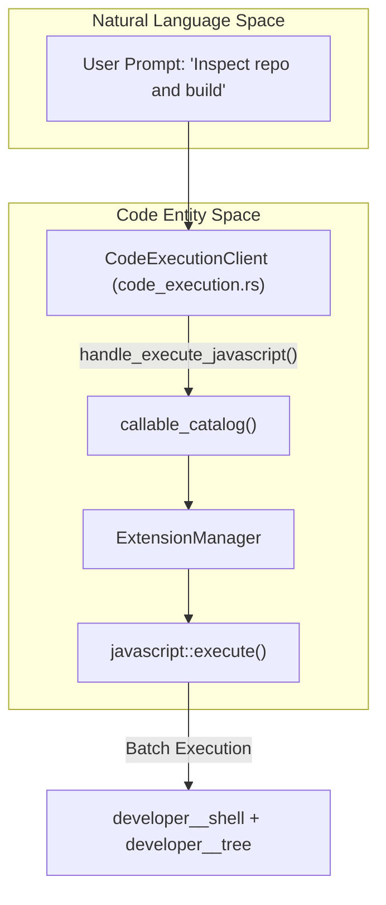

# Platform Extensions & Built-in Tools

<details>
<summary>Relevant source files</summary>

The following files were used as context for generating this wiki page:

- [crates/goose-agent/src/lib.rs](crates/goose-agent/src/lib.rs)
- [crates/goose-agent/src/skills/arguments.rs](crates/goose-agent/src/skills/arguments.rs)
- [crates/goose-agent/src/skills/discovery.rs](crates/goose-agent/src/skills/discovery.rs)
- [crates/goose-agent/src/skills/mod.rs](crates/goose-agent/src/skills/mod.rs)
- [crates/goose-cli/src/commands/plugin.rs](crates/goose-cli/src/commands/plugin.rs)
- [crates/goose-local-inference/src/paths.rs](crates/goose-local-inference/src/paths.rs)
- [crates/goose/src/agents/execute_commands.rs](crates/goose/src/agents/execute_commands.rs)
- [crates/goose/src/agents/extension_manager/mod.rs](crates/goose/src/agents/extension_manager/mod.rs)
- [crates/goose/src/agents/extension_manager/streamable_http.rs](crates/goose/src/agents/extension_manager/streamable_http.rs)
- [crates/goose/src/agents/platform_extensions/analyze/mod.rs](crates/goose/src/agents/platform_extensions/analyze/mod.rs)
- [crates/goose/src/agents/platform_extensions/apps.rs](crates/goose/src/agents/platform_extensions/apps.rs)
- [crates/goose/src/agents/platform_extensions/chatrecall.rs](crates/goose/src/agents/platform_extensions/chatrecall.rs)
- [crates/goose/src/agents/platform_extensions/code_execution.rs](crates/goose/src/agents/platform_extensions/code_execution.rs)
- [crates/goose/src/agents/platform_extensions/developer/mod.rs](crates/goose/src/agents/platform_extensions/developer/mod.rs)
- [crates/goose/src/agents/platform_extensions/developer/shell.rs](crates/goose/src/agents/platform_extensions/developer/shell.rs)
- [crates/goose/src/agents/platform_extensions/ext_manager.rs](crates/goose/src/agents/platform_extensions/ext_manager.rs)
- [crates/goose/src/agents/platform_extensions/mod.rs](crates/goose/src/agents/platform_extensions/mod.rs)
- [crates/goose/src/agents/platform_extensions/summon.rs](crates/goose/src/agents/platform_extensions/summon.rs)
- [crates/goose/src/config/paths.rs](crates/goose/src/config/paths.rs)
- [crates/goose/src/hints/import_files.rs](crates/goose/src/hints/import_files.rs)
- [crates/goose/src/hints/load_hints.rs](crates/goose/src/hints/load_hints.rs)
- [crates/goose/src/hints/mod.rs](crates/goose/src/hints/mod.rs)
- [crates/goose/src/hooks/mod.rs](crates/goose/src/hooks/mod.rs)
- [crates/goose/src/plugins/discovery.rs](crates/goose/src/plugins/discovery.rs)
- [crates/goose/src/plugins/formats/gemini.rs](crates/goose/src/plugins/formats/gemini.rs)
- [crates/goose/src/plugins/formats/mod.rs](crates/goose/src/plugins/formats/mod.rs)
- [crates/goose/src/plugins/formats/open_plugins.rs](crates/goose/src/plugins/formats/open_plugins.rs)
- [crates/goose/src/plugins/mod.rs](crates/goose/src/plugins/mod.rs)
- [crates/goose/src/providers/command_auth.rs](crates/goose/src/providers/command_auth.rs)
- [crates/goose/src/recipe/local_recipes.rs](crates/goose/src/recipe/local_recipes.rs)
- [crates/goose/src/skills/client.rs](crates/goose/src/skills/client.rs)
- [crates/goose/src/skills/mod.rs](crates/goose/src/skills/mod.rs)
- [crates/goose/src/skills/supporting_files.rs](crates/goose/src/skills/supporting_files.rs)
- [documentation/docs/guides/context-engineering/hooks.md](documentation/docs/guides/context-engineering/hooks.md)
- [examples/plugins/hello-hooks/README.md](examples/plugins/hello-hooks/README.md)
- [examples/plugins/hello-hooks/hooks/hooks.json](examples/plugins/hello-hooks/hooks/hooks.json)
- [examples/plugins/hello-hooks/plugin.json](examples/plugins/hello-hooks/plugin.json)
- [rust-toolchain.toml](rust-toolchain.toml)
- [ui/desktop/src/utils/pathUtils.test.ts](ui/desktop/src/utils/pathUtils.test.ts)
- [ui/desktop/src/utils/pathUtils.ts](ui/desktop/src/utils/pathUtils.ts)

</details>


Platform extensions are in-process components that provide the Goose agent with direct access to system capabilities, specialized logic, and subagent orchestration. Unlike external Model Context Protocol (MCP) servers that run as separate processes, platform extensions are compiled directly into the `goose` crate and have direct access to internal agent state and context [crates/goose/src/agents/platform_extensions/mod.rs:28-30]().

## Extension Architecture & Management

Platform extensions are defined within `crates/goose/src/agents/platform_extensions/` and are registered via the `PLATFORM_EXTENSIONS` registry [crates/goose/src/agents/platform_extensions/mod.rs:33-184](). Each extension implements `McpClientTrait`, allowing the agent core to interact with them via the standard MCP interface in-process [crates/goose/src/agents/mcp_client.rs:78-151]().

### Data Flow: Natural Language to Tool Execution

The following diagram bridges the **Natural Language Space** to the **Code Entity Space**, tracking how user instructions are translated by `PromptManager::build()` [crates/goose/src/agents/prompt_manager.rs:110-180]() into system prompt blocks, dispatched through `Agent::call_tool()`, and handled by concrete extension clients like `DeveloperClient` [crates/goose/src/agents/platform_extensions/developer/mod.rs:34-40](), `AppsManagerClient` [crates/goose/src/agents/platform_extensions/apps.rs:129-133](), and `CodeExecutionClient` [crates/goose/src/agents/platform_extensions/code_execution.rs:26-31]().

**Natural Language to Code Entity Dispatch Flow**

Sources: [crates/goose/src/agents/platform_extensions/mod.rs:33-184](), [crates/goose/src/agents/platform_extensions/developer/mod.rs:34-40](), [crates/goose/src/agents/platform_extensions/apps.rs:129-133](), [crates/goose/src/agents/platform_extensions/code_execution.rs:26-31](), [crates/goose/src/agents/prompt_manager.rs:110-180]()

---

## Core Platform Extensions

### Developer Extension
The `developer` extension provides essential software engineering tools, including terminal shell execution, file writing/editing, and tree-based directory visualization [crates/goose/src/agents/platform_extensions/developer/mod.rs:26-40]().

| Tool | Function | Key Implementation |
| :--- | :--- | :--- |
| `shell` | Executes commands in the user's shell. | `ShellTool` [crates/goose/src/agents/platform_extensions/developer/mod.rs:149-150]() |
| `write` | Creates or overwrites files. | `EditTools` [crates/goose/src/agents/platform_extensions/developer/mod.rs:110-121]() |
| `edit` | Exact text find-and-replace in files. | `EditTools` [crates/goose/src/agents/platform_extensions/developer/mod.rs:122-133]() |
| `tree` | Lists directory structure with line counts. | `TreeTool` [crates/goose/src/agents/platform_extensions/developer/mod.rs:160-163]() |
| `read_image`| Reads local or remote images for inspection. | `ImageTool` [crates/goose/src/agents/platform_extensions/developer/mod.rs:166-177]() |

**Shell Implementation Details:**
On Unix systems, `ShellTool` attempts to invoke a login shell to inherit the user's full environment `PATH` [crates/goose/src/agents/platform_extensions/developer/shell.rs:147-157](). When executing inside Flatpak environments, it wraps commands using `flatpak-spawn --host` [crates/goose/src/agents/platform_extensions/developer/shell.rs:45-50](). Output is guarded by length limits (2000 lines or 50KB) with automatic spilling to temporary files, and live output streams through `ShellOutputBatcher` [crates/goose/src/agents/platform_extensions/developer/shell.rs:22-22](), [crates/goose/src/agents/platform_extensions/developer/shell.rs:159-160]().
Sources: [crates/goose/src/agents/platform_extensions/developer/mod.rs:26-40](), [crates/goose/src/agents/platform_extensions/developer/mod.rs:108-177](), [crates/goose/src/agents/platform_extensions/developer/shell.rs:22-22](), [crates/goose/src/agents/platform_extensions/developer/shell.rs:45-50](), [crates/goose/src/agents/platform_extensions/developer/shell.rs:147-157](), [crates/goose/src/agents/platform_extensions/developer/shell.rs:159-160]()

### Summon & Skills
The `summon` extension manages tasks, subrecipes, subagents, and skills [crates/goose/src/agents/platform_extensions/summon.rs:46-58]().
*   **Discovery & Parameters:** Parses metadata frontmatter and merges parameters using `merge_subrecipe_parameters` [crates/goose/src/agents/platform_extensions/summon.rs:68-82]().
*   **Subagents:** Spawns asynchronous tasks via `spawn_background_task` with cancellation handles (`CancellationToken`) [crates/goose/src/agents/platform_extensions/summon.rs:2000-2011]().
*   **Skills:** The `skills` crate handles filesystem discovery of `SKILL.md` files in global (`~/.agents/skills`) and project-scoped directories [crates/goose/src/skills/mod.rs:47-55](), supporting placeholders like `{{GOOSE_DOCS_ROOT}}` [crates/goose/src/skills/mod.rs:113-123]().
Sources: [crates/goose/src/agents/platform_extensions/summon.rs:46-58](), [crates/goose/src/agents/platform_extensions/summon.rs:68-82](), [crates/goose/src/agents/platform_extensions/summon.rs:2000-2011](), [crates/goose/src/skills/mod.rs:47-55](), [crates/goose/src/skills/mod.rs:113-123]()

### Analyze (Code Graph)
The `analyze` extension uses `tree-sitter` to index code structure, providing directory overviews, file symbol listings, and call graphs for symbols [crates/goose/src/agents/platform_extensions/mod.rs:38-44]().
Sources: [crates/goose/src/agents/platform_extensions/mod.rs:38-44]()

---

## Utility & Memory Extensions

### Chat Recall
Provides long-term retrieval by searching past conversations stored in SQLite (`sessions.db`) [crates/goose/src/agents/platform_extensions/mod.rs:81-87]() using keyword/synonym query matching or session loading [crates/goose/src/agents/platform_extensions/chatrecall.rs:100-101]().
Sources: [crates/goose/src/agents/platform_extensions/mod.rs:81-87](), [crates/goose/src/agents/platform_extensions/chatrecall.rs:100-101]()

### Apps Manager
Managed via `AppsManagerClient` [crates/goose/src/agents/platform_extensions/apps.rs:129-133](), this extension creates, iterates, and stores sandboxed HTML/JS apps under the data directory [crates/goose/src/agents/platform_extensions/apps.rs:137-141](). It automatically seeds default apps like the clock app [crates/goose/src/agents/platform_extensions/apps.rs:58-60](), [crates/goose/src/agents/platform_extensions/apps.rs:166-177]().
Sources: [crates/goose/src/agents/platform_extensions/apps.rs:58-60](), [crates/goose/src/agents/platform_extensions/apps.rs:129-141](), [crates/goose/src/agents/platform_extensions/apps.rs:166-177]()

### Todo & Top Of Mind (TOM)
*   **Todo:** Maintains a persistent requirement checklist injected into the agent context [crates/goose/src/agents/platform_extensions/mod.rs:54-62]().
*   **TOM:** Injects custom state constraints via environment variables and the `tom` module [crates/goose/src/agents/platform_extensions/mod.rs:185-190]().
Sources: [crates/goose/src/agents/platform_extensions/mod.rs:54-62](), [crates/goose/src/agents/platform_extensions/mod.rs:185-190]()

### Code Execution Extension
`CodeExecutionClient` enables the agent to batch multiple tool calls into a single JavaScript execution block [crates/goose/src/agents/platform_extensions/code_execution.rs:26-31](). It loads callback configs for available tools [crates/goose/src/agents/platform_extensions/code_execution.rs:107-108]() and executes scripts efficiently [crates/goose/src/agents/platform_extensions/code_execution.rs:137-145]().

**Code Execution Architecture & Data Flow**

Sources: [crates/goose/src/agents/platform_extensions/code_execution.rs:26-31](), [crates/goose/src/agents/platform_extensions/code_execution.rs:107-108](), [crates/goose/src/agents/platform_extensions/code_execution.rs:137-145]()

---

## Hooks & Plugins System

Goose implements a lifecycle hooks framework modeled after the Open Plugins specification [crates/goose/src/hooks/mod.rs:1-2](). Hooks are loaded from `<plugin-root>/hooks/hooks.json` of enabled plugins [crates/goose/src/hooks/mod.rs:4-5]().

### Supported Hook Events
Hooks subscribe to events such as `PreToolUse`, `PostToolUse`, `SessionStart`, `SessionEnd`, `BeforeShellExecution`, `AfterShellExecution`, and `Stop` [crates/goose/src/hooks/mod.rs:55-68]().

### Execution Model
When an event occurs, matching rules (evaluated via regex `matcher`) execute command actions by passing the JSON-serialized event context to `stdin` [crates/goose/src/hooks/mod.rs:23-24](), [crates/goose/src/hooks/mod.rs:120-125](). Actions specify `on_failure` behaviors (`Allow` or `Block`) [crates/goose/src/hooks/mod.rs:184-190]().

**Example Hook Configuration (`hooks.json`):**
```json
{
  "hooks": {
    "PostToolUse": [
      {
        "matcher": "developer__shell|developer__text_editor",
        "hooks": [
          { "type": "command", "command": "${PLUGIN_ROOT}/scripts/log.sh" }
        ]
      }
    ]
  }
}
```
Sources: [crates/goose/src/hooks/mod.rs:1-24](), [crates/goose/src/hooks/mod.rs:55-68](), [crates/goose/src/hooks/mod.rs:120-125](), [crates/goose/src/hooks/mod.rs:184-190]()

### `hello-hooks` Example
The `examples/plugins/hello-hooks` directory provides a minimal plugin demonstrating the hooks system.
*   `plugin.json`: Defines the plugin's metadata [examples/plugins/hello-hooks/plugin.json]().
*   `hooks/hooks.json`: Configures a `PostToolUse` hook that triggers for `developer__shell` and `developer__edit` tools, executing a script [examples/plugins/hello-hooks/hooks/hooks.json]().
*   `scripts/log.sh`: The script executed by the hook, which logs the tool name and arguments to a file [examples/plugins/hello-hooks/hooks/hooks.json:10-11]().

This example illustrates how to set up a plugin with hooks to observe and react to agent actions.
Sources: [examples/plugins/hello-hooks/plugin.json](), [examples/plugins/hello-hooks/hooks/hooks.json]()

---

## Slash Commands

Built-in session management commands are parsed and executed prior to LLM inference [crates/goose/src/agents/execute_commands.rs:62-83](), [crates/goose/src/agents/execute_commands.rs:99-109]().

| Command | Action | Implementation |
| :--- | :--- | :--- |
| `/compact` | Manually triggers conversation compaction. | `COMPACT_TRIGGERS` [crates/goose/src/agents/execute_commands.rs:9-10]() |
| `/clear` | Clears conversation history. | `CommandDef` [crates/goose/src/agents/execute_commands.rs:30-33]() |
| `/skills` | Lists discovered skills and sources. | `CommandDef` [crates/goose/src/agents/execute_commands.rs:34-37]() |
| `/status` | Shows model, provider, and token usage. | `CommandDef` [crates/goose/src/agents/execute_commands.rs:51-54]() |
| `/goal` | Sets a required completion goal. | `CommandDef` [crates/goose/src/agents/execute_commands.rs:42-45]() |
| `/grind` | Pursues goal relentlessly until `max_turns`. | `CommandDef` [crates/goose/src/agents/execute_commands.rs:46-50]() |

Sources: [crates/goose/src/agents/execute_commands.rs:9-10](), [crates/goose/src/agents/execute_commands.rs:17-55](), [crates/goose/src/agents/execute_commands.rs:62-83](), [crates/goose/src/agents/execute_commands.rs:99-109]()