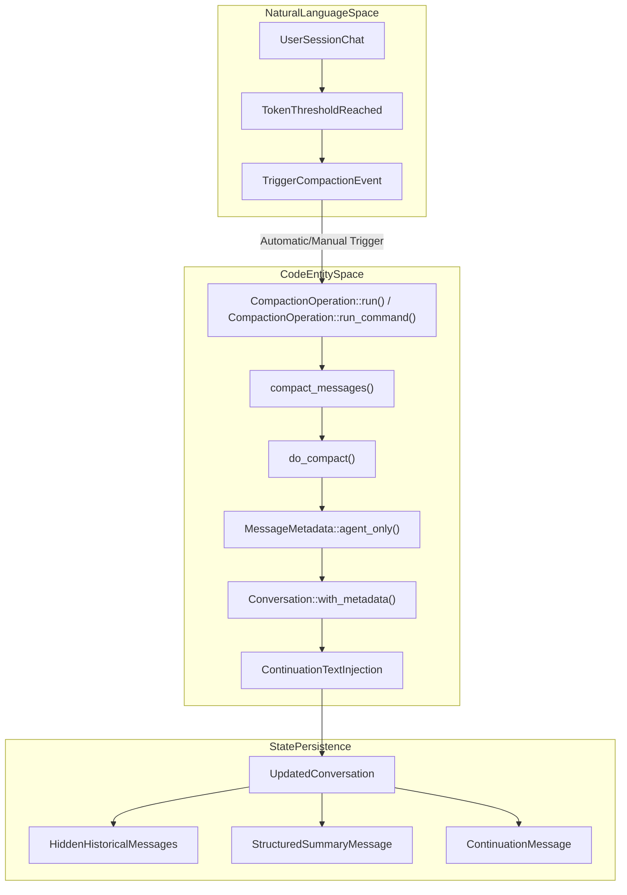
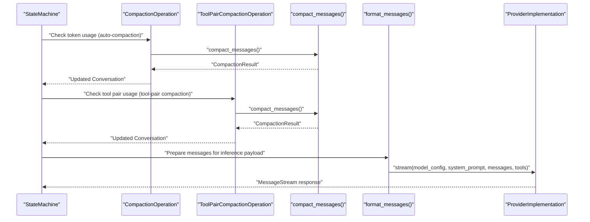

# Context Management & Compaction

Relevant source files

The following files were used as context for generating this wiki page:

- [crates/goose-agent/CHANGELOG.md](crates/goose-agent/CHANGELOG.md)
- [crates/goose-context-management/CHANGELOG.md](crates/goose-context-management/CHANGELOG.md)
- [crates/goose-provider-types/CHANGELOG.md](crates/goose-provider-types/CHANGELOG.md)
- [crates/goose-providers/CHANGELOG.md](crates/goose-providers/CHANGELOG.md)
- [crates/goose/src/agents/extension_manager/lease.rs](crates/goose/src/agents/extension_manager/lease.rs)
- [crates/goose/src/agents/final_output_tool.rs](crates/goose/src/agents/final_output_tool.rs)
- [crates/goose/src/agents/state_machine/mod.rs](crates/goose/src/agents/state_machine/mod.rs)
- [crates/goose/src/agents/state_machine/ops_compaction.rs](crates/goose/src/agents/state_machine/ops_compaction.rs)
- [crates/goose/src/agents/state_machine/ops_recipe.rs](crates/goose/src/agents/state_machine/ops_recipe.rs)
- [crates/goose/src/agents/state_machine/ops_toolcalling.rs](crates/goose/src/agents/state_machine/ops_toolcalling.rs)
- [crates/goose/src/agents/state_machine/tests/agent_reply.rs](crates/goose/src/agents/state_machine/tests/agent_reply.rs)
- [crates/goose/src/agents/state_machine/tests/hooks_lifecycle.rs](crates/goose/src/agents/state_machine/tests/hooks_lifecycle.rs)
- [crates/goose/src/agents/state_machine/tests/mod.rs](crates/goose/src/agents/state_machine/tests/mod.rs)
- [crates/goose/src/agents/state_machine/tests/pipeline.rs](crates/goose/src/agents/state_machine/tests/pipeline.rs)
- [crates/goose/src/agents/state_machine/tests/recipe_scheduling_lifecycle.rs](crates/goose/src/agents/state_machine/tests/recipe_scheduling_lifecycle.rs)
- [crates/goose/src/agents/state_machine/tests/reconstruction_isolation_lifecycle.rs](crates/goose/src/agents/state_machine/tests/reconstruction_isolation_lifecycle.rs)
- [crates/goose/src/agents/subagent_handler.rs](crates/goose/src/agents/subagent_handler.rs)
- [crates/goose/src/context_mgmt/mod.rs](crates/goose/src/context_mgmt/mod.rs)
- [crates/goose/src/doctor.rs](crates/goose/src/doctor.rs)
- [crates/goose/src/prompts/subagent_system.md](crates/goose/src/prompts/subagent_system.md)

This page details how Goose manages the Large Language Model (LLM) context window, token counting, automated compaction via summarization, truncation strategies, tool output summarization, and conversation fixing. This functionality is centralized primarily in the `goose-context-management` crate and the context management modules within the `goose` core crate [crates/goose/src/context_mgmt/mod.rs:1-24]().

## Context Management Overview & The `goose-context-management` Crate

Goose uses a layered approach to handle token and context window limits during long-running sessions, ensuring the agent remains productive without exceeding provider constraints [crates/goose/src/context_mgmt/mod.rs:93-94]().

### Key Components

| Component | Responsibility | Code Reference |
| :--- | :--- | :--- |
| `compact_messages` | Orchestrates history summarization, visibility updates, and continuation insertion | [crates/goose/src/context_mgmt/mod.rs:88-93]() |
| `CompactionResult` | Struct containing the updated `Conversation`, billable `ProviderUsage`, and `retained_context_tokens` | [crates/goose/src/context_mgmt/mod.rs:65-74]() |
| `ModelConfig` | Encapsulates model parameters, context limits, and token thresholds | [crates/goose-providers/src/model.rs:13-14]() |
| `MessageMetadata` | Controls agent versus user message visibility (`agent_visible`, `user_visible`) | [crates/goose/src/conversation/message.rs:142-145]() |
| `merge_consecutive_messages` | Merges adjacent messages of the same role for provider payload conformance | [crates/goose/src/conversation/mod.rs:5-5]() |

Sources: [crates/goose/src/context_mgmt/mod.rs:65-93](), [crates/goose-providers/src/model.rs:13-14](), [crates/goose/src/conversation/message.rs:142-145](), [crates/goose/src/conversation/mod.rs:5-5]()

## Token Counting & Model Limits

Token estimation governs when compaction triggers. Limits are derived from model metadata and runtime configuration.

### Model Limits and Canonical Registry
- **`ModelConfig`**: Defines limits and request parameters, supporting canonical model limit lookups via `with_canonical_limits` [crates/goose-providers/src/model.rs:13-14]().
- **Context Limits**: Default context windows are determined by the provider's `get_context_limit` method [crates/goose/src/providers/base.rs:60-62]().
- **Thresholds**: Compaction triggers automatically when token usage reaches a configured threshold (`DEFAULT_COMPACTION_THRESHOLD`) or a custom threshold configured by `GOOSE_AUTO_COMPACT_THRESHOLD` [crates/goose/src/context_mgmt/mod.rs:21-42](). The `auto_compact_threshold` function calculates this, potentially capping it by `GOOSE_AUTO_COMPACT_TOKEN_LIMIT` [crates/goose/src/context_mgmt/mod.rs:30-42]().

Sources: [crates/goose/src/context_mgmt/mod.rs:21-42](), [crates/goose/src/providers/base.rs:60-62](), [crates/goose-providers/src/model.rs:13-14]()

## Automatic & Manual Compaction

When token limits approach or when requested explicitly, Goose condenses conversation history via `compact_messages`. The `CompactionOperation` in the state machine handles the trigger for both automatic and manual compaction [crates/goose/src/agents/state_machine/ops_compaction.rs:129-199]().

### The Compaction Flow
1. **Detection & Filtering**: The system scans conversation history, preserving text-only user messages if applicable, while omitting internal turn contexts [crates/goose/src/context_mgmt/mod.rs:96-146]().
2. **Summarization (`do_compact`)**: Older messages are summarized into a concise structured overview via a model invocation [crates/goose/src/context_mgmt/mod.rs:150-151]().
3. **Visibility Metadata Adjustment**:
   - Original compacted messages have their metadata updated with `with_agent_invisible()` so they remain visible to the user in UI logs but are filtered out from subsequent LLM requests [crates/goose/src/context_mgmt/mod.rs:157-161]().
   - The summary message is inserted with `MessageMetadata::agent_only()` [crates/goose/src/context_mgmt/mod.rs:163-163]().
4. **Continuation Injection**: An assistant continuation prompt (`CONVERSATION_CONTINUATION_TEXT`, `TOOL_LOOP_CONTINUATION_TEXT`, or `MANUAL_COMPACT_CONTINUATION_TEXT`) is appended to guide the LLM post-compaction [crates/goose/src/context_mgmt/mod.rs:50-63]().

Title: "CompactionPipelineDataFlow"

Sources: [crates/goose/src/context_mgmt/mod.rs:50-169](), [crates/goose/src/agents/state_machine/ops_compaction.rs:129-199]()

## Tool Output & Pair Summarization

To maintain efficient context usage during intensive tool execution loops, Goose manages tool responses and history bloat. The `ToolPairCompactionOperation` specifically handles this [crates/goose/src/agents/state_machine/mod.rs:73-73]().

- **Tool Pair Summarization**: Controlled by `GOOSE_TOOL_PAIR_SUMMARIZATION` (via `tool_pair_summarization_enabled()`) and `TOOLCALL_SUMMARIZATION_BATCH_SIZE` (default 10), tool call and response pairs can be batched and summarized in the background [crates/goose/src/context_mgmt/mod.rs:27-27](), [crates/goose/src/context_mgmt/mod.rs:44-48]().
- **Sanitization**: Tool responses undergo automated Unicode tag sanitization during deserialization and content handling to protect LLM safety and context hygiene [crates/goose/src/conversation/message.rs:21-78]().

Sources: [crates/goose/src/context_mgmt/mod.rs:27-27](), [crates/goose/src/context_mgmt/mod.rs:44-48](), [crates/goose/src/conversation/message.rs:21-78](), [crates/goose/src/agents/state_machine/mod.rs:73-73]()

## Conversation Fix & Wire Format Adaptation

Before messages reach provider APIs (e.g., OpenAI, Anthropic, Google), message lists undergo validation and formatting translations.

- **Role Merging**: Consecutive messages sharing the same role are combined via `merge_consecutive_messages` to meet provider schema requirements [crates/goose/src/conversation/mod.rs:5-5]().
- **Thinking Block Preservation**: Reasoning content blocks (such as those from Anthropic or OpenAI Responses) are filtered or preserved depending on provider-specific format options [crates/goose-providers/src/formats/openai.rs:70-75](), [crates/goose-providers/src/formats/anthropic.rs:60-70]().

Title: "ContextPreparationSequence"

Sources: [crates/goose/src/context_mgmt/mod.rs:88-93](), [crates/goose-providers/src/formats/openai.rs:70-75](), [crates/goose-providers/src/formats/anthropic.rs:60-70](), [crates/goose/src/conversation/mod.rs:5-5]()