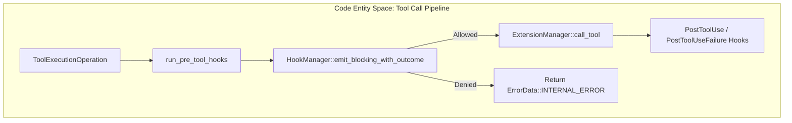

# Agent State Machine (`goose-agent`)

Relevant source files

The following files were used as context for generating this wiki page:

- [crates/goose-agent/README.md](crates/goose-agent/README.md)
- [crates/goose-agent/src/inference.rs](crates/goose-agent/src/inference.rs)
- [crates/goose-agent/src/machine.rs](crates/goose-agent/src/machine.rs)
- [crates/goose-agent/src/operation.rs](crates/goose-agent/src/operation.rs)
- [crates/goose-agent/src/tool.rs](crates/goose-agent/src/tool.rs)
- [crates/goose-agent/tests/cancellation.rs](crates/goose-agent/tests/cancellation.rs)
- [crates/goose-agent/tests/tool_operation.rs](crates/goose-agent/tests/tool_operation.rs)
- [crates/goose/src/agents/state_machine/ops_llm.rs](crates/goose/src/agents/state_machine/ops_llm.rs)
- [crates/goose/src/agents/state_machine/ops_steer.rs](crates/goose/src/agents/state_machine/ops_steer.rs)
- [crates/goose/src/agents/state_machine/ops_tool_pair_compaction.rs](crates/goose/src/agents/state_machine/ops_tool_pair_compaction.rs)
- [crates/goose/src/agents/state_machine/session.rs](crates/goose/src/agents/state_machine/session.rs)
- [crates/goose/src/agents/state_machine/tests/compaction_lifecycle.rs](crates/goose/src/agents/state_machine/tests/compaction_lifecycle.rs)
- [crates/goose/src/agents/state_machine/tests/dummy_api.rs](crates/goose/src/agents/state_machine/tests/dummy_api.rs)
- [crates/goose/src/agents/state_machine/tests/prompt_skill_lifecycle.rs](crates/goose/src/agents/state_machine/tests/prompt_skill_lifecycle.rs)
- [crates/goose/src/agents/state_machine/tests/provider_lifecycle.rs](crates/goose/src/agents/state_machine/tests/provider_lifecycle.rs)
- [crates/goose/src/agents/state_machine/tests/tool_lifecycle.rs](crates/goose/src/agents/state_machine/tests/tool_lifecycle.rs)
- [crates/goose/tests/state_machine_api.rs](crates/goose/tests/state_machine_api.rs)

### Purpose and Scope
This page details the state-machine-based turn execution engine that drives Goose sessions. Turn execution is modeled around the `goose-agent` crate's machine, operation, and event model, implemented within `crates/goose/src/agents/state_machine/` [crates/goose/src/agents/state_machine/session.rs:1-179](). It covers operation composition, key operational subsystems (`ops_llm`, `ops_toolcalling`, `ops_tool_approval`, `ops_recipe`, `ops_skills`, and stop hooks), token usage accounting, and effect handling.

---

## 1. Core Model and Traits (`goose-agent`)

The execution engine rests upon core abstractions defined in the `goose-agent` crate and implemented by the `goose` crate:

*   `MachineSession`: Implemented by `Session` to expose session identity and conversation state [crates/goose/src/agents/state_machine/session.rs:23-30]().
*   `SessionLoader<Session>`: Implemented by `SessionManager` to load persistent session state [crates/goose/src/agents/state_machine/session.rs:32-37]().
*   `EffectHandler<Session, GooseEffect>`: Implemented by `SessionManager` to apply state mutations and conversation updates resulting from operations [crates/goose/src/agents/state_machine/session.rs:40-152]().
*   `EffectUsage<GooseEffect>`: Extracts token usage metrics from effects [crates/goose/src/agents/state_machine/session.rs:154-167]().

Sources: [crates/goose/src/agents/state_machine/session.rs:10-167]()

---

## 2. Turn Execution Pipeline & Operation Composition

A Goose turn flows through a prioritized sequence of operations managed by `StateMachine` [crates/goose-agent/src/machine.rs:55-59](). Each operation evaluates the current session state and conversation, returning an `OperationResult` (e.g., `applied`, `yielded`, `not_applicable`) [crates/goose-agent/src/operation.rs:189-192](). The `StateMachine` iterates through these `Step`s, applying the first one that is applicable [crates/goose-agent/src/machine.rs:126-175]().

```mermaid
graph TD
    subgraph "Code Entity Space: Turn Execution"
        StateMachine["StateMachine::run"]
        SteerOp["SteerOperation"]
        MaxTurnsOp["MaxTurnsOperation"]
        CompactionOp["CompactionOperation"]
        ToolApprovalOp["ToolApprovalOperation"]
        SkillOp["SkillOperation"]
        RecipeOp["RecipeOperation"]
        ToolExecutionOp["ToolExecutionOperation"]
        UnknownToolOp["UnknownToolOperation"]
        StopHookOp["StopHookOperation"]
        ApplyEffects["SessionManager::apply_effects"]
    end

    StateMachine --> SteerOp
    SteerOp --> MaxTurnsOp
    MaxTurnsOp --> CompactionOp
    CompactionOp --> ToolApprovalOp
    ToolApprovalOp --> SkillOp
    SkillOp --> RecipeOp
    RecipeOp --> ToolExecutionOp
    ToolExecutionOp --> UnknownToolOp
    UnknownToolOp --> StopHookOp
    StopHookOp --> ApplyEffects

    style StateMachine fill:#none
    style ApplyEffects fill:#none
```

Sources: [crates/goose-agent/src/machine.rs:55-59](), [crates/goose-agent/src/operation.rs:189-192](), [crates/goose-agent/src/machine.rs:126-175]()

---

## 3. Key Operations Breakdown

### LLM Inference (`ops_llm`)
The LLM inference operation uses `GooseInferenceProvider` to wrap core providers, inject tool definitions, handle tool name canonicalization, and track inference spans [crates/goose/src/agents/state_machine/ops_llm.rs:23-171](). The `InferenceRunner` from `goose-agent` handles the core logic of interacting with the provider [crates/goose-agent/src/inference.rs:20-23]().
*   `GooseInferenceProvider`: Implements `Provider` to intercept streaming inference calls, enriching tool errors and preparing tool requests [crates/goose/src/agents/state_machine/ops_llm.rs:131-195]().
*   `prepare_tool_requests`: Modifies tool requests in messages to coerce arguments and inject tool metadata [crates/goose/src/agents/state_machine/ops_llm.rs:75-129]().
*   `chat_span`: Creates a tracing span for LLM chat operations, recording provider, model, and usage details [crates/goose-agent/src/inference.rs:117-143]().

Sources: [crates/goose/src/agents/state_machine/ops_llm.rs:1-195](), [crates/goose-agent/src/inference.rs:20-23](), [crates/goose-agent/src/inference.rs:117-143]()

### Tool Calling & Pre-Tool Hooks (`ops_toolcalling`)
Tool execution validates requests, dispatches them through the `ExtensionManager`, and enforces lifecycle hooks [crates/goose/src/agents/state_machine/ops_toolcalling.rs:1-156](). The `ToolOperation` in `goose-agent` provides a generic way to integrate tools into the state machine [crates/goose-agent/src/tool.rs:1-10]().
*   `run_pre_tool_hooks`: Emits `HookEvent::PreToolUse`, evaluates blocking rules, and records observation-only `PreToolUseResult` hooks [crates/goose/src/agents/state_machine/ops_toolcalling.rs:115-156]().
*   `tool_span`: Creates OpenTelemetry instrumentation spans for individual tool executions (`execute_tool`) [crates/goose/src/agents/state_machine/ops_toolcalling.rs:72-84]().

Sources: [crates/goose/src/agents/state_machine/ops_toolcalling.rs:72-156](), [crates/goose/src/hooks/mod.rs:55-105](), [crates/goose-agent/src/tool.rs:1-10]()

### Stop Hooks (`ops_stop_hook`)
`StopHookOperation` intercepts completed assistant turns to verify custom policies before finalizing output [crates/goose/src/agents/state_machine/ops_stop_hook.rs:47-120]().
*   `run`: Evaluates `HookEvent::Stop` against trailing assistant messages and working directory context [crates/goose/src/agents/state_machine/ops_stop_hook.rs:80-120]().
*   Block Capping: Tracks consecutive denials up to `block_cap`, injecting a system notification override if the cap is exceeded to prevent infinite loops [crates/goose/src/agents/state_machine/ops_stop_hook.rs:102-117]().

Sources: [crates/goose/src/agents/state_machine/ops_stop_hook.rs:1-120]()

### Tool Approval, Recipes, and Skills (`ops_tool_approval`, `ops_recipe`, `ops_skills`)
*   `ToolApprovalOperation`: Inspects tool parameters against `GooseMode` rules and permission levels to trigger user interaction prompts when required [crates/goose/src/agents/state_machine/tests/pipeline.rs:143-146](). This operation ensures that sensitive tool calls are approved by the user before execution [crates/goose/src/agents/state_machine/tests/tool_lifecycle.rs:33-49]().
*   `RecipeOperation`: Executes structured tasks or recipes, leveraging `FinalOutputTool` (`recipe__final_output`) to validate responses against JSON schemas [crates/goose/src/agents/final_output_tool.rs:10-155]().
*   `SkillOperation`: Dynamically injects available skills and workspace instructions into the context window based on hook triggers [crates/goose/src/agents/state_machine/tests/pipeline.rs:149](). This operation is responsible for integrating user-defined skills into the agent's capabilities [crates/goose/src/agents/state_machine/tests/prompt_skill_lifecycle.rs:1-10]().

Sources: [crates/goose/src/agents/state_machine/tests/pipeline.rs:143-158](), [crates/goose/src/agents/final_output_tool.rs:10-155](), [crates/goose/src/agents/state_machine/tests/tool_lifecycle.rs:33-49](), [crates/goose/src/agents/state_machine/tests/prompt_skill_lifecycle.rs:1-10]()

---

## 4. Usage Accounting & Effect Handling

When operations yield `GooseEffect` variants, `SessionManager::apply_effects` persists state changes and updates usage metrics [crates/goose/src/agents/state_machine/session.rs:40-152](). The `StateMachine`'s `apply` method is responsible for invoking the `EffectHandler` [crates/goose-agent/src/machine.rs:200-208]().
*   `GooseEffect::RecordUsage`: Aggregates token consumption via `usage::record` [crates/goose/src/agents/state_machine/session.rs:110-112]().
*   Conversation Replacement & Patching: Handles `AppendMessage`, `ReplaceConversation`, and tool request metadata patches atomically [crates/goose/src/agents/state_machine/session.rs:53-97](). This includes updating context usage after compaction [crates/goose/src/agents/state_machine/tests/compaction_lifecycle.rs:109-141]().
*   Event Emission: Publishes `AgentEvent` updates (such as `AgentEvent::Message` or `AgentEvent::Usage`) to UI and ACP subscribers [crates/goose/src/agents/state_machine/session.rs:116-149]().

Sources: [crates/goose/src/agents/state_machine/session.rs:40-152](), [crates/goose-agent/src/machine.rs:200-208](), [crates/goose/src/agents/state_machine/tests/compaction_lifecycle.rs:109-141]()