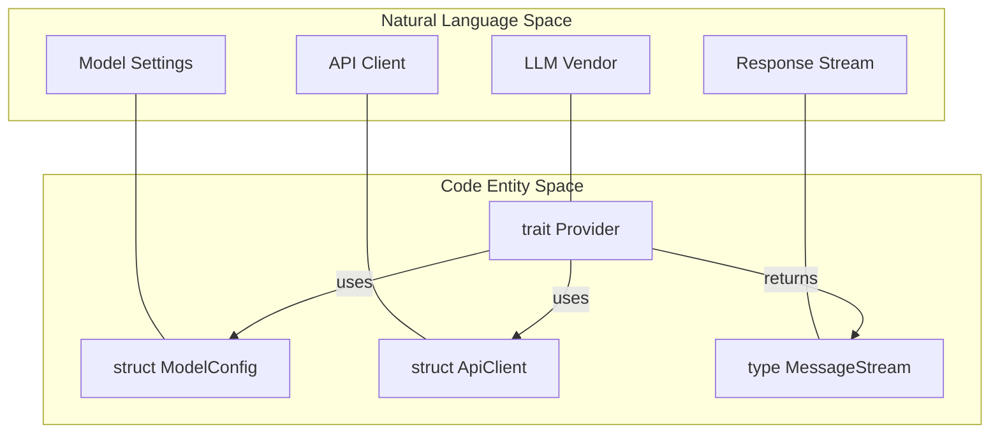
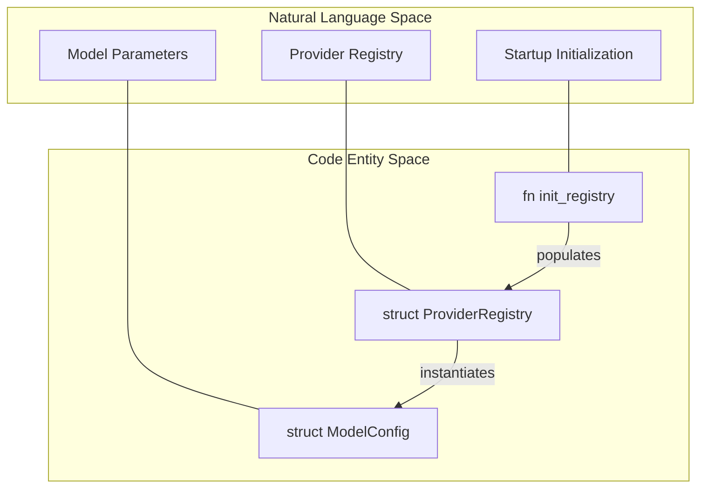
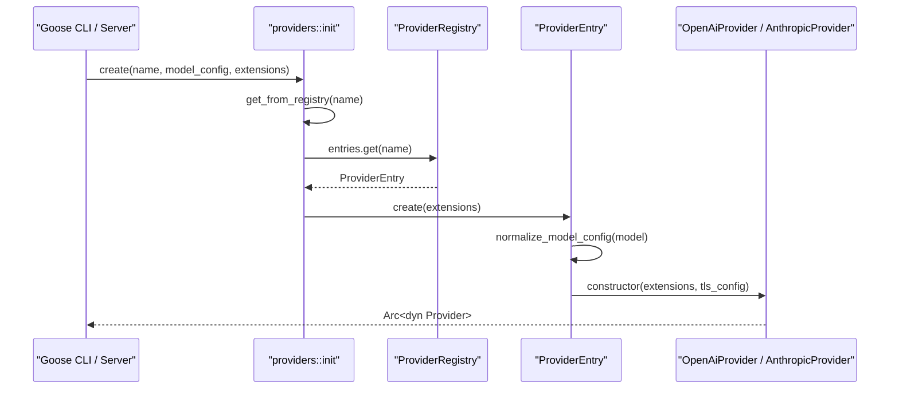

# Provider Layer

Relevant source files

The following files were used as context for generating this wiki page:

- [crates/goose-provider-types/src/formats.rs](crates/goose-provider-types/src/formats.rs)
- [crates/goose-provider-types/src/utils.rs](crates/goose-provider-types/src/utils.rs)
- [crates/goose-providers/src/declarative.rs](crates/goose-providers/src/declarative.rs)
- [crates/goose-providers/src/lib.rs](crates/goose-providers/src/lib.rs)
- [crates/goose-providers/src/ollama.rs](crates/goose-providers/src/ollama.rs)
- [crates/goose-providers/src/snowflake.rs](crates/goose-providers/src/snowflake.rs)
- [crates/goose/src/acp/fs.rs](crates/goose/src/acp/fs.rs)
- [crates/goose/src/acp/server/providers.rs](crates/goose/src/acp/server/providers.rs)
- [crates/goose/src/acp/server/tool_calls/chain.rs](crates/goose/src/acp/server/tool_calls/chain.rs)
- [crates/goose/src/acp/server/tool_calls/conversion.rs](crates/goose/src/acp/server/tool_calls/conversion.rs)
- [crates/goose/src/acp/server/tool_calls/enrichment.rs](crates/goose/src/acp/server/tool_calls/enrichment.rs)
- [crates/goose/src/acp/server/tool_notifications.rs](crates/goose/src/acp/server/tool_notifications.rs)
- [crates/goose/src/config/declarative_providers.rs](crates/goose/src/config/declarative_providers.rs)
- [crates/goose/src/model_config.rs](crates/goose/src/model_config.rs)
- [crates/goose/src/providers/anthropic_def.rs](crates/goose/src/providers/anthropic_def.rs)
- [crates/goose/src/providers/formats/mod.rs](crates/goose/src/providers/formats/mod.rs)
- [crates/goose/src/providers/google_def.rs](crates/goose/src/providers/google_def.rs)
- [crates/goose/src/providers/huggingface.rs](crates/goose/src/providers/huggingface.rs)
- [crates/goose/src/providers/init.rs](crates/goose/src/providers/init.rs)
- [crates/goose/src/providers/inventory/mod.rs](crates/goose/src/providers/inventory/mod.rs)
- [crates/goose/src/providers/mod.rs](crates/goose/src/providers/mod.rs)
- [crates/goose/src/providers/ollama_cloud.rs](crates/goose/src/providers/ollama_cloud.rs)
- [crates/goose/src/providers/ollama_def.rs](crates/goose/src/providers/ollama_def.rs)
- [crates/goose/src/providers/openai_def.rs](crates/goose/src/providers/openai_def.rs)
- [crates/goose/src/providers/provider_registry.rs](crates/goose/src/providers/provider_registry.rs)
- [crates/goose/src/providers/snowflake_def.rs](crates/goose/src/providers/snowflake_def.rs)
- [crates/goose/src/tool_call_labels.rs](crates/goose/src/tool_call_labels.rs)
- [crates/goose/tests/custom_provider_command_auth_test.rs](crates/goose/tests/custom_provider_command_auth_test.rs)
- [documentation/docs/getting-started/providers.md](documentation/docs/getting-started/providers.md)
- [ui/desktop/src/acp/__tests__/chatNotifications.test.ts](ui/desktop/src/acp/__tests__/chatNotifications.test.ts)
- [ui/desktop/src/acp/adapter/toolNotifications.ts](ui/desktop/src/acp/adapter/toolNotifications.ts)
- [ui/desktop/src/acp/chatNotifications.ts](ui/desktop/src/acp/chatNotifications.ts)

The Provider Layer is a core abstraction in Goose that decouples the agentic loop from specific Large Language Model (LLM) vendors. It provides a unified interface for sending messages, handling tool calls, and managing model-specific configurations like context limits and pricing.

## Overview

At the heart of the provider layer is the `Provider` trait, which defines how Goose interacts with an LLM [crates/goose-provider-types/src/base.rs:2-10](). Whether the model is hosted by a cloud provider (like OpenAI or Anthropic), running locally (via Ollama), or even executing as a subprocess or via ACP (Agent Client Protocol), it must implement this trait.

### Relationship to Code Entities

The following diagrams illustrate how natural language concepts map to specific Rust entities within the provider subsystem, bridging the conceptual space to the codebase architecture.

**Provider Entity Mapping**

Sources: [crates/goose-provider-types/src/base.rs:2-10](), [crates/goose-providers/src/api_client.rs:1-10](), [crates/goose-provider-types/src/model.rs:7-15](), [crates/goose-provider-types/src/base.rs:2-10]()

**Registry and Configuration Entity Mapping**

Sources: [crates/goose/src/providers/provider_registry.rs:117-121](), [crates/goose/src/providers/init.rs:55-58](), [crates/goose-provider-types/src/model.rs:7-15]()

---

## Core Abstractions

### The Provider Trait
The `Provider` trait is the primary interface for LLM interaction [crates/goose-provider-types/src/base.rs:2-10](). It handles the conversion of internal `Message` types into provider-specific requests and processes the resulting stream of responses. Key methods include `complete()` for non-streaming calls and `stream()` for real-time updates.

Sources: [crates/goose-provider-types/src/base.rs:2-10](), [crates/goose-providers/src/ollama.rs:1-15]()

### ModelConfig
`ModelConfig` encapsulates the parameters for a specific model invocation. This includes the model name, temperature, max tokens, and context limits [goose-provider-types/src/model.rs:7-15](). The provider system uses helper utilities to normalize and materialize model configurations from user settings [crates/goose/src/providers/provider_registry.rs:76-89]().

Sources: [goose-provider-types/src/model.rs:7-15](), [crates/goose/src/providers/provider_registry.rs:76-89]()

### ProviderRegistry
The `ProviderRegistry` serves as a factory for creating provider instances [crates/goose/src/providers/provider_registry.rs:117-121](). It maintains a collection of registered entries (`ProviderEntry`) containing metadata and constructors. The registry is initialized asynchronously via a `OnceCell` in `init.rs`, registering built-in, declarative, and custom providers [crates/goose/src/providers/init.rs:55-181]().

Sources: [crates/goose/src/providers/provider_registry.rs:117-121](), [crates/goose/src/providers/init.rs:55-181]()

---

## Initialization Flow

Providers are instantiated during session startup or when switching models. The system resolves credentials from environment variables or configuration files to construct the appropriate provider backend.

**Provider Initialization Sequence**

Sources: [crates/goose/src/providers/init.rs:102-104](), [crates/goose/src/providers/provider_registry.rs:91-96](), [crates/goose/src/providers/provider_registry.rs:154-165]()

---

## Subsystems and Details

The Provider Layer is composed of several specialized subsystems covered in the following child pages:

### [Provider Implementations](#2.2.1)
Covers concrete provider integrations such as **OpenAI**, **Anthropic**, **Google**, **Databricks**, **Azure**, **Bedrock**, **Snowflake**, and local runners like **Ollama**, along with declarative custom providers and retry/auth patterns [documentation/docs/getting-started/providers.md:23-39]().
*   **Key Files:** [crates/goose/src/providers/init.rs:64-181](), [crates/goose-providers/src/snowflake.rs:1-41]()

### [Message Formats & Wire Translation](#2.2.2)
Details how internal messages and content blocks are translated into vendor-specific JSON payloads, tool schemas, and streaming formats [crates/goose/src/providers/formats/mod.rs:1-37]().
*   **Key Files:** [crates/goose/src/providers/formats/mod.rs:1-37](), [crates/goose/src/providers/toolshim.rs:1-20]()

### [ACP & CLI Providers](#2.2.3)
Explains the Agent Client Protocol (ACP) providers and subprocess CLI wrappers like `ClaudeCodeProvider` [crates/goose/src/providers/init.rs:10-35]().
*   **Key Files:** [crates/goose/src/providers/init.rs:10-35](), [crates/goose/src/providers/claude_code.rs:1-20]()

### [Canonical Model Registry](#2.2.4)
Covers the `CanonicalModel` system for fetching and normalizing model metadata, context limits, and pricing [crates/goose/src/providers/canonical/mod.rs:1-20]() (re-exported from `goose-providers`).
*   **Key Files:** [crates/goose/src/providers/canonical/mod.rs:1-20](), [crates/goose-provider-types/src/canonical.rs:1-20]()

---

## Configuration and Secrets

Providers rely on the global configuration system to retrieve API keys, endpoints, and authentication tokens. Secrets are securely managed and referenced through environment variables or configuration maps [crates/goose/src/config/declarative_providers.rs:28-57]().

Sources: [crates/goose/src/config/declarative_providers.rs:28-57](), [crates/goose/src/providers/provider_secrets.rs:1-20]()