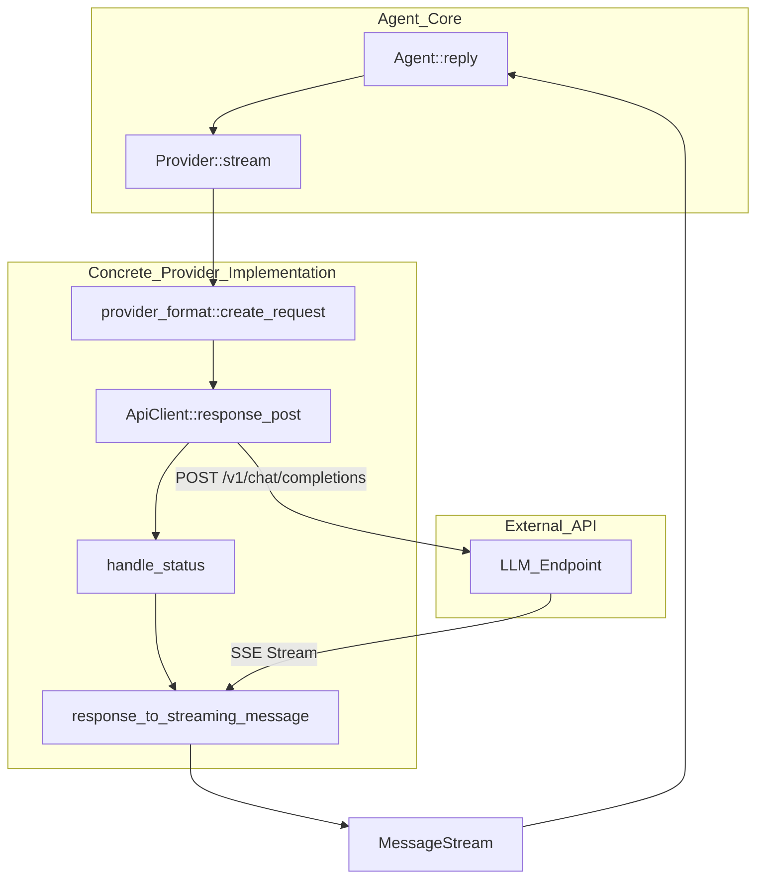
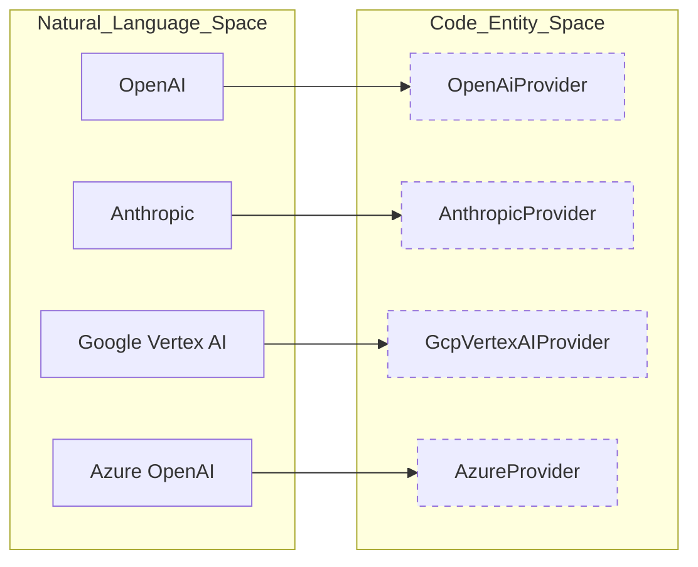
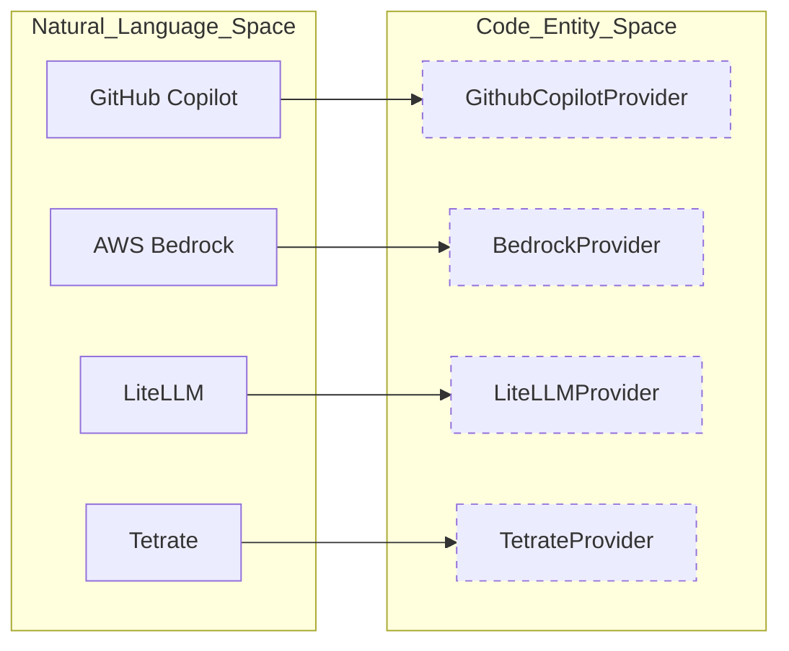

# Provider Implementations

<details>
<summary>Relevant source files</summary>

The following files were used as context for generating this wiki page:

- [crates/goose-providers/src/decision.rs](crates/goose-providers/src/decision.rs)
- [crates/goose-providers/src/openrouter.rs](crates/goose-providers/src/openrouter.rs)
- [crates/goose-providers/src/openrouter_format.rs](crates/goose-providers/src/openrouter_format.rs)
- [crates/goose-providers/src/typesafe.rs](crates/goose-providers/src/typesafe.rs)
- [crates/goose/examples/tetrate_auth.rs](crates/goose/examples/tetrate_auth.rs)
- [crates/goose/src/config/signup_openrouter/mod.rs](crates/goose/src/config/signup_openrouter/mod.rs)
- [crates/goose/src/config/signup_openrouter/server.rs](crates/goose/src/config/signup_openrouter/server.rs)
- [crates/goose/src/config/signup_openrouter/templates/error.html](crates/goose/src/config/signup_openrouter/templates/error.html)
- [crates/goose/src/config/signup_openrouter/templates/invalid.html](crates/goose/src/config/signup_openrouter/templates/invalid.html)
- [crates/goose/src/config/signup_openrouter/templates/success.html](crates/goose/src/config/signup_openrouter/templates/success.html)
- [crates/goose/src/config/signup_openrouter/tests.rs](crates/goose/src/config/signup_openrouter/tests.rs)
- [crates/goose/src/config/signup_tetrate/mod.rs](crates/goose/src/config/signup_tetrate/mod.rs)
- [crates/goose/src/config/signup_tetrate/server.rs](crates/goose/src/config/signup_tetrate/server.rs)
- [crates/goose/src/config/signup_tetrate/templates/error.html](crates/goose/src/config/signup_tetrate/templates/error.html)
- [crates/goose/src/config/signup_tetrate/templates/invalid.html](crates/goose/src/config/signup_tetrate/templates/invalid.html)
- [crates/goose/src/config/signup_tetrate/templates/success.html](crates/goose/src/config/signup_tetrate/templates/success.html)
- [crates/goose/src/config/signup_tetrate/tests.rs](crates/goose/src/config/signup_tetrate/tests.rs)
- [crates/goose/src/oauth/mod.rs](crates/goose/src/oauth/mod.rs)
- [crates/goose/src/providers/azure.rs](crates/goose/src/providers/azure.rs)
- [crates/goose/src/providers/bedrock.rs](crates/goose/src/providers/bedrock.rs)
- [crates/goose/src/providers/formats/bedrock.rs](crates/goose/src/providers/formats/bedrock.rs)
- [crates/goose/src/providers/formats/gcpvertexai.rs](crates/goose/src/providers/formats/gcpvertexai.rs)
- [crates/goose/src/providers/gcpvertexai.rs](crates/goose/src/providers/gcpvertexai.rs)
- [crates/goose/src/providers/githubcopilot.rs](crates/goose/src/providers/githubcopilot.rs)
- [crates/goose/src/providers/litellm.rs](crates/goose/src/providers/litellm.rs)
- [crates/goose/src/providers/oauth.rs](crates/goose/src/providers/oauth.rs)
- [crates/goose/src/providers/openrouter_def.rs](crates/goose/src/providers/openrouter_def.rs)
- [crates/goose/src/providers/sagemaker_tgi.rs](crates/goose/src/providers/sagemaker_tgi.rs)
- [crates/goose/src/providers/tetrate.rs](crates/goose/src/providers/tetrate.rs)
- [crates/goose/src/providers/xai.rs](crates/goose/src/providers/xai.rs)

</details>


The Provider layer in Goose serves as the core abstraction between the internal agent execution logic and various Large Language Model (LLM) backends. Each concrete provider implementation handles authentication, request formatting, streaming response decoding, model configuration normalization, and error handling specific to its underlying API or service.

## Provider Architecture & Registry

Goose implements a trait-based provider system where concrete backends implement the `Provider` and `ProviderDef` traits [crates/goose/src/providers/base.rs:31-51](). The `ProviderDef` trait defines metadata, configuration keys, and factory constructors (`from_env`), while the `Provider` trait handles turn execution, chat completions, and streaming token generation. The `ProviderRegistry` manages registration and dynamic instantiation [crates/goose/src/providers/provider_registry.rs:96-108]().

**Provider Execution Data Flow**

Sources: [crates/goose-providers/src/openrouter.rs:83-99](), [crates/goose/src/providers/gcpvertexai.rs:65-125]()

---

## Concrete Provider Implementations

### OpenAI & OpenAI-Compatible
The `OpenAiProvider` supports official OpenAI API endpoints as well as generic OpenAI-compatible APIs [crates/goose-providers/src/openai.rs:157-172](). It uses standard request formatting [crates/goose-providers/src/openai.rs:10-13]() and handles base URL resolution [crates/goose-providers/src/openai.rs:129-154]().
*   **Auth**: Uses `BearerToken` authentication via `OPENAI_API_KEY`.
*   **Base URL Parsing**: Automatically normalizes base URLs and strips or preserves `/v1` suffix variants [crates/goose-providers/src/openai.rs:129-154]().

### Anthropic
The `AnthropicProvider` connects directly to Anthropic's Claude models, handling specialized parameters such as thinking blocks and prompt caching headers [crates/goose-providers/src/anthropic.rs:1-60]().
*   **Auth**: Uses the `x-api-key` header configuration.
*   **Beta Features**: Dynamically attaches required beta headers for extended output windows and prompt caching.

### Google Gemini & GCP Vertex AI
Google models are supported via direct API keys (`GoogleProvider`) and enterprise GCP infrastructure (`GcpVertexAIProvider`).
*   **GoogleProvider**: Uses `x-goog-api-key` headers against `v1beta` endpoints.
*   **GcpVertexAIProvider**: Leverages `GcpAuth` for Google Cloud authentication and constructs region- and publisher-specific endpoints (`publishers/google` or `publishers/anthropic`) [crates/goose/src/providers/gcpvertexai.rs:65-125](). It also handles model-specific routing to different GCP locations (e.g., `us-east5` for Claude, `global` for Gemini 3.x) [crates/goose/src/providers/formats/gcpvertexai.rs:107-121]().

### Azure OpenAI
The `AzureProvider` wraps the `OpenAiCompatibleProvider` with Azure-specific authentication mechanisms [crates/goose/src/providers/azure.rs:23-24]().
*   **Auth**: Implements `AzureAuthProvider` supporting both static `api-key` headers and Entra ID bearer tokens via Azure's credential chain [crates/goose/src/providers/azure.rs:31-50]().
*   **API Versioning**: Detects new-style `/v1` endpoints to omit or include the required `api-version` query parameter [crates/goose/src/providers/azure.rs:18-21]().

### Databricks
The `DatabricksProvider` supports workspace integration using Personal Access Tokens (PAT) or OAuth2 user-to-machine flows, securely persisting credentials through the session secret store. The OAuth flow involves dynamic endpoint discovery and local callback server handling [crates/goose/src/providers/oauth.rs:151-186]().

### Ollama
The `OllamaProvider` is designed for local inference backends [crates/goose-providers/src/ollama.rs:1-50]().
*   **Retry & Loading**: Incorporates specialized retry strategies to accommodate model load times into local memory.
*   **Parameter Mapping**: Maps token limits and context constraints to Ollama-specific options like `num_ctx` and `num_predict`.

### GitHub Copilot
The `GithubCopilotProvider` implements OAuth device flow authentication against GitHub's internal endpoints [crates/goose/src/providers/githubcopilot.rs:48-50]().
*   **Device Flow**: Exchanges authorization codes for access tokens [crates/goose/src/providers/githubcopilot.rs:3]().
*   **Disk Cache**: Persists token state (`CopilotState`) inside the local configuration directory (`DiskCache`) [crates/goose/src/providers/githubcopilot.rs:173-186](). It also handles different GitHub hosts (e.g., `github.com` vs. enterprise instances) for URL construction [crates/goose/src/providers/githubcopilot.rs:128-145]().

### AWS Bedrock
The `BedrockProvider` interfaces with Amazon Bedrock models through AWS SDK bindings [crates/goose/src/providers/bedrock.rs:38]().
*   **Endpoints**: Supports both standard `Converse` and Mantle `Responses` endpoints [crates/goose/src/providers/bedrock.rs:44-47]().
*   **Thinking & Caching**: Formats message structures with caching and reasoning tokens via `to_bedrock_message_with_caching` and `bedrock_anthropic_thinking_fields` [crates/goose/src/providers/formats/bedrock.rs:32-35](). It also handles model-specific inference configurations like `max_tokens` and `temperature` [crates/goose/src/providers/formats/bedrock.rs:128-142]().

### Other Concrete Providers
*   **SageMaker**: Integrates with Amazon SageMaker endpoints running Text Generation Inference (TGI) or custom model containers.
*   **OpenRouter**: Aggregates numerous LLM backends behind a single API gateway, injecting custom parameters and rewriting schemas to prevent reference incompatibilities [crates/goose-providers/src/openrouter.rs:53-146](). It dynamically fetches supported models and their capabilities [crates/goose-providers/src/openrouter.rs:130-181]().
*   **LiteLLM**: Fetches model catalog information dynamically from `/model/info` and supports custom header propagation [crates/goose/src/providers/litellm.rs:65-150](). It caches model information to reduce API calls [crates/goose/src/providers/litellm.rs:112-142]().
*   **xAI**: Connects to Grok model endpoints using OpenAI-compatible wire translation [crates/goose/src/providers/xai.rs:40-62](). It leverages canonical model metadata for model capabilities [crates/goose/src/providers/xai.rs:15-17]().
*   **Snowflake**: Interfaces with Snowflake Cortex hosted LLMs.
*   **Tetrate**: Enterprise AI routing provider that catches credit exhaustion status and enriches errors with top-up URLs [crates/goose/src/providers/tetrate.rs:71-79](). It also handles specific error payload formats from the Tetrate API [crates/goose/src/providers/tetrate.rs:81-90]().
*   **KimiCode**: Implements custom authentication and token caching routines tailored for Kimi models.
*   **HuggingFace**: Direct inference integration for HuggingFace model endpoints and local discoverability.

Sources: [crates/goose/src/providers/bedrock.rs:38-47](), [crates/goose/src/providers/formats/bedrock.rs:32-35](), [crates/goose/src/providers/formats/bedrock.rs:128-142](), [crates/goose/src/providers/githubcopilot.rs:48-186](), [crates/goose/src/providers/azure.rs:18-50](), [crates/goose/src/providers/litellm.rs:65-150](), [crates/goose/src/providers/litellm.rs:112-142](), [crates/goose/src/providers/oauth.rs:151-186](), [crates/goose/src/providers/formats/gcpvertexai.rs:107-121](), [crates/goose-providers/src/openrouter.rs:130-181](), [crates/goose/src/providers/tetrate.rs:71-79](), [crates/goose/src/providers/tetrate.rs:81-90](), [crates/goose/src/providers/xai.rs:15-17](), [crates/goose/src/providers/xai.rs:40-62]()

---

## Declarative & Custom Providers

Goose enables users to define custom or third-party providers declaratively via JSON or YAML configuration files stored in the configuration directory [crates/goose/src/config/declarative_providers.rs:21-23]().

| Field | Description |
| :--- | :--- |
| `engine` | Underlying execution engine: `OpenAI`, `Ollama`, or `Anthropic` [crates/goose-providers/src/declarative.rs:96-103]() |
| `base_url` | Root endpoint URL for API requests [crates/goose-providers/src/declarative.rs:155]() |
| `api_key_env` | Environment variable name storing the provider's API key [crates/goose-providers/src/declarative.rs:154]() |
| `auth` | Optional command execution block for dynamic credential retrieval/refresh [crates/goose-providers/src/declarative.rs:119-141]() |
| `env_vars` | Parameter definitions for template placeholder expansion (`expand_env_vars`) [crates/goose/src/config/declarative_providers.rs:28-57]()

Sources: [crates/goose/src/config/declarative_providers.rs:21-57](), [crates/goose-providers/src/declarative.rs:96-141]()

---

## Authentication Patterns & Retry Mechanics

### Auth Strategies
Providers implement various authentication structures via the `AuthMethod` enum and `AuthProvider` trait:
1.  **BearerToken**: Standard `Authorization: Bearer <token>` [crates/goose-providers/src/api_client.rs]()
2.  **ApiKey**: Custom header injection (e.g., `api-key` for Azure) [crates/goose/src/providers/azure.rs:40-42]()
3.  **Custom Auth Provider**: Programmatic trait implementation for complex credential flows like Azure Entra ID or device authorization [crates/goose/src/providers/azure.rs:31-50]()
4.  **Command Auth**: Executable command pipelines defined in declarative configuration to fetch and cache dynamic tokens [crates/goose-providers/src/declarative.rs:119-141]()
5.  **OAuth Device Flow**: Interactive browser-based authentication for providers like GitHub Copilot [crates/goose/src/providers/githubcopilot.rs:3]()
6.  **OAuth User-to-Machine**: Local server-based OAuth flow for providers like Databricks [crates/goose/src/oauth/mod.rs:1-23]()

### Retry Logic
Transient failures such as rate limits (`429`) or server overload (`529`) are handled by `ProviderRetry` wrappers combined with `RetryConfig` exponential backoff parameters [crates/goose/src/providers/gcpvertexai.rs:40-50]().

**Retry Configuration Parameters**
```rust
const DEFAULT_INITIAL_RETRY_INTERVAL_MS: u64 = 5000;
const DEFAULT_MAX_RETRIES: usize = 6;
const DEFAULT_BACKOFF_MULTIPLIER: f64 = 2.0;
const DEFAULT_MAX_RETRY_INTERVAL_MS: u64 = 320_000;
```
Sources: [crates/goose/src/providers/gcpvertexai.rs:40-47]()

---

## Entity Mapping: Natural Language to Code

The following diagrams map user-facing provider identifiers to their corresponding Rust struct definitions and module implementations.

**Provider System Mapping (Part 1)**

Sources: [crates/goose/src/providers/provider_registry.rs:110-159](), [crates/goose/src/providers/gcpvertexai.rs:145-165](), [crates/goose/src/providers/azure.rs:23-24]()

**Provider System Mapping (Part 2)**

Sources: [crates/goose/src/providers/githubcopilot.rs:48-50](), [crates/goose/src/providers/bedrock.rs:38](), [crates/goose/src/providers/litellm.rs:42-51](), [crates/goose/src/providers/tetrate.rs:40]()