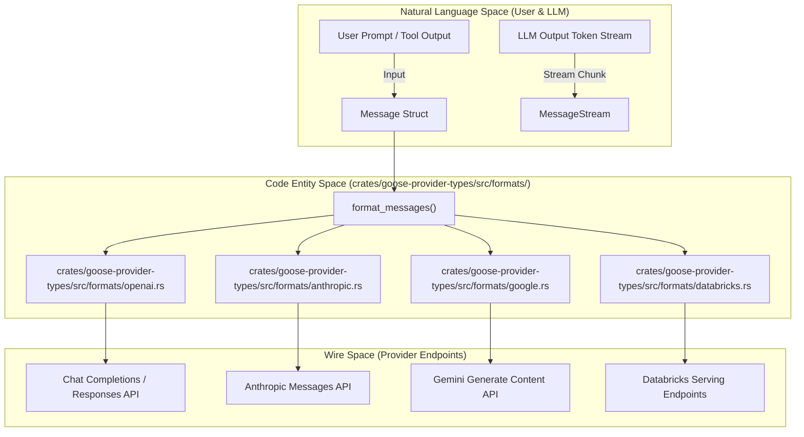
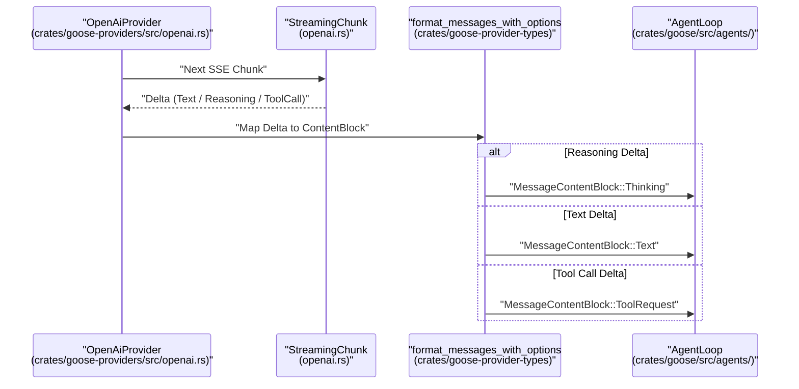

# Message Formats & Wire Translation

Relevant source files

The following files were used as context for generating this wiki page:

- [crates/goose-provider-types/src/conversation.rs](crates/goose-provider-types/src/conversation.rs)
- [crates/goose-provider-types/src/conversation/message.rs](crates/goose-provider-types/src/conversation/message.rs)
- [crates/goose-provider-types/src/conversation/token_usage.rs](crates/goose-provider-types/src/conversation/token_usage.rs)
- [crates/goose-provider-types/src/errors.rs](crates/goose-provider-types/src/errors.rs)
- [crates/goose-provider-types/src/formats/anthropic.rs](crates/goose-provider-types/src/formats/anthropic.rs)
- [crates/goose-provider-types/src/formats/databricks.rs](crates/goose-provider-types/src/formats/databricks.rs)
- [crates/goose-provider-types/src/formats/google.rs](crates/goose-provider-types/src/formats/google.rs)
- [crates/goose-provider-types/src/formats/openai.rs](crates/goose-provider-types/src/formats/openai.rs)
- [crates/goose-provider-types/src/formats/openai_responses.rs](crates/goose-provider-types/src/formats/openai_responses.rs)
- [crates/goose-provider-types/src/lib.rs](crates/goose-provider-types/src/lib.rs)
- [crates/goose-provider-types/src/mcp_utils.rs](crates/goose-provider-types/src/mcp_utils.rs)
- [crates/goose-provider-types/src/model.rs](crates/goose-provider-types/src/model.rs)
- [crates/goose-providers/src/anthropic.rs](crates/goose-providers/src/anthropic.rs)
- [crates/goose-providers/src/api_client.rs](crates/goose-providers/src/api_client.rs)
- [crates/goose-providers/src/databricks.rs](crates/goose-providers/src/databricks.rs)
- [crates/goose-providers/src/databricks_v2.rs](crates/goose-providers/src/databricks_v2.rs)
- [crates/goose-providers/src/google.rs](crates/goose-providers/src/google.rs)
- [crates/goose-providers/src/http_status.rs](crates/goose-providers/src/http_status.rs)
- [crates/goose-providers/src/openai.rs](crates/goose-providers/src/openai.rs)
- [crates/goose-providers/src/openai_compatible.rs](crates/goose-providers/src/openai_compatible.rs)
- [crates/goose-sdk/src/bindings.rs](crates/goose-sdk/src/bindings.rs)
- [crates/goose-sdk/src/observability.rs](crates/goose-sdk/src/observability.rs)
- [crates/goose/src/agents/gen_ai_telemetry.rs](crates/goose/src/agents/gen_ai_telemetry.rs)
- [crates/goose/src/providers/toolshim.rs](crates/goose/src/providers/toolshim.rs)
- [documentation/automation/gdk-api/generate.py](documentation/automation/gdk-api/generate.py)
- [ui/desktop/tests/integration/test_providers.test.ts](ui/desktop/tests/integration/test_providers.test.ts)
- [ui/desktop/tests/integration/test_providers_code_exec.test.ts](ui/desktop/tests/integration/test_providers_code_exec.test.ts)
- [ui/desktop/tests/integration/test_providers_lib.ts](ui/desktop/tests/integration/test_providers_lib.ts)
- [ui/desktop/vitest.integration.config.ts](ui/desktop/vitest.integration.config.ts)

This page documents how Goose translates its internal canonical message representation (`Message` and `MessageContentBlock`) into target provider wire formats (OpenAI, OpenAI Responses, Anthropic, Google, Databricks, and Snowflake). It covers serialization routines, streaming chunk parsing, multi-modal payload conversion, thinking block lifecycle management, and the `ToolShim` fallback mechanism for models lacking native tool calling.

---

## 1. Internal Message Architecture & Sanitization

Goose defines its core conversation structure using `Message` and `MessageContentBlock` within `crates/goose-provider-types/src/conversation/message.rs` [crates/goose-provider-types/src/conversation/message.rs:1-170](). 

When messages are deserialized from storage or received from client boundaries, `deserialize_sanitized_content` automatically normalizes legacy structures (such as migrating old `reasoning` blocks into modern `thinking` blocks) and strips invisible Unicode tags via `sanitize_unicode_tags` [crates/goose-provider-types/src/conversation/message.rs:21-79](). Provider metadata (such as tool call titles, external dispatch markers, and provider indices) is stored in `ProviderMetadata` maps associated with requests [crates/goose-provider-types/src/conversation/message.rs:81-168]().

**Conversation Translation Architecture**

Sources: `[crates/goose-provider-types/src/conversation/message.rs:21-79]`, `[crates/goose-provider-types/src/formats/openai.rs:197-212]`, `[crates/goose-provider-types/src/formats/anthropic.rs:177-187]`, `[crates/goose-provider-types/src/formats/google.rs:76-110]`, `[crates/goose-provider-types/src/formats/databricks.rs:122-140]()`

---

## 2. Provider Wire Formats & Translation Modules

Each provider integration relies on a dedicated format module inside `crates/goose-provider-types/src/formats/` to handle JSON schema construction and type mapping.

### OpenAI & OpenAI-Compatible
The OpenAI format (`crates/goose-provider-types/src/formats/openai.rs`) provides payload structuring for OpenAI and compatible backends (Ollama, vLLM, OpenRouter). 
- **Tool Calls:** Serialized into the `tool_calls` array [crates/goose-provider-types/src/formats/openai.rs:205-217](). Truncation checks inspect argument completeness and emit `output_token_limit_tool_error` if output limits truncate JSON arguments [crates/goose-provider-types/src/formats/openai.rs:57-65]().
- **Reasoning Deltas:** Decoded via the `Delta` struct, prioritizing `reasoning_content` (DeepSeek/OpenRouter) over `reasoning` (vLLM) [crates/goose-provider-types/src/formats/openai.rs:134-148]().
- **OpenAI Responses API:** Implemented in `crates/goose-provider-types/src/formats/openai_responses.rs`, translating `ResponsesApiResponse` and `ResponseOutputItem` variants into canonical message formats [crates/goose-provider-types/src/formats/openai_responses.rs:25-91]().

### Anthropic (Claude)
The Anthropic format (`crates/goose-provider-types/src/formats/anthropic.rs`) targets the Anthropic Messages API.
- **Thinking Blocks:** Governed by `ThinkingType` (Adaptive, Enabled, Disabled) and configuration flags in `AnthropicFormatOptions` [crates/goose-provider-types/src/formats/anthropic.rs:52-71]().
- **Prompt Caching:** Ephemeral prompt caching is injected via the `cache_control` helper emitting `{"type": "ephemeral"}` blocks [crates/goose-provider-types/src/formats/anthropic.rs:129-136]().
- **Stale Thinking Detection:** `thinking_block_is_stale` prevents context corruption when a user switches models mid-session by validating requested versus resolved model metadata [crates/goose-provider-types/src/formats/anthropic.rs:146-159]().

### Google Gemini
The Google format (`crates/goose-provider-types/src/formats/google.rs`) maps conversations to the `contents` and `parts` structure.
- **Thought Signatures:** Loop continuity across turns is maintained by injecting `thoughtSignature` metadata (`metadata_with_signature`) into model response parts [crates/goose-provider-types/src/formats/google.rs:23-38]().
- **Safety & Visibility Filtering:** Automatically strips internal control blocks such as `ToolConfirmationRequest` and `ActionRequired` before transmitting payloads to Gemini [crates/goose-provider-types/src/formats/google.rs:83-92]().

### Databricks & Snowflake
Databricks and Snowflake integrations adapt Anthropic and OpenAI wire shapes for managed endpoints. Databricks (`crates/goose-provider-types/src/formats/databricks.rs`) formats reasoning blocks with a structured `summary` array and enforces consecutive `tool`-role ordering for hosted Claude endpoints [crates/goose-provider-types/src/formats/databricks.rs:65-124]().

Sources: `[crates/goose-provider-types/src/formats/openai.rs:57-148]`, `[crates/goose-provider-types/src/formats/openai_responses.rs:25-91]`, `[crates/goose-provider-types/src/formats/anthropic.rs:52-159]`, `[crates/goose-provider-types/src/formats/google.rs:23-92]`, `[crates/goose-provider-types/src/formats/databricks.rs:65-124]()`

---

## 3. Streaming and Thinking Block Propagation

Goose parses incoming server-sent event (SSE) streams into a uniform `MessageStream`. 

**Streaming Data Translation Sequence**

Sources: `[crates/goose-providers/src/openai.rs:1-35]`, `[crates/goose-provider-types/src/formats/openai.rs:128-174]`, `[crates/goose-provider-types/src/formats/openai_responses.rs:177-213]()`

Thinking and reasoning blocks are treated as first-class citizens across providers, normalized into `MessageContentBlock::Thinking` regardless of whether the wire format uses `reasoning_content` (OpenAI), `thinking` blocks (Anthropic), or `thoughtSignature` (Google) [crates/goose-provider-types/src/formats/openai.rs:141-148](), [crates/goose-provider-types/src/formats/anthropic.rs:52-71](), [crates/goose-provider-types/src/formats/google.rs:23-38]().

Sources: `[crates/goose-providers/src/openai.rs:1-35]`, `[crates/goose-provider-types/src/formats/openai.rs:128-174]`, `[crates/goose-provider-types/src/formats/openai_responses.rs:177-213]`, `[crates/goose-provider-types/src/formats/google.rs:23-38]()`

---

## 4. Tool Schemas and ToolShim

Goose extensions expose tools via the Model Context Protocol (MCP). These tool schemas are translated into provider-specific function definitions during request building.

For models lacking native tool-calling support, the `ToolShim` module (`crates/goose/src/providers/toolshim.rs`) intercepts text outputs, submits them to an interpreter backend (`OllamaInterpreter` or local llama.cpp), and parses structured tool intentions back into canonical `ToolRequest` structures [crates/goose/src/providers/toolshim.rs:1-90]().

- **Tool Name Resolution:** `resolve_tool_name` handles fuzzy matching, stripping prefixes like `functions.` and converting dot notation into double-underscore conventions (`__`) to match registered tools [crates/goose/src/providers/toolshim.rs:118-164]().
- **Sanitization:** `sanitize_function_name` guarantees compliance with strict upstream regex constraints required by OpenAI and Google API endpoints [crates/goose-provider-types/src/formats/openai.rs]().

Sources: `[crates/goose/src/providers/toolshim.rs:1-164]`, `[crates/goose-provider-types/src/formats/openai.rs:1-50]()`

---

## 5. Multi-Modal and Binary Data Normalization

Multi-modal inputs (images and documents) are handled uniformly across different provider formats:
- **OpenAI/Compatible:** Images are encoded as base64 data URLs via `convert_image` and `detect_image_path` [crates/goose-provider-types/src/formats/openai.rs:5-10]().
- **Databricks:** Inline images within tool results are extracted into separate `user`-role messages to comply with upstream parser expectations [crates/goose-provider-types/src/formats/databricks.rs:65-90]().
- **Google Gemini:** Binaries are placed directly into `inlineData` request parts [crates/goose-provider-types/src/formats/google.rs:163-170]().

Sources: `[crates/goose-provider-types/src/formats/openai.rs:5-10]`, `[crates/goose-provider-types/src/formats/databricks.rs:65-90]`, `[crates/goose-provider-types/src/formats/google.rs:163-170]()`