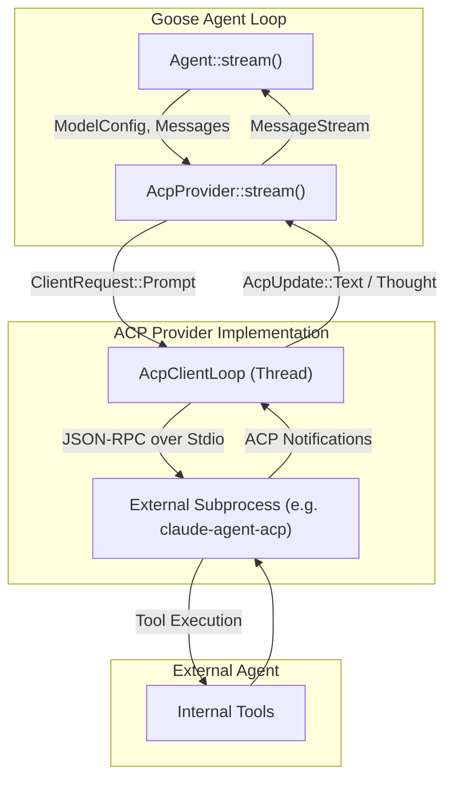

# ACP & CLI Providers

<details>
<summary>Relevant source files</summary>

The following files were used as context for generating this wiki page:

- [crates/goose/src/config/base.rs](crates/goose/src/config/base.rs)
- [crates/goose/src/prompts/session_name.md](crates/goose/src/prompts/session_name.md)
- [crates/goose/src/providers/amp_acp.rs](crates/goose/src/providers/amp_acp.rs)
- [crates/goose/src/providers/base.rs](crates/goose/src/providers/base.rs)
- [crates/goose/src/providers/chatgpt_codex.rs](crates/goose/src/providers/chatgpt_codex.rs)
- [crates/goose/src/providers/claude_acp.rs](crates/goose/src/providers/claude_acp.rs)
- [crates/goose/src/providers/claude_code.rs](crates/goose/src/providers/claude_code.rs)
- [crates/goose/src/providers/cli_common.rs](crates/goose/src/providers/cli_common.rs)
- [crates/goose/src/providers/codex.rs](crates/goose/src/providers/codex.rs)
- [crates/goose/src/providers/codex_acp.rs](crates/goose/src/providers/codex_acp.rs)
- [crates/goose/src/providers/copilot_acp.rs](crates/goose/src/providers/copilot_acp.rs)
- [crates/goose/src/providers/cursor_agent.rs](crates/goose/src/providers/cursor_agent.rs)
- [crates/goose/src/providers/gemini_cli.rs](crates/goose/src/providers/gemini_cli.rs)
- [crates/goose/src/providers/pi_acp.rs](crates/goose/src/providers/pi_acp.rs)
- [crates/goose/src/session/session_naming.rs](crates/goose/src/session/session_naming.rs)
- [crates/goose/tests/providers.rs](crates/goose/tests/providers.rs)

</details>


This page details the implementation of providers that integrate Goose with external agentic systems via the Agent Client Protocol (ACP) and those that wrap external command-line interfaces (CLI) as subprocesses.

---

## Agent Client Protocol (ACP) Providers

The Agent Client Protocol (ACP) is a specialized communication layer designed to allow Goose to act as a client to other agentic systems. ACP implementations delegate reasoning and tool execution to an external agent server that speaks the ACP specification over JSON-RPC (typically via `stdio`).

### ACP Provider Registry

Goose implements several ACP-based providers that bridge the internal `Provider` trait to external agent processes:

| Provider | Implementation File | Purpose |
| :--- | :--- | :--- |
| `claude-acp` | [crates/goose/src/providers/claude_acp.rs:1-20]() | Connects to Anthropic's Claude Code via `claude-agent-acp`. |
| `codex-acp` | [crates/goose/src/providers/codex_acp.rs:1-20]() | Connects to OpenAI Codex via `codex-acp`. |
| `copilot-acp` | [crates/goose/src/providers/copilot_acp.rs:1-10]() | Connects to GitHub Copilot ACP implementations. |
| `pi-acp` | [crates/goose/src/providers/pi_acp.rs:1-25]() | Connects to Inflection Pi via `pi-acp`. |
| `amp-acp` | [crates/goose/src/providers/amp_acp.rs:1-10]() | Connects to AMP (Agent Management Platform) servers. |

Sources: [crates/goose/src/providers/claude_acp.rs:1-20](), [crates/goose/src/providers/codex_acp.rs:1-20](), [crates/goose/src/providers/copilot_acp.rs:1-25](), [crates/goose/src/providers/pi_acp.rs:1-25](), [crates/goose/src/providers/amp_acp.rs:1-10]()

---

## Data Flow & Architecture

The `AcpProvider` struct manages communication with an external ACP agent. It utilizes a background `ClientLoopGuard` which owns an `mpsc::Sender<ClientRequest>` and manages the OS thread running the subprocess event loop.

### ACP Provider Data Flow



The `AcpProvider` manages session state and supports dynamic model switching by issuing `SetConfigOption` requests whenever a `model_config_option_id` is defined. It also handles `PermissionRequest` updates, routing them through the Goose security pipeline.

Sources: [crates/goose/src/acp/provider.rs:61-163](), [crates/goose/src/acp/provider.rs:176-210]()

---

## CLI Subprocess Providers

CLI providers wrap standalone command-line agents and manage them as one-shot or persistent subprocesses. These providers are deprecated in favor of ACP providers but remain supported for backward compatibility.

### Claude Code
The `ClaudeCodeProvider` integrates with Anthropic's CLI utility. It uses a custom `ControlRequest` protocol [crates/goose/src/providers/claude_code.rs:71-76]() to manage session lifecycle (`initialize` and `set_model` subtypes) [crates/goose/src/providers/claude_code.rs:81-86]().
- **Tool Permissions**: Bridged via `IncomingRequestBody::CanUseTool` [crates/goose/src/providers/claude_code.rs:127-136]().
- **Process Management**: Encapsulated within `CliProcess` [crates/goose/src/providers/claude_code.rs:150-161]().

Sources: [crates/goose/src/providers/claude_code.rs:71-161]()

### OpenAI Codex
The `CodexProvider` [crates/goose/src/providers/codex.rs:47-57]() executes the `codex exec` subprocess [crates/goose/src/providers/codex.rs:162]().
- **Reasoning Effort**: Maps `ThinkingEffort` to Codex configuration levels (`none`, `low`, `medium`, `high`, `xhigh`) [crates/goose/src/providers/codex.rs:74-86]().
- **Permission Flags**: Applies mode-specific flags such as `--yolo` for `GooseMode::Auto` [crates/goose/src/providers/codex.rs:103-106]().

Sources: [crates/goose/src/providers/codex.rs:47-106](), [crates/goose/src/providers/codex.rs:162]()

### Cursor Agent & Gemini CLI
- **Cursor Agent**: Wraps the `cursor-agent` binary and inspects authentication status via `cursor-agent status` [crates/goose/src/providers/cursor_agent.rs:63-71]().
- **Gemini CLI**: Executes Gemini models using `--output-format stream-json` [crates/goose/src/providers/gemini_cli.rs:114]().

Sources: [crates/goose/src/providers/cursor_agent.rs:63-71](), [crates/goose/src/providers/gemini_cli.rs:114]()

---

## OAuth-Based Authentication Flows

Certain providers implement custom OAuth and device code flows to authenticate with backend services without requiring manual token entry.

- **ChatGPT Codex**: Implements an OAuth callback server on port `1455` targeting `chatgpt.com/backend-api/codex` [crates/goose/src/providers/chatgpt_codex.rs:37-43]().
- **Gemini OAuth**: Implements an installed-app flow (RFC 8628) to authenticate against Google Cloud Code Assist endpoints.

Sources: [crates/goose/src/providers/chatgpt_codex.rs:37-43]()

---

## Bridging Natural Language to Code Entities

The following class diagram maps high-level ACP concepts to their corresponding Rust code entities in the codebase.

### ACP Protocol to Code Mapping

```mermaid
classDiagram
    class "agent_client_protocol::schema::v1" as ACP {
        <<protocol>>
        InitializeRequest
        NewSessionRequest
        PromptRequest
        RequestPermissionRequest
    }
    class "AcpProvider" as Provider {
        +connect()
        +stream()
    }
    class "AcpClientLoop" as Loop {
        +handle_request()
        +spawn_child_process()
    }
    class "Agent" as Agent {
        +reply()
    }

    ACP --> Provider : "Deserializes JSON-RPC"
    Provider --> Loop : "Dispatches ClientRequest"
    Loop --> Agent : "Translates AcpUpdate to MessageStream"
    Agent --> Provider : "Invokes stream()"
```

Sources: [crates/goose/src/acp/provider.rs:1-15](), [crates/goose/src/acp/provider.rs:78-105](), [crates/goose/src/acp/provider.rs:176-210]()

---

## Testing Infrastructure

ACP and CLI providers are verified via integration tests simulating external server communication:
- **ACP Server Tests**: `crates/goose/tests/acp_server_test.rs` validates server-side dispatch behavior.
- **ACP Fixtures**: `crates/goose/tests/acp_fixtures/mod.rs` supplies mock ACP agents for verifying client provider correctness.

Sources: [crates/goose/tests/providers.rs:1-968]()