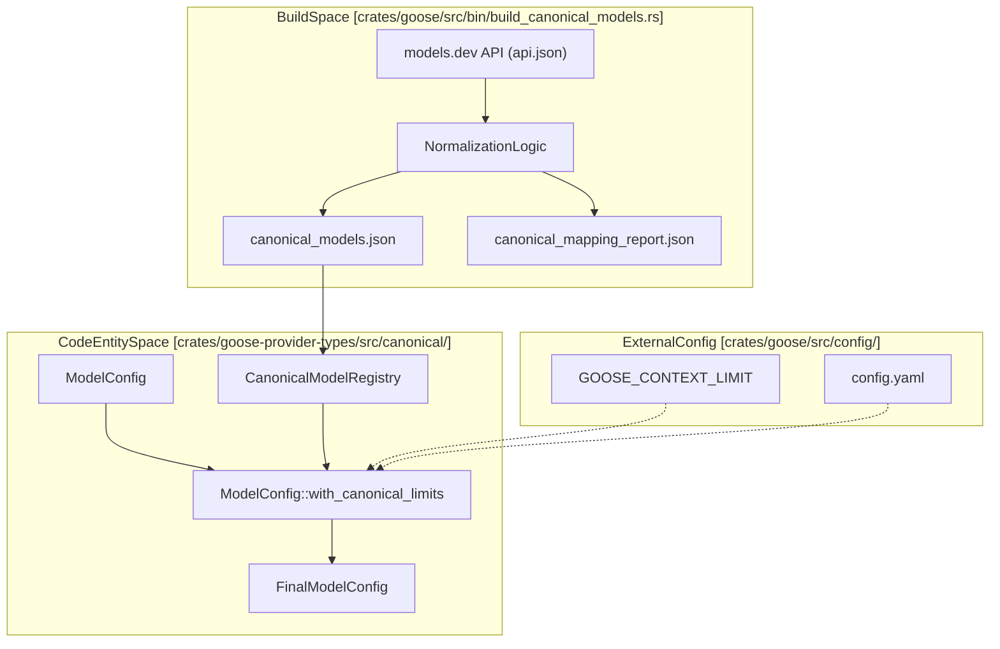
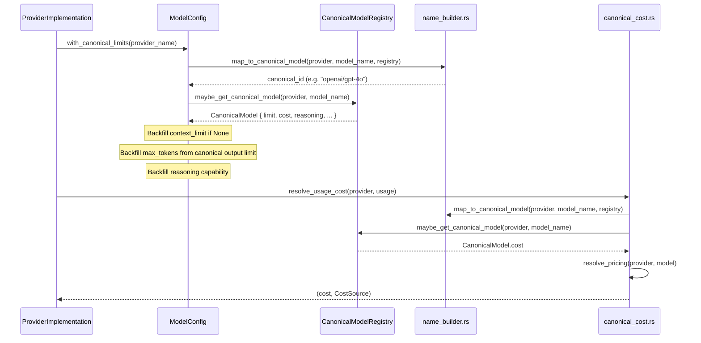

# Canonical Model Registry

Relevant source files

The following files were used as context for generating this wiki page:

- [crates/goose-provider-types/build.rs](crates/goose-provider-types/build.rs)
- [crates/goose-provider-types/src/canonical.rs](crates/goose-provider-types/src/canonical.rs)
- [crates/goose-provider-types/src/canonical/README.md](crates/goose-provider-types/src/canonical/README.md)
- [crates/goose-provider-types/src/canonical/model.rs](crates/goose-provider-types/src/canonical/model.rs)
- [crates/goose-provider-types/src/canonical/models_dev.rs](crates/goose-provider-types/src/canonical/models_dev.rs)
- [crates/goose-provider-types/src/canonical/name_builder.rs](crates/goose-provider-types/src/canonical/name_builder.rs)
- [crates/goose-provider-types/src/canonical/registry.rs](crates/goose-provider-types/src/canonical/registry.rs)
- [crates/goose/src/agents/state_machine/usage.rs](crates/goose/src/agents/state_machine/usage.rs)
- [crates/goose/src/bin/build_canonical_models.rs](crates/goose/src/bin/build_canonical_models.rs)
- [crates/goose/src/model_catalog.rs](crates/goose/src/model_catalog.rs)
- [crates/goose/src/providers/canonical_cost.rs](crates/goose/src/providers/canonical_cost.rs)
- [deny.toml](deny.toml)

The Canonical Model Registry is a subsystem within the Provider Layer responsible for normalizing model metadata across disparate LLM providers. It ensures that Goose has consistent access to critical model information—such as context window limits, output token maximums, pricing, and specific capabilities (e.g., reasoning)—regardless of how the underlying provider identifies or describes the model.

## System Overview

The system operates in two distinct phases:
1.  **Build Time (`build_canonical_models.rs`)**: A data pipeline that fetches live metadata from provider APIs (specifically models.dev), normalizes it, and persists it into a static JSON registry.
2.  **Runtime (`registry.rs`)**: A registry that loads the persisted metadata and provides lookup functions to enrich `ModelConfig` objects during agent initialization.

### Data Flow Diagram

The following diagram illustrates how raw provider data is transformed into the `canonical_models.json` file and subsequently used by the Goose agent.

Title: "Canonical Model Data Pipeline"

Sources: [crates/goose/src/bin/build_canonical_models.rs:1-60](), [crates/goose-provider-types/src/canonical/registry.rs:1-20](), [crates/goose-provider-types/src/canonical.rs:82-104]()

---

## Implementation Details

### The Canonical Model Structure
The core data structure representing a normalized model is `CanonicalModel`. It encapsulates the physical limits and economic costs associated with a specific model version.

| Field | Type | Description |
| :--- | :--- | :--- |
| `id` | `String` | The unique identifier (e.g., `anthropic/claude-3-5-sonnet`) [crates/goose-provider-types/src/canonical/model.rs:145-148]() |
| `name` | `String` | The display name of the model [crates/goose-provider-types/src/canonical/model.rs:149-151]() |
| `limit` | `Limit` | Contains `context` (input window) and `output` (max completion tokens) [crates/goose-provider-types/src/canonical/model.rs:127-134]() |
| `cost` | `Pricing` | Contains `input`, `output`, `cache_read`, and `cache_write` costs per million tokens [crates/goose-provider-types/src/canonical/model.rs:39-58]() |
| `reasoning` | `Option<bool>` | Indicates if the model supports native reasoning/thinking blocks [crates/goose-provider-types/src/canonical/model.rs:160-163]() |
| `modalities` | `Modalities` | Lists supported input/output types (text, image, pdf) [crates/goose-provider-types/src/canonical/model.rs:27-36]() |

Sources: [crates/goose-provider-types/src/canonical/model.rs:1-196]()

### Build Pipeline (`build_canonical_models.rs`)
This tool is executed during development or CI to refresh the registry. It performs the following:
1.  **Fetching**: Calls `MODELS_DEV_API_URL` (`https://models.dev/api.json`) [crates/goose/src/bin/build_canonical_models.rs:30]().
2.  **Normalization**: Processes the fetched data using `process_model` [crates/goose-provider-types/src/canonical/models_dev.rs:84-168]() to create `CanonicalModel` instances.
3.  **Mapping and Checking**: The `MappingReport` [crates/goose/src/bin/build_canonical_models.rs:72-79]() tracks which provider models map to canonical models and reports unmapped ones.
4.  **Serialization**: Writes the results to `canonical_models.json` and `canonical_mapping_report.json` [crates/goose-provider-types/src/canonical/README.md:14-23](). The `build.rs` script then compresses `canonical_models.json` into `canonical_models.json.zst` for bundling [crates/goose-provider-types/build.rs:1-14]().

Sources: [crates/goose/src/bin/build_canonical_models.rs:1-200](), [crates/goose-provider-types/src/canonical/models_dev.rs:1-186](), [crates/goose-provider-types/src/canonical/README.md:1-23](), [crates/goose-provider-types/build.rs:1-14]()

### Name Normalization Logic (`name_builder.rs`)
The registry employs sophisticated string matching to map heterogeneous model strings (e.g., from Bedrock or Azure) to their base model identities.

*   **`strip_version_suffix`**: Removes date stamps like `-20240808` or suffixes like `-latest` using `STRIP_PATTERNS` [crates/goose-provider-types/src/canonical/name_builder.rs:7-16]().
*   **`infer_provider_from_model`**: Guesses the origin (e.g., `anthropic` if name contains `claude`) when using meta-providers like Databricks or Bedrock [crates/goose-provider-types/src/canonical/name_builder.rs:175-182]().
*   **`swap_claude_word_order`**: Normalizes `claude-3-5-sonnet` vs `claude-sonnet-3.5` variations using `CLAUDE_PATTERNS` [crates/goose-provider-types/src/canonical/name_builder.rs:154-172]().
*   **`map_provider_name`**: Converts internal Goose provider names (e.g., `kimi_code`) to catalog-compatible names (e.g., `kimi-code-plan-cn`) [crates/goose-provider-types/src/canonical/name_builder.rs:44-65]().
*   **`map_to_canonical_model`**: The main function that attempts to map a given provider and model name to a canonical model ID, using various heuristics including stripping suffixes, inferring providers, and handling specific naming conventions like Claude's [crates/goose-provider-types/src/canonical/name_builder.rs:68-150]().

Sources: [crates/goose-provider-types/src/canonical/name_builder.rs:1-182]()

---

## Cost Resolution and Precedence

The registry is the foundation for `estimate_model_cost`, but it sits within a larger precedence hierarchy to ensure user-defined rates are honored.

### Pricing Resolution Precedence
1.  **Provider-reported costs**: Real-time usage data from the API (if available) [crates/goose/src/providers/canonical_cost.rs:49-51]().
2.  **User-declared prices**: Defined in custom provider configuration files [crates/goose/src/providers/canonical_cost.rs:78-84]().
3.  **Bundled Canonical Registry**: The primary data source from `canonical_models.json` [crates/goose/src/providers/canonical_cost.rs:61-76]().
4.  **Bundled Declarative Definitions**: Fallback vendored definitions for registry gaps [crates/goose/src/providers/canonical_cost.rs:61-76]().

### Local and Meta-Provider Logic
*   **Local Inference**: Catalog pricing is cleared for `ollama` or `local` providers since they are free to run [crates/goose-provider-types/src/canonical.rs:165-167]().
*   **Meta-Providers**: For providers like Azure Foundry or Databricks, Goose infers the underlying publisher (e.g., Anthropic) to get capability data but prefers the host's own catalog rows for pricing if the publisher's price is 0.0 (common for open-weights models) [crates/goose-provider-types/src/canonical/name_builder.rs:88-99](), [crates/goose-provider-types/src/canonical/name_builder.rs:139-148]().

Title: "ModelConfig Enrichment Sequence"

Sources: [crates/goose-provider-types/src/canonical.rs:82-104](), [crates/goose-provider-types/src/canonical/name_builder.rs:68-150](), [crates/goose/src/providers/canonical_cost.rs:43-84](), [crates/goose/src/agents/state_machine/usage.rs:33-34]()

---

## Key Files and Components

### `canonical_models.json`
The static database generated by the build pipeline, containing complete model specifications across providers. This file is compressed into `canonical_models.json.zst` and bundled into the `goose-provider-types` crate [crates/goose-provider-types/build.rs:1-14]().
Sources: [crates/goose-provider-types/src/canonical/README.md:14-23](), [crates/goose-provider-types/build.rs:1-14]()

### `canonical_mapping_report.json`
A report generated by `build_canonical_models.rs` that details the mapping of provider-specific model names to canonical IDs, including unmapped models and changes over time.
Sources: [crates/goose-provider-types/src/canonical/README.md:18-23](), [crates/goose/src/bin/build_canonical_models.rs:72-79]()

### `registry.rs` (via `goose_providers::canonical`)
Contains the logic for searching the registry. It handles matching for model versions and provides a clean API for the rest of the `goose` crate to query capabilities. The `ACTIVE_REGISTRY` is a lazily initialized `RwLock` holding the bundled or cached `CanonicalModelRegistry` [crates/goose-provider-types/src/canonical/registry.rs:16-23]().

Key Functions:
*   `CanonicalModelRegistry::bundled()`: Provides access to the bundled canonical model registry [crates/goose-provider-types/src/canonical/registry.rs:47-55]().
*   `maybe_get_canonical_model(provider, model)`: The primary entry point that resolves a provider/model pair to a `CanonicalModel` [crates/goose-provider-types/src/canonical.rs:169-173]().
*   `recommended_models_from_registry(provider)`: Returns sorted, recommended models for a provider based on release date and tool-calling support [crates/goose-provider-types/src/canonical.rs:37-94]().
*   `fetch_remote_catalog` and `load_cached_catalog`: Handle fetching and caching the `models.dev` catalog from a remote URL [crates/goose-provider-types/src/canonical/registry.rs:149-184](), [crates/goose-provider-types/src/canonical/registry.rs:133-141](). These are used by `goose::model_catalog::initialize` to keep the registry up-to-date [crates/goose/src/model_catalog.rs:11-21]().

Sources: [crates/goose-provider-types/src/canonical/registry.rs:1-117](), [crates/goose-provider-types/src/canonical.rs:37-94](), [crates/goose-provider-types/src/canonical.rs:169-173](), [crates/goose/src/model_catalog.rs:11-21]()