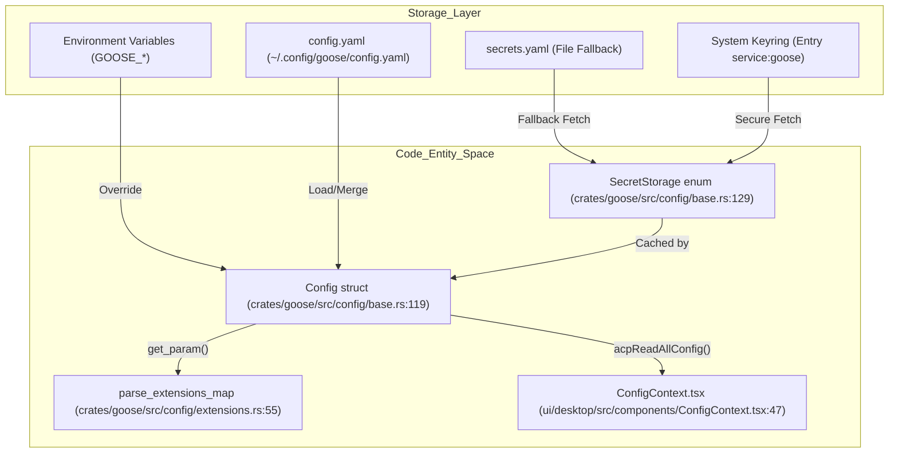
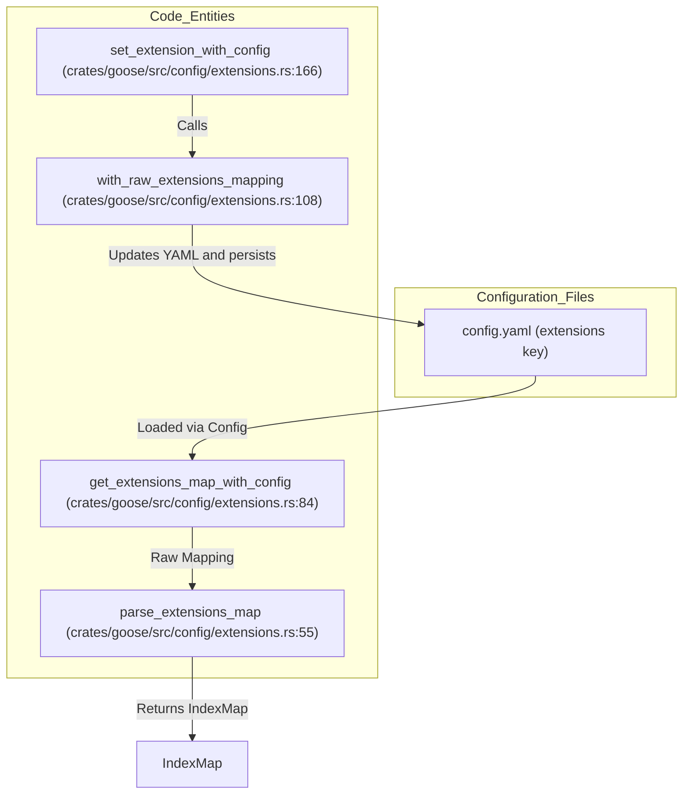

# Configuration System

Relevant source files

The following files were used as context for generating this wiki page:

- [crates/goose/src/config/base.rs](crates/goose/src/config/base.rs)
- [crates/goose/src/providers/amp_acp.rs](crates/goose/src/providers/amp_acp.rs)
- [crates/goose/src/providers/claude_acp.rs](crates/goose/src/providers/claude_acp.rs)
- [crates/goose/src/providers/codex_acp.rs](crates/goose/src/providers/codex_acp.rs)
- [crates/goose/src/providers/copilot_acp.rs](crates/goose/src/providers/copilot_acp.rs)
- [crates/goose/src/providers/pi_acp.rs](crates/goose/src/providers/pi_acp.rs)
- [crates/goose/src/providers/utils.rs](crates/goose/src/providers/utils.rs)
- [documentation/docs/guides/config-files.md](documentation/docs/guides/config-files.md)
- [documentation/docs/guides/context-engineering/subagents.mdx](documentation/docs/guides/context-engineering/subagents.mdx)
- [documentation/docs/guides/environment-variables.md](documentation/docs/guides/environment-variables.md)
- [documentation/docs/guides/goose-cli-commands.md](documentation/docs/guides/goose-cli-commands.md)
- [documentation/docs/guides/multi-model/index.mdx](documentation/docs/guides/multi-model/index.mdx)
- [documentation/docs/guides/recipes/index.mdx](documentation/docs/guides/recipes/index.mdx)
- [documentation/docs/guides/recipes/recipe-reference.md](documentation/docs/guides/recipes/recipe-reference.md)
- [documentation/docs/guides/recipes/session-recipes.md](documentation/docs/guides/recipes/session-recipes.md)
- [documentation/docs/guides/recipes/storing-recipes.md](documentation/docs/guides/recipes/storing-recipes.md)
- [documentation/docs/guides/recipes/subrecipes.md](documentation/docs/guides/recipes/subrecipes.md)
- [documentation/docs/guides/running-tasks.md](documentation/docs/guides/running-tasks.md)
- [documentation/docs/guides/sessions/smart-context-management.md](documentation/docs/guides/sessions/smart-context-management.md)
- [documentation/docs/troubleshooting/known-issues.md](documentation/docs/troubleshooting/known-issues.md)
- [documentation/docs/tutorials/recipes-tutorial.md](documentation/docs/tutorials/recipes-tutorial.md)
- [documentation/src/components/RecipeFields.js](documentation/src/components/RecipeFields.js)
- [documentation/src/components/VideoCarousel.js](documentation/src/components/VideoCarousel.js)
- [documentation/static/files/thoughts/plans/2025-12-23-remove-tool-selection-strategy.raw](documentation/static/files/thoughts/plans/2025-12-23-remove-tool-selection-strategy.raw)
- [documentation/static/files/thoughts/research/2025-12-22-llm-tool-selection-strategy.raw](documentation/static/files/thoughts/research/2025-12-22-llm-tool-selection-strategy.raw)

The Goose configuration system is a multi-layered architecture designed to manage model parameters, extension settings, and security credentials across different environments. It supports dynamic key-value pairs, environment variable overrides, and secure secret storage through system keyrings or encrypted file fallbacks.

## Core Configuration Architecture

The primary entry point for configuration is the `Config` struct defined in `crates/goose/src/config/base.rs`. It manages the loading, caching, and persistence of settings from multiple sources [crates/goose/src/config/base.rs:119-127]().

### Configuration Precedence
Goose resolves configuration values using the following priority (highest to lowest):
1. **Environment Variables**: Exact key matches with automatic uppercase conversion (e.g., `openai_api_key` checks for `OPENAI_API_KEY`) [crates/goose/src/config/base.rs:113-116]().
2. **Additional Config Files**: Paths specified via `GOOSE_ADDITIONAL_CONFIG_FILES` [crates/goose/src/config/base.rs:176-177]().
3. **User Configuration**: The `config.yaml` file located in the user's config directory [crates/goose/src/config/base.rs:200-205]().
4. **System Configuration**: Global settings at `/etc/goose/config.yaml` (Unix) or `PROGRAMDATA` (Windows) [crates/goose/src/config/base.rs:155-171]().

### File Locations
| Operating System | Path |
| --- | --- |
| **macOS/Linux** | `~/.config/goose/config.yaml` [documentation/docs/guides/config-files.md:11-11]() |
| **Windows** | `%APPDATA%\Block\goose\config\config.yaml` [documentation/docs/guides/config-files.md:12-12]() |

Sources: [crates/goose/src/config/base.rs:34-34](), [crates/goose/src/config/base.rs:155-205](), [documentation/docs/guides/config-files.md:9-13]()

---

## Data Flow: Configuration Resolution

The following diagram illustrates how the `Config` struct aggregates data from various sources and persists updates, bridging natural language spaces to concrete code entities.

### Configuration Resolution and Code Entity Mapping

Sources: [crates/goose/src/config/base.rs:119-137](), [crates/goose/src/config/extensions.rs:55-82](), [ui/desktop/src/components/ConfigContext.tsx:47-60]()

---

## Secret Storage & Keyring

Goose distinguishes between general configuration settings and sensitive secrets (such as API keys).

### Secret Storage Precedence
1. **Environment Variables**: Direct check for exact key matches [crates/goose/src/config/base.rs:88-88]().
2. **System Keyring**: Uses the `keyring` crate to access OS-level credential stores (default service `goose`, username `secrets`) [crates/goose/src/config/base.rs:30-33](). This can be bypassed by setting `GOOSE_DISABLE_KEYRING` [crates/goose/src/config/base.rs:89-89]().
3. **File Fallback**: If the keyring is disabled or unavailable, secrets are stored in a restricted local file (e.g., `secrets.yaml`) [crates/goose/src/config/base.rs:90-91]().

### Implementation Detail
The `SecretStorage` enum dispatches between `Keyring` and `File` variants [crates/goose/src/config/base.rs:129-137](). The `Config` struct maintains a thread-safe `secrets_cache` using `Arc<Mutex<Option<HashMap<String, Value>>>>` to minimize expensive OS keyring roundtrips [crates/goose/src/config/base.rs:126-126]().

Sources: [crates/goose/src/config/base.rs:20-52](), [crates/goose/src/config/base.rs:87-92](), [crates/goose/src/config/base.rs:129-137]()

---

## Model Configuration & Environment Precedence

Model behavior, LLM provider selection, caching, and retry parameters are defined via environment variables and configuration files.

### Global and Provider Settings
- **`GOOSE_PROVIDER` & `GOOSE_MODEL`**: Specifies the default LLM backend and model identifier [documentation/docs/guides/environment-variables.md:19-20]().
- **`GOOSE_TEMPERATURE` & `GOOSE_MAX_TOKENS`**: Control response generation randomness and token length caps [documentation/docs/guides/environment-variables.md:21-22]().
- **`GOOSE_CACHE_TTL`**: Sets Anthropic prompt-cache TTL (`5m` or `1h`) [documentation/docs/guides/environment-variables.md:23-23]().
- **Provider Retries**: Configurable parameters for backend services like AWS Bedrock (`BEDROCK_MAX_RETRIES`, `BEDROCK_BACKOFF_MULTIPLIER`) and Databricks (`DATABRICKS_MAX_RETRIES`) [documentation/docs/guides/environment-variables.md:97-128]().

Sources: [documentation/docs/guides/environment-variables.md:17-147](), [documentation/docs/guides/config-files.md:28-41]()

---

## GooseMode

`GooseMode` defines the agent's behavior regarding tool execution and user approval. It is a critical security and usability setting.

### GooseMode Values
| Value | Description |
|---|---|
| `"auto"` | Tools execute automatically without explicit approval. |
| `"approve"` | User approval is required for all tool executions. |
| `"chat"` | Tools are disabled; the agent operates in chat-only mode. |
| `"smart_approve"` | Tools execute automatically for safe operations, but require approval for potentially risky actions (e.g., file system modifications). |

### Configuration and Resolution
`GooseMode` can be set via the `GOOSE_MODE` environment variable or in `config.yaml` [documentation/docs/guides/config-files.md:52-52](). ACP-based providers like `codex-acp` and `claude-acp` map `GooseMode` values to their internal permission settings [crates/goose/src/providers/codex_acp.rs:73-78](), [crates/goose/src/providers/claude_acp.rs:74-83]().

Sources: [crates/goose/src/providers/codex_acp.rs:73-78](), [crates/goose/src/providers/claude_acp.rs:74-83](), [documentation/docs/guides/config-files.md:52-52]()

---

## Extension Configuration

Extensions are declared under the `extensions` key in `config.yaml` and managed via the `goose::config::extensions` module [crates/goose/src/config/extensions.rs:13-20]().

### Extension Structures
- **`ExtensionEntry`**: Combines an `enabled` boolean flag with an underlying `ExtensionConfig` [crates/goose/src/config/extensions.rs:15-20]().
- **`name_to_key`**: Normalizes extension names into valid snake-case or alphanumeric keys for mapping lookups [crates/goose/src/config/extensions.rs:22-32]().
- **`parse_extensions_map`**: Iterates over raw YAML mappings, injects missing name identifiers, filters out unavailable platform extensions, and populates an `IndexMap<String, ExtensionEntry>` [crates/goose/src/config/extensions.rs:55-82]().

### Extension Management Flow

Sources: [crates/goose/src/config/extensions.rs:55-169](), [documentation/docs/guides/config-files.md:117-131]()

---

## Declarative Providers, Experiments, and Migrations

In addition to core configuration, the system modularizes several auxiliary configuration components via submodules under `goose::config`:
- **Declarative Providers (`declarative_providers.rs`)**: Implements `DeclarativeProviderConfig` to support user-defined custom LLM endpoints dynamically [crates/goose/src/config/mod.rs:2-16]().
- **Experiments (`experiments.rs`)**: Managed through `ExperimentManager`, enabling feature flags and experimental capabilities [crates/goose/src/config/mod.rs:3-17]().
- **Paths (`paths.rs`)**: Resolves system directories, configuration locations, cache paths, and default log folders [crates/goose/src/config/base.rs:1]().
- **Migrations (`migrations.rs`)**: Automatically upgrades legacy configuration structures (such as flat provider settings or older session store layouts) when Goose updates [crates/goose/src/config/mod.rs:5-5]().

Sources: [crates/goose/src/config/base.rs:1](), [crates/goose/src/config/mod.rs:2-17](), [documentation/docs/guides/config-files.md:41-42]()

---

## Recipe Configuration

Recipes are reusable configurations that package instructions, tools, and settings. They can be defined in YAML or JSON files and loaded from various locations.

### Recipe Structure
Recipes follow a schema that includes fields like `title`, `description`, `instructions`, `prompt`, `extensions`, `parameters`, and `settings` [documentation/docs/guides/recipes/recipe-reference.md:39-55]().

### Recipe Settings
The `settings` field within a recipe allows overriding global configuration for that specific recipe, including:
- `goose_provider`: Specifies the LLM provider for the recipe [documentation/docs/guides/recipes/session-recipes.md:51-51]().
- `goose_model`: Specifies the model to use [documentation/docs/guides/recipes/session-recipes.md:52-52]().
- `temperature`: Sets the model temperature [documentation/docs/guides/recipes/session-recipes.md:53-53]().

### Recipe Discovery
Goose searches for recipes in a defined order:
1. Current directory (`.`) [documentation/docs/guides/recipes/storing-recipes.md:134-134]()
2. Custom paths specified by `GOOSE_RECIPE_PATH` environment variable [documentation/docs/guides/recipes/storing-recipes.md:135-135]()
3. Global recipe library (`~/.config/goose/recipes/`) [documentation/docs/guides/recipes/storing-recipes.md:136-136]()
4. Local project recipes (`./.goose/recipes/`) [documentation/docs/guides/recipes/storing-recipes.md:137-137]()
5. GitHub repository configured via `GOOSE_RECIPE_GITHUB_REPO` [documentation/docs/guides/recipes/storing-recipes.md:138-138]()

Sources: [documentation/docs/guides/recipes/recipe-reference.md:39-55](), [documentation/docs/guides/recipes/session-recipes.md:51-53](), [documentation/docs/guides/recipes/storing-recipes.md:130-138]()

---

## Session Management Configuration

Configuration options exist to control how Goose manages conversation sessions and context.

### Key Session Variables
- **`GOOSE_MAX_TURNS`**: Sets the maximum number of turns allowed without user input [documentation/docs/guides/environment-variables.md:137-137]().
- **`GOOSE_GATEWAY_MAX_TURNS`**: Overrides `GOOSE_MAX_TURNS` specifically for gateway sessions (e.g., Telegram) [documentation/docs/guides/environment-variables.md:138-138]().
- **`GOOSE_AUTO_COMPACT_THRESHOLD`**: Percentage threshold at which Goose automatically compacts session history [documentation/docs/guides/config-files.md:66-66]().
- **`GOOSE_AUTO_COMPACT_TOKEN_LIMIT`**: Absolute token limit for auto-compaction, acting as an earlier trigger than the percentage threshold [documentation/docs/guides/config-files.md:67-67]().
- **`GOOSE_CONTEXT_STRATEGY`**: Defines how Goose handles context limits when auto-compaction is disabled or insufficient (e.g., `summarize`, `truncate`, `clear`, `prompt`) [documentation/docs/guides/sessions/smart-context-management.md:115-125]().

Sources: [documentation/docs/guides/environment-variables.md:137-138](), [documentation/docs/guides/config-files.md:66-67](), [documentation/docs/guides/sessions/smart-context-management.md:115-125]()