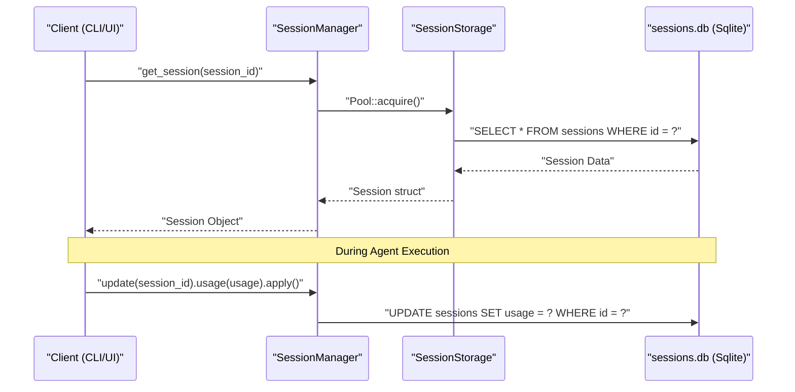
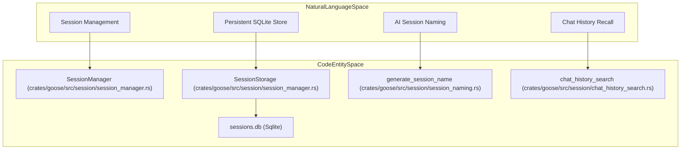

# Session & Storage

Relevant source files

The following files were used as context for generating this wiki page:

- [Cargo.lock](Cargo.lock)
- [Cargo.toml](Cargo.toml)
- [crates/goose-cli/Cargo.toml](crates/goose-cli/Cargo.toml)
- [crates/goose-cli/src/cli.rs](crates/goose-cli/src/cli.rs)
- [crates/goose-cli/src/commands/mod.rs](crates/goose-cli/src/commands/mod.rs)
- [crates/goose-cli/src/commands/session.rs](crates/goose-cli/src/commands/session.rs)
- [crates/goose-cli/src/lib.rs](crates/goose-cli/src/lib.rs)
- [crates/goose-cli/src/main.rs](crates/goose-cli/src/main.rs)
- [crates/goose-mcp/Cargo.toml](crates/goose-mcp/Cargo.toml)
- [crates/goose-provider-types/src/canonical/data/canonical_models.json](crates/goose-provider-types/src/canonical/data/canonical_models.json)
- [crates/goose-provider-types/src/canonical/data/provider_metadata.json](crates/goose-provider-types/src/canonical/data/provider_metadata.json)
- [crates/goose/Cargo.toml](crates/goose/Cargo.toml)
- [crates/goose/src/prompts/session_name.md](crates/goose/src/prompts/session_name.md)
- [crates/goose/src/providers/cli_common.rs](crates/goose/src/providers/cli_common.rs)
- [crates/goose/src/session/chat_history_search.rs](crates/goose/src/session/chat_history_search.rs)
- [crates/goose/src/session/mod.rs](crates/goose/src/session/mod.rs)
- [crates/goose/src/session/session_manager.rs](crates/goose/src/session/session_manager.rs)
- [crates/goose/src/session/session_naming.rs](crates/goose/src/session/session_naming.rs)
- [ui/desktop/package.json](ui/desktop/package.json)

This page details how Goose manages the lifecycle of agent sessions, including their creation, persistence in SQLite, and resumption. It covers the core `SessionManager`, the underlying storage schema, session naming, diagnostics, chat history search, and the mechanisms for session updates.

## Overview

A **Session** in Goose represents a single conversation or task context. It encapsulates the chat history (`Conversation`), metadata (working directory, token usage, model config), and the state of active extensions. Sessions are persistent, allowing users to stop and resume work across CLI and Desktop interfaces.

The primary entities involved are:
- **`SessionManager`**: The central coordinator for session CRUD operations and database interactions [crates/goose/src/session/session_manager.rs]().
- **`SessionStorage`**: The internal layer handling the SQLite connection pool and raw SQL execution [crates/goose/src/session/session_manager.rs:63-65]().
- **`sessions.db`**: A SQLite database managed via `sqlx` that serves as the source of truth for all sessions [crates/goose/src/session/session_manager.rs:24-25]().
- **`SessionUpdateBuilder`**: A fluent interface for applying incremental updates to a session's state [crates/goose/src/session/session_manager.rs:160-184]().

Sources: [crates/goose/src/session/session_manager.rs:24-184]()

## Session Lifecycle and Data Flow

When a session is started or resumed, the system ensures the agent's state matches the persisted data. Sessions are assigned a `SessionType` (such as `User`, `Scheduled`, `SubAgent`, `Hidden`, `Terminal`, `Gateway`, or `Acp`) [crates/goose/src/session/session_manager.rs:38-61]().

### 1. Creation and Initialization
New sessions are initialized with a working directory, an optional `Recipe`, and default configuration options.

### 2. Persistence & Updates
The `SessionManager` uses `SessionUpdateBuilder` to apply changes atomically to the SQLite database [crates/goose/src/session/session_manager.rs:160-184](). This includes metadata updates, token accounting (`usage` and `accumulated_usage`), and `ExtensionData` [crates/goose/src/session/session_manager.rs:80-85]().

### Session Persistence Flow

Title: "Session Persistence Flow"

Sources: [crates/goose/src/session/session_manager.rs:24-25](), [crates/goose/src/session/session_manager.rs:160-184]()

## Storage Implementation

Goose uses SQLite for session storage, located in the application data directory (`Paths::data_dir()`) [crates/goose/src/session/session_manager.rs:1-65]().

### Database Schema & Versioning
The database schema is versioned (`CURRENT_SCHEMA_VERSION` is `17`) [crates/goose/src/session/session_manager.rs:32](). Key structures mapped to database rows include:
- **`Session`**: Stores core metadata, working directory, description/name, token metrics, and active `GooseMode` [crates/goose/src/session/session_manager.rs:67-109]().
- **`SessionInsights`**: Provides aggregated metrics such as `total_sessions` and `total_tokens` [crates/goose/src/session/session_manager.rs:187-191]().

### Natural Language Space to Code Entity Space Bridge

Title: "Session Subsystem Code Mapping"

Sources: [crates/goose/src/session/session_manager.rs:32-65](), [crates/goose/src/session/mod.rs]()

## Session Naming & Diagnostics

### Session Naming
Sessions are automatically named based on the context of the initial user prompt once a threshold of message count is reached (`MSG_COUNT_FOR_SESSION_NAME_GENERATION`) [crates/goose/src/session/session_manager.rs:13-15](). This behavior can be bypassed via configuration flags if automatic background LLM calls are undesirable (e.g., in headless/CI environments).

### Diagnostics
The `diagnostics` module provides tools to inspect system information, configuration paths, recent logs, and active session states (`generate_diagnostics`) [crates/goose-cli/src/commands/session.rs:6](). These reports help troubleshoot execution or connection issues in both CLI and Desktop environments.

Sources: [crates/goose/src/session/session_manager.rs:13-15](), [crates/goose-cli/src/commands/session.rs:6]()

## Chat History Search & Recall

Goose implements chat history search to allow agents to query past interactions across sessions:
- **`chat_history_search`**: Implements SQLite-backed full-text or pattern matching over historical conversation messages [crates/goose/src/session/chat_history_search.rs]().
- **Recall Integration**: Integrated into platform extensions like `chatrecall` so the agent can autonomously reference past context [crates/goose/src/session/mod.rs]().

Sources: [crates/goose/src/session/chat_history_search.rs](), [crates/goose/src/session/mod.rs]()