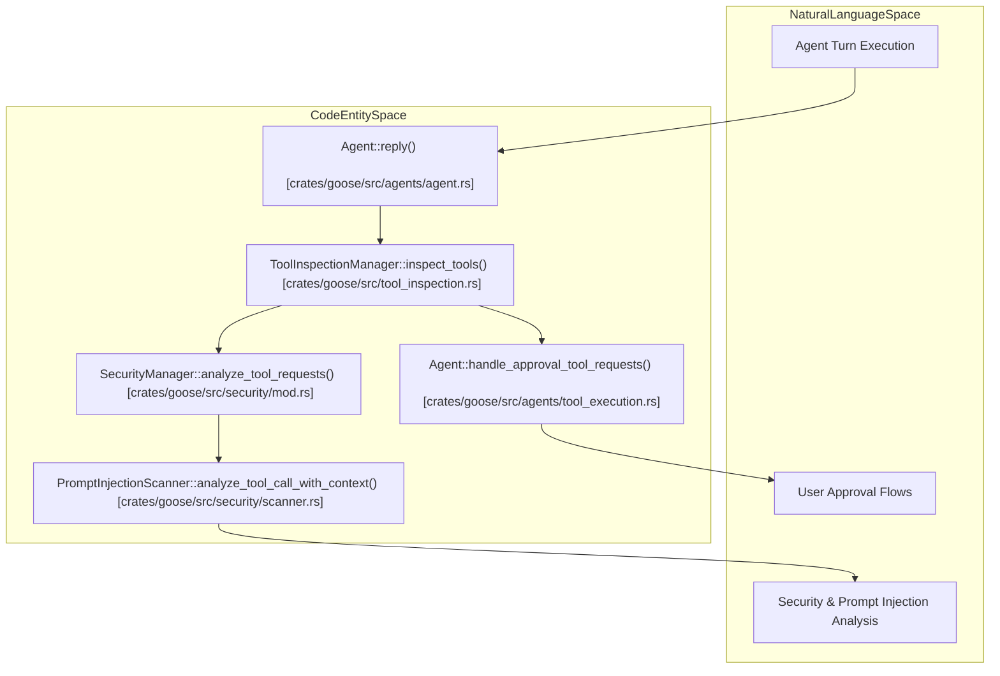
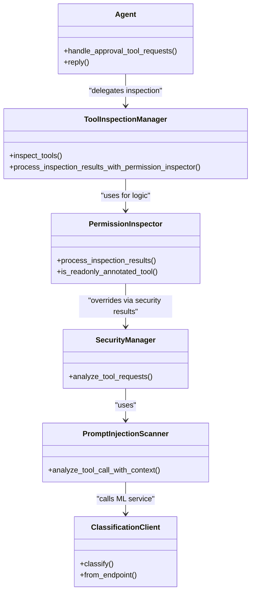

# Security & Permission System

Relevant source files

The following files were used as context for generating this wiki page:

- [crates/goose-cli/src/commands/info.rs](crates/goose-cli/src/commands/info.rs)
- [crates/goose-cli/src/commands/roam.rs](crates/goose-cli/src/commands/roam.rs)
- [crates/goose/src/acp/server/schedule.rs](crates/goose/src/acp/server/schedule.rs)
- [crates/goose/src/acp/server_factory.rs](crates/goose/src/acp/server_factory.rs)
- [crates/goose/src/acp/transport/mod.rs](crates/goose/src/acp/transport/mod.rs)
- [crates/goose/src/agents/moim.rs](crates/goose/src/agents/moim.rs)
- [crates/goose/src/agents/prompt_manager.rs](crates/goose/src/agents/prompt_manager.rs)
- [crates/goose/src/agents/snapshots/goose__agents__prompt_manager__tests__all_platform_extensions.snap](crates/goose/src/agents/snapshots/goose__agents__prompt_manager__tests__all_platform_extensions.snap)
- [crates/goose/src/agents/snapshots/goose__agents__prompt_manager__tests__basic.snap](crates/goose/src/agents/snapshots/goose__agents__prompt_manager__tests__basic.snap)
- [crates/goose/src/agents/snapshots/goose__agents__prompt_manager__tests__one_extension.snap](crates/goose/src/agents/snapshots/goose__agents__prompt_manager__tests__one_extension.snap)
- [crates/goose/src/agents/snapshots/goose__agents__prompt_manager__tests__typical_setup.snap](crates/goose/src/agents/snapshots/goose__agents__prompt_manager__tests__typical_setup.snap)
- [crates/goose/src/agents/tool_execution.rs](crates/goose/src/agents/tool_execution.rs)
- [crates/goose/src/config/permission.rs](crates/goose/src/config/permission.rs)
- [crates/goose/src/permission/permission_inspector.rs](crates/goose/src/permission/permission_inspector.rs)
- [crates/goose/src/permission/permission_judge.rs](crates/goose/src/permission/permission_judge.rs)
- [crates/goose/src/prompts/system.md](crates/goose/src/prompts/system.md)
- [crates/goose/src/security/classification_client.rs](crates/goose/src/security/classification_client.rs)
- [crates/goose/src/security/egress_inspector.rs](crates/goose/src/security/egress_inspector.rs)
- [crates/goose/src/security/mod.rs](crates/goose/src/security/mod.rs)
- [crates/goose/src/security/patterns.rs](crates/goose/src/security/patterns.rs)
- [crates/goose/src/security/scanner.rs](crates/goose/src/security/scanner.rs)
- [crates/goose/src/security/security_inspector.rs](crates/goose/src/security/security_inspector.rs)
- [crates/goose/src/tool_inspection.rs](crates/goose/src/tool_inspection.rs)
- [crates/goose/tests/acp_fixtures/mod.rs](crates/goose/tests/acp_fixtures/mod.rs)
- [crates/goose/tests/acp_fixtures/provider.rs](crates/goose/tests/acp_fixtures/provider.rs)
- [crates/goose/tests/acp_fixtures/server.rs](crates/goose/tests/acp_fixtures/server.rs)
- [crates/goose/tests/acp_transport_auth_test.rs](crates/goose/tests/acp_transport_auth_test.rs)
- [crates/goose/tests/permission_persistence.rs](crates/goose/tests/permission_persistence.rs)
- [documentation/docs/guides/roaming-agents.md](documentation/docs/guides/roaming-agents.md)
- [documentation/docs/guides/security/classification-api-spec.md](documentation/docs/guides/security/classification-api-spec.md)
- [documentation/docs/guides/security/index.mdx](documentation/docs/guides/security/index.mdx)
- [documentation/docs/guides/security/prompt-injection-detection.md](documentation/docs/guides/security/prompt-injection-detection.md)
- [ui/desktop/src/components/settings/security/SecurityToggle.tsx](ui/desktop/src/components/settings/security/SecurityToggle.tsx)
- [ui/desktop/src/utils/configUtils.ts](ui/desktop/src/utils/configUtils.ts)

The Goose security and permission system provides a multi-layered inspection pipeline that evaluates tool requests before execution. It combines rule-based heuristics, machine learning classifiers, and user-driven approval flows to mitigate risks such as prompt injection and unauthorized data modification.

## Permission Inspection Pipeline

The inspection process is managed by `ToolInspectionManager`, which orchestrates a series of `ToolInspector` implementations. Each inspector evaluates a list of `ToolRequest` objects and returns an `InspectionResult` containing a recommended `InspectionAction` [crates/goose/src/tool_inspection.rs:12-59]().

### The ToolInspector Trait
Any security or permission check implements the `ToolInspector` trait, defining the `inspect` method for evaluating tool calls against the current conversation context [crates/goose/src/tool_inspection.rs:33-54]().

### Key Inspectors
1.  **SecurityInspector**: Utilizes `SecurityManager` to perform prompt injection and malicious command detection [crates/goose/src/security/security_inspector.rs:10-12]().
2.  **AdversaryInspector**: Reviews tool calls against user-defined rules in `adversary.md` for high-risk tools like `shell` and `computercontroller__automation_script` [crates/goose/src/security/adversary_inspector.rs:56-78]().
3.  **RepetitionInspector**: Monitors for looping behavior where the agent repeatedly calls identical tools.
4.  **Egress Inspector**: Restricts data leaving the local environment via network-enabled tools [crates/goose/src/security/egress_inspector.rs:1-6]().
5.  **PermissionInspector**: Baseline inspector checking the `PermissionManager` store to determine if a tool is pre-authorized or requires approval based on `GooseMode` [crates/goose/src/permission/permission_inspector.rs:15-20]().

### Inspection Logic Flow

**Figure 1: Tool Request Inspection Lifecycle (Natural Language to Code Entity Space)**

Sources: [crates/goose/src/tool_inspection.rs:75-119](), [crates/goose/src/security/security_inspector.rs:66-89](), [crates/goose/src/agents/tool_execution.rs:149-164](), [crates/goose/src/security/mod.rs:95-106]()

---

## Security Scanning & Prompt Injection

`SecurityManager` manages `PromptInjectionScanner`, offering pattern-based matching and ML-based classification [crates/goose/src/security/mod.rs:25-29]().

### PromptInjectionScanner
The scanner targets shell-based tools as high-risk surfaces [crates/goose/src/security/scanner.rs:136-143]().

*   **Pattern Matching**: Uses `PatternMatcher` to identify known malicious strings (e.g., `rm -rf /`, `curl ... | bash`) via regex-based heuristics [crates/goose/src/security/scanner.rs:200-210](), [crates/goose/src/security/patterns.rs:48-187]().
*   **ML Classification**: Enabled via `SECURITY_PROMPT_CLASSIFIER_ENABLED`, sending commands and conversation context to a classification model via `ClassificationClient` [crates/goose/src/security/scanner.rs:49-62](), [crates/goose/src/security/classification_client.rs:141-175]().

### Security Thresholds
A configurable confidence threshold (default `0.8`) determines if a tool call should be blocked [crates/goose/src/security/scanner.rs:125-129](). If `confidence` exceeds this threshold, `SecurityInspector` returns `InspectionAction::RequireApproval` with a tracking finding ID [crates/goose/src/security/mod.rs:176-194]().

Sources: [crates/goose/src/security/mod.rs:167-198](), [crates/goose/src/security/scanner.rs:131-198](), [crates/goose/src/security/patterns.rs:36-45]()

---

## Permission Store & GooseMode

`GooseMode` dictates the system's default autonomy level.

| Mode | Behavior |
| :--- | :--- |
| `Chat` | No tool access allowed; tool calls skipped and replaced with an explanation [crates/goose/src/agents/tool_execution.rs:151-162](). |
| `Approve` | Requires explicit user approval for every tool call [crates/goose/src/permission/permission_inspector.rs:162](). |
| `Smart Approve` | Automatically approves low-risk read-only actions and flags high-risk ones [crates/goose/src/permission/permission_inspector.rs:173-176](). |
| `Auto` | Executes tools automatically unless flagged by a security inspector [crates/goose/src/permission/permission_inspector.rs:161](). |

### Permission Store & Judging
`PermissionManager` maintains persistent tool permissions (`AlwaysAllow`, `AskBefore`, `NeverAllow`) [crates/goose/src/config/permission.rs:20-25]().

*   **`detect_read_only_requests`**: Evaluates tool requests to identify state-non-modifying operations [crates/goose/src/permission/permission_judge.rs:145-150]().
*   **`create_read_only_tool`**: Defines the `platform__tool_by_tool_permission` system tool used by the judge model [crates/goose/src/permission/permission_judge.rs:41-89]().

### Approval Flow Implementation
When approval is required, the agent yields an `action_required` message with tool parameters, suspending execution while awaiting input on `confirmation_rx` [crates/goose/src/agents/tool_execution.rs:136-147]().

**Figure 2: Permission Enforcement & Scanning Code Entities**

Sources: [crates/goose/src/agents/tool_execution.rs:148-164](), [crates/goose/src/permission/permission_inspector.rs:73-132](), [crates/goose/src/permission/permission_judge.rs:145-175](), [crates/goose/src/security/classification_client.rs:38-65]()

---

## Adversary Inspector

`AdversaryInspector` reviews tool calls against custom rules in `adversary.md` [crates/goose/src/security/adversary_inspector.rs:56-71]().

*   **Configuration**: Parsed from `~/.config/goose/adversary.md` via frontmatter, targeting specified tools (defaulting to `shell`) [crates/goose/src/security/adversary_inspector.rs:141-152]().
*   **Default Rules**: If empty, defaults apply to block data exfiltration, root destruction, and privilege escalation [crates/goose/src/security/adversary_inspector.rs:38-47]().
*   **LLM Review**: Uses the configured provider to evaluate tool calls against rule sets prior to returning an `InspectionResult` [crates/goose/src/security/adversary_inspector.rs:242-260]().

Sources: [crates/goose/src/security/adversary_inspector.rs:106-139](), [crates/goose/src/security/adversary_inspector.rs:199-210]()