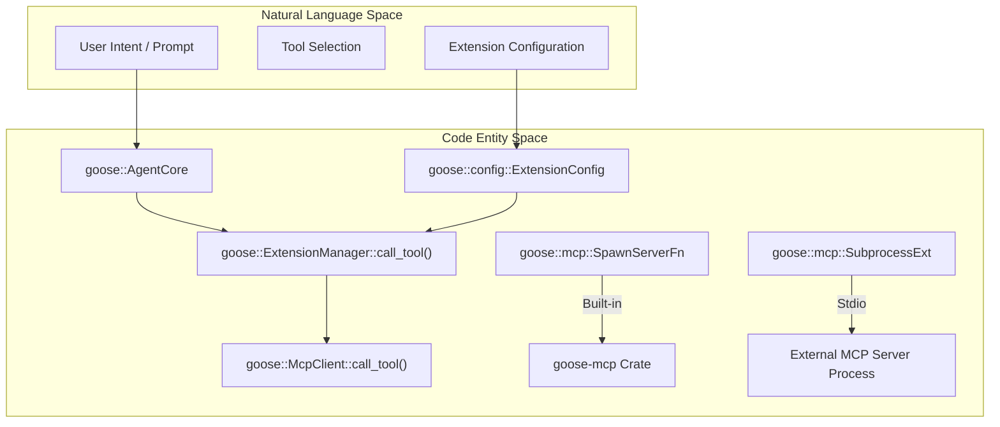
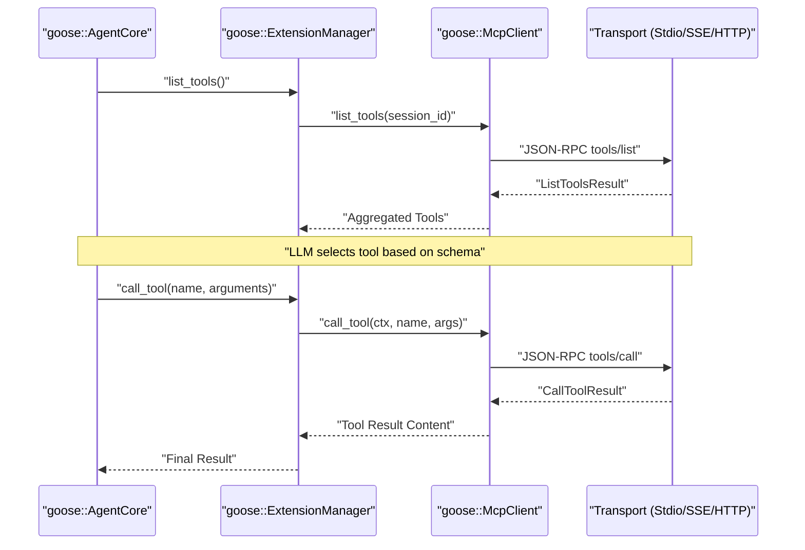

# MCP Extension System

Relevant source files

The following files were used as context for generating this wiki page:

- [documentation/docs/getting-started/using-extensions.md](documentation/docs/getting-started/using-extensions.md)
- [documentation/docs/guides/interactive-chat/_category_.json](documentation/docs/guides/interactive-chat/_category_.json)
- [documentation/docs/guides/interactive-chat/index.mdx](documentation/docs/guides/interactive-chat/index.mdx)
- [documentation/docs/guides/interactive-chat/mcp-ui.md](documentation/docs/guides/interactive-chat/mcp-ui.md)
- [documentation/docs/guides/managing-tools/_category_.json](documentation/docs/guides/managing-tools/_category_.json)
- [documentation/docs/guides/managing-tools/adjust-tool-output.md](documentation/docs/guides/managing-tools/adjust-tool-output.md)
- [documentation/docs/guides/managing-tools/code-mode.md](documentation/docs/guides/managing-tools/code-mode.md)
- [documentation/docs/guides/managing-tools/index.md](documentation/docs/guides/managing-tools/index.md)
- [documentation/docs/guides/managing-tools/tool-permissions.md](documentation/docs/guides/managing-tools/tool-permissions.md)
- [documentation/docs/guides/sessions/in-session-actions.md](documentation/docs/guides/sessions/in-session-actions.md)
- [documentation/docs/guides/sessions/session-management.md](documentation/docs/guides/sessions/session-management.md)
- [documentation/docs/guides/tips.md](documentation/docs/guides/tips.md)
- [documentation/docs/mcp/apps-mcp.md](documentation/docs/mcp/apps-mcp.md)
- [documentation/docs/mcp/chatrecall-mcp.md](documentation/docs/mcp/chatrecall-mcp.md)
- [documentation/docs/mcp/code-mode-mcp.md](documentation/docs/mcp/code-mode-mcp.md)
- [documentation/docs/mcp/extension-manager-mcp.md](documentation/docs/mcp/extension-manager-mcp.md)
- [documentation/docs/mcp/todo-mcp.md](documentation/docs/mcp/todo-mcp.md)
- [documentation/docs/tutorials/building-mcp-apps.md](documentation/docs/tutorials/building-mcp-apps.md)
- [documentation/docs/tutorials/custom-extensions.md](documentation/docs/tutorials/custom-extensions.md)
- [documentation/src/components/PlatformExtensionNote.js](documentation/src/components/PlatformExtensionNote.js)
- [documentation/static/img/apps-extension-results.png](documentation/static/img/apps-extension-results.png)
- [documentation/static/videos/plan-trip-demo.mp4](documentation/static/videos/plan-trip-demo.mp4)

The Model Context Protocol (MCP) is the core mechanism for Goose's extensibility [documentation/docs/tutorials/custom-extensions.md:12-16](). It standardizes how Goose interacts with external tools, resources, and prompts through a consistent client-server architecture [documentation/docs/tutorials/custom-extensions.md:12-16](). Goose embeds an MCP client capable of communicating with built-in modules, subprocess-managed runtimes via Stdio, and remote SSE endpoints.

For detailed coverage of specific sub-topics, see the child pages:
- [Built-in MCP Extensions (goose-mcp)](#3.1) — Native `goose-mcp` servers including developer, computercontroller, memory, tutorial, and autovisualiser.
- [MCP Client & Transport Layer](#3.2) — `McpClient`, transport adapters (Stdio, SSE, Streamable HTTP), subprocess supervision, and replay testing.
- [External MCP Servers & Extension Catalog](#3.3) — The `servers.json` catalog, installation link generator, and `goose://` deep links.

---

## Extension Architecture & Lifecycle

Goose manages extensions through an internal system and wraps client communication via the MCP client. The lifecycle spans discovery, environment provisioning, tool aggregation, dispatch, and cleanup.

Sources: [documentation/docs/tutorials/custom-extensions.md:12-16]()

### Lifecycle Steps
1. **Discovery & Loading**: Extension configurations are loaded on startup. Built-in servers are registered natively [documentation/docs/getting-started/using-extensions.md:21-29]().
2. **Initialization**: Subprocess-based extensions are spawned with required environment parameters and context variables like the working directory [documentation/docs/tutorials/custom-extensions.md:12-16]().
3. **Tool Aggregation**: Goose queries each active server implementation using `list_tools` to build the available capability set [documentation/docs/tutorials/custom-extensions.md:12-16]().
4. **Dispatch**: When the model requests execution, the `ExtensionManager` maps the tool call to the corresponding `McpClient::call_tool` handler [documentation/docs/tutorials/custom-extensions.md:12-16]().

Sources: [documentation/docs/tutorials/custom-extensions.md:12-16]()

---

## Extension Categories

Goose classifies extensions into four main groups based on packaging and execution mode:

| Type | Execution & Packaging | Details |
| :--- | :--- | :--- |
| **Built-in** | Compiled directly into the Goose binary | Maintained in `goose-mcp`, requiring zero external runtimes [documentation/docs/getting-started/using-extensions.md:21-29](). |
| **Platform** | Core internal capabilities | Includes utilities like `todo` [documentation/docs/mcp/todo-mcp.md:11-13](), `summon`, `chatrecall` [documentation/docs/getting-started/using-extensions.md:36-46](), and `code-mode` [documentation/docs/guides/managing-tools/code-mode.md:11-15]() exposed via the MCP interface. |
| **External Stdio** | External processes via standard I/O | Launched using package runners like `npx`, `uv`, or raw binaries [documentation/docs/tutorials/custom-extensions.md:12-16](). |
| **Remote SSE/HTTP** | HTTP endpoints with Server-Sent Events or streamable HTTP | Connected remotely over network transports. |

For configuration guides, see [External MCP Servers & Extension Catalog](#3.3).

Sources: [documentation/docs/getting-started/using-extensions.md:21-29](), [documentation/docs/mcp/todo-mcp.md:11-13](), [documentation/docs/getting-started/using-extensions.md:36-46](), [documentation/docs/guides/managing-tools/code-mode.md:11-15](), [documentation/docs/tutorials/custom-extensions.md:12-16]()

---

## Protocol Capabilities

Beyond basic tool execution, Goose's MCP client implementation supports advanced protocol features:
- **Resources & Prompts**: Exposes static or dynamic resources (e.g., repository contents or documentation files) and prompt templates [documentation/docs/tutorials/custom-extensions.md:19-20]().
- **MCP Apps**: Enables extensions to return interactive HTML UIs rendered directly inside Goose Desktop [documentation/docs/tutorials/building-mcp-apps.md:10-17](), [documentation/docs/guides/interactive-chat/mcp-ui.md:10-23]().

For deeper implementation details regarding transports and conformance testing, consult [MCP Client & Transport Layer](#3.2).

Sources: [documentation/docs/tutorials/custom-extensions.md:19-20](), [documentation/docs/tutorials/building-mcp-apps.md:10-17](), [documentation/docs/guides/interactive-chat/mcp-ui.md:10-23]()