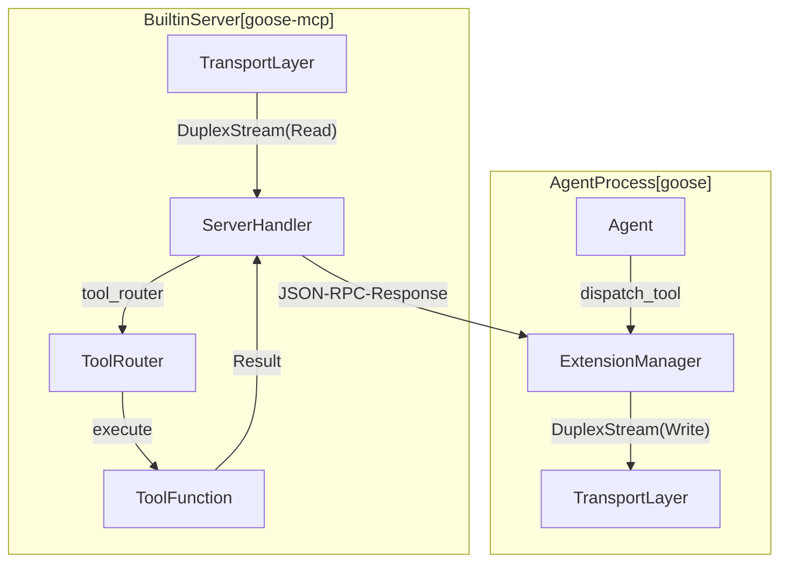
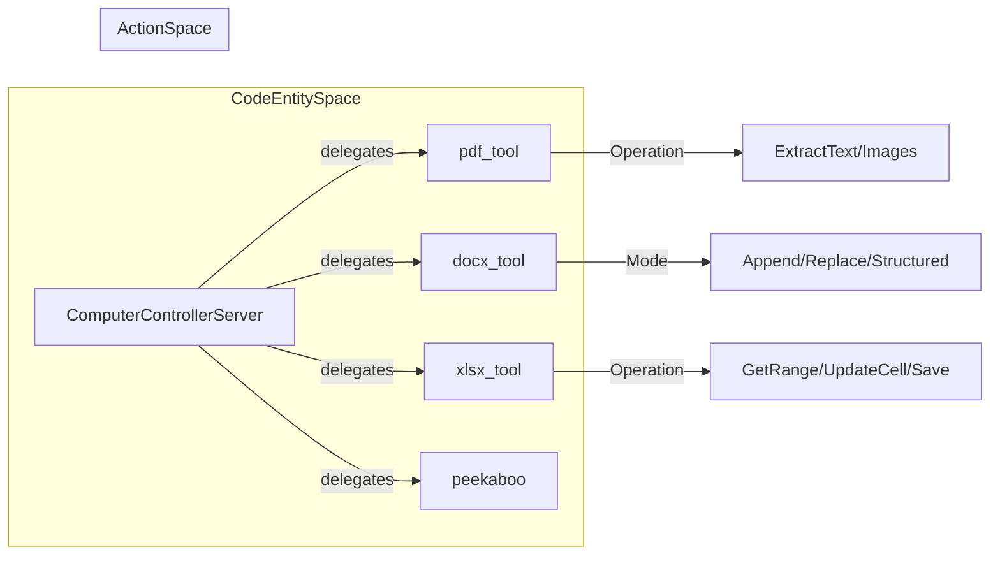

# Built-in MCP Extensions (goose-mcp)

Relevant source files

The following files were used as context for generating this wiki page:

- [crates/goose-mcp/src/autovisualiser/mod.rs](crates/goose-mcp/src/autovisualiser/mod.rs)
- [crates/goose-mcp/src/computercontroller/mod.rs](crates/goose-mcp/src/computercontroller/mod.rs)
- [crates/goose-mcp/src/lib.rs](crates/goose-mcp/src/lib.rs)
- [crates/goose-mcp/src/memory/mod.rs](crates/goose-mcp/src/memory/mod.rs)
- [crates/goose-mcp/src/tutorial/mod.rs](crates/goose-mcp/src/tutorial/mod.rs)
- [documentation/docs/guides/codebase-analysis.md](documentation/docs/guides/codebase-analysis.md)
- [documentation/docs/mcp/agentql-mcp.md](documentation/docs/mcp/agentql-mcp.md)
- [documentation/docs/mcp/alby-mcp.md](documentation/docs/mcp/alby-mcp.md)
- [documentation/docs/mcp/asana-mcp.md](documentation/docs/mcp/asana-mcp.md)
- [documentation/docs/mcp/blender-mcp.md](documentation/docs/mcp/blender-mcp.md)
- [documentation/docs/mcp/browserbase-mcp.md](documentation/docs/mcp/browserbase-mcp.md)
- [documentation/docs/mcp/cloudflare-mcp.md](documentation/docs/mcp/cloudflare-mcp.md)
- [documentation/docs/mcp/cloudinary-asset-management-mcp.md](documentation/docs/mcp/cloudinary-asset-management-mcp.md)
- [documentation/docs/mcp/computer-controller-mcp.md](documentation/docs/mcp/computer-controller-mcp.md)
- [documentation/docs/mcp/context7-mcp.mdx](documentation/docs/mcp/context7-mcp.mdx)
- [documentation/docs/mcp/developer-mcp.md](documentation/docs/mcp/developer-mcp.md)
- [documentation/docs/mcp/elevenlabs-mcp.md](documentation/docs/mcp/elevenlabs-mcp.md)
- [documentation/docs/mcp/mongodb-mcp.md](documentation/docs/mcp/mongodb-mcp.md)
- [documentation/docs/mcp/playwright-mcp.md](documentation/docs/mcp/playwright-mcp.md)

The `goose-mcp` crate houses a collection of Model Context Protocol (MCP) servers compiled directly into the Goose binary. By embedding these extensions—covering file operations, terminal execution, GUI/document control, persistent memory, interactive visualisations, and IDE integration—Goose guarantees a robust baseline of tool execution across platforms without requiring external child process management for core capabilities.

Sources: [crates/goose-mcp/src/lib.rs:1-64]()

---

## 1. Architecture and Lifecycle

Built-in extensions operate via an internal registry mapping string identifiers to spawn functions. Each built-in server implements the `ServerHandler` trait from the `rmcp` Rust MCP SDK and communicates over an in-memory tokio `DuplexStream` transport.

### Extension Registry and Spawning
The `BUILTIN_EXTENSIONS` static lazy map binds names to `SpawnServerFn` handlers [crates/goose-mcp/src/lib.rs:89-101](). When an extension is activated, Goose invokes `spawn_and_serve`, which spins up a background tokio task running `server.serve(transport)` [crates/goose-mcp/src/lib.rs:57-71]().

Sources: [crates/goose-mcp/src/lib.rs:57-71](), [crates/goose-mcp/src/lib.rs:89-101]()

---

## 2. Computer Controller (`computercontroller`)

The `computercontroller` extension bridges the LLM with host OS GUI automation, screen capture, and document parsing (`PDF`, `DOCX`, `XLSX`).

### Implementation Details
*   **macOS Automation**: Uses the `peekaboo` module via CLI passthrough on macOS to invoke native accessibility APIs for actions like clicking, typing, and screenshot capture (`ComputerControlParams`) [crates/goose-mcp/src/computercontroller/mod.rs:30-48]().
*   **Document Parsers**:
    *   `pdf_tool`: Handles `PdfOperation::ExtractText` and `PdfOperation::ExtractImages` [crates/goose-mcp/src/computercontroller/mod.rs:52-67]().
    *   `docx_tool`: Manages text extraction and document mutation (`DocxOperation::UpdateDoc`) supporting `DocxUpdateMode` modes like `Append`, `Replace`, `Structured`, and `AddImage` [crates/goose-mcp/src/computercontroller/mod.rs:69-92]().
    *   `xlsx_tool`: Provides spreadsheet operations (`XlsxOperation`) including `ListWorksheets`, `GetColumns`, `GetRange`, `FindText`, `UpdateCell`, and `Save` [crates/goose-mcp/src/computercontroller/mod.rs:172-191]().

Sources: [crates/goose-mcp/src/computercontroller/mod.rs:30-48](), [crates/goose-mcp/src/computercontroller/mod.rs:52-67](), [crates/goose-mcp/src/computercontroller/mod.rs:69-92](), [crates/goose-mcp/src/computercontroller/mod.rs:172-191]()

---

## 3. Memory (`memory`)

The `MemoryServer` implements persistent cross-session knowledge storage categorized into **Local** (project-specific under `.goose/memory/`) and **Global** (user-wide under `~/.config/goose/memory/`) scopes [crates/goose-mcp/src/memory/mod.rs:133-135]().

### Key Functions & Safety
*   `extract_working_dir_from_meta`: Inspects MCP request metadata for `agent-working-dir` to scope local storage [crates/goose-mcp/src/memory/mod.rs:42-48]().
*   `is_reserved_windows_category`: Sanitizes category names to prevent creation of files with Windows reserved device names (`CON`, `PRN`, `AUX`, `NUL`, etc.) [crates/goose-mcp/src/memory/mod.rs:23-40]().
*   `RememberMemoryParams` / `RetrieveMemoriesParams`: Structs defining parameters for storing and querying tagged key-value/text entries [crates/goose-mcp/src/memory/mod.rs:60-80]().

Sources: [crates/goose-mcp/src/memory/mod.rs:23-48](), [crates/goose-mcp/src/memory/mod.rs:60-80](), [crates/goose-mcp/src/memory/mod.rs:133-135]()

---

## 4. Auto Visualiser (`autovisualiser`)

The `AutoVisualiserRouter` implements the "MCP Apps" specification (SEP-1865), serving interactive HTML visualisations via resource URIs with the MIME type `text/html;profile=mcp-app` [crates/goose-mcp/src/autovisualiser/mod.rs:18-20]().

### Supported Visualisations & Resources
*   `ui://autovisualiser/chart`: Line, bar, and scatter charts [crates/goose-mcp/src/autovisualiser/mod.rs:38-41]().
*   `ui://autovisualiser/sankey`: Flow diagrams with node/link validation logic (`SankeyData`) [crates/goose-mcp/src/autovisualiser/mod.rs:42-46](), [crates/goose-mcp/src/autovisualiser/mod.rs:102-164]().
*   `ui://autovisualiser/mermaid`: Dynamic Mermaid syntax diagram rendering via embedded templates [crates/goose-mcp/src/autovisualiser/mod.rs:73-77]().
*   `ui://autovisualiser/map`: Geographic markers [crates/goose-mcp/src/autovisualiser/mod.rs:68-72]().

Sources: [crates/goose-mcp/src/autovisualiser/mod.rs:18-20](), [crates/goose-mcp/src/autovisualiser/mod.rs:38-46](), [crates/goose-mcp/src/autovisualiser/mod.rs:68-77](), [crates/goose-mcp/src/autovisualiser/mod.rs:102-164]()

---

## 5. Tutorial Extension (`tutorial`)

The `TutorialServer` powers interactive onboarding by embedding markdown-based guide files directly into the binary via the `include_dir!` macro [crates/goose-mcp/src/tutorial/mod.rs:1-1]().

*   `load_tutorial`: Tool handler that accepts `LoadTutorialParams` and returns requested tutorial text annotated with `Role::Assistant` [crates/goose-mcp/src/tutorial/mod.rs:17-21](), [crates/goose-mcp/src/tutorial/mod.rs:83-107]().
*   `get_available_tutorials`: Scans embedded tutorial files to parse their header lines and inject available lessons into agent instructions [crates/goose-mcp/src/tutorial/mod.rs:66-79]().

Sources: [crates/goose-mcp/src/tutorial/mod.rs:1-1](), [crates/goose-mcp/src/tutorial/mod.rs:17-21](), [crates/goose-mcp/src/tutorial/mod.rs:66-79](), [crates/goose-mcp/src/tutorial/mod.rs:83-107]()

---

## 6. JetBrains Proxy Extension

Goose integrates with JetBrains IDEs (IntelliJ, PyCharm, WebStorm) to provide context-aware code analysis, navigation, and refactoring. This is typically handled by an external MCP server, but the integration points are designed to be seamless.

*   **Streamable HTTP Transport**: Used for IDE versions 2026.1 and newer, establishing a direct connection to IDE-hosted server endpoints.
*   **STDIO Transport**: Used for versions 2025.2 through 2025.x via standard process input/output streaming.

Sources: No direct code citations from `goose-mcp` for JetBrains proxy, as it's typically an external MCP.

---

## 7. Summary Table of Built-in Extensions

| Extension | Module | Transport | Purpose | Key Tools |
| :--- | :--- | :--- | :--- | :--- |
| **Developer** | `goose` (Core) | In-process / CLI | Shell execution, file editing, project setup | `shell`, `write`, `edit`, `tree` |
| **Computer Controller** | `computercontroller` | In-process DuplexStream | OS desktop GUI & document parsing (`PDF`/`DOCX`/`XLSX`) | `computer_control`, `pdf_tool`, `docx_tool`, `xlsx_tool` |
| **Memory** | `memory` | In-process DuplexStream | Cross-session global & project memory persistence | `remember_memory`, `retrieve_memories`, `remove_memory_category` |
| **Auto Visualiser** | `autovisualiser` | In-process DuplexStream | Interactive MCP App visualisations and charts | `render_chart`, `render_sankey`, `render_mermaid` |
| **Tutorial** | `tutorial` | In-process DuplexStream | Interactive onboarding and guided tutorials | `load_tutorial` |

Sources: [crates/goose-mcp/src/lib.rs:89-101](), [crates/goose-mcp/src/memory/mod.rs:60-90](), [crates/goose-mcp/src/computercontroller/mod.rs:30-191](), [crates/goose-mcp/src/tutorial/mod.rs:83-88]()