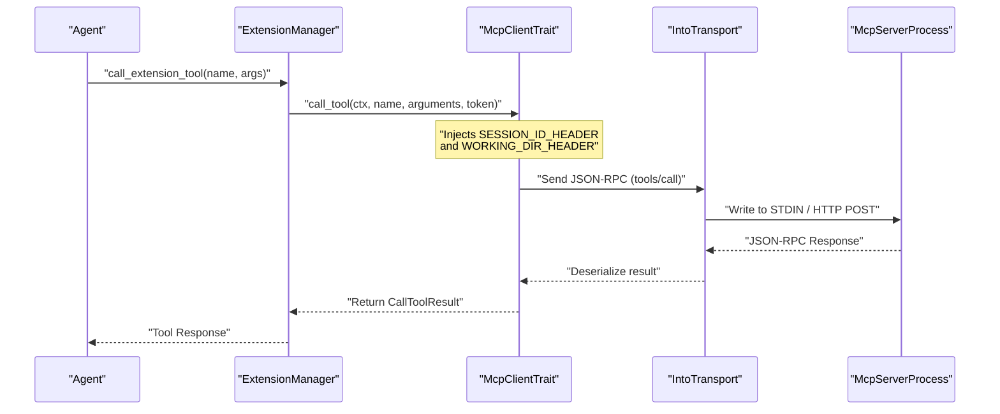
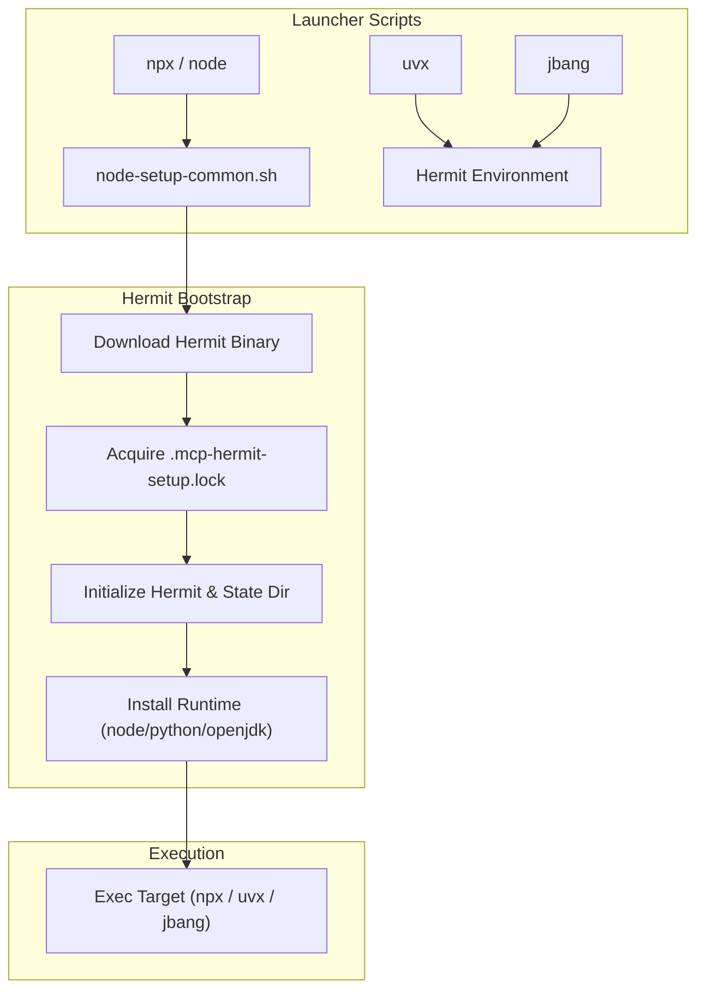
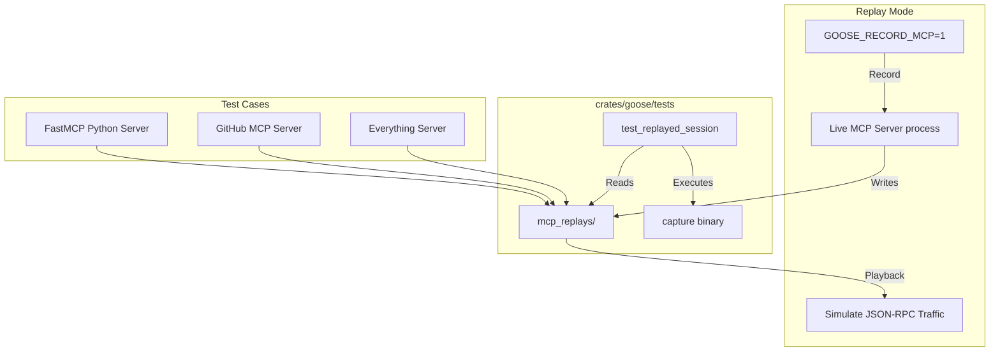

# MCP Client & Transport Layer

Relevant source files

The following files were used as context for generating this wiki page:

- [crates/goose/src/agents/mcp_client.rs](crates/goose/src/agents/mcp_client.rs)
- [crates/goose/tests/mcp_integration_test.rs](crates/goose/tests/mcp_integration_test.rs)
- [crates/goose/tests/mcp_replays/github-mcp-serverstdio](crates/goose/tests/mcp_replays/github-mcp-serverstdio)
- [crates/goose/tests/mcp_replays/github-mcp-serverstdio.results.json](crates/goose/tests/mcp_replays/github-mcp-serverstdio.results.json)
- [crates/goose/tests/mcp_replays/npx-y@modelcontextprotocol_server-everything@2026.1.14](crates/goose/tests/mcp_replays/npx-y@modelcontextprotocol_server-everything@2026.1.14)
- [crates/goose/tests/mcp_replays/npx-y@modelcontextprotocol_server-everything@2026.1.14.results.json](crates/goose/tests/mcp_replays/npx-y@modelcontextprotocol_server-everything@2026.1.14.results.json)
- [crates/goose/tests/mcp_replays/uvrun--withfastmcp==2.14.4fastmcpruntests_fastmcp_test_server.py](crates/goose/tests/mcp_replays/uvrun--withfastmcp==2.14.4fastmcpruntests_fastmcp_test_server.py)
- [documentation/blog/2025-11-30-announcing-advent-of-ai/index.md](documentation/blog/2025-11-30-announcing-advent-of-ai/index.md)
- [documentation/blog/2025-12-04-mcp-sampling/index.md](documentation/blog/2025-12-04-mcp-sampling/index.md)
- [documentation/blog/2026-01-15-why-tool-descriptions-arent-enough/index.md](documentation/blog/2026-01-15-why-tool-descriptions-arent-enough/index.md)
- [documentation/docs/docker/Dockerfile](documentation/docs/docker/Dockerfile)
- [documentation/docs/docker/docker-compose.yml](documentation/docs/docker/docker-compose.yml)
- [documentation/docs/mcp/council-of-mine-mcp.md](documentation/docs/mcp/council-of-mine-mcp.md)
- [scripts/test-subrecipes-examples/project_analyzer.yaml](scripts/test-subrecipes-examples/project_analyzer.yaml)
- [scripts/test-subrecipes-examples/project_analyzer_parallel.yaml](scripts/test-subrecipes-examples/project_analyzer_parallel.yaml)
- [scripts/test-subrecipes-examples/subrecipes/code_patterns.yaml](scripts/test-subrecipes-examples/subrecipes/code_patterns.yaml)
- [scripts/test-subrecipes-examples/subrecipes/file_stats.yaml](scripts/test-subrecipes-examples/subrecipes/file_stats.yaml)
- [scripts/test_mcp.sh](scripts/test_mcp.sh)
- [scripts/test_subrecipes.sh](scripts/test_subrecipes.sh)
- [ui/desktop/src/bin/.gitkeep](ui/desktop/src/bin/.gitkeep)
- [ui/desktop/src/bin/jbang](ui/desktop/src/bin/jbang)
- [ui/desktop/src/bin/node](ui/desktop/src/bin/node)
- [ui/desktop/src/bin/node-launchers.test.ts](ui/desktop/src/bin/node-launchers.test.ts)
- [ui/desktop/src/bin/node-setup-common.sh](ui/desktop/src/bin/node-setup-common.sh)
- [ui/desktop/src/bin/npx](ui/desktop/src/bin/npx)
- [ui/desktop/src/bin/uvx](ui/desktop/src/bin/uvx)

This page details the Model Context Protocol (MCP) client implementation and transport layer within Goose. It covers the core `McpClientTrait` abstraction, transport mechanisms (Stdio, SSE, Streamable HTTP), subprocess lifecycle and environment management, launcher scripts (`node`, `uvx`, `jbang` via Hermit), and the MCP replay testing and conformance suite.

Sources: [crates/goose/src/agents/mcp_client.rs:1-207](), [crates/goose/tests/mcp_integration_test.rs:1-221]()

---

## McpClient Architecture & Core Components

The `mcp-client` subsystem bridges the Goose core and external capability servers using the `rmcp` library. It manages protocol handshakes, capability negotiation, tool/resource discovery, and tool execution.

### Key Traits and Structures
*   **`McpClientTrait`**: The primary asynchronous interface implemented by clients, exposing methods like `list_tools`, `call_tool`, `list_resources`, `read_resource`, `list_prompts`, and `get_prompt` [crates/goose/src/agents/mcp_client.rs:76-142]().
*   **`GooseMcpHostInfo`**: Manages host capabilities, specifically handling client extensions like `io.modelcontextprotocol/ui` for MCP Apps [crates/goose/src/agents/mcp_client.rs:61-73]().
*   **Active Tool Call Tracking**: Uses `ActiveToolCallGuard` to trace running tool invocations per session ID, ensuring safety during concurrent dispatches [crates/goose/src/agents/mcp_client.rs:144-165]().

**MCP Request Lifecycle Diagram**

Sources: [crates/goose/src/agents/mcp_client.rs:76-142](), [crates/goose/tests/mcp_integration_test.rs:1-169]()

Sources: [crates/goose/src/agents/mcp_client.rs:1-207]()

---

## Transport Implementations & Subprocess Management

Goose supports multiple transport channels to connect to local and remote MCP servers through `rmcp` transport traits.

| Transport Type | Implementation Entity | Scope & Usage |
| :--- | :--- | :--- |
| **Stdio** | `TokioChildProcess` / Stdio pipes | Local subprocesses (`npx`, `uvx`, Python scripts, custom binaries). Manages standard input/output streams and captures diagnostic `STDERR` [crates/goose/tests/mcp_replays/github-mcp-serverstdio:1-10](). |
| **Streamable HTTP** | `StreamableHttpClientTransport` | High-performance streaming transport for servers emitting chunked JSON-RPC data. |
| **SSE** | Server-Sent Events (`Sse`) | Remote or web-based MCP endpoints communicating over HTTP streams. |

### Subprocess Management & Session Context
When spawning local Stdio processes, Goose injects execution context into the JSON-RPC initialization handshake via the `_meta` block:
*   `agent-session-id`: Mapped to `SESSION_ID_HEADER` [crates/goose/src/agents/mcp_client.rs:3]()
*   `working-directory`: Mapped to `WORKING_DIR_HEADER` [crates/goose/src/agents/mcp_client.rs:3]()

Sources: [crates/goose/src/agents/mcp_client.rs:1-45](), [crates/goose/tests/mcp_replays/github-mcp-serverstdio:1-10]()

---

## Node, `uvx`, and `jbang` Launchers

To ensure consistent execution environments across macOS, Linux, and Windows (especially when launched from GUI desktop wrappers where system paths are restricted), Goose bundles robust shell wrappers in `ui/desktop/src/bin/`. These wrappers bootstrap runtimes using **Hermit** (`mcp-hermit`) before executing user-requested commands.

### Launcher Bootstrap Flow

Sources: [ui/desktop/src/bin/uvx:1-186](), [ui/desktop/src/bin/npx:1-17](), [ui/desktop/src/bin/node-setup-common.sh:1-182](), [ui/desktop/src/bin/jbang:1-181]()

### Key Launcher Behaviors
*   **Locking & Concurrency**: All launchers implement file-based locking (`.mcp-hermit-setup.lock`) with a 300-second timeout to prevent race conditions when multiple MCP extensions initialize simultaneously [ui/desktop/src/bin/uvx:33-43](), [ui/desktop/src/bin/node-setup-common.sh:42-52]().
*   **PATH Remediation**: GUI-launched macOS apps inherit minimal paths lacking system utilities (like `chown`). Launchers explicitly prepend `/usr/sbin:/sbin` to `PATH` [ui/desktop/src/bin/node-setup-common.sh:26-30]().
*   **Registry & Custom Caches**: Support custom package registries (`GOOSE_UV_REGISTRY`, `GOOSE_NPM_REGISTRY`, `GOOSE_JBANG_REGISTRY`) and isolate hermetic state directories under `mcp-hermit/cache` [ui/desktop/src/bin/uvx:100-102](), [ui/desktop/src/bin/uvx:171-180](), [ui/desktop/src/bin/node-setup-common.sh:110-112]().

Sources: [ui/desktop/src/bin/uvx:1-186](), [ui/desktop/src/bin/npx:1-17](), [ui/desktop/src/bin/node-setup-common.sh:1-182](), [ui/desktop/src/bin/jbang:1-181]()

---

## MCP Replay Tests and Conformance

Goose validates MCP client correctness and protocol resilience using a binary capture/replay test harness (`crates/goose/tests/mcp_integration_test.rs`).

### Replay Architecture

Sources: [crates/goose/tests/mcp_integration_test.rs:129-221](), [crates/goose/tests/mcp_replays/github-mcp-serverstdio:1-15]()

### Conformance and Recording
*   **Dual Mode Execution**: Set `GOOSE_RECORD_MCP=1` to record live protocol traces from servers like `@modelcontextprotocol/server-everything` or `github-mcp-server`. By default, tests operate in **Playback** mode, asserting exact message equivalence against committed replay files [crates/goose/tests/mcp_integration_test.rs:199-204]().
*   **FastMCP Stderr Handling**: Automated test scripts (`scripts/test_mcp.sh`) ensure that Python FastMCP servers emitting startup banners or warnings on `STDERR` do not disrupt the `STDIO` JSON-RPC handshake [scripts/test_mcp.sh:1-83]().

Sources: [crates/goose/tests/mcp_integration_test.rs:1-221](), [scripts/test_mcp.sh:1-83](), [crates/goose/tests/mcp_replays/github-mcp-serverstdio:1-15]()