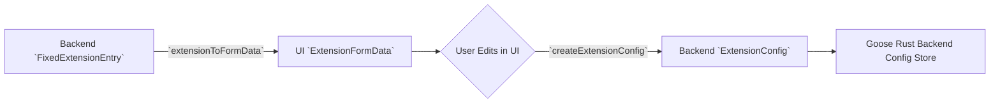

# External MCP Servers & Extension Catalog

<details>
<summary>Relevant source files</summary>

The following files were used as context for generating this wiki page:

- [documentation/docs/mcp/_template_.mdx](documentation/docs/mcp/_template_.mdx)
- [documentation/docs/mcp/apify-mcp.md](documentation/docs/mcp/apify-mcp.md)
- [documentation/docs/mcp/container-use-mcp.md](documentation/docs/mcp/container-use-mcp.md)
- [documentation/docs/mcp/dev.to-mcp.md](documentation/docs/mcp/dev.to-mcp.md)
- [documentation/docs/mcp/figma-mcp.md](documentation/docs/mcp/figma-mcp.md)
- [documentation/docs/mcp/github-mcp.md](documentation/docs/mcp/github-mcp.md)
- [documentation/docs/mcp/gitmcp-mcp.md](documentation/docs/mcp/gitmcp-mcp.md)
- [documentation/docs/mcp/goose-docs-mcp.md](documentation/docs/mcp/goose-docs-mcp.md)
- [documentation/docs/mcp/jetbrains-mcp.md](documentation/docs/mcp/jetbrains-mcp.md)
- [documentation/docs/mcp/neon-mcp.md](documentation/docs/mcp/neon-mcp.md)
- [documentation/docs/mcp/reddit-mcp.md](documentation/docs/mcp/reddit-mcp.md)
- [documentation/docs/mcp/square-mcp.md](documentation/docs/mcp/square-mcp.md)
- [documentation/src/components/CLIExtensionInstructions.tsx](documentation/src/components/CLIExtensionInstructions.tsx)
- [documentation/src/components/GooseDesktopInstaller.tsx](documentation/src/components/GooseDesktopInstaller.tsx)
- [documentation/src/components/server-card.tsx](documentation/src/components/server-card.tsx)
- [documentation/src/css/extensions.css](documentation/src/css/extensions.css)
- [documentation/src/css/tailwind.css](documentation/src/css/tailwind.css)
- [documentation/src/pages/extensions/detail.tsx](documentation/src/pages/extensions/detail.tsx)
- [documentation/src/pages/extensions/index.tsx](documentation/src/pages/extensions/index.tsx)
- [documentation/src/types/server.ts](documentation/src/types/server.ts)
- [documentation/src/utils/github-stars.ts](documentation/src/utils/github-stars.ts)
- [documentation/src/utils/install-links.ts](documentation/src/utils/install-links.ts)
- [documentation/src/utils/mcp-servers.ts](documentation/src/utils/mcp-servers.ts)
- [documentation/static/img/dev.to-project.png](documentation/static/img/dev.to-project.png)
- [documentation/static/servers.json](documentation/static/servers.json)
- [documentation/tailwind.config.js](documentation/tailwind.config.js)

</details>


## Purpose and Scope

This page documents the technical implementation of Goose's external Model Context Protocol (MCP) server integration. It covers the centralized extension catalog (`servers.json`), the `goose://` deep link URI protocol for one-click installation, the parser and security validation logic in `addExtensionFromDeepLink`, configuration form mapping utilities, and popular third-party integrations (such as JetBrains, GitHub, and Alby).

---

## Extension Catalog (`servers.json`)

The source of truth for the Goose extension marketplace is a centralized JSON catalog located at `documentation/static/servers.json`. This file defines the metadata, installation commands, documentation paths, and required environment variables for all endorsed and community-provided MCP servers.

### Catalog Data Structure

Each entry in the catalog follows a strict schema used by both the documentation site and the Goose Desktop application to render installation UI and generate deep links.

| Field | Type | Description |
| :--- | :--- | :--- |
| `id` | `string` | Unique identifier for the extension [documentation/static/servers.json:3](). |
| `name` | `string` | Human-readable name [documentation/static/servers.json:4](). |
| `command` | `string` | The shell command to run the server (e.g., `npx`, `uvx`) [documentation/static/servers.json:6](). |
| `is_builtin` | `boolean` | Whether the extension is compiled into Goose [documentation/static/servers.json:9](). |
| `environmentVariables` | `Array` | List of required or optional keys (e.g., `API_KEY`) [documentation/static/servers.json:11-17](). |
| `installation_notes` | `string` | Human-readable instructions for the user [documentation/static/servers.json:8](). |
| `endorsed` | `boolean` | Whether the extension is officially verified by the Goose team [documentation/static/servers.json:10](). |

**Example Catalog Entry:**
```json
{
  "id": "agentql-mcp",
  "name": "AgentQL",
  "description": "Transform unstructured web content into structured data",
  "command": "npx -y agentql-mcp",
  "link": "https://github.com/tinyfish-io/agentql-mcp",
  "installation_notes": "Install using npx package manager.",
  "is_builtin": false,
  "endorsed": false,
  "environmentVariables": [
    {
      "name": "AGENTQL_API_KEY",
      "description": "Required environment variable",
      "required": true
    }
  ]
}
```[documentation/static/servers.json:3-18]()

Sources:
- `documentation/static/servers.json:1-193`

---

## One-Click Installation & Deep Links (`goose://`)

Goose implements a custom URI scheme (`goose://`) to facilitate one-click installation of MCP servers from web documentation or community catalogs.

### Deep Link Generation (`getGooseInstallLink`)

The `getGooseInstallLink` utility transforms a catalog entry into a protocol-compliant URI [documentation/src/utils/install-links.ts:3-56](). It handles different transport types, mapping `streamable-http` and local command-line executors (`npx`, `uvx`, `docker`, `jbang`) into query parameters (`cmd`, `url`, `arg`, `env`, `header`).

### Deep Link Processing & Security (`addExtensionFromDeepLink`)

When a `goose://` deep link is opened by the desktop application, `addExtensionFromDeepLink` processes the URL.

The parser performs strict security checks:
1. **Protocol Verification**: Asserts that the URL uses the exact `goose:` protocol schema.
2. **Command Whitelisting**: `getStdioConfig` restricts executable commands to an explicit list (`cu`, `docker`, `jbang`, `npx`, `uvx`, `goose`, `npx.cmd`).
3. **Injection Prevention**: Blocks potentially dangerous command-line arguments like `npx -c` which can lead to remote code execution.

**Diagram 1: Natural Language to Code Entity Mapping (Installation Flow)**
```mermaid
graph TD
    NL_Catalog["Natural Language: servers.json catalog entry"] -->|`getGooseInstallLink(server: MCPServer)`| LinkGenerator[documentation/src/utils/install-links.ts]
    LinkGenerator -->|Generates URI| DeepLinkURI["`goose://extension?cmd=npx&arg=...`"]
    DeepLinkURI -->|User clicks link (Desktop App)| DeepLinkHandler["Desktop App Deep Link Handler"]
    DeepLinkHandler -->|Parses URI| `addExtensionFromDeepLink`
    `addExtensionFromDeepLink` --> SecurityChecks["Security Checks (Protocol, Command Whitelisting, Injection Prevention)"]
    SecurityChecks -->|Valid| ConfigBuilder["Extension Configuration Builder"]
    ConfigBuilder --> ExtensionState["Extension State (ConfigContext)"]
```
Sources:
- `documentation/src/utils/install-links.ts:3-56`

---

## Extension Configuration & Form Lifecycle

The desktop settings interface manages extensions through form conversion layers that translate Rust backend configurations into UI form states and vice versa.

### Key Functions
- `nameToKey(name: string)`: Converts friendly extension names into lowercase string keys without whitespace.
- `extensionToFormData(extension: FixedExtensionEntry)`: Flattens a backend `FixedExtensionEntry` (stdio, streamable_http, or builtin) into an `ExtensionFormData` structure, handling secret keys and legacy `envs`.
- `createExtensionConfig(formData: ExtensionFormData)`: Assembles validated form input back into an `ExtensionConfig` payload for backend persistence.

**Diagram 2: Configuration Entity Transformation Lifecycle**

Sources:
- `documentation/src/components/GooseDesktopInstaller.tsx`
- `documentation/src/components/CLIExtensionInstructions.tsx`

---

## Popular Third-Party Integrations

Goose provides dedicated documentation and optimized installation recipes for multiple external MCP servers.

| Extension | Command / URL Pattern | Transport Type | Use Case |
| :--- | :--- | :--- | :--- |
| **GitHub** | `https://api.githubcopilot.com/mcp/` | `streamable_http` | Repository management, PR reviews, and issue tracking [documentation/docs/mcp/github-mcp.md:47-50](). |
| **JetBrains** | `http://127.0.0.1:<PORT>/stream` | `streamable_http` / `stdio` | Integrated development inside IntelliJ, PyCharm, and other JetBrains IDEs [documentation/docs/mcp/jetbrains-mcp.md:23-44](). |
| **Neon** | `https://mcp.neon.tech/mcp` | `streamable_http` | Serverless Postgres database provisioning and management [documentation/docs/mcp/neon-mcp.md:37-39](). |
| **Container Use** | `npx -y mcp-remote https://container-use.com/mcp` | `stdio` (remote proxy) | Isolated development and execution environments via Docker [documentation/docs/mcp/container-use-mcp.md:46-47](). |
| **Alby** | `npx -y @getalby/mcp` | `stdio` | Bitcoin Lightning Network integration and micro-payments [documentation/static/servers.json:20-35](). |
| **Cloudinary** | `npx -y --package @cloudinary/asset-management -- mcp start` | `stdio` | Cloud-based media asset management and processing [documentation/static/servers.json:142-156](). |
| **Dev.to** | `http://localhost:3000/mcp` | `streamable_http` | Access Dev.to public API for articles, tags, and user info [documentation/docs/mcp/dev.to-mcp.md:27-29](). |
| **GitMCP** | `npx -y mcp-remote https://gitmcp.io/docs` | `stdio` (remote proxy) | Live access to GitHub repositories for documentation search and code exploration [documentation/docs/mcp/gitmcp-mcp.md:23-26](). |
| **Apify** | `npx -y @apify/actors-mcp-server` | `stdio` | Web scraping and automation with Apify Store [documentation/static/servers.json:37-51](). |

### Custom Extension Transport Variations
Extensions are categorized into three core transport architectures within Goose:
1. **`stdio`**: Local child-process execution (via `npx`, `uvx`, or `docker`), parsed into `cmd` and `args` components.
2. **`streamable_http`**: Remote SSE / HTTP long-polling endpoints supporting custom HTTP headers, OAuth scopes, and secret environment bindings.
3. **`builtin`**: In-process platform extensions compiled directly into Goose (e.g., `autovisualiser`, `computercontroller`) [documentation/static/servers.json:71-168]().

Sources:
- `documentation/static/servers.json:1-193`
- `documentation/docs/mcp/jetbrains-mcp.md:1-136`
- `documentation/docs/mcp/github-mcp.md:1-138`
- `documentation/docs/mcp/neon-mcp.md:1-202`
- `documentation/docs/mcp/container-use-mcp.md:1-198`
- `documentation/docs/mcp/dev.to-mcp.md:1-143`
- `documentation/docs/mcp/gitmcp-mcp.md:1-175`