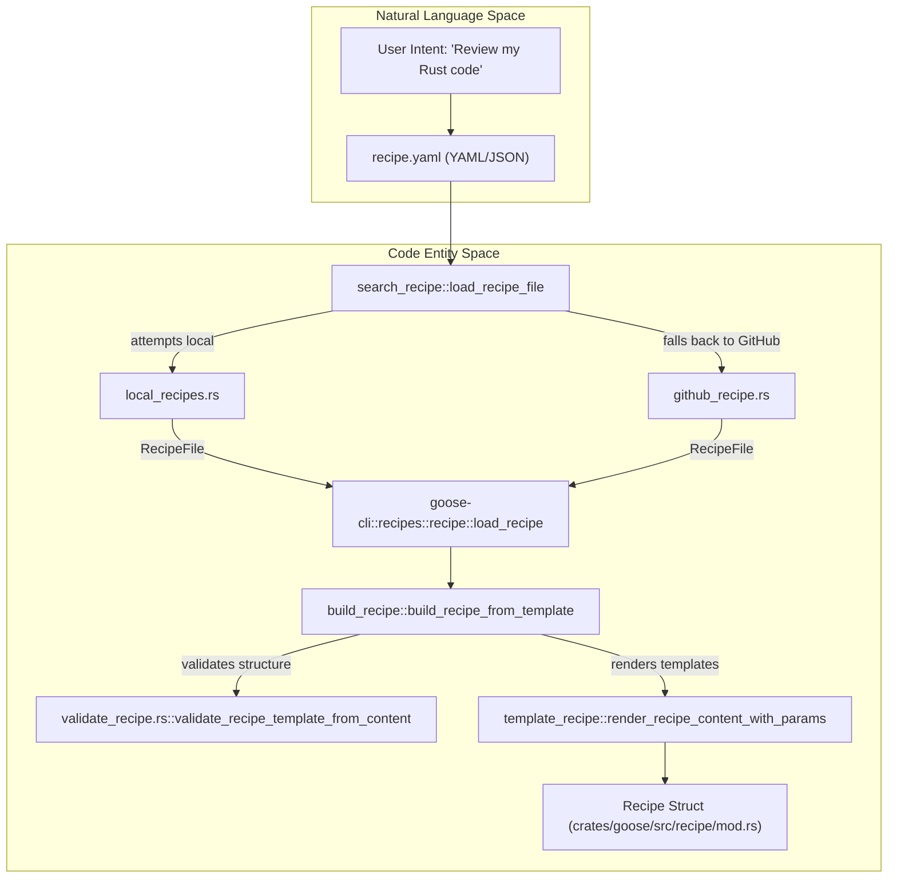
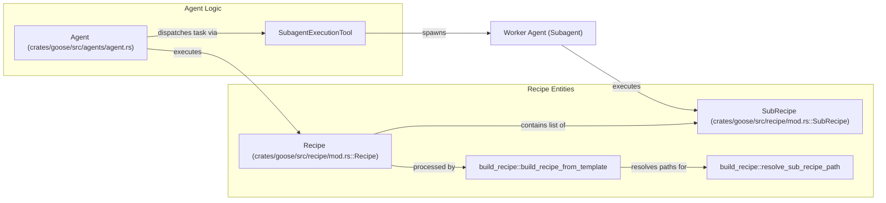

# Recipes & Scheduling

Relevant source files

The following files were used as context for generating this wiki page:

- [crates/goose-cli/src/commands/recipe.rs](crates/goose-cli/src/commands/recipe.rs)
- [crates/goose-cli/src/recipes/github_recipe.rs](crates/goose-cli/src/recipes/github_recipe.rs)
- [crates/goose-cli/src/recipes/mod.rs](crates/goose-cli/src/recipes/mod.rs)
- [crates/goose-cli/src/recipes/print_recipe.rs](crates/goose-cli/src/recipes/print_recipe.rs)
- [crates/goose-cli/src/recipes/recipe.rs](crates/goose-cli/src/recipes/recipe.rs)
- [crates/goose-cli/src/recipes/search_recipe.rs](crates/goose-cli/src/recipes/search_recipe.rs)
- [crates/goose-mcp/src/subprocess.rs](crates/goose-mcp/src/subprocess.rs)
- [crates/goose/src/recipe/mod.rs](crates/goose/src/recipe/mod.rs)
- [crates/goose/src/subprocess.rs](crates/goose/src/subprocess.rs)
- [crates/goose/tests/subprocess_cleanup.rs](crates/goose/tests/subprocess_cleanup.rs)
- [documentation/docs/guides/config-files.md](documentation/docs/guides/config-files.md)
- [documentation/docs/guides/context-engineering/subagents.mdx](documentation/docs/guides/context-engineering/subagents.mdx)
- [documentation/docs/guides/environment-variables.md](documentation/docs/guides/environment-variables.md)
- [documentation/docs/guides/goose-cli-commands.md](documentation/docs/guides/goose-cli-commands.md)
- [documentation/docs/guides/multi-model/index.mdx](documentation/docs/guides/multi-model/index.mdx)
- [documentation/docs/guides/recipes/index.mdx](documentation/docs/guides/recipes/index.mdx)
- [documentation/docs/guides/recipes/recipe-reference.md](documentation/docs/guides/recipes/recipe-reference.md)
- [documentation/docs/guides/recipes/session-recipes.md](documentation/docs/guides/recipes/session-recipes.md)
- [documentation/docs/guides/recipes/storing-recipes.md](documentation/docs/guides/recipes/storing-recipes.md)
- [documentation/docs/guides/recipes/subrecipes.md](documentation/docs/guides/recipes/subrecipes.md)
- [documentation/docs/guides/running-tasks.md](documentation/docs/guides/running-tasks.md)
- [documentation/docs/guides/sessions/smart-context-management.md](documentation/docs/guides/sessions/smart-context-management.md)
- [documentation/docs/troubleshooting/known-issues.md](documentation/docs/troubleshooting/known-issues.md)
- [documentation/docs/tutorials/recipes-tutorial.md](documentation/docs/tutorials/recipes-tutorial.md)
- [documentation/src/components/RecipeFields.js](documentation/src/components/RecipeFields.js)
- [documentation/src/components/VideoCarousel.js](documentation/src/components/VideoCarousel.js)
- [documentation/static/files/thoughts/plans/2025-12-23-remove-tool-selection-strategy.raw](documentation/static/files/thoughts/plans/2025-12-23-remove-tool-selection-strategy.raw)
- [documentation/static/files/thoughts/research/2025-12-22-llm-tool-selection-strategy.raw](documentation/static/files/thoughts/research/2025-12-22-llm-tool-selection-strategy.raw)

Recipes are reusable configurations that package instructions, tools (extensions), and goals into a single unit. They allow users to standardize agent behavior for specific tasks and share those workflows with others. Scheduling extends this by allowing recipes to run autonomously at defined intervals.

## Recipe System

The Recipe system is built around a structured YAML or JSON schema that defines how an agent should behave and what resources it can access. The `Recipe` struct [crates/goose/src/recipe/mod.rs:42-86]() acts as the core data model, containing fields for `instructions`, `prompt`, `extensions`, `parameters`, `sub_recipes`, and `retry` [crates/goose/src/recipe/mod.rs:51-86]().

Recipes support dynamic execution through **Template Variables**. Using `{{ variable_name }}` syntax, authors can define parameters that are filled at runtime. The `RecipeParameter` [crates/goose/src/recipe/mod.rs:197-206]() supports various input types including `String`, `Boolean`, `Number`, `Date`, and `File` [crates/goose/src/recipe/mod.rs:175-184](). The `File` type allows importing content directly from a file path into the prompt during the build process [crates/goose/src/recipe/build_recipe/mod.rs:141-147]().

### Key Components
*   **Discovery**: Goose searches for recipes in local directories and configured GitHub repositories via `search_recipe::load_recipe_file` [crates/goose-cli/src/recipes/search_recipe.rs:11-19]() and `retrieve_recipe_from_github` [crates/goose-cli/src/recipes/github_recipe.rs:33-66](). The `GOOSE_RECIPE_GITHUB_REPO` configuration key [crates/goose-cli/src/recipes/github_recipe.rs:32]() specifies the remote repository. Recipes can be stored globally (`~/.config/goose/recipes/`) or locally (`YOUR_WORKING_DIRECTORY/.goose/recipes/`) [documentation/docs/guides/recipes/storing-recipes.md:20-27]().
*   **Validation**: The system validates recipe templates using `validate_recipe_template_from_content` [crates/goose/src/recipe/build_recipe/mod.rs:30]() or file validation commands [crates/goose-cli/src/commands/recipe.rs:10-22]() to ensure required parameters and schema integrity.
*   **Interactive Parameters**: The CLI can prompt users for missing parameters during execution via a `user_prompt_fn` callback mechanism [crates/goose-cli/src/recipes/recipe.rs:13-19]().
*   **Deep Linking**: Recipes can be encoded into `goose://recipe?config=...` URLs using `recipe_deeplink::encode` [crates/goose-cli/src/commands/recipe.rs:175-184](), allowing sharing and launching in the Desktop app.

For details, see [Recipe System](#4.1).

### Recipe Lifecycle Diagram

Sources: [crates/goose/src/recipe/mod.rs:42-86](), [crates/goose/src/recipe/build_recipe/mod.rs:45-71](), [crates/goose-cli/src/recipes/search_recipe.rs:11-19](), [crates/goose-cli/src/recipes/github_recipe.rs:33-66](), [crates/goose-cli/src/recipes/recipe.rs:21-38]()

## Scheduling & Automation

Scheduling allows for the automated, cron-based execution of recipes. This is managed by the `Scheduler` and exposed via the `ScheduleTool` implementation [crates/goose/src/agents/schedule_tool.rs:64-127](). The system stores job instances which contain the recipe source path, cron expression, and execution metadata.

The CLI provides commands like `handle_schedule_add` [crates/goose-cli/src/commands/schedule.rs:68-140]() for user management, including adding and listing jobs. The Desktop UI (`SchedulesView`) also offers a management view for monitoring, pausing, and editing active schedules [ui/desktop/src/components/schedule/SchedulesView.tsx:82-106]().

For details, see [Scheduling & Automation](#4.2).

## Subagents & Multi-Agent Orchestration

Recipes can define `sub_recipes` [crates/goose/src/recipe/mod.rs:119-128](), enabling complex, multi-stage workflows where a lead agent spawns worker agents to handle specific sub-tasks.

When a recipe with sub-recipes is executed, the system resolves sub-recipe paths relative to the parent recipe's location using `resolve_sub_recipe_path` [crates/goose/src/recipe/build_recipe/mod.rs:154-177](). The `SubRecipe` struct allows passing specific parameters (`values`) to the child agent [crates/goose/src/recipe/mod.rs:119-128](). The CLI supports adding additional sub-recipes dynamically at runtime via `extract_recipe_info_from_cli` [crates/goose-cli/src/recipes/extract_from_cli.rs:11-59]().

For details, see [Subagents & Multi-Agent Orchestration](#4.3).

### Orchestration Flow Diagram

Sources: [crates/goose/src/recipe/mod.rs:82](), [crates/goose/src/recipe/mod.rs:119-128](), [crates/goose-cli/src/recipes/extract_from_cli.rs:11-59](), [crates/goose/src/recipe/build_recipe/mod.rs:154-177]()

## Summary Table of Recipe Features

| Feature | Description | Code Pointer |
| :--- | :--- | :--- |
| **Parameters** | Dynamic variables (`RecipeParameter`) injected into prompts | [crates/goose/src/recipe/mod.rs:197-206]() |
| **Extensions** | `ExtensionConfig` list required for the recipe | [crates/goose/src/recipe/mod.rs:59-64]() |
| **Sub-recipes** | Hierarchical recipe execution via `SubRecipe` | [crates/goose/src/recipe/mod.rs:119-128]() |
| **Retry Logic** | `RetryConfig` for automated success validation | [crates/goose/src/recipe/mod.rs:85]() |
| **Deep Links** | Encoded URLs for sharing via `recipe_deeplink` | [crates/goose-cli/src/commands/recipe.rs:168-191]() |
| **Settings** | Model, provider, and temperature overrides | [crates/goose/src/recipe/mod.rs:98-110]() |

Sources: [crates/goose/src/recipe/mod.rs:42-206](), [crates/goose-cli/src/commands/recipe.rs:168-191](), [crates/goose/src/recipe/build_recipe/mod.rs:154-177]()