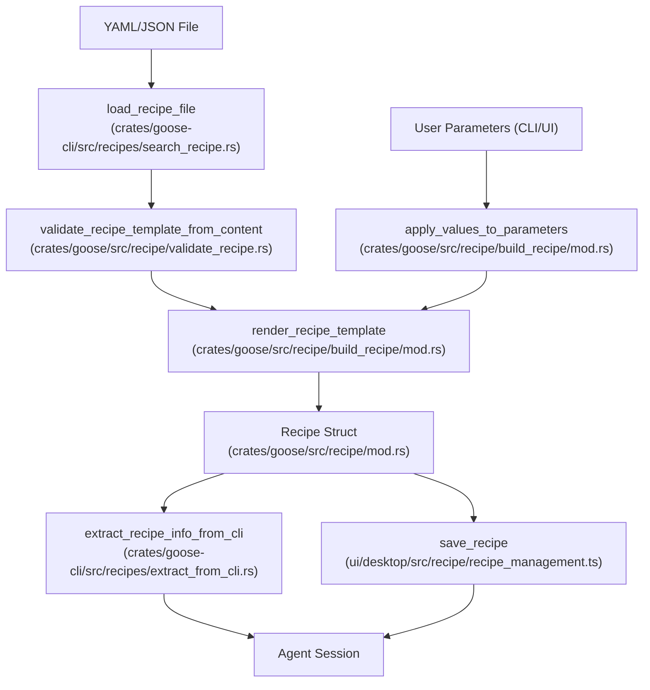
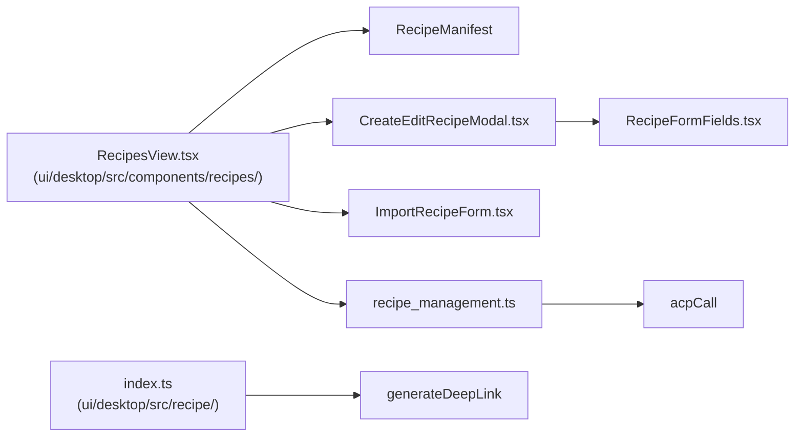

# Recipe System

Relevant source files

The following files were used as context for generating this wiki page:

- [crates/goose-cli/src/commands/recipe.rs](crates/goose-cli/src/commands/recipe.rs)
- [crates/goose-cli/src/commands/schedule.rs](crates/goose-cli/src/commands/schedule.rs)
- [crates/goose-cli/src/recipes/extract_from_cli.rs](crates/goose-cli/src/recipes/extract_from_cli.rs)
- [crates/goose-cli/src/recipes/github_recipe.rs](crates/goose-cli/src/recipes/github_recipe.rs)
- [crates/goose-cli/src/recipes/mod.rs](crates/goose-cli/src/recipes/mod.rs)
- [crates/goose-cli/src/recipes/print_recipe.rs](crates/goose-cli/src/recipes/print_recipe.rs)
- [crates/goose-cli/src/recipes/recipe.rs](crates/goose-cli/src/recipes/recipe.rs)
- [crates/goose-cli/src/recipes/search_recipe.rs](crates/goose-cli/src/recipes/search_recipe.rs)
- [crates/goose-mcp/src/subprocess.rs](crates/goose-mcp/src/subprocess.rs)
- [crates/goose/src/agents/schedule_tool.rs](crates/goose/src/agents/schedule_tool.rs)
- [crates/goose/src/recipe/build_recipe/mod.rs](crates/goose/src/recipe/build_recipe/mod.rs)
- [crates/goose/src/recipe/build_recipe/tests.rs](crates/goose/src/recipe/build_recipe/tests.rs)
- [crates/goose/src/recipe/mod.rs](crates/goose/src/recipe/mod.rs)
- [crates/goose/src/recipe/read_recipe_file_content.rs](crates/goose/src/recipe/read_recipe_file_content.rs)
- [crates/goose/src/recipe/template_recipe.rs](crates/goose/src/recipe/template_recipe.rs)
- [crates/goose/src/recipe/validate_recipe.rs](crates/goose/src/recipe/validate_recipe.rs)
- [crates/goose/src/recipe/value_deserializer.rs](crates/goose/src/recipe/value_deserializer.rs)
- [crates/goose/src/subprocess.rs](crates/goose/src/subprocess.rs)
- [crates/goose/tests/schedule_recipe_parity.rs](crates/goose/tests/schedule_recipe_parity.rs)
- [crates/goose/tests/schedule_tool_security.rs](crates/goose/tests/schedule_tool_security.rs)
- [crates/goose/tests/subprocess_cleanup.rs](crates/goose/tests/subprocess_cleanup.rs)
- [ui/desktop/src/acp/__tests__/recipeParamRequests.test.ts](ui/desktop/src/acp/__tests__/recipeParamRequests.test.ts)
- [ui/desktop/src/acp/recipeParamRequests.ts](ui/desktop/src/acp/recipeParamRequests.ts)
- [ui/desktop/src/components/ParameterInputModal.tsx](ui/desktop/src/components/ParameterInputModal.tsx)
- [ui/desktop/src/components/__tests__/ParameterInputModal.test.tsx](ui/desktop/src/components/__tests__/ParameterInputModal.test.tsx)
- [ui/desktop/src/components/common/InlineEditText.tsx](ui/desktop/src/components/common/InlineEditText.tsx)
- [ui/desktop/src/components/recipes/CreateEditRecipeModal.tsx](ui/desktop/src/components/recipes/CreateEditRecipeModal.tsx)
- [ui/desktop/src/components/recipes/RecipesView.tsx](ui/desktop/src/components/recipes/RecipesView.tsx)
- [ui/desktop/src/components/recipes/shared/CreateSubRecipeInline.tsx](ui/desktop/src/components/recipes/shared/CreateSubRecipeInline.tsx)
- [ui/desktop/src/components/recipes/shared/RecipeFormFields.tsx](ui/desktop/src/components/recipes/shared/RecipeFormFields.tsx)
- [ui/desktop/src/components/recipes/shared/__tests__/RecipeFormFields.test.tsx](ui/desktop/src/components/recipes/shared/__tests__/RecipeFormFields.test.tsx)
- [ui/desktop/src/components/recipes/shared/recipeFormSchema.ts](ui/desktop/src/components/recipes/shared/recipeFormSchema.ts)
- [ui/desktop/src/components/schedule/ScheduleDetailView.tsx](ui/desktop/src/components/schedule/ScheduleDetailView.tsx)
- [ui/desktop/src/components/schedule/SchedulesView.tsx](ui/desktop/src/components/schedule/SchedulesView.tsx)
- [ui/desktop/src/recipe/index.ts](ui/desktop/src/recipe/index.ts)
- [ui/desktop/src/recipe/recipe_management.ts](ui/desktop/src/recipe/recipe_management.ts)
- [ui/desktop/src/recipe/validation.test.ts](ui/desktop/src/recipe/validation.test.ts)
- [ui/desktop/src/recipe/validation.ts](ui/desktop/src/recipe/validation.ts)

The Recipe System in Goose packages agent configurations—including instructions, tools (extensions), goals, and model settings—into reusable, shareable templates. Recipes execute via the CLI, the Desktop UI, or on a schedule, enabling automated and consistent agent behavior across different environments.

## Recipe Definition & Schema

Recipes are defined in YAML or JSON formats [crates/goose/src/recipe/mod.rs:25-26](). A recipe is represented internally by the `Recipe` struct [crates/goose/src/recipe/mod.rs:42-86]().

### Core Fields
| Field | Type | Description |
|-------|------|-------------|
| `version` | `String` | Version of the file format, defaults to "1.0.0" [crates/goose/src/recipe/mod.rs:44-45](). |
| `title` | `String` | Short descriptive name for the recipe [crates/goose/src/recipe/mod.rs:47](). |
| `description` | `String` | Detailed explanation of the recipe's purpose [crates/goose/src/recipe/mod.rs:49](). |
| `instructions` | `Option<String>` | System-level instructions defining the agent's persona and rules [crates/goose/src/recipe/mod.rs:54](). |
| `prompt` | `Option<String>` | The initial user message to start the session [crates/goose/src/recipe/mod.rs:57](). |
| `extensions` | `Option<Vec<ExtensionConfig>>` | MCP extensions and tools required by the recipe [crates/goose/src/recipe/mod.rs:64](). |
| `parameters` | `Option<Vec<RecipeParameter>>` | Variables for dynamic template substitution [crates/goose/src/recipe/mod.rs:76](). |
| `sub_recipes` | `Option<Vec<SubRecipe>>` | A list of other recipes to execute as part of this workflow [crates/goose/src/recipe/mod.rs:82](). |
| `settings` | `Option<Settings>` | Model configuration including provider, model name, temperature, and max turns [crates/goose/src/recipe/mod.rs:98-110](). |
| `retry` | `Option<RetryConfig>` | Configuration for automated retry logic and success validation [crates/goose/src/recipe/mod.rs:85](). |
| `activities` | `Option<Vec<String>>` | Clickable activity bubbles for the Desktop UI [crates/goose/src/recipe/mod.rs:70](). |

### Dynamic Parameters
Recipes support template variables using `{{ variable_name }}` syntax. The `RecipeParameter` struct defines how these variables are collected [crates/goose/src/recipe/mod.rs:197-206]():
*   **Requirement Levels**: `Required`, `Optional`, or `UserPrompt` (triggers interactive request) [crates/goose/src/recipe/mod.rs:157-161]().
*   **Input Types**: `String`, `Number`, `Boolean`, `Date`, `File` (imports file content), and `Select` [crates/goose/src/recipe/mod.rs:175-184]().

Sources: [crates/goose/src/recipe/mod.rs:42-207]()

---

## Recipe Building & Execution

Turning a raw template into an executable `Recipe` involves validation, parameter resolution, and template rendering via `minijinja`.

### Data Flow: Template to Agent
The following diagram bridges natural language configuration space to concrete code entities in the `goose` crate.

**Recipe Processing Pipeline**

Sources: [crates/goose/src/recipe/build_recipe/mod.rs:20-76](), [crates/goose-cli/src/recipes/extract_from_cli.rs:11-59](), [crates/goose-cli/src/recipes/search_recipe.rs:1-10]()

### Key Functions
*   `build_recipe_from_template`: Primary entry point for resolving a recipe. Validates content, applies parameters, and returns a hydrated `Recipe` struct [crates/goose/src/recipe/build_recipe/mod.rs:47-76]().
*   `apply_values_to_parameters`: Merges provided values with defaults and handles `UserPrompt` callbacks [crates/goose/src/recipe/build_recipe/mod.rs:78-94]().
*   `extract_recipe_info_from_cli`: Maps a resolved `Recipe` into an `InputConfig` for CLI agent sessions [crates/goose-cli/src/recipes/extract_from_cli.rs:11-59]().
*   `render_recipe_content_with_params`: Uses the template engine to substitute variables in recipe strings [crates/goose/src/recipe/template_recipe.rs:126-145]().

Sources: [crates/goose/src/recipe/build_recipe/mod.rs:47-157](), [crates/goose-cli/src/recipes/extract_from_cli.rs:11-59](), [crates/goose/src/recipe/template_recipe.rs:126-145]()

---

## Storage & Discovery

Goose discovers recipes from local paths, global configurations, and configured GitHub repositories.

### Discovery Logic
1.  **Current Directory**: Scans `.` for `*.yaml` and `*.json` files [crates/goose-cli/src/recipes/search_recipe.rs:1-50]().
2.  **Custom Paths**: Directories specified in the `GOOSE_RECIPE_PATH` environment variable.
3.  **Global Recipe Library**: `~/.config/goose/recipes/` (macOS/Linux) or `%APPDATA%\Block\goose\recipes\` (Windows).
4.  **Local Project Recipes**: `./.goose/recipes/` within a project directory.
5.  **GitHub Recipes**: Uses `retrieve_recipe_from_github` with the GitHub CLI (`gh`) when `GOOSE_RECIPE_GITHUB_REPO` is set [crates/goose-cli/src/recipes/github_recipe.rs:32-66]().

Sources: [crates/goose-cli/src/recipes/github_recipe.rs:32-66](), [crates/goose-cli/src/recipes/search_recipe.rs:1-50]()

---

## Deeplinks & URL Encoding

Recipes can be serialized into deep links for one-click sharing and execution across clients.

*   `generate_deeplink`: Encodes a validated recipe into a `goose://recipe?config=...` URL string with appended query parameters [crates/goose-cli/src/commands/recipe.rs:168-191]().
*   `decodeRecipe` / `encodeRecipe`: TypeScript wrappers in the desktop application that interface with the ACP recipe module [ui/desktop/src/recipe/index.ts:28-58]().
*   `parseDeeplink`: Validates deeplink format and verifies required fields (title, description, and instructions or prompt) before rendering [ui/desktop/src/recipe/index.ts:93-121]().

Sources: [crates/goose-cli/src/commands/recipe.rs:168-191](), [ui/desktop/src/recipe/index.ts:28-121]()

---

## CLI & Desktop Integration

### CLI Recipe Commands
The `goose-cli` provides commands for recipe management:
*   `goose recipe list`: Lists available recipes with optional `--verbose` or `--format json` output [crates/goose-cli/src/commands/recipe.rs:102-151]().
*   `explain_recipe`: Explains a recipe, showing required and missing parameters [crates/goose-cli/src/recipes/recipe.rs:54-72]().
*   `render_recipe_as_yaml`: Renders a hydrated recipe to YAML [crates/goose-cli/src/recipes/recipe.rs:40-52]().
*   `handle_validate`: Validates recipe template syntax and parameters [crates/goose-cli/src/commands/recipe.rs:10-22]().

Sources: [crates/goose-cli/src/commands/recipe.rs:10-151](), [crates/goose-cli/src/recipes/recipe.rs:40-72]()

### Desktop UI: Recipe Editor
The Goose Desktop UI provides a visual interface for managing recipes, editing parameters, and importing templates.

**Recipe UI Architecture**

Sources: [ui/desktop/src/components/recipes/RecipesView.tsx:1-40](), [ui/desktop/src/recipe/index.ts:28-58]()

### Key UI Features
*   **Recipe Library**: Browse saved recipes with last modified dates and source tracking [ui/desktop/src/components/recipes/RecipesView.tsx:1-120]().
*   **Parameter Input Modal**: Renders dynamic forms (`ParameterInputModal.tsx`) supporting types like `select`, `boolean`, `number`, and `string` [ui/desktop/src/components/ParameterInputModal.tsx:57-124]().
*   **Sharing**: Generates sharing URLs via `generateDeepLink` [ui/desktop/src/recipe/index.ts:55-58]().

Sources: [ui/desktop/src/components/recipes/RecipesView.tsx:1-120](), [ui/desktop/src/components/ParameterInputModal.tsx:57-124](), [ui/desktop/src/recipe/index.ts:55-58]()

---

## Security & Validation

Goose implements several validation layers to protect against malformed templates and prompt injection:

1.  **Unicode Tag Detection**: Scans for hidden unicode tags that could be used for prompt injection [crates/goose/src/recipe/mod.rs:11]().
2.  **Parameter Validation**: `parse_and_validate_parameters` ensures that template variables are correctly defined and supplied [crates/goose/src/recipe/validate_recipe.rs:1-30]().
3.  **Error Stripping**: `strip_error_location` cleans up raw parsing error messages for friendly UI display [crates/goose/src/recipe/mod.rs:33-39]().
4.  **File Parameter Safety**: `File` type parameters do not support default values to prevent unintended importing of sensitive user files [crates/goose/src/recipe/mod.rs:181-182]().

Sources: [crates/goose/src/recipe/mod.rs:11-39](), [crates/goose/src/recipe/mod.rs:181-182](), [crates/goose/src/recipe/validate_recipe.rs:1-30]()