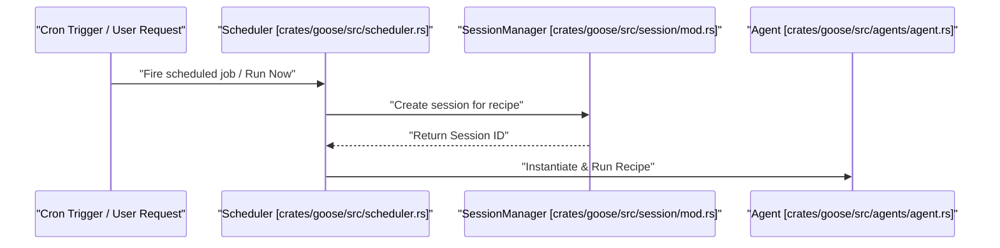
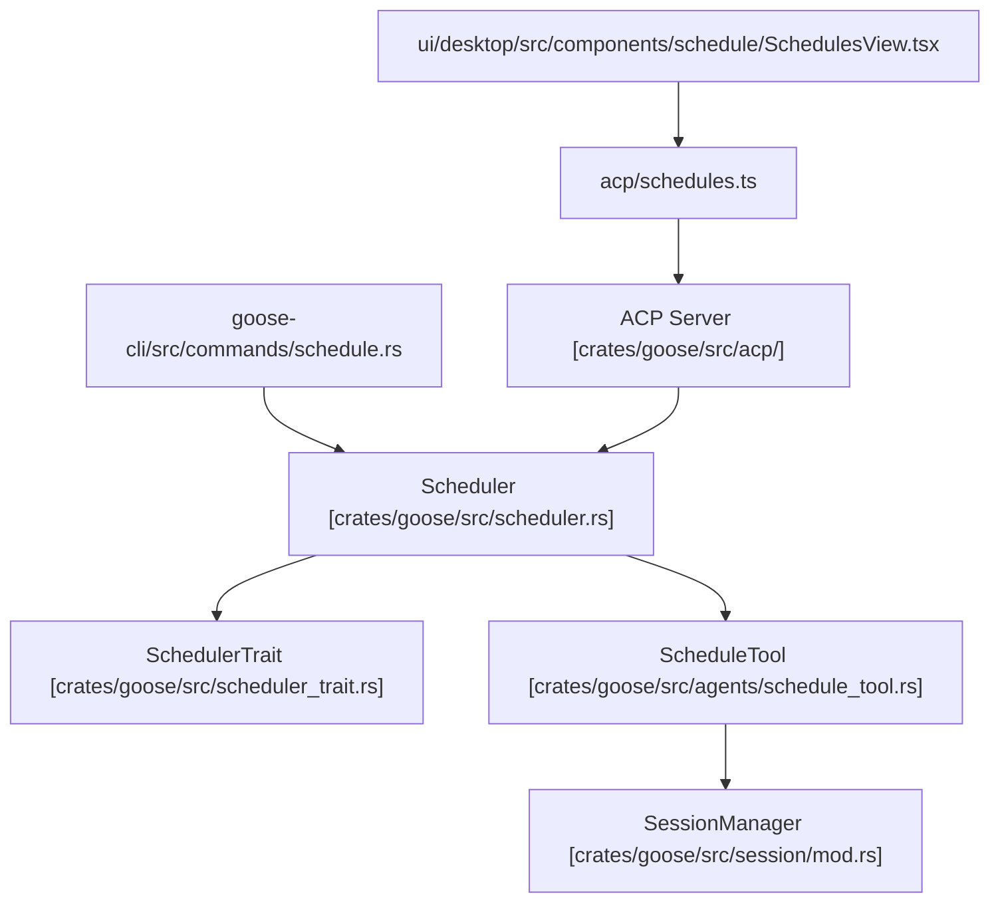

# Scheduling & Automation

Relevant source files

The following files were used as context for generating this wiki page:

- [crates/goose-cli/src/commands/schedule.rs](crates/goose-cli/src/commands/schedule.rs)
- [crates/goose-cli/src/recipes/extract_from_cli.rs](crates/goose-cli/src/recipes/extract_from_cli.rs)
- [crates/goose/src/agents/schedule_tool.rs](crates/goose/src/agents/schedule_tool.rs)
- [crates/goose/src/recipe/build_recipe/mod.rs](crates/goose/src/recipe/build_recipe/mod.rs)
- [crates/goose/src/recipe/build_recipe/tests.rs](crates/goose/src/recipe/build_recipe/tests.rs)
- [crates/goose/src/recipe/read_recipe_file_content.rs](crates/goose/src/recipe/read_recipe_file_content.rs)
- [crates/goose/src/recipe/template_recipe.rs](crates/goose/src/recipe/template_recipe.rs)
- [crates/goose/src/recipe/validate_recipe.rs](crates/goose/src/recipe/validate_recipe.rs)
- [crates/goose/src/recipe/value_deserializer.rs](crates/goose/src/recipe/value_deserializer.rs)
- [crates/goose/tests/schedule_recipe_parity.rs](crates/goose/tests/schedule_recipe_parity.rs)
- [crates/goose/tests/schedule_tool_security.rs](crates/goose/tests/schedule_tool_security.rs)
- [ui/desktop/src/acp/schedules.ts](ui/desktop/src/acp/schedules.ts)
- [ui/desktop/src/components/ErrorBoundary.tsx](ui/desktop/src/components/ErrorBoundary.tsx)
- [ui/desktop/src/components/schedule/CronPicker.tsx](ui/desktop/src/components/schedule/CronPicker.tsx)
- [ui/desktop/src/components/schedule/ScheduleDetailView.tsx](ui/desktop/src/components/schedule/ScheduleDetailView.tsx)
- [ui/desktop/src/components/schedule/ScheduleModal.tsx](ui/desktop/src/components/schedule/ScheduleModal.tsx)
- [ui/desktop/src/components/schedule/SchedulesView.tsx](ui/desktop/src/components/schedule/SchedulesView.tsx)
- [ui/desktop/src/components/schedule/__tests__/CronPicker.test.tsx](ui/desktop/src/components/schedule/__tests__/CronPicker.test.tsx)
- [ui/desktop/src/components/schedule/__tests__/ScheduleModal.test.tsx](ui/desktop/src/components/schedule/__tests__/ScheduleModal.test.tsx)
- [ui/desktop/src/components/settings/chat/GoosehintsModal.tsx](ui/desktop/src/components/settings/chat/GoosehintsModal.tsx)
- [ui/desktop/src/desktopFileAccess.test.ts](ui/desktop/src/desktopFileAccess.test.ts)
- [ui/desktop/src/desktopFileAccess.ts](ui/desktop/src/desktopFileAccess.ts)
- [ui/desktop/src/preload.fileAccess.test.ts](ui/desktop/src/preload.fileAccess.test.ts)
- [ui/desktop/src/utils/conversionUtils.ts](ui/desktop/src/utils/conversionUtils.ts)
- [ui/desktop/src/utils/cronSchedule.ts](ui/desktop/src/utils/cronSchedule.ts)

The Scheduling & Automation subsystem in Goose empowers users to automate the execution of Recipes—predefined workflows and agent task sequences—using cron-style scheduling. This functionality is tightly integrated into the core Goose agent and session systems. Recipes are triggered automatically by a cron scheduler or can be started interactively from CLI or GUI.

This page fully documents the scheduling architecture, covering how cron-based jobs are defined, persisted, executed, and controlled via CLI commands and the desktop UI. It explains the central role of the `Scheduler` abstraction and how the Goose Agent exposes a platform tool for schedule management.

---

## 1. System Overview & Data Flow

Scheduling automation revolves around the `Scheduler` struct which manages `ScheduledJob` entities persisted in a local store, loaded at startup, and monitored for cron trigger times using the `tokio-cron-scheduler` crate. When a job triggers, the scheduler invokes the `SessionManager` to create a new recipe execution session. This session invokes the Goose `Agent` which reads and executes the scheduled recipe.

### Natural Language to Code Entity Space: Execution Flow

Sources: [crates/goose/src/agents/agent.rs:32-39](), [crates/goose/src/scheduler_trait.rs:1-46](), [crates/goose/src/session/mod.rs:25]()

---

## 2. The Scheduler & `SchedulerTrait`

The `Scheduler` struct forms the core runtime component responsible for managing scheduled jobs and their execution lifecycle. It implements `SchedulerTrait`, an abstraction providing the main interface for adding, removing, listing, pausing, and running jobs.

### ScheduledJob Structure

Each job is an instance of the `ScheduledJob` struct containing metadata and runtime state:
- `id`: Unique string identifier for the job [crates/goose/src/scheduler.rs:107]()
- `source`: File path or source reference to the recipe to be executed [crates/goose/src/scheduler.rs:108]()
- `cron`: Cron expression defining the schedule [crates/goose/src/scheduler.rs:109]()
- `last_run`: Optional timestamp of the last execution [crates/goose/src/scheduler.rs:110]()
- `currently_running`: Flag indicating if the job is actively executing [crates/goose/src/scheduler.rs:112]()
- `paused`: Flag to pause automatic triggering [crates/goose/src/scheduler.rs:114]()
- `current_session_id`: Optional session ID of the active execution session [crates/goose/src/scheduler.rs:116]()

Sources: [crates/goose/src/scheduler.rs:33-210](), [crates/goose/src/scheduler_trait.rs:1-46]()

---

## 3. Agent Tool Integration (`ScheduleTool`)

The Goose Agent integrates schedule management as a platform tool implemented via the `ScheduleTool` struct [crates/goose/src/agents/schedule_tool.rs:63-66]().

### Tool Actions & Execution

The `ScheduleTool` routes commands through its `execute` method [crates/goose/src/agents/schedule_tool.rs:76-125]() across actions such as:
- `"list"`: Calls `scheduler.list_scheduled_jobs()` and serializes results [crates/goose/src/agents/schedule_tool.rs:89]()
- `"create"`: Reads recipe files via `read_schedule_recipe` [crates/goose/src/agents/schedule_tool.rs:179](), validates size limits (`MAX_SCHEDULE_RECIPE_BYTES`) [crates/goose/src/agents/schedule_tool.rs:42-55](), and registers jobs [crates/goose/src/agents/schedule_tool.rs:193]()
- `"run_now"`: Triggers an immediate execution [crates/goose/src/agents/schedule_tool.rs:94]()
- `"pause"` / `"unpause"` / `"delete"` / `"kill"` / `"inspect"` / `"sessions"`: Manages job lifecycle and retrieves execution history [crates/goose/src/agents/schedule_tool.rs:95-119]()

Sources: [crates/goose/src/agents/schedule_tool.rs:1-210]()

---

## 4. CLI Scheduling Commands

Goose's CLI exposes `goose schedule` commands allowing users to manipulate scheduled jobs from the terminal [crates/goose-cli/src/commands/schedule.rs:68-200]().

- `handle_schedule_add`: Validates cron expressions using `validate_cron_expression` [crates/goose-cli/src/commands/schedule.rs:10-66](), constructs a `ScheduledJob` [crates/goose-cli/src/commands/schedule.rs:83-94](), and persists it via `Scheduler` [crates/goose-cli/src/commands/schedule.rs:103]()
- `handle_schedule_list`: Fetches and displays job states (`RUNNING`, `PAUSED`, `IDLE`) [crates/goose-cli/src/commands/schedule.rs:142-176]()
- `handle_schedule_remove`: Deletes scheduled job records [crates/goose-cli/src/commands/schedule.rs:178-200]()

Sources: [crates/goose-cli/src/commands/schedule.rs:10-200]()

---

## 5. Desktop UI Scheduling Components & ACP

The Goose Desktop UI offers visual management of schedules via React components interacting with backend ACP functions (`acpListSchedules`, `acpCreateSchedule`, `acpDeleteSchedule`, `acpPauseSchedule`, etc.) [ui/desktop/src/components/schedule/SchedulesView.tsx:1-13]().

- `SchedulesView`: Main schedule dashboard rendering `ScheduleCard` items and tracking running states [ui/desktop/src/components/schedule/SchedulesView.tsx:82-102]()
- `ScheduleDetailView`: Provides schedule inspection, recent session logs, and manual run triggers [ui/desktop/src/components/schedule/ScheduleDetailView.tsx:1-104]()
- `ScheduleModal`: Form for creating or editing schedules supporting local YAML files and deep links [ui/desktop/src/components/schedule/ScheduleModal.tsx:1-126]()
- `CronPicker`: Translates user schedules into cron strings using `cronstrue` [ui/desktop/src/components/schedule/CronPicker.tsx:1-187]()

Sources: [ui/desktop/src/components/schedule/SchedulesView.tsx:1-160](), [ui/desktop/src/components/schedule/ScheduleDetailView.tsx:1-104](), [ui/desktop/src/components/schedule/ScheduleModal.tsx:1-178](), [ui/desktop/src/components/schedule/CronPicker.tsx:1-187]()

---

## 6. Code Entity Mapping

### Architecture Subsystem to Code Entity Mapping

Sources: [crates/goose/src/scheduler.rs:105-210](), [crates/goose/src/agents/schedule_tool.rs:36-36](), [crates/goose-cli/src/commands/schedule.rs:10-176](), [crates/goose/src/scheduler_trait.rs:1-46]()

---

# Summary

The Scheduling & Automation system combines cron-based job execution, recipe workflows, and distributed session management to enable seamless automated task orchestration in Goose. The `Scheduler` struct coordinates job lifecycles, backed by robust persistence, CLI commands, and a rich desktop UI.

Sources:
- [crates/goose/src/scheduler.rs:1-210]()
- [crates/goose/src/agents/schedule_tool.rs:1-210]()
- [crates/goose-cli/src/commands/schedule.rs:1-200]()
- [ui/desktop/src/components/schedule/CronPicker.tsx:1-187]()