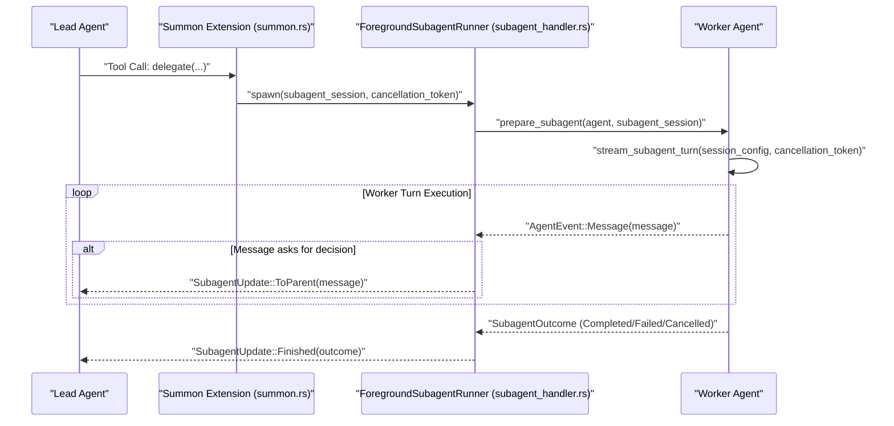
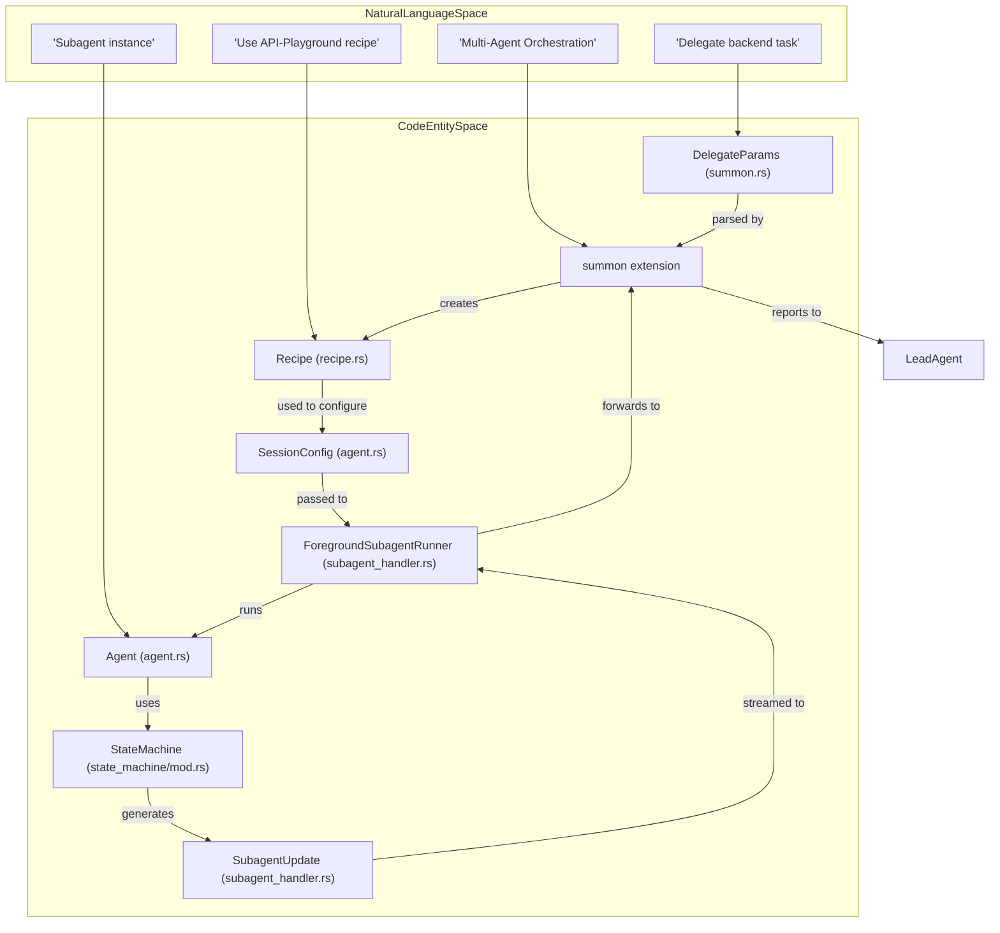

# Subagents & Multi-Agent Orchestration

Relevant source files

The following files were used as context for generating this wiki page:

- [crates/goose/src/agents/execute_commands.rs](crates/goose/src/agents/execute_commands.rs)
- [crates/goose/src/agents/extension_manager/lease.rs](crates/goose/src/agents/extension_manager/lease.rs)
- [crates/goose/src/agents/extension_manager/mod.rs](crates/goose/src/agents/extension_manager/mod.rs)
- [crates/goose/src/agents/extension_manager/streamable_http.rs](crates/goose/src/agents/extension_manager/streamable_http.rs)
- [crates/goose/src/agents/final_output_tool.rs](crates/goose/src/agents/final_output_tool.rs)
- [crates/goose/src/agents/platform_extensions/analyze/mod.rs](crates/goose/src/agents/platform_extensions/analyze/mod.rs)
- [crates/goose/src/agents/platform_extensions/apps.rs](crates/goose/src/agents/platform_extensions/apps.rs)
- [crates/goose/src/agents/platform_extensions/chatrecall.rs](crates/goose/src/agents/platform_extensions/chatrecall.rs)
- [crates/goose/src/agents/platform_extensions/code_execution.rs](crates/goose/src/agents/platform_extensions/code_execution.rs)
- [crates/goose/src/agents/platform_extensions/developer/mod.rs](crates/goose/src/agents/platform_extensions/developer/mod.rs)
- [crates/goose/src/agents/platform_extensions/developer/shell.rs](crates/goose/src/agents/platform_extensions/developer/shell.rs)
- [crates/goose/src/agents/platform_extensions/ext_manager.rs](crates/goose/src/agents/platform_extensions/ext_manager.rs)
- [crates/goose/src/agents/platform_extensions/mod.rs](crates/goose/src/agents/platform_extensions/mod.rs)
- [crates/goose/src/agents/platform_extensions/summon.rs](crates/goose/src/agents/platform_extensions/summon.rs)
- [crates/goose/src/agents/state_machine/mod.rs](crates/goose/src/agents/state_machine/mod.rs)
- [crates/goose/src/agents/state_machine/ops_compaction.rs](crates/goose/src/agents/state_machine/ops_compaction.rs)
- [crates/goose/src/agents/state_machine/ops_recipe.rs](crates/goose/src/agents/state_machine/ops_recipe.rs)
- [crates/goose/src/agents/state_machine/ops_toolcalling.rs](crates/goose/src/agents/state_machine/ops_toolcalling.rs)
- [crates/goose/src/agents/state_machine/tests/agent_reply.rs](crates/goose/src/agents/state_machine/tests/agent_reply.rs)
- [crates/goose/src/agents/state_machine/tests/hooks_lifecycle.rs](crates/goose/src/agents/state_machine/tests/hooks_lifecycle.rs)
- [crates/goose/src/agents/state_machine/tests/mod.rs](crates/goose/src/agents/state_machine/tests/mod.rs)
- [crates/goose/src/agents/state_machine/tests/pipeline.rs](crates/goose/src/agents/state_machine/tests/pipeline.rs)
- [crates/goose/src/agents/state_machine/tests/recipe_scheduling_lifecycle.rs](crates/goose/src/agents/state_machine/tests/recipe_scheduling_lifecycle.rs)
- [crates/goose/src/agents/state_machine/tests/reconstruction_isolation_lifecycle.rs](crates/goose/src/agents/state_machine/tests/reconstruction_isolation_lifecycle.rs)
- [crates/goose/src/agents/subagent_handler.rs](crates/goose/src/agents/subagent_handler.rs)
- [crates/goose/src/context_mgmt/mod.rs](crates/goose/src/context_mgmt/mod.rs)
- [crates/goose/src/doctor.rs](crates/goose/src/doctor.rs)
- [crates/goose/src/prompts/subagent_system.md](crates/goose/src/prompts/subagent_system.md)
- [crates/goose/src/providers/command_auth.rs](crates/goose/src/providers/command_auth.rs)
- [documentation/blog/2025-07-21-orchestrating-subagents/api-playground.png](documentation/blog/2025-07-21-orchestrating-subagents/api-playground.png)
- [documentation/blog/2025-07-21-orchestrating-subagents/avengers.gif](documentation/blog/2025-07-21-orchestrating-subagents/avengers.gif)
- [documentation/blog/2025-07-21-orchestrating-subagents/built-by-subagents.png](documentation/blog/2025-07-21-orchestrating-subagents/built-by-subagents.png)
- [documentation/blog/2025-07-21-orchestrating-subagents/index.md](documentation/blog/2025-07-21-orchestrating-subagents/index.md)
- [documentation/blog/2025-07-28-ai-to-ai/ai-to-ai.png](documentation/blog/2025-07-28-ai-to-ai/ai-to-ai.png)
- [documentation/blog/2025-07-28-ai-to-ai/index.md](documentation/blog/2025-07-28-ai-to-ai/index.md)
- [documentation/blog/2025-08-10-vibe-coding-with-goose-building-apps-with-ai-agents/header-image.png](documentation/blog/2025-08-10-vibe-coding-with-goose-building-apps-with-ai-agents/header-image.png)
- [documentation/blog/2025-08-10-vibe-coding-with-goose-building-apps-with-ai-agents/index.md](documentation/blog/2025-08-10-vibe-coding-with-goose-building-apps-with-ai-agents/index.md)
- [rust-toolchain.toml](rust-toolchain.toml)

## Purpose and Scope
This page details how Goose spawns, configures, and coordinates subagents for multi-agent task execution. It covers the core orchestration components including `SubagentHandler`, `TaskConfig`, sub-recipe execution, orchestrator and summon extensions, parallel task tracking, and the Lead/Worker architectural model.

---

## Orchestration Architecture

Goose supports complex task decomposition through a hierarchical orchestration model. A "Lead" agent can spawn "Worker" subagents to handle specific sub-tasks, parallelize execution, or utilize different specialized models for distinct parts of a workflow.

The orchestration system is built on a recursive agent model where a subagent is an independent instance of the `Agent` struct, initialized with its own configuration while sharing parent session contexts where necessary. Subagents are triggered via natural language or specific recipe instructions, with their lifecycle managed automatically by the `SubagentHandler` [crates/goose/src/agents/subagent_handler.rs:85-194]().

### Key Components

| Component | Role | File Reference |
| :--- | :--- | :--- |
| `SubagentHandler` | Manages the lifecycle, message routing, and execution of subagent tasks. | [crates/goose/src/agents/subagent_handler.rs:85-194]() |
| `ForegroundSubagentRunner` | Handles the execution of a subagent in the foreground, streaming updates to the parent. | [crates/goose/src/agents/subagent_handler.rs:85-194]() |
| `DelegateParams` | Defines parameters for delegating a task to a subagent, including instructions, source, and configuration overrides. | [crates/goose/src/agents/platform_extensions/summon.rs:47-58]() |
| `SubagentOutcome` | Represents the final result of a subagent's execution (Completed, Cancelled, Failed). | [crates/goose/src/agents/subagent_handler.rs:146-177]() |
| `SubagentUpdate` | Enum for updates streamed from a subagent to its parent, including messages and the final outcome. | [crates/goose/src/agents/subagent_handler.rs:186-193]() |

### Multi-Agent Data Flow

The following diagram illustrates how Goose coordinates subagent spawning through the handler and the recursive use of the core agent logic.

**Lead/Worker Spawning Flow**

Sources: [crates/goose/src/agents/platform_extensions/summon.rs:1000-1040](), [crates/goose/src/agents/subagent_handler.rs:85-194](), [crates/goose/src/agents/subagent_handler.rs:35-82]()

---

## Lead/Worker Model Pattern

Goose implements a "Lead/Worker" pattern where the Lead agent is responsible for planning, task delegation, and synthesis, while Worker subagents are responsible for execution.

### Parallel Task Tracking
Subagents can run sequentially or concurrently. The `ForegroundSubagentRunner` [crates/goose/src/agents/subagent_handler.rs:85-194]() handles the execution and streams updates back to the parent. The `spawn_run` function [crates/goose/src/agents/subagent_handler.rs:180-194]() creates a `BoxStream` for these updates, allowing the parent agent to monitor progress and receive messages from the subagent.

### Sub-Recipe Execution
Orchestration extends to **Recipes**. A Lead agent can use the `summon` or orchestrator extensions to delegate tasks to specific recipes or sub-recipes [crates/goose/src/agents/platform_extensions/summon.rs:1-1040](). The `prepare_subagent` function [crates/goose/src/agents/subagent_handler.rs:35-82]() applies recipe components, response schemas, and system instructions to the subagent prior to execution. This includes setting the `max_turns` from the recipe settings [crates/goose/src/agents/subagent_handler.rs:44-48]() and building a specialized system prompt [crates/goose/src/agents/subagent_handler.rs:69-75]().

**Entity Mapping: Natural Language to Code**

Sources: [crates/goose/src/agents/platform_extensions/summon.rs:47-58](), [crates/goose/src/agents/platform_extensions/summon.rs:1000-1040](), [crates/goose/src/agents/subagent_handler.rs:35-82](), [crates/goose/src/agents/subagent_handler.rs:85-194](), [crates/goose/src/agents/state_machine/mod.rs:1-20](), [crates/goose/src/agents/platform_extensions/mod.rs:33-186]()

---

## Implementation Details

### Subagent Initialization
Subagents are initialized with a `SessionConfig` [crates/goose/src/agents/agent.rs:1-29]() derived from the `DelegateParams` [crates/goose/src/agents/platform_extensions/summon.rs:47-58]() provided to the `delegate` tool. This configuration sets constraints such as maximum turn counts, defaulting to `DEFAULT_SUBAGENT_MAX_TURNS` (25) unless specified [crates/goose/src/agents/platform_extensions/summon.rs:5](). They are assigned a specialized system prompt built via `build_subagent_prompt` [crates/goose/src/agents/subagent_handler.rs:69-75](), which defines their operational boundaries and available tools, often incorporating the `subagent_system.md` template [crates/goose/src/prompts/subagent_system.md:1-29]().

### Communication & Feedback
Lead agents monitor subagents through `SubagentUpdate` streams [crates/goose/src/agents/subagent_handler.rs:186-193](). When a subagent performs an action or tool invocation, the `ForegroundSubagentRunner` [crates/goose/src/agents/subagent_handler.rs:85-194]() routes `AgentEvent::Message` notifications back to the Lead agent session [crates/goose/src/agents/subagent_handler.rs:127-136](). The `summon` extension then processes these updates, potentially forwarding messages to the parent agent.

### Resource & Error Handling
- **Isolation**: Subagents maintain independent provider configurations and extension sets, preventing tool-state leakage back to the Lead agent [crates/goose/src/agents/subagent_handler.rs:65-67](). The `prepare_subagent` function ensures the subagent's provider and model configuration are correctly set [crates/goose/src/agents/subagent_handler.rs:65-67]().
- **Dynamic Task Tools**: Extensions dynamically register tools for available recipes, allowing Lead agents to invoke them on demand. The `summon` extension's `list_tools` method [crates/goose/src/agents/platform_extensions/summon.rs:300-319]() exposes available subrecipes and agents as callable tools.
- **Cancellation**: Execution is governed by `CancellationToken` [crates/goose/src/agents/subagent_handler.rs:24](), enabling users to gracefully interrupt multi-agent subtasks. The `SubagentEnding` struct [crates/goose/src/agents/subagent_handler.rs:196-198]() ensures proper cleanup and reporting of cancellation.
- **Context Management**: Subagents, like main agents, utilize context management features to handle large conversations. The `compact_messages` function [crates/goose/src/context_mgmt/mod.rs:87-93]() can summarize conversation history to stay within token limits.

Sources: [crates/goose/src/agents/subagent_handler.rs:1-194](), [crates/goose/src/agents/platform_extensions/summon.rs:47-58](), [crates/goose/src/agents/platform_extensions/summon.rs:5](), [crates/goose/src/agents/agent.rs:1-29](), [crates/goose/src/prompts/subagent_system.md:1-29](), [crates/goose/src/context_mgmt/mod.rs:87-93]()